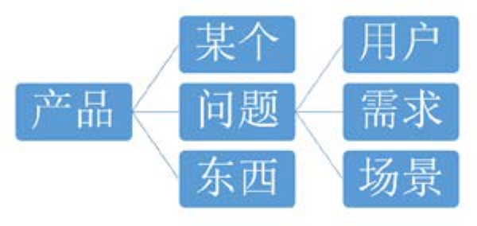

## 2.1　产品：解决某个问题的东西

产品经理是做什么的？毋庸置疑，是做产品的。再回过头来解读一下“产品”到底是什么，讲几个产品经理每天工作中都挂在嘴边的关键词。然后聊聊从各种维度怎么给产品分类。

第一个词肯定是产品了，提到这个词你会想到什么？微信、微博？iPhone、电脑？桌子、椅子？一盘菜、一部电影？一个旅游计划、一次培训？

我们对它们的共性下一个定义——解决某个问题的东西。这个定义听上去像是一句废话，但它其实抛出了三个关键词，分别是“某个”、“问题”和“东西”。

►**某个：**
任何一个产品都没法解决所有问题。特别是在产品早期，要有针对性地满足某些用户的某些需求，要有明确定位。大包大揽是产品成功以后的结果，不是一开始的做法。

►**问题：**
理想与现实有差距，人们想缩小甚至消除这个差距，就会产生各种问题，用产品经理的话来说，就是有了用户需求场景。

►**东西：**
指有形的实物或无形的服务，一般是一个有目标的解决方案，包括常说的产品、功能、特性、服务、流程等。

图2-1示意了这些关键词的包含关系，下面将依次展开解释。

<figure markdown="1">

{ width="251" height="118" }

<figcaption markdown="span" style="margin:0.5em auto;font-size:0.8em;font-style:normal;line-height:1.5">
图2-1　一些关键词的关系
</figcaption>

</figure>

