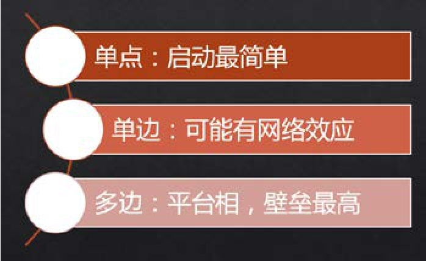
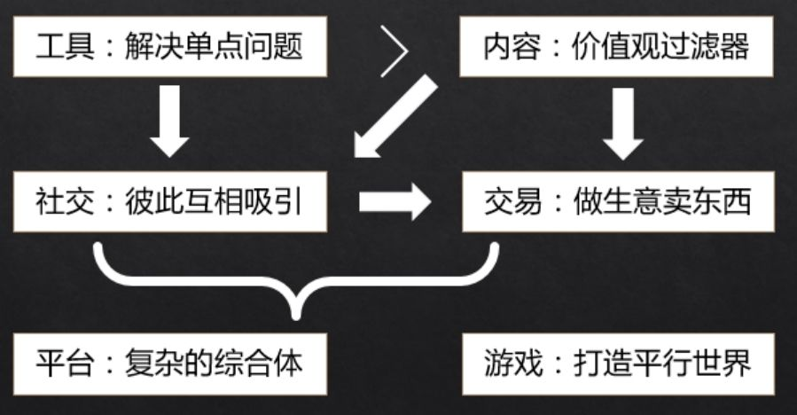

## 2.2　常见的产品分类维度

《淘宝十年产品事》里有一节的标题叫“产品经理都是分类控”，因为分类是认识、理解世界最常用的方式之一。世界本为一体，我们为了便于理解，把原子及以下层面的事情叫作物理学，原子组成分子则进入了化学领域，有机大分子，又和生物沾边，生物越来越复杂，有了人类学，人类个体研究叫心理学，一群人就是社会学，从而衍生出经济、政治、文化……从以上学科分类的由来可以看出，其实分类是人类寻求高效认识世界的一种简化方式。

下面将从多个角度来试着对产品进行分类。对了，先想一下给产品分类的目的，它其实是为了产品经理们给自己定位，以便做出更好的职业选择。

通过多维度的分类，了解各种产品都有什么特点，以及对应产品经理的任务有什么区别，可以获知自己需要针对性地加强哪方面能力，进一步可以用来指导自己日常的努力方向。举个例子，比如做智能硬件，就要懂开模、打样、小批量、量产等概念，而要在B2B行业做一个钢铁的SaaS加交易平台，就得对相关产业有很深入的认识。

但分类清楚确实很难。所以我们先做个设定，分类的是互联网类，最多扩大到IT类产品。分类的角度包括：用户关系、用户需求、用户类型、产品形态和其他。

### 2.2.1 　用户关系角度

从产品与用户的关系角度，分为三类：单点、单边、多边，其中多边又可以分为双边、三边等。下面各举一例以方便理解。

计算器是个典型的单点用户型产品。只要有一个用户使用，就能产生完整的用户价值。虽然启动简单，但没法形成网络效应，用户的转移成本很低。

电话是个典型的单边用户型产品，需要有一群人同时使用。只有一个人有电话是没有意义的，使用这个产品的用户越多，每个用户的价值越大，产品也就有了网络效应，可以像黑洞一样把用户都吸引过来。

多边用户型产品一般都是平台级产品，需要几群不同的人一起使用才能产生价值。最典型的就是知乎这个问答网站——由提问者、回答者、围观者构成三边，沉淀了很多内容和关系，任何一个类似的产品，就算在功能上完全抄袭，也很难把用户吸引过去。

[图2-3](#figure-2-3)为以上描述的要点。纵向上越往下的用户关系种类，其产品越难启动。假想一个多边产品，比如O2O餐饮：一个使用社会化资源配送的订餐平台。一边是闲置大妈做饭，另一边是小白领买家点餐，还有一边是闲置的大爷配送。做饭的大妈、送餐的大爷和订餐的大爷大妈的儿女，少了任何一边都不行，可想而知有多难。但这样的产品一旦启动起来，惯性也更大，壁垒也更高，更难被干掉[[6]](../03/index.md#footnote_content_txt003_6)
，而且市场也更倾向于集中，更容易出现垄断巨头。

<figure id="figure-2-3" tabindex="-1" markdown="1">

{ width="293" height="179" }

<figcaption markdown="span" style="margin:0.5em auto;font-size:0.8em;font-style:normal;line-height:1.5">
图2-3　单点、单边、多边产品的关键特点
</figcaption>

</figure>

有了这个概念，就可以讲下一个角度了。因为，将用户关系与用户需求这两个角度结合起来，更容易理解。

### 2.2.2 　用户需求角度

先说结论，从用户需求角度，把产品分为6大类：工具、内容、社交、交易、平台、游戏。但必须提前说明，这个分类的界限并没有那么严格，很多产品是多个分类的混合体。

**工具，解决单点问题**

工具用来解决特定的单点问题，可以“用完即走”。计算器、词典、解压缩软件，以及现在常用的支付和看天气的应用，都是典型的工具。上个世纪90年代，国内有很多的个人、工作室做的软件，大多数都符合工具简单有用的特征，比如下载工具网络蚂蚁、微信之父张小龙早期的作品Foxmail等。其基本的产品逻辑是：用户要解决特定问题→需要做一个任务→使用工具→达成目标。

大多数工具是典型的单点产品，启动容易，可以快速解决流量问题，但弱点在于黏性。

因为用户对工具的态度是“有事儿了才会想到你”，甚至希望用的时候最好不需要注册。对产品来说，每一次的新用户使用只是增加了一个UV（unique visitor，独立访问者），并不知道背后的用户到底是谁。由于使用不会、也不需要留下任何信息，所以用户的转换成本极低。以看天气的工具为例，对于用户而言，用哪个工具来看天气区别很小，从一个工具换到另一个工具基本没有任何障碍和顾虑。

于是，工具通常都想找理由让用户留下点东西，比如个人信息、用户关系等，以便生成用户的画像，然后针对性地提供个性化定制服务。这样，用户就更有可能黏在这个产品上了。通常，让用户留下信息不能采用强制措施，而应该鼓励和诱导，让用户因为留信息的行为而明显受益。比如，高德地图让你留下常去的地点，这样你在操作导航时会更加方便；今日头条通过算法越来越熟悉你的阅读习惯，让你看到的新闻都是你想看的；搜狗的输入法让你留下个人词库，当你下次再输入一些朋友名字、专业名词时可以更便捷；大姨吗、Keep等让用户与用户之间互动，留下用户关系，渐渐地从工具变成了一个社区，你也有了更多的归属感。

先把流量做起来，再解决“知道来的都是谁，抓住Ta们”，这是工具“从流量到用户”的转化套路。

盈利模式层面，好的工具可以直接卖钱，但很容易被别的产品用“工具免费，作为引流手段”的市场策略干掉。所以，工具通常是一种比较初级的产品形态。

**内容，价值观过滤器**

**必须提供有价值的信息，如果用户想打发时间，那么“可打发时间**
”**也算一种价值。**

内容产品和用户的关系也多是单点的，表现为单向和中心化的信息传递，由供应方生产内容，提供给用户消费，是自上而下的[[7]](../03/index.md#footnote_content_txt003_7)
。传统的媒体，后来的三大新闻门户、视频网站，比较新的网红、IP概念都可以算“做内容”，而文字、声音、图片、视频等都是常见的内容形态。

其基本的产品逻辑是：主动（搜索、订阅等） 或 被动（推送、推荐等）接触内容→消费内容→消费后行为（评论、点赞、打赏等互动，以及分享、传播等扩散行为）。

单纯的内容，很难独立形成商业闭环，传统的变现模式是广告，相对低效，只是做了薄薄的一层“导流”工作，把用户转卖给别人，后面发生什么与你无关。

但到了2016年上半年，大家似乎找到了一些新的商业模式。这是因为内容是一种特殊的工具，使用这种工具的人，更有共性，对产品经理来说，意味着可以更懂用户，可以拥有更多数据。比如，你很难说每天都要看天气的人有什么共同点，但看《罗辑思维》的人，都可以算是“爱智求真”的。筛选出一群三观接近的人之后，就更容易做出“用户画像”，更容易了解他们的深层需求，于是除了“卖用户”，还可以给用户“卖东西”。

于是，我们看到了内容产品的各种变种强势上升的局面，传统做内容的高手纷纷与互联网亲密接触，并大红大紫，比如罗振宇的罗辑思维与得到App、财经作家吴晓波的吴晓波频道系列产品、冬吴相对论的吴伯凡也做了新的“伯凡时间”，等等。

他们通过优质的内容，大大降低了获取流量和用户的成本，接下来各显神通从用户身上获取收入。很多人选择直接交易，比如罗辑思维向热爱知识的用户卖书，吴晓波做了符合中产阶级口味的“美好的店”。还有一些，采用更直接的“供养”变现，用高级的内容筛选出“认可好内容本身就值钱，并且有支付能力和意愿”的用户，直接卖内容本身，如：得到、喜马拉雅等App里的专栏，知乎Live，甚至是微信公众号的赞赏。

内容作为一种产品，其供给也经历了匮乏到过剩的演变。现在如果大家想做内容产品，既需要一个能迅速吸引注意力的“有趣”表象，也需要一个能提供真正价值、长期沉淀用户的“有用”内核。

**社交，彼此互相吸引**

**用户与用户互相玩，彼此吸引并建立关系，最终因此而留下来。**

社交的前提是有一大批用户，让用户彼此建立关系。这个概念下，可以容纳早年的论坛、聊天室，后来的社区、社群等。与工具和内容型产品相比，社交产品更像是去中心化的产物。

社交产品常见的模式是单边启动，需要同时有一大群人一起来用，才能产生价值，人越多价值越大。但也有时候是双边启动，比如某些婚恋交友类的社交应用，需要同时有一群美女和一群帅哥，才能玩得转。

社交产品的最大优势就是用户黏性相对高，最大的劣势是离钱比较远。

资本环境火热的时候，人们更加乐观，看得长远，所以乐于投资长链条的产品模式，比如“先做个工具获取用户，再培育出一个社区留住用户，再做电商，通过交易变现”。而社交产品正好符合长链条的特征，潜在用户量大，可获取的用户数据多，但怎么赚钱不确定。从积极的角度来看，就是故事的想象空间更大。

但资本收紧的时候，人们就想要更快看到收益，喜欢更有确定性的产品模式，会不停问如何实现“用户变现”。常见的一些直接用社交变现的玩法，有卖虚拟礼物、道具的，比如秀场直播App里的虚拟豪车游艇；有巧妙设置社交障碍必须付费破解的，比如花钱才能看到对方的联系信息；也有手握流量卖广告的；更多的就是转电商，给用户卖东西了。

社交产品也有很多维度的细分，比如从是否认识可分为熟人和陌生人两种社交，从社交介质可分为文字、语音、图片、视频等很多种社交，从用户共性在哪里又可分为地域、同学、同好等不同种社交，大家有兴趣都可以找到相应的产品去研究。

**交易，做生意卖东西**

**线上的交易，就是电商和O2O概念下的各种收费服务。**

交易产品是天然有现金流的，看到了现钱，离盈利模式就更近一步。最最传统的“生意”，其实就是典型的交易，本质即“低买高卖”。前面提到的内容和工具型产品，本身也都可以直接作为商品来卖，只要生产成本低于售价。

需要提一下的是，号称自己做交易的产品分两种。有的是真正做“交易”，即自己卖货，这种相对容易启动，属于B2C模式。有些做的其实是“交易平台”，自己不买东西，通过服务卖家、买家让双方在平台上成交。“交易平台”是典型的双边启动，需要同时有足够多的卖家和买家，才能跑起来。

做交易产品，就不得不提到“供应链”这个词。你要卖的东西，如何获取，是自己生产还是去采购？如何做品控？如何管理库存和资金？……这一系列问题都和供应链相关。另外一端，要考虑如何获取买家，如果做好购买转化。简单地说，就是一手抓供给、一手抓需求，两手都要硬。

而利用互联网来优化原有供应链，需要的更多是“商业智慧”，你会发现，新手产品经理们更擅长的“IT系统、用户体验”在交易产品的初期，其实没那么重要。如果说社交类产品是腾讯系出来创业最牛，那交易类产品就是阿里系出来做相对靠谱了。也许可以有个推论，阿里系创业者在资本市场收紧的时候会更有优势，因为“腾讯更懂体验、阿里更懂商业”的区别还是挺明显的。

**平台，复杂的综合体**

**这是一种同时满足多种角色的产品形态，也可以说是“生态**
”**。**

各国的政府就是一个平台，最常见的盈利模式是抽佣——收税。这是最难启动的产品，越来越觉得没有根基的团队，一上来做平台必死，必须要先从一种简单明确的用户需求启动，比如先把供给抓在手里，做B2C，等有需求的买家群体养好了，再逐步开放第三方卖家入驻。

现如今，很少有只单纯满足一种用户需求的产品了，而平台产品就是最典型的综合体，里面可能有工具、内容、社交、交易、游戏等各种元素。

比如微信，它在满足一对一沟通或用来扫码时是个工具，群、朋友圈是典型的社交场景，公众号、朋友圈里面有内容，微店开起来是交易，还有微信游戏，整体又是个综合平台。

再如大众点评，如果你只是找个餐馆，它是工具，上面的店铺信息又可以视为内容，买优惠券可以算交易，评论内容有点社交属性，整体也是个平台。

天猫，是个平台，很多商家在上面卖东西，交易属性很强，可以叫作交易平台。

爱奇艺，是个平台，很多内容提供方把自己的影视作品放在上面，内容属性很强，可以视为内容平台。

平台的竞争优势，不在于IT系统本身，而在于平台的各种用户角色在平台上的内容、关系等沉淀。

**游戏，打造平行世界**

**可大可小，一切皆可包容，是真实世界的副本。**

千万不要小看了游戏，它可不仅仅是一个手机上无聊时打发时间的小东西，游戏里面可以融合进社交、交易等元素，往大了想，游戏甚至可以理解为是在创造平行世界，释放人类富余的生产力。

随着实体世界越来越成熟，虚拟世界中越来越有可能诞生更大的增长点，很多科幻作品都给出过这种预言。2016年VR[[8]](../03/index.md#footnote_content_txt003_8)
、AR[[9]](../03/index.md#footnote_content_txt003_9)
这么火，也让这个平行世界与现实世界有了更多的交融，让游戏行业有了更大的想象空间。不过，我对游戏类产品研究很少，本书中就不班门弄斧了。

最后小结一条常见的产品发展路径，把上面说到的几种用户需求串起来。如[图2-4](#figure-2-4)，从一个小工具单点启动，快速获取用户，然后让这些用户彼此吸引，留下个人信息和用户关系，转社交，黏住他们；或者从内容转社交，建立互动探讨的机制；接着设法转交易，给他们卖一些符合调性的东西；继而引入各种合作方，成为平台……越往后想象空间越大。

<figure id="figure-2-4" tabindex="-1" markdown="1">

{ width="378" height="196" }

<figcaption markdown="span" style="margin:0.5em auto;font-size:0.8em;font-style:normal;line-height:1.5">
图 2-4　几种产品的演变路径
</figcaption>

</figure>

### 2.2.3 　用户类型角度

虽说产品的用户多种多样，但最常听到这两大类：2B与2C，分别是英文to Business与to Customer的缩写。最典型的，百度产品经理就分两大类：2B的商业型产品经理和2C的用户型产品经理，因为这两种产品区别真的很大。还有些小众的，比如2G，面向政府（Government）；2D，面向开发者（Developer），其实它们也都可以归类到2B或2C中。

我自己做过给内贸企业用的CRM和进销存，应该算2B；做过给淘宝运营员工用的营销后台系统，也算2B；做过阿里内部在线学习平台，这个很难定义；做过天猫的某些垂直市场，和卖家、买家都有关系。既然并不容易分清楚，那有必要来分析一下B与C的区别到底在哪里。

人类社会的初级阶段，没有任何成型的社会组织，只有C，没有B，个体自给自足。最多，为了生存需要，产生了一些简单协作，比如配合狩猎、分工种地等。至少在工具层面上，只有供个人使用的，而并没有需要集体协作的。所以，2B一定是随着“拥有很多人的组织”出现以后才有的。这种组织，最典型的就是商业公司，也就是2B，Business的指代对象。

**第一个角度：企业**
vs **个人**

目标用户不同，2C的产品是个人用，2B的产品是企业使用，典型的如ERP及各种SaaS系统、协作工具、客服工具、HR财务系统等。但企业使用的产品最终也是某个具体的个人来用。所以，这里2B的意思是，产品至少要同时面对企业代表（要不要买、要不要用的决策）和终端用户两种角色。当然，这两种角色可能重叠。很显然，2B产品的购买和使用决策相对复杂，可能必须通过见面才能找到关键决策者。打个比方，当一个销售人员面对企业，需要考虑的是：老板手下的外贸经理看你不爽说你坏话；你和老板娘套的太近乎老板吃醋；你的软件抢了IT部门经理的饭碗；你催财务那个小子的态度不好，却不知道他是老板的小舅子；你对看门大爷特别客气，幸运的是他是老板的老丈人……很多关系，很多角色，很多因素，都会影响购买。这也是为什么2B的产品，经常会有顾问型的销售团队，要设计复杂的销售路径。

而典型的2C产品，相对简单，自己买自己用。但也有特例，比如各种礼品，就是买给别人用的。

所以，和下面的各种角度一样，没法用一个对比把2B和2C完全划清界限，只是从各种角度来加深认识。那么，是不是2B的产品，还有“需要一群人一起使用，才能完成任务”的特点呢？

**第二个角度：群体**
vs**个体**

一个典型的OA系统，需要公司里各种角色一起用，包括提交人、业务审批人、财务审批人等；一个B2B供应链的工具、平台，需要上下游一起用，才能产生效果。而2C的产品，经常是自己一个人用就可以了，比如用播放器看电影、用浏览器上网。

不过，这样的定义还是不够完美。有的产品，比如“查询公司信息的工具”，一个人就能用，但更像2B的产品；而一群人一起玩网游，也需要协作，但大家不会把网游看成2B产品。貌似2B还需要有个“工作需要”的属性。

**第三个角度：工作**
vs**生活**

2B的产品是生产资料，2C的产品是生活资料。比如，各种2D（to Developer，也可视为2B的一种特例）的工具，包括各种后台系统，是工程师们吃饭的家伙，是生产和效率工具。这类产品的用户多为专家，对效率的需要超过了一众简单易用、轻松上手的产品。而后者，就是典型的2C产品，如美颜、拍照、社区等。

所以，基本上，后台产品偏2B，前台产品偏2C。生产工具的用户量通常不大，多为熟练用户，生活工具的用户量大，多为小白，于是有了这个推论：2B重商业价值，2C重用户体验。

工作为了赚钱，是渠道，是投资，是积累；生活需要花钱，是零售，是消费，是消耗。于是，我又想到一个新的角度。

**第四个角度：男人**
vs**女人**

这个角度有些奇葩，2B像男人，2C像女人，男人在乎目的与结果，女人在乎过程与感受。研究一下如何让男人、女人开心，对如何做好2B、2C产品会颇有启发。而近年来，最受欢迎、成就最大的往往是“中性人”，Ta们同时拥有双性的优势，比如经常听到“小鲜肉”、“女汉子”的说法。

类似地 ，2B、2C也没有完美的分类方法和清晰的分类界限，我们应该综合两者的优势来做产品，它不是一个非此即彼的概念，而是一条线的两端。

一端是to大B，接近于做定制项目，有甲方乙方，在这种情况下，客户作为甲方，甚至承担了很多产品的决策，充分体现出“用户是产品团队的一部分”。个人认为，在乙方公司里做产品经理，个人发展比较容易碰到瓶颈，因为更多是在执行任务。另一端是典型的C类应用，腾讯的很多产品都是。中间有to小B的产品，有的采用了很多2C产品的设计，比如为上百万小企业做的钉钉；也有含2B属性的个人工具，比如有道云笔记，加入了多人协作的元素。2B的产品原来过于重视价值，而忽视了体验，这是因为选择没有那么多，属于不得不用、用来干活的家伙，但这两年开始，2B市场的竞争也激烈起来，所以体验也越来越好了。

最后，提一句2B产品的分类，主要有以下四种[[10]](../03/index.md#footnote_content_txt003_10)
：

► B2D ，云储存、大数据等开发者服务，帮助开发者提升效率的基础设施。

► SaaS1.0，通用管理型SaaS，是传统意义上的管理软件。

► B2B ，垂直行业交易平台，是信息撮合+在线成交。

► SaaS2.0，垂直行业 SaaS 工具+交易，是SaaS1.0和B2B的综合，2015年左右开始成为新趋势。

### 2.2.4 　产品形态角度

互联网、IT行业，常见的产品形态有手机App、网站、智能硬件等。试着把它们分为四种形式：BS结构、CS结构、软硬结合、大实体。

**BS结构**
：Browser-Server结构。

对研发团队来说，大部分工作在服务端，或者说云端，客户端借助一个浏览器来做展示。各种PC网站，都是这种模式。用户端可以做到无知觉升级，所以，这种产品特别敢于尝试新功能，有问题只需要在服务端修改即可搞定。它的研发过程相对简单，最大的优势就是“快”，甚至可以做到每天发布升级，比如2016年二季度很火爆的现象级产品“分答”。

相对客户端，Browser模式还有个跨平台的优势，不用Windows、Mac，或者iOS、Android分开做。

**CS结构**
：Client-Server结构。

它有一个需要安装的客户端，还会有一个服务端，手机里的App、电脑里安装的软件就是这种。当然，也有一种无服务端的纯客户端应用，但现在能见到的相对较少，而且也太不“互联网”了。这种产品出了问题，经常需要改客户端，那就得重新通过渠道发安装包，用户还得升级后才能改正。事实上，有时产品都更新到了5.0版本，用户还在用2.0。

**软硬结合**
：除了软件部分，还有硬件实体。

这种形式更复杂，比如各种手环、智能家居的电器。可以想象，它对质量的要求更高，如果硬件上有Bug，要么召回，要么只能变废品。所以，有了硬件部分的产品，更新换代的速度会明显降下来，能做到6个月左右升级一次就已经很快了。

互联网、移动互联网都已经进入深水区，大家普遍认为的下一个大发展——物联网，就要把各种实体硬件也拉进这张大网来了。

**大实体**
：有软硬件更有服务。

虽然上述几种形式或多或少都涉及服务部分，但这种产品形式的服务比重更大。以造汽车为例，要做出一个超级复杂的实体，会牵涉到很多的配件供应商，还有代码量极大的行车电脑系统和应用软件，更有复杂的服务体系，比如大家很熟悉的4S店。这样的一个产品，其实背后就是一个产业，只能以年为单位缓慢进化。

这四种形式的总体规律是，前面的轻，做起来快，迭代周期短，试错成本低，对质量的要求没那么高，有问题容易改正。当然，相应的进入壁垒也就比较低。

顺着这个话题，最后再和大家探讨一个移动App有关的实用话题：一个App的某个功能，到底是用Native（Client模式）还是Web（Browser模式）更好呢？

►**偏交互的用Native，偏浏览的用Web：**
交互指复杂操作，包括输入、选择等，Web往往支持得不好。

►**已稳定的用Native，试错中的用Web：**
H5页面适配各种手机系统、浏览器简单，用来做低成本验证很方便。而已经固化的功能，用Native更节省手机本地资源，使用起来更流畅，而且因为不依赖网络，也会更稳定。

►**访问硬件的用Native，信息展示的用Web：**
硬件包括手机里的各种传感器等，Native的访问权限更高，安全性也更高。

►**核心功能用Native，周边辅助用Web：**
Native的工作量相对大，应该把时间多用在刀刃上。

►**变化少的用Native，经常变的用Web：**
比如电商的活动页面，经常需要变，做在Native应用里就会很被动。

各种模式，一定各有优劣，否则，就不会长期并存了。关键在于，作为产品经理，要理解不同模式的优劣，才能做到扬长避短。比如，有些App，采用Hybrid即混合模式，就是为了结合Native和Web两种模式的优点。2016年下半年微信推出的“小程序”，也在不少特点上做到了兼顾，值得好好研究一下。

### 2.2.5 　各种其他角度

最后，简单地从几个其他角度讲讲产品的不同，这部分限于篇幅原因没有充分展开，也可能还有一些角度，我没有想到，如果读者感兴趣，可以继续深入研究并找我交流。

**行业分类角度**

随着互联网深入到各行各业，与具体行业的结合越来越紧密，要想做出出彩的产品，对领域知识的了解越发重要。我们都知道，金融、教育、医疗、娱乐等都是万亿级的大市场，但要做好这些行业的产品，没有多年的行业沉淀，恐怕是不行的。

关于行业的具体分类，大家可以去参考公司注册时需要选择的行业类别，这里不再赘述。而在某个领域的产品大类里，也会因上文提到的各种分类维度而衍生出各种不同的产品。下面结合2.2.2　节中从用户需求角度的分类标准，对娱乐行业里的音乐行业进行分类。

►**工具：**
音频播放器、音乐制作软件。

►**内容：**
歌曲库，以及早年的百度MP3。

►**社交：**
音乐讨论社区。

►**交易：**
版权市场，以及供个人付费购买高品质音乐的产品，如QQ音乐。

►**平台：**
阿里音乐（阿里总是倾向于做整个生态）。

►**游戏：**
节奏大师、太鼓达人等。

**盈利模式角度**

盈利模式基本可以分为两大类，俗称卖货的行当与卖人的行当。

卖货采用前向收费，直接向用户要钱。比如，面向信息使用者或浏览者收费，包括用户包月费、点播费等，运营商向手机用户收取服务费，电影院、公园卖票，以及QQ的一些付费功能等。作为个人用户，在互联网上使用各种产品时直接付的钱，基本都属于这种。

卖人采用后向收费，即2B的抽水模式，主要向对企业单位或信息提供者收取费用，包括广告发布、竞价排名、冠名赞助、企业会员等费用。该收费模式是互联网网站采用最多的盈利方式之一，具有代表性的是搜索引擎类网站（如谷歌、百度）、大多数视频类网站的广告（如优酷、土豆）及电子商务网站（如天猫、京东商城）。

这个分法也可以映射到2C和2B的区别，卖货的基础是货要好，卖人的基础是人要多，但人多的本质还是产品好。

**关键资源角度**

不同产品能不能成，需要的关键资源不同，主要有如下五种。

►**资本驱动**
，对应着需要大笔资金做准入门槛的产品。比如金融行业的某些业务，没有足够多的钱，根本没法进场。再如拼价格战，补贴大战时，资金不够多的公司也会被迅速淘汰。

►**技术驱动**
，意味着拥有核心技术能力，成为别人无法模仿的壁垒。比如Google的搜索引擎算法。如今的人工智能领域，谁拥有最牛的算法、海量的数据、强大的计算能力，谁就能取得领先。

►**产品体验**
，产品本身要好，对互联网行业来说，就是用户体验很爽。比如很多社交应用，有漂亮的界面、流畅的交互、快速的响应、丰富的内容，用户用过之后会触发口碑传播，一传十十传百。我们常说的“消费升级”，也要求产品本身升级。

►**运营服务**
，对应着需要很多“人肉”参与的产品，强调运营效率、服务体验等。比如在O2O类产品的早期市场争夺战中，大家都很强调“地推”，就是靠人海战术迅速获取商户、用户资源的手段，谁的人不够多、执行力不够强、速度不够快，谁就会被淘汰。

►**垄断资源**
，取决于获取资源的能力。拥有一座矿山、一个油田、一片土地，或者是专属经营权等。比如只有1.3.6　可以卖火车票，某某公司成为谁的独家合作伙伴等。

当然，一个产品的成功往往需要多个因素都具备，少了任何一个，都可能掉链子，即“成功都是相似的，失败却各有不同”。

**行业成熟度角度**

这个行业，属于新兴的还是成熟的，对应着产品生命周期中的不同阶段：初创期、爆发期、平台期、衰退期，本书第09章会展开细说。简单地说，是“从0到1”和“从1到N”的区别。产品的侧重点也不同，相对而言，前者重研发，强调创新突破，后者重营销，强调复制扩张。比如电商行业，现在相对成熟，而智能硬件，还只能说在很早期。

整体而言，互联网行业的产品，处于“从0到1”阶段的比较多，而传统行业随着互联网技术、理念的渗透，也开始在一些细分市场里出现了新的机会。比如图书出版，现在的一本书，已经不再是完全线下的实体，而是会想各种办法尝试线上与线下的联动。

