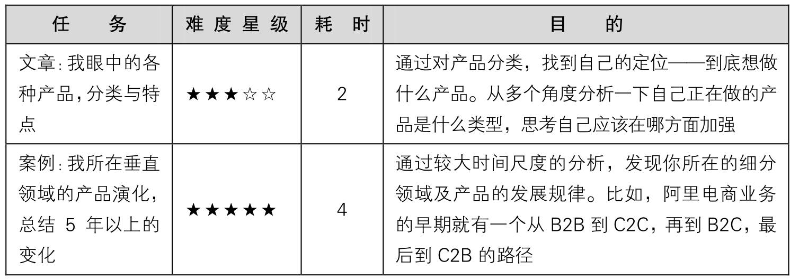
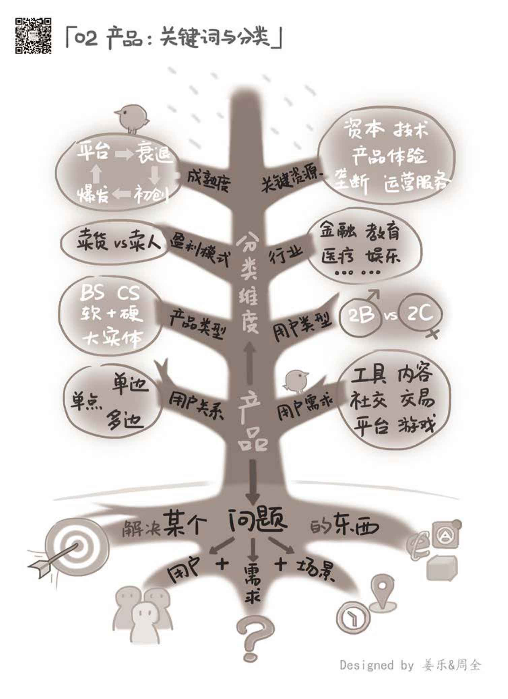

## 2.3　延伸阅读与练习

本章的延伸阅读，在已有的几本书里不多，大家可以看一下《启示录》的第三部分——产品（179.2.0　页），Marty对某些特色产品，如企业级产品、平台产品等都给出了自己的理解。

可以做的练习任务如下。

<figure markdown="1">

{ width="621" height="215" }

</figure>

<figure markdown="1">

{ width="634" height="874" }

</figure>

---

[[1]](../01/01.md#footnote_quote_txt003_1)
有一本经典书籍《定位》，作者是艾·里斯、杰克·特劳特，内容偏营销层面，但很有参考意义。大家有兴趣可以作为扩展阅读。

[[2]](../01/02.md#footnote_quote_txt003_2)
第04、05章，再展开聊人性。

[[3]](../01/02.md#footnote_quote_txt003_3)
iOS的App Store审核过程很烦琐，一定要有所了解并制定合理时间预期，否则很容易被会被打乱计划、导致进度失控。

[[4]](../01/02.md#footnote_quote_txt003_4)
业内知名产品经理，个人网站www.ikent.me。

[[5]](../01/02.md#footnote_quote_txt003_5)
指连结硬件和操作系统的Package。

[[6]](../02/01.md#footnote_quote_txt003_6)
这个话题，还可以看曹政（微信公号：caozsay）从冷启动的角度写过的一篇文章《［caoz谈创业］聊聊四种冷启动》。

[[7]](../02/02.md#footnote_quote_txt003_7)
UGC产品，即用户产生内容的产品，比较特别，与典型的内容型产品不同，它是非中心化，自下而上的，这类产品社区属性更强。

[[8]](../02/02.md#footnote_quote_txt003_8)
虚拟现实技术，Virtual Reality，简称VR，是一种可以创建和体验虚拟世界的计算机仿真系统。它利用计算机生成一种模拟环境，是一种多源信息融合的交互式的三维动态视景和实体行为的系统仿真，使用户沉浸到该环境中。

[[9]](../02/02.md#footnote_quote_txt003_9)
增强现实技术，Augmented Reality，简称 AR，是一种实时地计算摄影机影像的位置及角度并加上相应图像、视频、3D模型的技术，这种技术的目标是在屏幕上把虚拟世界套在现实世界并进行互动。

[[10]](../02/03.md#footnote_quote_txt003_10)
2.2.2　节对用户需求的6种产品分类，更像是对2C产品的划分。

