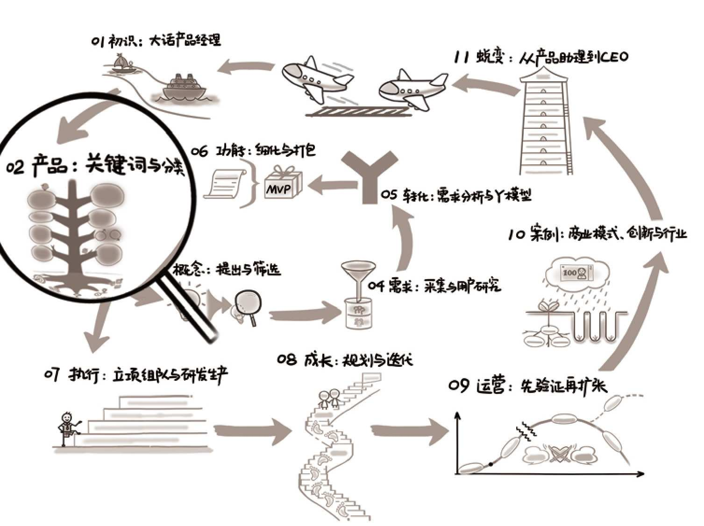

## 第02章　产品：关键词与分类

{ width="634" height="473" }

**第02章　产品：关键词与分类/41**

**2.1　产品：解决某个问题的东西/43**

2.1.1　某个：明确定位/43

2.1.2　问题：用户、需求、场景/44

2.1.3　东西：解决方案/50

**2.2　常见的产品分类维度/51**

2.2.1　用户关系角度/51

2.2.2　用户需求角度/52

2.2.3　用户类型角度/57

2.2.4　产品形态角度/60

2.2.5　各种其他角度/61

**2.3　延伸阅读与练习/63**

