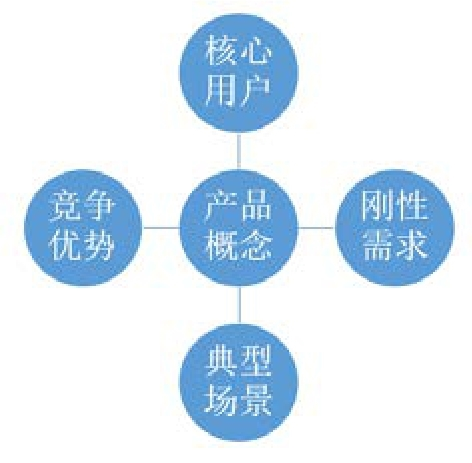
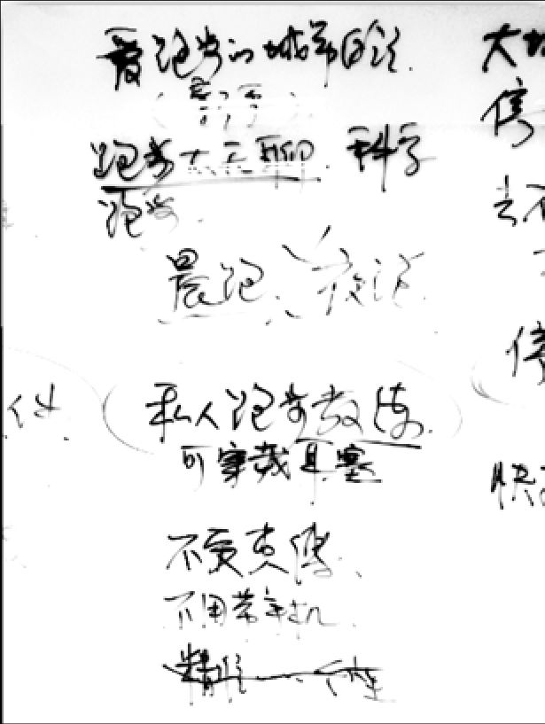

## 3.1　产品概念的提出

在第02章，大家了解了什么是产品，产品有哪几类，从这一章开始，我们一起进入“一个产品从无到有”的旅程，体会做产品都要经历哪些环节。做一个产品的第一步，要先有个idea（点子），即提出一个“产品概念”。从这一章到第07章的立项组队为止，是“想清楚”的小循环，再往后，会说“做出来”与“推出去”。

提出产品概念很简单，要确定五个关键要素，参见[图3-1](#figure-3-1)：

►**核心用户：**
产品目标用户中最重要的用户是谁，表达为一个抽象的人群。

►**刚性需求：**
Ta们碰到最痛的痛点是什么。

►**典型场景：**
这些痛点最常出现在怎样的生活、工作情况下。

►**产品概念：**
用什么方案解决，用一个词、最多一句话概括你的解决方案。

►**竞争优势：**
相对已有方案，有什么突出优势。

以上的五个要素，就是产品的“切入点”（并不是完整的产品），下面一条条来讲述。通过前三个要素，可以顺便加深对第02章说的“用户”、“需求”、“场景”的理解。

<figure id="figure-3-1" tabindex="-1" markdown="1">

{ width="197" height="194" }

<figcaption markdown="span" style="margin:0.5em auto;font-size:0.8em;font-style:normal;line-height:1.5">
图 3-1　产品概念提出的几个关键要素
</figcaption>

</figure>

### 3.1.1 　核心用户

核心用户这个词，我们经常听到，可能你还会听到潜在用户、目标用户、种子用户等，本章3.3.3　小节，会把这些有关“用户”的词放在一起比较一下，这一部分先说核心用户。

复习一下“目标用户”，其实它就是第02章说的“用户”，指所有跟产品发生关系的用户群体，而“核心用户”是指目标用户中最最重要的那一部分人。

举个例子，校园社交App，目标用户是在校生，核心用户就是一批校花，先有了校花，就可以让男生们也上来。核心用户的需求要优先满足，不能为了次要用户的需求去影响核心用户，如果校花们不希望被所有男生联系，那么，虽然所有男生都想联系校花，那也得做一些限制。

甚至，一些产品会为了讨好核心用户，故意得罪其他不重要的用户，即所谓的“洗粉”行为。这在早年的产品里很少出现，电信不会拒绝给谁家装电话，淘宝也不太会拒绝任何要购物的人。

吴晓波频道在2015年旗帜鲜明地表态——反对屌丝文化，服务中产阶级。这种做法，虽然对总用户量有损害，但剩下的用户更纯净。如今的产品，用户与用户之间不再独立，而是彼此有链接。如果用户群体的价值观接近，那么，他们之间更能建立起认同，链接更紧密，对产品的黏性也就更大。

另一方面，这是一个供给充足、市场细分、用户选择很多的时代，情愿选择让一部分人爱你爱得发疯，另一部分人恨你恨得要死，也不要让所有人都觉得你还OK，你是个好人，然后就没有然后了。

这就是产品的调性、品牌的人格化。

核心用户定义得越精准，产品设计、推广等过程中的目标将越明确。

### 3.1.2 　刚性需求

任何一种用户的需求都有很多，其中最重要的那些，叫作刚性需求。

刚性需求要满足下面三个条件：**真实、刚需、高频**
。

►**真实：需求是真的存在，还是幻想出来的。**
我们要对需求的真伪做一个判断。经常听到用户说的可能都是一些伪需求，比如用户说“我希望能做到每天早起锻炼身体，你这个App能不能每天提醒我”，你真的做给他了，他可能懒得用，如果用户有心要锻炼，这是个闹钟可以解决的问题，如果无心，再提醒也白搭。

►**刚需：特指需求是否强烈，不满足能否忍受。**
一些需求到底是不是很刚性，其实很难说。举个例子，要在很繁华的闹市区停车的话，可能更刚需的是要找一个车位，毕竟绕了20分钟停不下来实在受不了，相对弹性一点的可能是省停车费，能省点最好，实在省不了也就忍了，这是是否刚性的区别。

►**高频，需求发生的频次是高是低。**
这比较容易理解，有的需求发生的频次可能每天都有，比如叫外卖，有的需求发生的频次可能一年才有一次，比如春运。有些需求2C低频，但2B就高频了，可以通过服务B来化解，比如家庭日常水电维修，对每家每户来说肯定是低频，但可以尝试作为小区物业的服务提供商。

同时满足以上三点很难，所以要综合考虑，满足刚性需求要优先于弹性需求。

### 3.1.3 　典型场景

俗话说，做产品就是做场景。在用户、需求确定的前提下，场景也会有很多。特别是在移动互联网时代，移动设备作为我们身体的延伸，随时随地进行着场景的切换。但我们更在乎的是典型场景。

到底什么场景更典型？可以通过有没有“唤起点”来判断。**在某种情景下、某时某刻，用户能想到，最好是能第一个想到你的产品。这个时刻就是产品的唤起点**
。

工作日的10点多，很多IT民工都开始发愁中午吃什么，这时候，就唤起了“饿了么”、“大众点评”、“口碑”等。

晚上下班回家，平时一直蹭他车的同事今天要加班，没得蹭了，这时候，唤起了“滴滴出行”。

早上起床，蹲坑，发现正好7点刚过几分钟，“知乎日报”的“如何正确地吐槽”又更新了，顺便看看。

……

上述都是主动唤起，用户主动想到你，还有些被动唤起的做法，也可以尝试，比如特定情境下的各种消息提醒：生日、老婆生日、过年过节、早晚高峰、促销活动……

可怜的是，很多产品根本没有任何“唤起点”，用户怎么想到用你？这也意味着你还没找到自己的典型场景。

所以，只要是一个“点”，就不要怕小，怕的是没有独特性，怕的是不够典型。

### 3.1.4 　产品概念

简单的一句话，说出你的解决方案是什么，一个App，一个网站，一个服务体系，还是一个企业协同办公的工具？第02章讨论的产品分类，在这里就用得上了，可以分门别类地列出来供筛选、确认。

举一个口碑网的案例。

口碑网和大众点评差不多，同一时间起来，后来做得没有大众点评那么顺利，特别是被阿里收购以后。它的创始人是李治国，也算是阿里最早的产品经理之一，现在是天使投资人和挖财的CEO，多年前和他交流过。口碑网的初衷很简单，李治国自己经常去一些餐馆吃饭，他发现很多餐馆味道不好价格又贵，或者卫生不好、服务员态度很差。他就想，要吐吐槽但是没地方吐，别人还得继续上当受骗，应该有一个什么东西，让这些黑店就不要有生意了，让好的餐馆生意越来越好。最后，就有了口碑网。

这个案例中用户需求场景的简化描述为：常去餐厅吃饭的年轻人，踩了雷以后要吐槽发泄。

产品概念：一个有餐厅列表、可以点评的网站。

我也在做投资相关的事情，所以会和很多创业者交流。当发现这个创业者说来说去都是背景信息，5分钟还讲不清楚他在做什么的时候，我就会打断他，问这个问题：你为了解决什么人的什么需求，做了什么东西？

大家平时和产品经理交流时，也可以将这个问题直接抛过去，然后就能清楚对方到底做的是什么产品了。最多再加一个问题，为什么你这个产品做得比别人好？这也就是下一个要思考的要素——竞争优势。

### 3.1.5 　竞争优势

我们做产品时，通常会找一个“竞争标的”，也就是这个产品到底是跟谁对比的。优势是与另外一些解决方案比出来的，“标的”的选择很重要，体现了你的定位与开局思路，视野和格局。

任何一个值得解决的问题，通常已经有很多解决方案了，但是这并不意味着你就不可以再做。但，再做的话要和现有的解决方案相比，是否创造了额外的价值？如果额外的价值大于转移成本，那么新的解决方案就能获胜。

对于竞争优势，“人无我有”是一种，比较容易理解；“人有我优”也是一种，无非“多快好省”，具体地说，包括更多功能、更快搞定问题、更好的质量、更省钱，等等。

比如近年来，电动汽车对于汽油汽车，逐步显现出了很多竞争优势。电池技术的成熟，使得续航里程接近了“一箱油”，电动车越来越实用了。充电桩的密度越来越大，私人安装也越来越方便，充电问题逐渐减小，很多城市的上牌、限行政策也是利好。这些，使得电动汽车的优势逐步上升。

再来几个例子：

叫外卖而不出去吃，是因为想节省外出的时间，或者就是懒。

网上买家用电器，是因为可以把很多型号放在一起对比技术参数和价格。

接客户用更贵的专车而不是快车，是因为车好服务好，可以让客户对我们的印象加分。

你的优势，会成为用户选择的理由。

**案例：私人跑步教练**

曾经在某公司做了一次交流，大家一起做“产品从无到有”的演练，一组同学提出了一个idea，在竞争优势方面明显有问题，没想清楚“标的”是什么。如[图3-2](#figure-3-2)所示。

<figure id="figure-3-2" tabindex="-1" markdown="1">

{ width="258" height="343" }

<figcaption markdown="span" style="margin:0.5em auto;font-size:0.8em;font-style:normal;line-height:1.5">
图3-2　产品概念练习的实拍
</figcaption>

</figure>

►**核心用户**
：爱跑步的都市白领，更精准的说法是“新手”。

►**刚性需求：**
不会科学锻炼（备选：跑步时太无聊）。

►**典型场景：**
晨跑（备选：夜跑）。

►**解决方案：**
私人跑步教练——是个可穿戴的设备，比如耳机，用来监测你的运动，还能时不时给些提醒。

►**竞争优势：**
不受束缚、不用带手机、精准个性化。

单看“竞争优势”，这是最常见的错误——“原来你什么都想要，要到用户想逃”。

首先，“不受束缚、不用带手机”的“标的”好像是“有线耳机+手机App”。其次，想“精准个性化”，这个点很难和手机App做出差异，感觉像是把“私人教练”、“活人”放在了对比的位置——这相当于给了自己一刀，让用户认知产生了混乱，而且和纯正的“新手”用户的普适需求不是很匹配。

以上为开局思路，要点是：不要乱，先找定一个对手，打透了以后然后再考虑视野和格局，以及各种扩展。

**聊聊竞品分析**

顺着竞争优势，聊聊竞品分析。具体怎么分析，网上有很多方法。初级的做法是列一个表格，对比一下几个产品，标出各种功能的有无，诸如A有B没有、C有D没有、AB都有但CD更好，等等。但是到底什么是“竞品”，很多人都理解错了。

下面，带大家逐步拓展竞品的范畴：

**相似的产品→能满足同样需求的不同产品（从表层到深层需求）→所有消耗用户时间的产品**

假设你是一个早点摊子上负责卖豆浆的伙计。为了卖出更多的豆浆，拿到更多的提成，开始做竞品分析，你会把什么当作竞品？

最初级的考虑是同质产品，旁边那个卖豆浆油条的摊子，肯定算一个，这叫“**用同样的产品功能解决同样的用户需求**
”。和这样的竞品玩，比得是产品功能的优劣，比如你是现磨的，他是采购袋装的。你可以引发喝豆浆应该加糖还是加酱油的旷世舌战，他有红豆、花生等多种口味可选，还可以装背包里带走……你观察一下每天路过的用户都是什么样的人，大致就知道各自的优劣势了。

这样的竞品分析，相对简单，瞄着和你做同样产品的人即可，好比猫眼和淘票票互盯，暴风影音和QQ影音互盯。而这种分析的结果，往往也**只能带来一些功能层面上的优化，不会对产品方向带来什么新思路**
。

我们常说，打败新浪微博的一定不是腾讯微博，而可能是微信的朋友圈；降低某品牌私家车销量的也不一定是其他品牌，也许是越来越发达的公共交通、越来越方便的顺风车；让客服失业的也不是另外一批工资更低的客服，而是人工智能的自动应答系统……

所以，对竞品的认知需要升级。

日子一天天过去，咱现磨的豆浆越来越得到用户的认可，健康看得见嘛！忽然某天早上，你发现隔壁摊子居然放弃豆浆市场了，开始卖各种牛奶和果汁！你震惊了，Why？赶紧去问用户，你为什么不买豆浆改买牛奶了？用户说我不一定要喝豆浆啊，包子太干了，要搭配点解渴的东西才好，所以，牛奶也可以。

**“用不同的产品功能解决同样的用户需求”**
，这叫“替代品”。

于是，你体会到，**竞品分析不应该单单停留在对“产品功能”的分析上，还可以去寻找你这个功能背后要满足的“用户需求”，能解决同样“用户需求”的其他解决方案，也是竞品。这种分析，会给产品带来新思路、新方向。**
好比，做网上超市的要多去沃尔玛逛逛，做报纸的应该订几份杂志。

多去接触用户，你会发现，他们买豆浆的原因还不止一种，用**同样的产品功能解决不同的用户需求**
也很正常。这会反过来促使你重新思考自己的定位，到底要优先满足什么需求？于是你会在不同的需求场景下，找到不同的潜在竞品：豆腐、千张：有人喜欢豆制品；粥、馄饨：包子也不买了，直接来稀的；自来水、漱口水：吃完包子漱口，把菜叶弄掉……

再进一步，你还可以把这个买豆浆的原因追问下去，从而**用同样的产品功能满足不同层次的用户需求**
。挖到最深处，一般会是人性的心理或生理层面。比如，喜欢豆制品那个用户，也许是体检后发现自己缺什么元素，与选用保健品、药品的动机有重合。那么，你卖豆浆是否可以往“健康”的需求上靠？这样，在不同层次上，通过对不同的竞品做分析，可以给产品更多跨界的思路。

于是，对竞品的理解逐步扩展。

你不再只盯着隔壁那个卖豆浆的老王：你关注到100米外开了个星巴克，200米外有个喜士多，隔一条街有家健身房……你的自我定位，到底是豆浆店、早餐店，还是都市上班族没空好好吃早饭的解决方案，甚至有可能是改善国民健康的系统工程， 你也渐渐有了视野和格局。

豆浆只是你的切入点，是最初的解决方案。解决方案可以经常变，明天推出拌面、后天引进个牛奶的供应商……但问题不应常变，你总要回到问题本身，再往后挖很多层，背后就是自己要解决的那个“元问题”，比如：360就是安全，QQ就是连接，星巴克卖的是小资生活，迪士尼卖的是快乐，锤子卖的是情怀。也许，你卖的是健康。

最后，再扩展一下竞品的范畴。

对于所有泛互联网产品而言，终极的竞争可以用这句话一言以蔽之：**互联网/手机**
**上的所有产品都是竞品，竞争的是用户仅有的那点时间**
。到了2016年，中国互联网用户已经超过7亿，没法再翻倍，每个用户的时间也几乎被占满，他们不再是无事可做，而是忙不过来。有人提出了“国民总时间”的概念，本来有人口红利，大家各自去占领增量市场，但如今，已经是在争夺用户仅有的注意力了，这个存量市场，必然是此消彼长。

所以你处于这样一个环境下，不妨去了解你的目标用户还在用什么产品、把时间精力给了谁，那么，不管那个产品和你的领域差距有多大，也可以算作广义竞品，比如周末的下午，用户到底会选择去学习提升：参加一个线上培训；还是去娱乐休闲：看一部电影。而与广义竞品争夺用户时间，那真要看谁更懂人性了。

当然，分析完之后，自己最终做什么产品功能，还得考虑很多其他因素。

