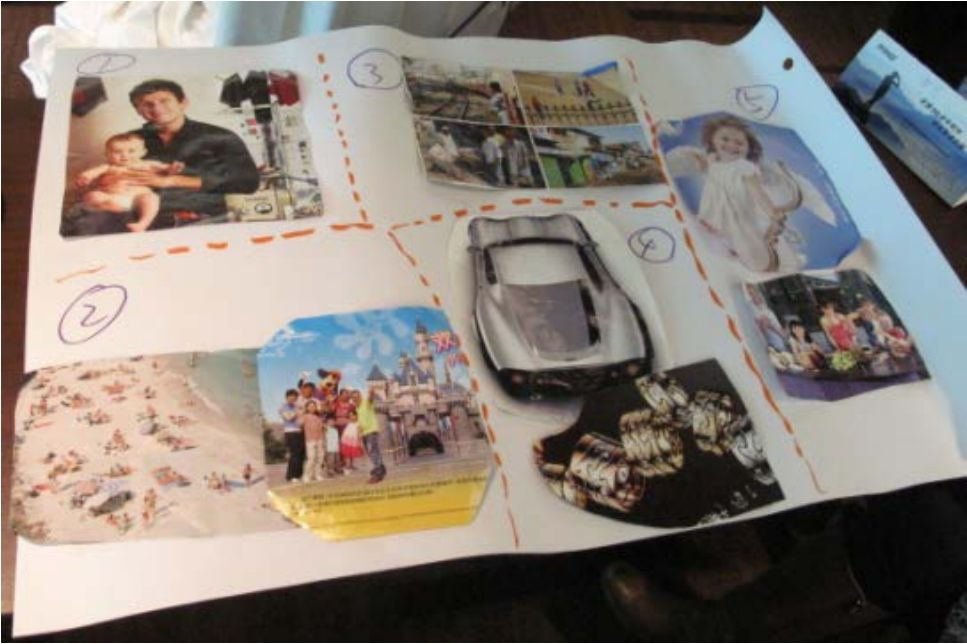

## 3.2.1 　案例1：智能长命锁

这是我参与的一次实战演练的产出，通过这个例子，可以看到“产品概念”的思路源头和具体表达形式。

现场，我们用了一些工具来辅助说故事，很简单，找一堆没用的旧画报，把它们撕碎了，通过图片来启发思路，读者也可以试试。在其中找到能关联3.1节提及的五个关键要素的图片，每个问题可以一张或多张。找到以后，把图片贴在一张大白纸上，给未来的产品干系人讲这个故事，看看听的人是否有感觉，如果high了，产品概念通过。

我们组用一刻钟时间找到的产品概念：“智能长命锁”，如图3-3所示。

{ width="407" height="270" }

图3-3　用画报来启发思路

我在组织团队讨论时，问大家有什么在日常生活中让你很头疼的事情。组内两位年轻父母都提到了自己的孩子，而其他人也纷纷表示认同。于是，我们对3.1节提出的五个问题给出了这样的回答：

**核心用户**
：小孩3～5岁的白领（图片没找到更合适的，只有一个抱着小宝宝的年轻爸爸）。

**刚性需求**
：因为人多、环境新、突发事件多等因素，对小孩的安全时刻提心吊胆（贴了一些危机四伏的街道、沙滩的图片）。

**典型场景**
：带着小孩一起出去玩（找了海滩和迪斯尼的图片）。

**产品概念**
：智能长命锁，可能的功能有GPS定位、超距离报警、哭声报警等（图片中概念车表达了“高科技”这个关键词，戒指表达了“时尚”这个关键词）。

**竞争优势**
：家长放心（配一家人其乐融融吃饭的图片），而且孩子开心——这个产品很漂亮，孩子也很喜欢（配一张笑着的小天使图片）[[1]](../05/index.md#footnote_content_txt004_1)
。

除了吐槽，领域知识（此例中，是带孩子出游的经验经历，和对智能硬件的基本了解）也是准确描述上面内容的必备能力，不用长篇大论，简单的5句话，就定义出产品最初的切入点。

