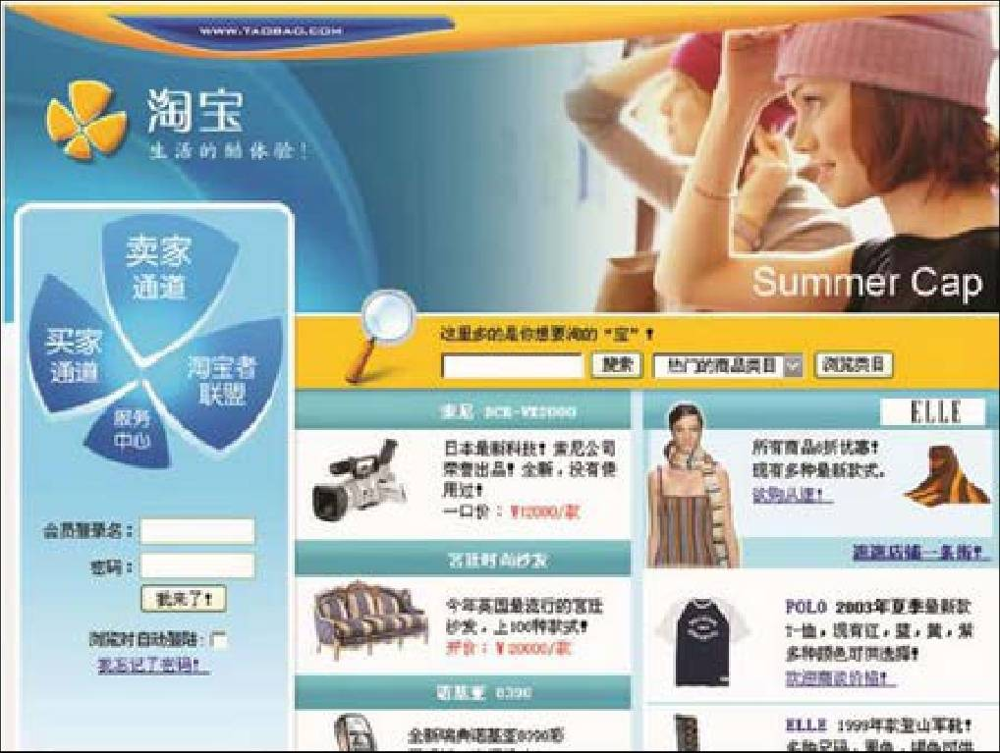
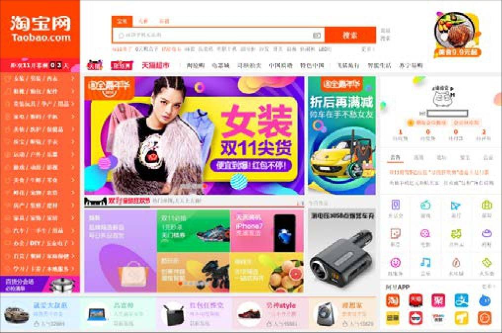

## 3.2.2 　案例2：淘宝首页

再来个更真实的案例，淘宝首页，如图3-4、图3-5所示。

随着时间推移，淘宝的产品经理们逐渐理解了首页存在的意义，它不只是一个普通的页面，而且是淘宝一个很重要的产品，我们通过它来看看产品是怎么寻找切入点的。

<figure markdown="1">

{ width="427" height="322" }

<figcaption markdown="span" style="margin:0.5em auto;font-size:0.8em;font-style:normal;line-height:1.5">
图3.4　2003年淘宝最初的首页
</figcaption>

</figure>

<figure markdown="1">

{ width="427" height="282" }

<figcaption markdown="span" style="margin:0.5em auto;font-size:0.8em;font-style:normal;line-height:1.5">
图3.5　2016年的淘宝首页
</figcaption>

</figure>

首先，我们要确定这个产品的**核心用户**
。

►第一步，做用户细分，列出可能与淘宝首页发生关系的各种用户：买家、卖家、合作伙伴（即服务买卖方的服务商）、淘宝员工、竞争对手、机器爬虫，等等。

►第二步，判断每种用户的价值，排个优先级。这个例子比较简单，显然是“买家”最重要（整个淘宝谁更重要很难说，但首页一定是买家更重要）。

►第三步，判断“买家”这个用户群体的粒度是否足够细。如果够细，到此为止，如果不够，回到第一步再细分，并循环这三步。

在这个例子里，“买家”还需要细分。当然，分类方法很多，我们最终采取了一种很常见的分类方法：按照用户对产品所在领域的熟悉程度，分为新手、中间用户和专家。其中，最核心的是“新手”，因为只有新手买家，才会在首页上仔细研究各个模块。相对成熟一点的用户，虽然也会访问首页，但通常只是“路过”，然后直接去了某个特定的频道。或者，他们已经形成了自己的购物习惯，从“我的淘宝”、“收藏的店铺”里开始，甚至从一些外部的导购站点进入淘宝。

接着，要确定这批核心用户的**刚性需求和典型场景**
。

►第一步，类似地列出新手买家的各种需求：逛、购物、学习如何使用淘宝等。举个例子说明一下“逛”，“逛”不等于无目的的购物，而是“我没打算在淘宝买××，但我想来看看商家的底价，以及别人怎么评价这个东西”这类场景。

►第二步，对这些需求做价值判断。这个例子中，我们优先满足“购物”。

►第三步，判断“购物”这个需求场景的粒度是否足够细。如果够细，到此为止，如果不够，回到第一步再细分，并循环这三步。

此例中，各种“购物”的需求我们都想满足，所以整个“购物”可以看作刚性需求。但在具体满足时，还是需要细分，以便在首页上用不同的功能模块满足不同类购物的需求场景。

分法同样很多。过去几年里比较经典的分法是，按照购物的目标是否明确，分为目标清晰的购物需求、目标模糊的购物需求和无目标的购物需求。淘宝早期重视购物、交易，不重视逛、社交的基因，也给后来的很多导购网站留下机会。

所以，淘宝首页这个产品概念对应的切入点就是新手买家的各种购物需求。而对于竞争优势，作为淘宝的一个子产品，淘宝首页主要依托于主站多年的积累。

这个例子里，很难说是先有了淘宝首页，然后淘宝的产品经理们一步步明确了对应的用户需求场景，还是先发现了新手买家网购的痛，再设计的淘宝首页，这并不关键。打个不吉利的比方，公司有一个半死不活的产品，你发现正好能满足一个原来没意识到的用户需求场景，那也是大功一件。所以，**问题和解决方案，不一定先有哪个，最重要的是要找到它们的匹配。**

这才是产品经理价值的本质。

**聊聊用户分类的方法**

顺着淘宝首页，再讲讲用户分类。寻找切入点，乃至后续的精细化运营的关键就是要对用户进行细分，所以，从目标用户中一层一层找到核心用户，是产品经理非常关键的一项基本技能。

分类的方法有很多，先从逻辑上分析一下什么样的分类是好的。我的理解是把全集分为子集后，不同子集的个体之间差异尽量大，每个子集内的个体差异尽量小。如分类能满足一个叫MECE[[2]](../05/index.md#footnote_content_txt004_2)
的原则就更好，就是尽量做到不重不漏。

在这个大的分类逻辑指导下，在对目标用户进行分类时务求遵守的原则就是，**不同细分用户的“需求场景”差异要尽量大**
。下面给出几条实用套路。

**第一，如果产品的用户是多边的，先根据不同角色分类。**

多边型的产品，对应单点（如小工具）和单边（某些同好社交应用）的产品，要有至少两种明显差异的用户群体，通常这种产品都具有平台属性。

举例，对于淘宝来说，常见的分法是买家、卖家、第三方服务商、平台方；对于滴滴出行，就可能会分成司机、乘客、平台运营方；对于知乎，可以分为提问者、回答者、吃瓜群众、平台方……不同用户群体的需求场景差异显然巨大。

**第二，新人、中间用户和专家。**

这是按照用户对“产品所在领域的熟悉程度”来分类的结果，也是一种非常常用的用户分类方法。对于单边的用户角色，如果找不到更好的分法，我建议用这个方法保底，毕竟新人和专家的需求场景差异已经足够大，前者希望“简单易用易上手”，后者期待“稳定可靠性能高”。

以QQ音乐为例，如果用户是新人，可能需要最热的榜单、通过场景自动选歌，而专家用户，则更可能会去搜某一张专辑或者搜某位歌手；又如开车，新人需要一辆好开的自动挡，专家可能需要能上赛道的手动小钢炮、能进山的硬派越野。

与此近似的角度，是新用户与老用户。

**第三，根据人口统计信息（包括年龄、性别、职业、所在地、消费水平等）。**

这个方法要慎用，要避免人口统计信息和产品关系不大的情况（比如按照不同职业来区分打车用户，就没什么逻辑），这样划分成的几类用户，需求场景差异往往不是很明显。

说几个比较适合的例子。银行设定信用卡级别，是按照资产、收入、消费水平来分类；乐高设定玩具难度等级，是按照不同年龄段儿童来分类，因为背后代表了智力水平的差异；一些服装品牌制定款式的策略，是按照地域，即一线大城市与三四线城市划分；K12教育里的学生，按照不同年龄段分类；厕所，按照性别分类，等等。

**第四，根据产品的业务场景。**

还有一些分类方法，很难总结为通用的规则，要具体问题具体分析，通过几个例子给大家一点启发。

比如做企业服务，可以按照用户（公司）的融资阶段分为种子轮、天使轮、A、B、C……PreIPO、已上市等。

做培训，可以按照互联网、IT、快消、生产制造等行业划分，也可以按技术、产品、运营、管理等不同岗位划分。

做航旅，可以按照用户累积里程分为普通、银卡、金卡、铂金。

做媒体，可以按照读者的三观将其分为信中医和反中医的，民族主义的和世界大同的。

做社区，经常分为提供原创内容的PGC写手、加工内容（点赞、评论、转发等）的积极分子、纯消费内容的浏览型用户。

做出游，可以分为单人、情侣、亲子、团建等。

还有比较通用的，例如分为需要引导的菜鸟，需要维系的忠粉，需要召回的旧爱，需要赶走的讨厌鬼。

……

编个打油诗作为小结：

**多边先分边，**

**新人与专家，**

**人口统计学，**

**业务场景化。**

最后提一句，对需求场景的细分，思路上与用户分类是类似的。分得不好，后面做起来一团乱麻，分好了，便于分而治之。

