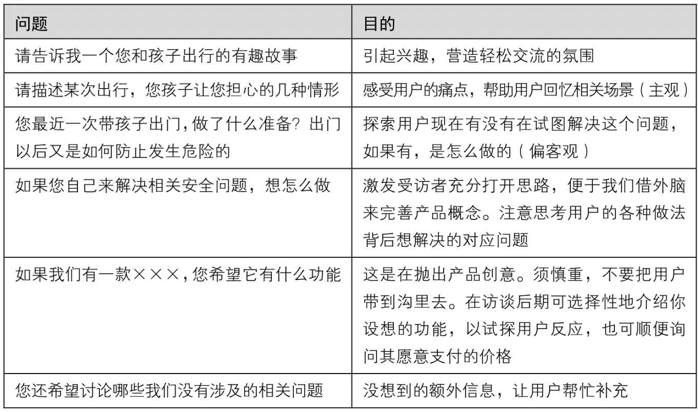
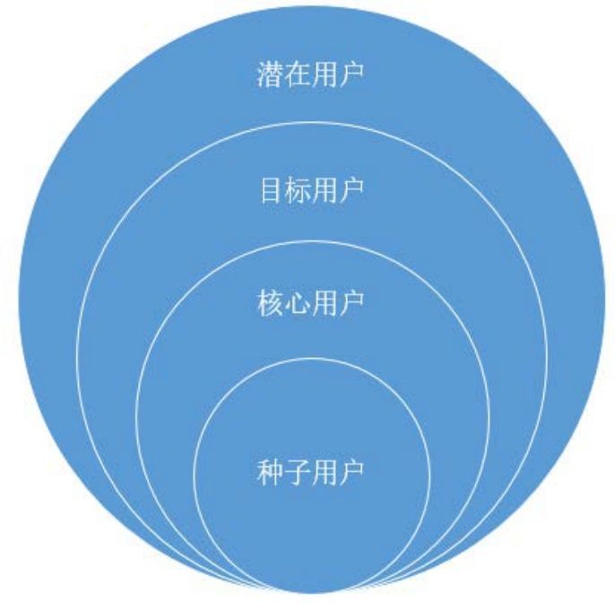

## 3.3.3 　外部因素：价值

说完了内部，再向外部看看。我看过一个TED的视频，演讲者根据硅谷很多公司成功与否的统计数据得出结论，最重要的成功因素居然是——时势。这告诉我们，“人有多大胆，地有多大产”是不理性的。一个好的产品概念，必须要筛选过各种外部因素，才有可能落地。外部因素有价值和成本两方面，其中，对于价值的思考，可以分为宏观和微观两个角度。

**宏观：天花板**

对天花板的分析，就是对某个行业宏观价值的思考。对于新手产品经理来说，平时不太接触这事儿，因为老板都已经分析好了。天花板的意思，具体点说，就是我们想做的事情，扩大到一个行业，整体有多大？增速怎样？现在是高速增长期还是成熟期，甚至已经是衰退期？

所以，可以列出这样一个等式：

潜在用户[[3]](../05/index.md#footnote_content_txt004_3)
× 单用户可挖掘价值 = 行业天花板。

由以上公式可以很容易地得出结论：金融、医疗、教育这些关系到民生的行业，都是天花板很高的超大行业。我们也可通过计算来衡量一个项目的宏观价值，如果一个事情的市场容量远达不到十亿美元，发展就比较困难。如果硬要做，你必须占据绝对大的市场份额，才能成长为一家大公司，而如果有一个千亿美元的市场，你就算处在第三、四名，也能活得很不错。

当然，这只是从投资、做大事的角度来说的。如果你想清楚了，就想做一件小而美的事情，那可以不那么在乎行业天花板。

通常，提供了足够多的用户价值，总能有办法找到自己的商业价值，说得再直白一点，就是总能赚到钱。

我们要仰望星空，还要脚踏实地，并且长期思考从实地到天空的发展路径。天花板是终局，但刚起步的时候，还是要多多思考切入点，相应的微观价值，就是身边人。

**微观：身边人**

“你自己需要这个产品么？”这是我个人比较喜欢问的。要做一个产品，最好自己就是典型用户，最好身边再有一群受这个问题困扰很深的人。只有这样，自己才能更加感同身受，找到的切入点才会更加准确。

儒家有一个传统价值观，叫作“修身齐家治国平天下”，我比较认同其中的顺序，越亲的人越重要。做产品，也应该从身边做起，越能帮到亲近的人，价值感越大。Facebook一开始就是扎克伯格做给自己和身边的宅男，在无聊的时候看妹子照片用的。Pinterest（一个采用瀑布流形式展现图片内容的应用）最早的用户是创始人自己的妈妈，以及相似的有“剪报”习惯的全职主妇，她们用Pinterest在手机电脑上做剪报。后来，这个产品才渗透进设计师群体，成为从业者找图片素材的好地方。

从身边起步还有两个特殊优势：一是为身边人，甚至为自己做产品，能减小“误以为自己懂用户”的错误概率[[4]](../05/index.md#footnote_content_txt004_4)
；二是找第一批精准用户更加容易，简化了项目启动过程。

我们把这些身边人叫作“种子用户”。

**找到你的种子用户**

听说有一家公司的一个新产品，在内部就迭代了6次。原因是每一次发布后老板都不满意，只好再改一版，前后改了6次。其实这样的根本不叫迭代。迭代的概念是和“种子用户”连在一起的，自己内部改改改，那只能叫没想清楚就动手。接下来看看种子用户究竟是怎么辅助迭代的。

种子用户是**受你要解决的那个问题困扰最深的一小群人**
，最早的一批用户，通常是某种意义上的熟人，你很清楚每个个体姓甚名谁，他们也常被叫作“天使用户”、“铁粉”、“用户顾问”。从产品概念的验证开始，一直到需求采集阶段，很需要找到并维护好这群人。

他们对产品的帮助很大。

►**愿意配合**
。因为他们受困扰很深，所以有人来帮助解决，自然很高兴。如果你的产品找不到几个很愿意尝试、积极配合的人，那只能说，你的产品概念有问题，几乎没有解决任何人的痛点；或者，有这样一群人，但你不认识，这表明你们团队的行业积累有缺失。

►**可以提供很多有价值的信息**
。俗话说，久病成良医。他们中的很多人已经在自己尝试解决这个问题，去了解他们现在是怎么做的，让他们谈谈对新产品的想法，你一定会有很多收获。所以，种子用户也叫“用户顾问”。

►**可以忍受缺陷**
。种子用户们虽然很想解决问题，但往往因为资源的缺乏，有想法但没能做出很好的解决方案，难免饥不择食。这时候，只要有方案出现，他们极有可能愿意忍受其缺陷。而这种不完美的产品，才是真正的迭代产物。你要做的是，在功能列表里筛选出MVP[[5]](../05/index.md#footnote_content_txt004_5)
，做出来后推给他们。有时候，他们发现Bug后不仅不生气，还会热心提交反馈，这一特征实在太有价值了。

►**可以成为义务推销员**
。如果他们满意了，一定会帮你宣传。所以，在选择种子用户时，找到某些细分领域的意见领袖很重要。

我们看到，越来越多的行业在内测（或叫封测）阶段，会充分利用“种子用户”，并且尽量放大这个过程的营销作用，比如小米早期的路由器，以及一些高端的特色餐饮店。

**初次接触用户，验证概念**

产品概念在大多数情况下，还真是“空想”出来的。当然，作为产品经理，在相关领域肯定是要有积累的，须在过去几年、几十年见过无数用户。

紧接着，就得不断在“创意—验证—调整”这个循环里往返，从产品概念筛选开始，不断地去用户那里验证，一般会采取用户访谈的方式。仍然以“智能长命锁”为例，通过一系列的问题以及点评，大家体会一下“初次接触用户”的过程。

通常，会先有一些预筛选问题，防止在非目标用户身上花费太多精力。比如，可以在电话预约的时候问：您有没有孩子？孩子多大？经常带他/她出门吗？通话过程中可以考察对方的沟通能力、配合程度等。

约到靠谱的目标用户以后，会有一系列问题等着他。表3-1所示案例可以当作用户访谈模板。当然，当面问时应该尽量口语化。

表3-1　初次接触用户的访谈内容示例

{ width="619" height="363" }

按照我在《人人都是产品经理》里对用户研究方法的分类，第一次和用户接触属于“定性的说”，涉及的都是“开放式”、“非引导”的问题。我们应该尽量到客户发生需求的场景去倾听客户、如实记录，不要做太多过滤和解读。

在这一步，跨部门的共同参与很关键，这样才能有“早期共识”，便于后续的产品推进。

**从种子用户到潜在用户**

图3-7中有几个前面加了不同修饰语的“用户”词组，让我们简单辨析一下它们各自所在的语境（本书之后会沿用这些语境）[[6]](../05/index.md#footnote_content_txt004_6)
。

{ width="288" height="285" }

图3-7　本书提及的几种用户

最外面一层的潜在用户，指向将来的想象空间与发展天花板；临近一层的目标用户，指所有现在能跟产品发生关系的用户群体；下一层的核心用户，指目标用户中最重要的那个群体；最里面一层的种子用户，指核心用户中最早接触的那一小批用户，通常是一些具象的、我们认识的个体。

以滴滴这家公司为例，种子用户也许就是公司在机场摆摊阶段每天遇到的那几十个人；核心用户为北京乃至各大城市的出租车司机，产品在切入点的选择上，通常先搞定供给端再找需求端；目标用户为出租车司机加上乘客，产品有了对目标用户的覆盖之后就可以形成一个价值闭环；滴滴打车扩张成滴滴出行后，又会覆盖到当初的潜在用户，例如有闲暇时间可以代驾的司机及可以开顺风车的车主。

