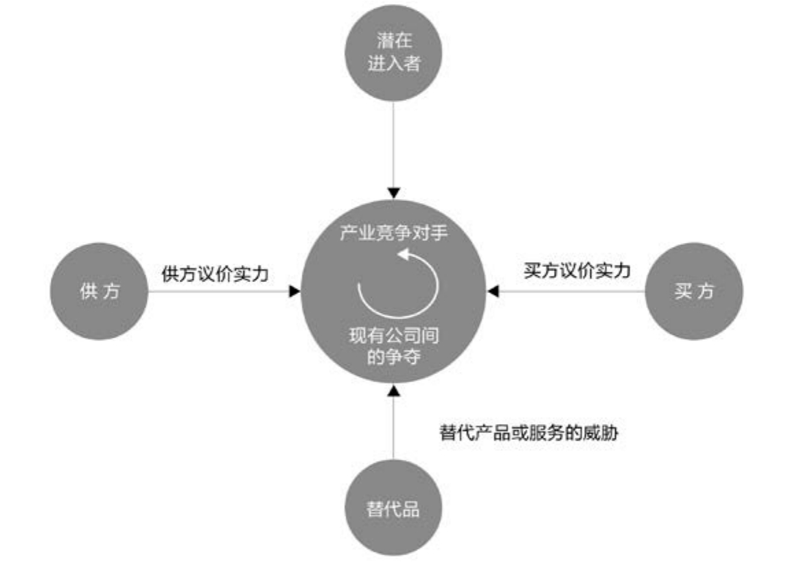

## 3.3.4 　外部因素：成本

价值高的事情不一定就要做，还要看看成本与风险。成本因素依然可以分为宏观和微观两方面。

**宏观：大环境**

宏观环境是指不太受企业掌控的大环境，比如2016年国家有过好几次关于私家车用作专车、顺风车的政策变化，对这个行业的从业者显然有很大影响。当然，如果你的公司足够大，也可以反向推动政策的改变。

有一个模板，叫作PESTEL（是下面这些英文单词的缩写），可供参考。

►**政治因素（Political）：**
是指对组织经营活动具有实际与潜在影响的政治力量和有关的政策、规定等因素。

►**经济因素（Economic）：**
是指组织外部的经济结构、产业布局、资源状况、经济发展水平以及未来的经济走势等。

►**社会因素（Social）：**
是指组织所在社会中成员的历史发展、文化传统、价值观念、教育水平以及风俗习惯等因素。

►**技术因素（Technological）：**
不仅仅包括那些引起革命性变化的发明，也包括与企业生产有关的新技术、新工艺、新材料的出现，以及发展趋势、应用前景。

►**环境因素（Environmental）：**
一个组织的活动、产品或服务中能与环境发生相互作用的要素。

►**法律因素（Legal）：**
组织外部的法律、法规、司法状况和公民法律意识所组成的综合系统。

对于大环境，我们更多的是顺势而为，仅举几个例子加以说明：在中国的法律面前，你就没有办法做某些与性、大麻有关的产品；在经济不景气时，娱乐行业的市场规模反而会提升，出现所谓的“口红效应”；在特定的社会文化氛围下，很多产品都必须本地化，如淘宝的旺旺迎合的是喜欢讨价还价的习惯，支付宝迎合的是信用体系缺失的环境，这些都是本地化的产物。

**微观：行业环境**

微观指行业环境，如图3-8所示的波特五力模型[[7]](../05/index.md#footnote_content_txt004_7)
已经总结得很好了，让我们来依次对号入座。

{ width="483" height="343" }

图3-8　波特五力模型

►对于同行业内现有竞争者的能力，其主要指标为市场成熟度和竞争激烈程度。对于不成熟的早期市场，竞争对手少，但用户教育成本高，要避免做“帮后来者教育用户”的事情，而竞争激烈时期，可以考虑的策略是往行业上游走。比如，几年前团购流行时上演了“千团大战”，你就可以考虑做团购网站的导航、做团购商品的供应商。

►潜在竞争者进入的能力，代表行业门槛高低。一些依托“黑科技”创业的领域，门槛相对高，而商业模式创新则门槛相对低。

►替代品的替代能力，有一个很好的例子，就是智能手机音视频功能对MP3、MP4市场的颠覆，可谓“毁灭你，与你何干”。对于这点，我们要保持对变化的敏感，与其被别人干掉，不如自己先拥抱变化。

►供应商的讨价还价能力，其实是一个店大欺客的问题。如果你的上游供应商过于集中，就很可能对你强势，设法分散是个解决方案。

►购买者的讨价还价能力，其实是一个客大欺店的问题。如果你只有一个客户，可想而知，他提任何条件，你都只能答应，所以也是要设法分摊风险。

此外，你的供应商或购买者，也就是产业链的上下游，如果过于强大，往往会倾向于控制产业链上的更多环节，也就是很可能跨界到你的领域来直接竞争。打个比方，一家给餐馆提供食材的供应商，业务跑顺了以后，很可能会自己开几个餐馆。

互联网行业的环境，要特别提一下BAT这类巨头。你要考虑自己的产品和巨头是什么关系。如果不小心走到了巨头战车会碾过的路上，也许他们都没有发现你的存在，你就已经死了。所以，你的产品最好能和行业巨头形成互补，或者迅速做到巨头愿意收购你的地步。

产品经理经常提的“竞品分析”，其实一定程度上也在分析行业环境。

至此，已经把产品概念筛选要考虑的因素讲完了。当然这只是一种框架，由于每一个行业都不同，每个人习惯也不同，你完全可以用别的框架。而模板的目的，只是防止在产品早期漏掉某些方面的思考，因为事后再弥补的成本会高很多。

