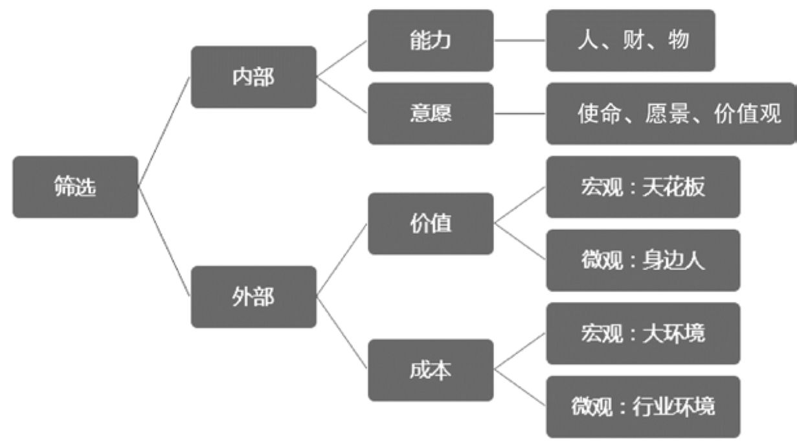

## 3.3　产品概念的筛选

提出产品概念的几句话以后，如何最快速判断它是否靠谱呢？通常的经验是，先随手找几个人问问，把产品概念讲给他们听，如果你听到大家说“呵呵呵，我好像不需要”、“好奇怪，不理解为什么要这样做”，那就需要回炉重想，而如果听到“这个你准备卖多少钱”、“有点用，但是不是已经有类似的东西了”这样的问题，就说明这个概念靠谱，大家已经认可你的大方向了。

接下来就要对这些概念进行筛选。

首先要明确一个大前提，产品概念筛选其实是在一个时间切片上做的。随着时间的变化，筛选工作应该每隔一段时间做一次。因为经验告诉我们，有的事情真的是一个大浪潮，而有的事情可能只是一个小浪花。

筛选要考虑的维度有很多，如果能有一个模板，会为大家省不少力气。接下来就提供一个我的总结：如何从内部的能力、意愿，以及外部的价值、成本这几个方面来完成筛选，如[图3-6](#figure-3-6)所示。先说理念，再说案例。

<figure id="figure-3-6" tabindex="-1" markdown="1">

{ width="517" height="289" }

<figcaption markdown="span" style="margin:0.5em auto;font-size:0.8em;font-style:normal;line-height:1.5">
图3-6　 产品概念筛选的要素
</figcaption>

</figure>

### 3.3.1 　内部因素：能力

先看内部因素的“能力”，它又分为人、财、物三个方面。

**人：团队是否与要做的事情匹配。**

老板、投资人在判断一些早期项目时，最看重的是人，特别是几个核心成员，尤其是创始人。重点考察这些“人”过去的经历，拥有的能力和经验是否胜任项目，这个团队是不是互补，是否能覆盖这件事需要的各种能力。当然，如果泛化地来看团队，还会包括周边的人脉、上下游的合作方等。

**财：各种资本、资金的支持是不是到位。**

比方说你要做O2O。2015年正在上演补贴大战，滴滴和快的一天要补贴上千万人民币。这个时候你要拿到足够多的钱才能做，而有些小的打车软件，整个公司账户上也就一千万左右，就只能直接退出竞争。所以，融资或在公司内部“抢资源”，也是一种关键能力。

**物：行业资源与业务能力。**

►**行业资源，**
任何产品都需要，往往靠的是长时间在行业、产业的积淀。比如想做在线教育，团队里光有互联网人、能做出一个系统是不够的，还要考虑有没有人在教育行业待过五年十年，是否理解“学习”这个天然反人性的领域，懂不懂各种教育机构、政府部门的规则与潜规则，有没有足够多的讲师、课程资源，等等。

►**业务能力，**
是通过反复做某些事逐渐总结出的套路，如复杂的IT支持系统、运营活动的方法论、公司内部的流程等。大公司的流程大多很复杂，在做一些创新创业项目时，就会成为障碍。举个简单的例子，我当时在阿里B2B做一个创新项目，要买一个八千块左右的硬件，就遇到了麻烦。因为当时阿里B2B是香港的上市公司，各种规定很严格，买超过五千块钱的东西就要走采购流程。最后，只能找不少于三个有资格的供应商来报价，然后再比价、走审批。东西买回来已经过去半个月了。而对于一个创业公司，可能只要在网上淘一淘，第二天就能收到。所以，不合适的业务流程，也可能成为一种能力上的不足。

这三方面，最本质的还是人，财和物都可以由人带过来。

### 3.3.2 　内部因素：意愿

意愿就是使命、愿景、价值观。这些东西听起来很虚，但其实也是非常实的，你觉得一个东西太虚，很多时候只是因为你不了解。

使命就是我们要解决一个什么问题，要做一件什么事情，比如“让天下没有难做的生意”；愿景是说我们希望成为什么，比如“让客户相会、工作和生活在阿里巴巴，并持续发展最少102年”；价值观就是我们认为什么是对的什么是错的。这些问题的深入思考，决定了我们想做什么，不愿意做什么。

我跟一个创业者聊天时，会反复问他——你为什么要做这个项目？有的人会回答“因为现在热嘛”、“正处在风口”或“有一条很宽的赛道”。如果问来问去都是类似的答案，我们其实不会太重视，因为他的意愿不是原生的，不是自己真心想做，而是有一点机会主义的倾向。

那么，最好的意愿是什么？是要发自内心地对这个事情特别有使命感，并且一直为之努力，感觉这辈子如果不做就白活了，我会特别偏好这种创业者。创业的过程总会碰到各种各样的困难，只有这种有原生动力的人，才能够坚持，尤其是持续坚持（坚持的是目标，是初心，方法手段没必要傻坚持）。而且，对于有这样意愿的创业者，退一步讲，就算失败了，也会很坦然，觉得自己试过了，过程很值。

每个公司都有自己的定位，有所为有所不为，大多数互联网公司不可能因为有几个研发工程师空着，就去接外包项目。跟初心有关的事情，往往更容易成功，如果是为了追风口，为了公司的战略需要，失败的概率就会很大。个人觉得，2013年底阿里做“来往”的想法，就是过于在意“公司需要”而不是“用户需要”。反而从中孵化出的“钉钉”，有着帮助阿里客户沟通、协同的初衷，在意愿上就胜出很多。

当然，意愿也不是某一天突然产生的，而是长时间的思考、沉淀的产物。对公司、对个人都一样，有了明确的意愿，做起事来才会有方向感、目标感。

### 3.3.3 　外部因素：价值

说完了内部，再向外部看看。我看过一个TED的视频，演讲者根据硅谷很多公司成功与否的统计数据得出结论，最重要的成功因素居然是——时势。这告诉我们，“人有多大胆，地有多大产”是不理性的。一个好的产品概念，必须要筛选过各种外部因素，才有可能落地。外部因素有价值和成本两方面，其中，对于价值的思考，可以分为宏观和微观两个角度。

**宏观：天花板**

对天花板的分析，就是对某个行业宏观价值的思考。对于新手产品经理来说，平时不太接触这事儿，因为老板都已经分析好了。天花板的意思，具体点说，就是我们想做的事情，扩大到一个行业，整体有多大？增速怎样？现在是高速增长期还是成熟期，甚至已经是衰退期？

所以，可以列出这样一个等式：

潜在用户[[3]](../05/index.md#footnote_content_txt004_3)
× 单用户可挖掘价值 = 行业天花板。

由以上公式可以很容易地得出结论：金融、医疗、教育这些关系到民生的行业，都是天花板很高的超大行业。我们也可通过计算来衡量一个项目的宏观价值，如果一个事情的市场容量远达不到十亿美元，发展就比较困难。如果硬要做，你必须占据绝对大的市场份额，才能成长为一家大公司，而如果有一个千亿美元的市场，你就算处在第三、四名，也能活得很不错。

当然，这只是从投资、做大事的角度来说的。如果你想清楚了，就想做一件小而美的事情，那可以不那么在乎行业天花板。

通常，提供了足够多的用户价值，总能有办法找到自己的商业价值，说得再直白一点，就是总能赚到钱。

我们要仰望星空，还要脚踏实地，并且长期思考从实地到天空的发展路径。天花板是终局，但刚起步的时候，还是要多多思考切入点，相应的微观价值，就是身边人。

**微观：身边人**

“你自己需要这个产品么？”这是我个人比较喜欢问的。要做一个产品，最好自己就是典型用户，最好身边再有一群受这个问题困扰很深的人。只有这样，自己才能更加感同身受，找到的切入点才会更加准确。

儒家有一个传统价值观，叫作“修身齐家治国平天下”，我比较认同其中的顺序，越亲的人越重要。做产品，也应该从身边做起，越能帮到亲近的人，价值感越大。Facebook一开始就是扎克伯格做给自己和身边的宅男，在无聊的时候看妹子照片用的。Pinterest（一个采用瀑布流形式展现图片内容的应用）最早的用户是创始人自己的妈妈，以及相似的有“剪报”习惯的全职主妇，她们用Pinterest在手机电脑上做剪报。后来，这个产品才渗透进设计师群体，成为从业者找图片素材的好地方。

从身边起步还有两个特殊优势：一是为身边人，甚至为自己做产品，能减小“误以为自己懂用户”的错误概率[[4]](../05/index.md#footnote_content_txt004_4)
；二是找第一批精准用户更加容易，简化了项目启动过程。

我们把这些身边人叫作“种子用户”。

**找到你的种子用户**

听说有一家公司的一个新产品，在内部就迭代了6次。原因是每一次发布后老板都不满意，只好再改一版，前后改了6次。其实这样的根本不叫迭代。迭代的概念是和“种子用户”连在一起的，自己内部改改改，那只能叫没想清楚就动手。接下来看看种子用户究竟是怎么辅助迭代的。

种子用户是**受你要解决的那个问题困扰最深的一小群人**
，最早的一批用户，通常是某种意义上的熟人，你很清楚每个个体姓甚名谁，他们也常被叫作“天使用户”、“铁粉”、“用户顾问”。从产品概念的验证开始，一直到需求采集阶段，很需要找到并维护好这群人。

他们对产品的帮助很大。

►**愿意配合**
。因为他们受困扰很深，所以有人来帮助解决，自然很高兴。如果你的产品找不到几个很愿意尝试、积极配合的人，那只能说，你的产品概念有问题，几乎没有解决任何人的痛点；或者，有这样一群人，但你不认识，这表明你们团队的行业积累有缺失。

►**可以提供很多有价值的信息**
。俗话说，久病成良医。他们中的很多人已经在自己尝试解决这个问题，去了解他们现在是怎么做的，让他们谈谈对新产品的想法，你一定会有很多收获。所以，种子用户也叫“用户顾问”。

►**可以忍受缺陷**
。种子用户们虽然很想解决问题，但往往因为资源的缺乏，有想法但没能做出很好的解决方案，难免饥不择食。这时候，只要有方案出现，他们极有可能愿意忍受其缺陷。而这种不完美的产品，才是真正的迭代产物。你要做的是，在功能列表里筛选出MVP[[5]](../05/index.md#footnote_content_txt004_5)
，做出来后推给他们。有时候，他们发现Bug后不仅不生气，还会热心提交反馈，这一特征实在太有价值了。

►**可以成为义务推销员**
。如果他们满意了，一定会帮你宣传。所以，在选择种子用户时，找到某些细分领域的意见领袖很重要。

我们看到，越来越多的行业在内测（或叫封测）阶段，会充分利用“种子用户”，并且尽量放大这个过程的营销作用，比如小米早期的路由器，以及一些高端的特色餐饮店。

**初次接触用户，验证概念**

产品概念在大多数情况下，还真是“空想”出来的。当然，作为产品经理，在相关领域肯定是要有积累的，须在过去几年、几十年见过无数用户。

紧接着，就得不断在“创意—验证—调整”这个循环里往返，从产品概念筛选开始，不断地去用户那里验证，一般会采取用户访谈的方式。仍然以“智能长命锁”为例，通过一系列的问题以及点评，大家体会一下“初次接触用户”的过程。

通常，会先有一些预筛选问题，防止在非目标用户身上花费太多精力。比如，可以在电话预约的时候问：您有没有孩子？孩子多大？经常带他/她出门吗？通话过程中可以考察对方的沟通能力、配合程度等。

约到靠谱的目标用户以后，会有一系列问题等着他。表3-1所示案例可以当作用户访谈模板。当然，当面问时应该尽量口语化。

<figure markdown="1">

<figcaption markdown="span" style="margin:0.5em auto;font-size:0.8em;font-style:normal;line-height:1.5">
表3-1　初次接触用户的访谈内容示例
</figcaption>

{ width="619" height="363" }

</figure>

按照我在《人人都是产品经理》里对用户研究方法的分类，第一次和用户接触属于“定性的说”，涉及的都是“开放式”、“非引导”的问题。我们应该尽量到客户发生需求的场景去倾听客户、如实记录，不要做太多过滤和解读。

在这一步，跨部门的共同参与很关键，这样才能有“早期共识”，便于后续的产品推进。

**从种子用户到潜在用户**

[图3-7](#figure-3-7)中有几个前面加了不同修饰语的“用户”词组，让我们简单辨析一下它们各自所在的语境（本书之后会沿用这些语境）[[6]](../05/index.md#footnote_content_txt004_6)
。

<figure id="figure-3-7" tabindex="-1" markdown="1">

{ width="288" height="285" }

<figcaption markdown="span" style="margin:0.5em auto;font-size:0.8em;font-style:normal;line-height:1.5">
图3-7　本书提及的几种用户
</figcaption>

</figure>

最外面一层的潜在用户，指向将来的想象空间与发展天花板；临近一层的目标用户，指所有现在能跟产品发生关系的用户群体；下一层的核心用户，指目标用户中最重要的那个群体；最里面一层的种子用户，指核心用户中最早接触的那一小批用户，通常是一些具象的、我们认识的个体。

以滴滴这家公司为例，种子用户也许就是公司在机场摆摊阶段每天遇到的那几十个人；核心用户为北京乃至各大城市的出租车司机，产品在切入点的选择上，通常先搞定供给端再找需求端；目标用户为出租车司机加上乘客，产品有了对目标用户的覆盖之后就可以形成一个价值闭环；滴滴打车扩张成滴滴出行后，又会覆盖到当初的潜在用户，例如有闲暇时间可以代驾的司机及可以开顺风车的车主。

### 3.3.4 　外部因素：成本

价值高的事情不一定就要做，还要看看成本与风险。成本因素依然可以分为宏观和微观两方面。

**宏观：大环境**

宏观环境是指不太受企业掌控的大环境，比如2016年国家有过好几次关于私家车用作专车、顺风车的政策变化，对这个行业的从业者显然有很大影响。当然，如果你的公司足够大，也可以反向推动政策的改变。

有一个模板，叫作PESTEL（是下面这些英文单词的缩写），可供参考。

►**政治因素（Political）：**
是指对组织经营活动具有实际与潜在影响的政治力量和有关的政策、规定等因素。

►**经济因素（Economic）：**
是指组织外部的经济结构、产业布局、资源状况、经济发展水平以及未来的经济走势等。

►**社会因素（Social）：**
是指组织所在社会中成员的历史发展、文化传统、价值观念、教育水平以及风俗习惯等因素。

►**技术因素（Technological）：**
不仅仅包括那些引起革命性变化的发明，也包括与企业生产有关的新技术、新工艺、新材料的出现，以及发展趋势、应用前景。

►**环境因素（Environmental）：**
一个组织的活动、产品或服务中能与环境发生相互作用的要素。

►**法律因素（Legal）：**
组织外部的法律、法规、司法状况和公民法律意识所组成的综合系统。

对于大环境，我们更多的是顺势而为，仅举几个例子加以说明：在中国的法律面前，你就没有办法做某些与性、大麻有关的产品；在经济不景气时，娱乐行业的市场规模反而会提升，出现所谓的“口红效应”；在特定的社会文化氛围下，很多产品都必须本地化，如淘宝的旺旺迎合的是喜欢讨价还价的习惯，支付宝迎合的是信用体系缺失的环境，这些都是本地化的产物。

**微观：行业环境**

微观指行业环境，如[图3-8](#figure-3-8)所示的波特五力模型[[7]](../05/index.md#footnote_content_txt004_7)
已经总结得很好了，让我们来依次对号入座。

<figure id="figure-3-8" tabindex="-1" markdown="1">

{ width="483" height="343" }

<figcaption markdown="span" style="margin:0.5em auto;font-size:0.8em;font-style:normal;line-height:1.5">
图3-8　波特五力模型
</figcaption>

</figure>

►对于同行业内现有竞争者的能力，其主要指标为市场成熟度和竞争激烈程度。对于不成熟的早期市场，竞争对手少，但用户教育成本高，要避免做“帮后来者教育用户”的事情，而竞争激烈时期，可以考虑的策略是往行业上游走。比如，几年前团购流行时上演了“千团大战”，你就可以考虑做团购网站的导航、做团购商品的供应商。

►潜在竞争者进入的能力，代表行业门槛高低。一些依托“黑科技”创业的领域，门槛相对高，而商业模式创新则门槛相对低。

►替代品的替代能力，有一个很好的例子，就是智能手机音视频功能对MP3、MP4市场的颠覆，可谓“毁灭你，与你何干”。对于这点，我们要保持对变化的敏感，与其被别人干掉，不如自己先拥抱变化。

►供应商的讨价还价能力，其实是一个店大欺客的问题。如果你的上游供应商过于集中，就很可能对你强势，设法分散是个解决方案。

►购买者的讨价还价能力，其实是一个客大欺店的问题。如果你只有一个客户，可想而知，他提任何条件，你都只能答应，所以也是要设法分摊风险。

此外，你的供应商或购买者，也就是产业链的上下游，如果过于强大，往往会倾向于控制产业链上的更多环节，也就是很可能跨界到你的领域来直接竞争。打个比方，一家给餐馆提供食材的供应商，业务跑顺了以后，很可能会自己开几个餐馆。

互联网行业的环境，要特别提一下BAT这类巨头。你要考虑自己的产品和巨头是什么关系。如果不小心走到了巨头战车会碾过的路上，也许他们都没有发现你的存在，你就已经死了。所以，你的产品最好能和行业巨头形成互补，或者迅速做到巨头愿意收购你的地步。

产品经理经常提的“竞品分析”，其实一定程度上也在分析行业环境。

至此，已经把产品概念筛选要考虑的因素讲完了。当然这只是一种框架，由于每一个行业都不同，每个人习惯也不同，你完全可以用别的框架。而模板的目的，只是防止在产品早期漏掉某些方面的思考，因为事后再弥补的成本会高很多。

