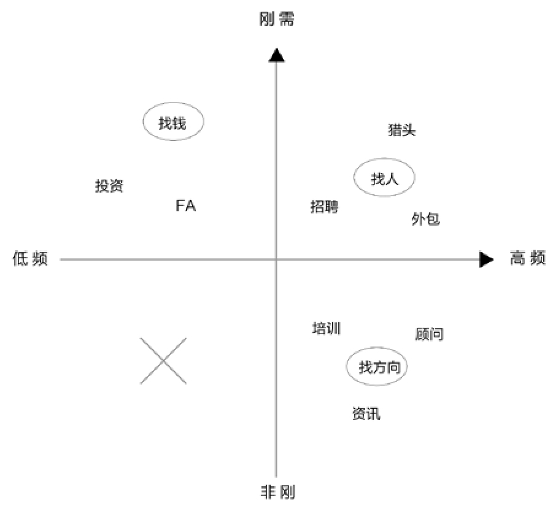

## 3.4　概念筛选的综合案例

本章的最后，说两个产品概念筛选的综合案例。

### 3.4.1 　案例1：阿里旺旺的成与败

2013年，在和几位同事一起整理旺旺产品发展史的过程中，给我最大的体会就是：

**做产品要顺势而为。这个势，说大点是行业的浪潮、公司和产品的基因，说小点是用户群体的特质、需求的特性、场景的特点**
。

旺旺的前身是2003年就有的阿里巴巴的贸易通，2004年在代码上略做改动做出了淘宝旺旺，后来合并成阿里旺旺，再又逐渐细分为中文站版、淘宝买家版、淘宝卖家版。自始至终，这个产品的出身，已经决定了它的“交易工具”属性、“电子商务IM”定位，这既成了它的优势，也成了它的瓶颈，或者说，成为了它的基因。

旺旺的子账号体系是QQ没有的。因为QQ的用户是个人，而旺旺某些版本的用户，其实背后是一个企业，企业需要一个统一对外的沟通工具。这就像一个企业的热线电话，一个人接听肯定忙不过来。所以，电话有了分机，旺旺有了子账号，并且还延伸出“智能分流”、工作台等工作场景特有的特性。

而对于买家个人使用的旺旺，一些成功之处也是由场景而来，比如聊天窗口里展现交易的各种信息：发个宝贝链接，直接能看到宝贝缩略图，窗口右边可以直接完成购买、查看物流的动作。对于一个通用IM，很难定制同样的功能。哪怕是聊天窗口里调用Windows的计算器这样一个看起来很没技术含量的特性，都有很多旺旺用户使用，因为交易的过程要简单算算，而你如果把这个特性放在一个通用IM上，就很诡异。

**对一类用户、需求、场景的深入定制，一方面可以成就一个产品，成为对手进入的壁垒，另一方面，这堵墙也有可能成为这个产品的牢笼。**

“上班用旺旺，下班用QQ”，这是2007年旺旺想达成的目标。当时，QQ的用户数虽然多，但还不足以一统江湖，而QQ的低龄化、娱乐化也远比今天明显，公司白领上班时还有很多人在用MSN、雅虎通，旺旺完全有机会切入这个市场。没曾想，由于旺旺用户和淘宝网的特性，绝大部分白领在使用旺旺时都不是在工作，而是在买东西。于是，逐渐地有企事业单位禁止员工上班时间逛淘宝网，自然也禁止员工使用旺旺。虽然禁肯定是禁不住的，但用户在旺旺上的好友关系以及对旺旺的认知，已经很难扭转，真是成也萧何败也萧何。

### 3.4.2 　案例2：B12在方向上的思考

说说现在我自己的一家公司，在2016年初新选择的方向。公司叫“B12”，是做创业服务的，潜在的目标用户其实很广，需求也很多，我们做了如下筛选。

**B12的核心用户要满足的条件**

行业：我们在互联网行业和传统行业之间选择了前者，因为更熟悉。

►**客户公司规模：**
刚刚有想法的三五个人的团队，还是已经拿到A轮B轮C轮，甚至更大的公司？我们选择了从种子到A轮规模的公司。

►**地域：**
先服务用户最多的北京，还是先服务人脉更广的杭州？我们选择了杭州，先做地头蛇。

►**具体的用户：**
是创业公司里比较基础的岗位，还是他们的高层、合伙人级别的用户？我们选择了后者。

筛选的讨论过程并不短，甚至还可以再增加多个维度，但想清楚这个最关键。

**B12的需求场景是帮助创业者找方向**

创业者的需求无非是找人找钱找方向。我们画了如[图3-9](#figure-3-9)所示的一张频度高低、刚性强弱的四象限图。

►右上，高频刚需，对应“找人”，常见的业务形态有招聘、猎头、外包等，市场大，竞争激烈。

►左上，低频刚需，对应“找钱”，常见的有投资、FA（指帮人找融资的服务）。

►左下，低频非刚需，不值得做。

►右下，高频非刚需，对应“找方向”，常见的有培训、咨询顾问、新闻资讯等。

我们结合自己的优劣势，最后定了一个切入点：通过牛人来帮助创业者找方向，或者说修正方向。

下面解释一下理由。

<figure id="figure-3-9" tabindex="-1" markdown="1">

{ width="379" height="348" }

<figcaption markdown="span" style="margin:0.5em auto;font-size:0.8em;font-style:normal;line-height:1.5">
图3-9　早期创业者的需求
</figcaption>

</figure>

**B12的产品概念偏内容，覆盖媒体及一些服务**

我们陆续推出了“B12大话”，线上分享；“B12大会”，线下峰会；“B12学堂”，小班培训、实战；“B12私教”，上门分享，等等。这些都是在服务核心用户，帮助他们去找方向。

我们筛选的思路及规划的竞争优势如下。

内部的能力方面，B12原来只是一个自媒体，2015年还不到10个人，2016年初已经扩展到30人左右的团队，可以做更多的事情了，2015年下半年，拿到了财经作家吴晓波的狮享家基金的投资，也有了一些行业资源。而且在杭州的创业圈也积累了一点品牌影响力。

意愿方面，我们一直以来就是想帮助创业者，口号是“让创新得到赞赏”。本来是想通过媒体只赞赏那些优秀的创业者，现在加上了“帮助那些不是那么优秀的创业者”。

再到外部价值分析。国家的双创政策是一个利好因素，对传统企业而言，转型也是一个大趋势。我的另外一家公司，叫作良仓孵化器，也是做创业服务的；还有我们的兄弟公司盈动资本，是做投资的，同样在为创业者服务。以上这些公司整体上其实是一个小的生态圈，可以形成联动。

外部的行业环境方面，其实有很多类似的公司，比如36氪，以及传统的培训公司、猎头公司、投资公司和孵化器。所以，还是要找到足够精准细分的切入点，才能确保生存和发展。

综上所述，B12的产品概念可以概括为，**我们认同创新，鼓励创业精神**
——**筛选出最优秀的创业者，树立为榜样赞赏他；还不那么优秀的创业者，在能力上帮助他**
。

当然，产品概念环节想清楚，或者自认为想清楚，和最后的成事，还差着十万八千里。就在我写书的过程中，B12的方向依然在不断调整，不断探索。

