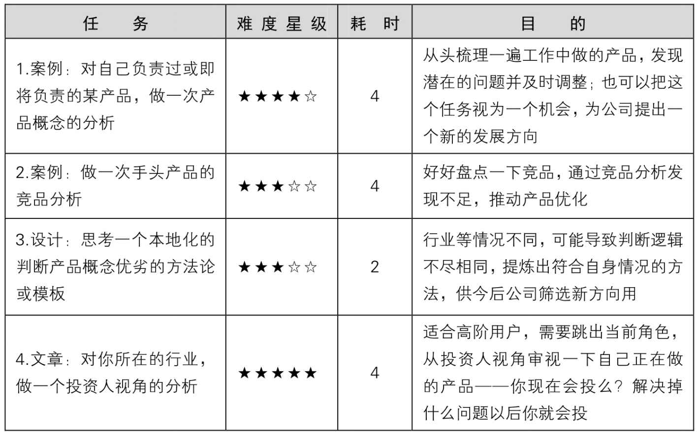
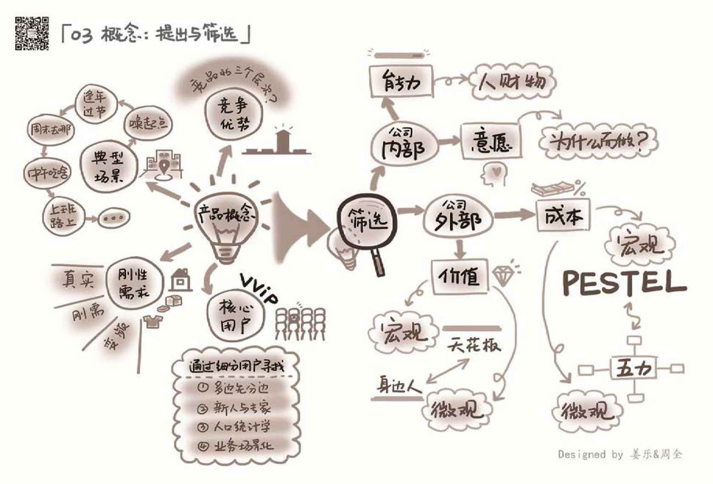

## 3.5　延伸阅读与练习

本章关联到另外几本书的相关章节如下。其中的表情表示推荐阅读（笑脸）与选择阅读（冷漠脸），亦可根据一些关键词扩展阅读。

<figure markdown="1">

{ width="355" height="124" }

</figure>

可以做的练习任务如下。

<figure markdown="1">

{ width="623" height="386" }

</figure>

<figure markdown="1">

{ width="824" height="558" }

</figure>

---

[[1]](../02/index.md#footnote_quote_txt004_1)
现场时间较短，产品概念描述的不够完善，而且定位也完全跑偏了。多年以后，市场上出现很多“儿童防丢手环”，而我们当时的竞品标的是“传统非智能长命锁”。

[[2]](../02/index.md#footnote_quote_txt004_2)
MECE的全称是 Mutually Exclusive Collectivly Exhaustive，中文意思是“相互独立，完全穷尽”。也就是对于一个重大的议题，分类要能够做到不重叠、不遗漏，而且能够借此有效把握问题的核心，并解决问题。它是麦肯锡的第一个女咨询顾问巴巴拉·明托（Barbara Minto）在金字塔原理中提出的一个很重要的原则。

[[3]](../03/index.md#footnote_quote_txt004_3)
潜在用户是指你目前还覆盖不到，但是通过产品的发展、扩张，将来可能会和你产生关系的那群人。

[[4]](../03/index.md#footnote_quote_txt004_4)
但产品长大以后，切不可再自以为自己理解各种用户。

[[5]](../03/index.md#footnote_quote_txt004_5)
MVP是指最小可行产品（本书后续章节会详细介绍）。

[[6]](../03/index.md#footnote_quote_txt004_6)
如果你发现其他作者的文章中，这几个词意思不同，一般是因为定义造成的差异，请结合上下文理解。

[[7]](../03/index.md#footnote_quote_txt004_7)
迈克尔·波特（Michael Porter）于20世纪80年代初提出这个模型，认为行业中存在着决定竞争规模和程度的五种力量，这五种力量综合起来影响着产业的吸引力以及现有企业的竞争战略决策。

