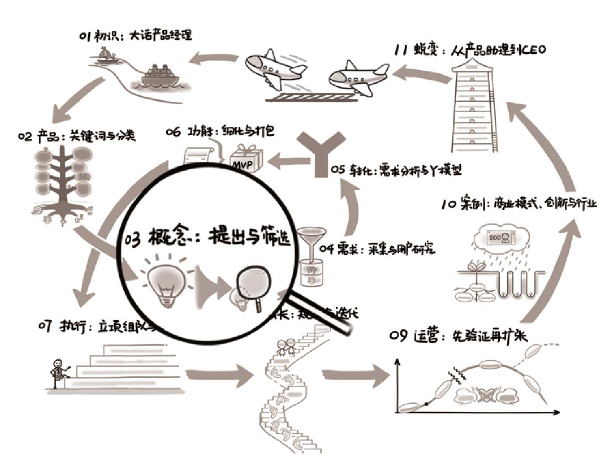

## 第03章　概念：提出与筛选

<figure markdown="1">

{ width="634" height="474" }

</figure>

**第03章　概念：提出与筛选/67**

**3.1　产品概念的提出/69**

3.1.1　核心用户/69

3.1.2　刚性需求/70

3.1.3　典型场景/71

3.1.4　产品概念/71

3.1.5　竞争优势/72

**3.2　概念提出的综合案例/76**

3.2.1　案例1：智能长命锁/76

3.2.2　案例2：淘宝首页/78

**3.3　产品概念的筛选/82**

3.3.1　内部因素：能力/83

3.3.2　内部因素：意愿/84

3.3.3　外部因素：价值/84

3.3.4　外部因素：成本/88

**3.4　概念筛选的综合案例/91**

3.4.1　案例1：阿里旺旺的成与败/91

3.4.2　案例2：B12在方向上的思考/92

**3.5　延伸阅读与练习/94**

