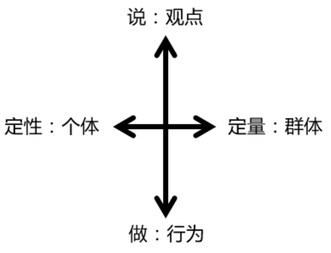
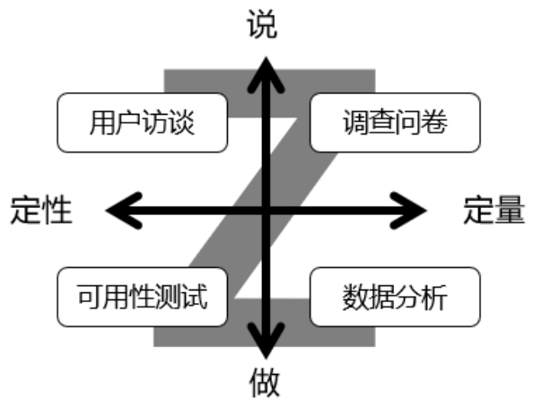

## 4.1.2 　说和做，定性与定量

接下来，从另一维度来对需求进行分类。可以用如图4-1所示的两个关键轴把所有需求采集方法分成四类：说、做、定性、定量。

<figure markdown="1">

{ width="230" height="174" }

<figcaption markdown="span" style="margin:0.5em auto;font-size:0.8em;font-style:normal;line-height:1.5">
图4-1　说和做，定性与定量
</figcaption>

</figure>

纵向是说和做。

怎么说表达了观点，怎么做反映了行为，用户怎么说和怎么做经常是不一致的。“说”最大的劣势是“耳听为虚”，怎么解决耳听为虚呢？看他怎么做。“做”的优势就是“眼见为实”，但也有劣势：我们不知道用户为什么这么做，背后的原因是什么，也就意味着没法从根本上解决问题。于是，需要再去听他如何说。所以说和做是一对不可分拆的方法，尽量同时用于一次需求采集，否则可能会出问题。

横向是定性与定量。

定性研究可以找出原因，偏向于了解，属于个体研究；而定量研究可以发现现象，偏向于证实，属于群体研究。定性的问题是“以偏概全”。如果你的产品有几百万用户，而定性研究经常只针对几十个用户，那么这几十人是否能代表全体？这种情况下很可能被部分样本的特殊情况带入歧途，所以要辅以定量的方法。但是定量会“以表代本”，只能用来发现表面的现象，却无法从中知道背后的原因。比如，通过定性的数据发现7月份用户活跃度比6月份降了5个百分点，那么，就可以抽取几个6月活跃但7月不活跃的用户，做一个定性的访谈，来搞清楚到底发生了什么。

产品经理理解用户需求的过程，并不违背人类认知新事物的一般规律——从观点到行为，再从行为到观点，一样会从定性到定量，再从定量到定性，以实现螺旋式上升，使了解和证实在不断迭代中得到进化。

图4-1中两根轴划分出的四个象限，各对应一种常见的需求采集方法，分别为**用户访谈、调查问卷、可用性测试**
[[1]](../05/index.md#footnote_content_txt005_1)
**、数据分析**
，《人人都是产品经理》里有过详述。 沿着这些方法的使用顺序可以写出一个“Z”字，如图4-2所示。在需求采集的不同时期，可以有针对性地分别采用不同方法。这套简单有效组合拳，就是接下来要用案例加以说明的“Z字采集法”。

<figure markdown="1">

{ width="249" height="194" }

<figcaption markdown="span" style="margin:0.5em auto;font-size:0.8em;font-style:normal;line-height:1.5">
图4-2　Z字采集法
</figcaption>

</figure>

下面是一个我参与过的淘宝产品的完整需求采集过程。

►**产品规划阶段：**
听用户“定性地说”，确定产品方向（做什么）；随机抽样了40个用户做访谈，据此写出需求列表。

►**项目早期：**
听用户“定量地说”，确定需求优先级（先做什么）；投放了20万份调查问卷，确定了需求优先级的排序。当然，这只是确定优先级的辅助手段，最终做什么，还是由产品经理决定。

►**项目实施过程：**
看用户“定性地做”，确定要先实现的那几个需求应该怎么做；设计的同时完成可用性测试，其间陆续找了10个用户来验证。

►**上线后的优化阶段：**
看用户“定量地做”，根据产品的用户使用情况做数据分析，不断地改进产品。

“Z字采集法”也有一个螺旋上升的循环，数据分析以后，通常又会做用户访谈来证实数据分析的假设。

当然，这是一个比较重要的产品，所以在用户研究上投入了较多的时间与人力。更多的时候，会视情况采取简化的方案。而每种方法具体怎么运用，网上资料很多，本书不再赘述。

接下来看一些其他划分方法。

