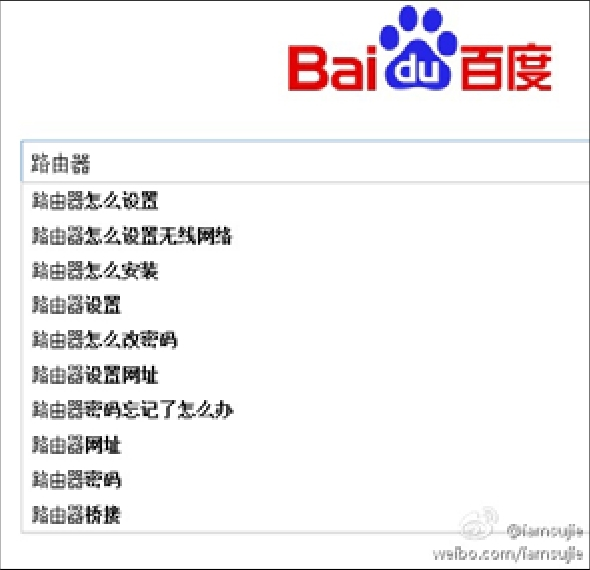

## 4.2　一些实用的采集方法

对于需求采集与用户研究方法，《人人都是产品经理》里系统化地讲过不少具体操作、可能遇到的问题及其对策，其他相关资料也有很多，这里只介绍几个简单、好用的实践策略。

腾讯的10.100.1000　，相信很多产品经理都听说过：产品经理每个月必须做10个用户调查，看100篇用户写的相关文章，处理1000个用户反馈。其实不用纠结数字和形式，关键是要保持和用户接触的强度。

在阿里，我待过的一个团队会逼产品去做客服，由此来迅速熟悉用户。有条件的可以让新人去客服部门轮岗数周到数月，没条件的也可以让产品经理每个月听半天的客服电话。同理，产品经理去做销售，哪怕作为技术支持人员陪同销售去见客户，也能大大加深对用户的理解。

还有一种很有意思的方法：请一群用户到公司里面开批斗会。开会的内容很简单，让用户来骂我们。一开始用户可能不好意思，说得不痛不痒，这时候可以找几个自己人作托，先骂几个“厉害的”让大家见识见识，然后你就会发现用户全都放开了。最后记得再给用户一些小礼物，让他们体会到我们的真心实意。

利用网络也是好办法，比如这个例子：智能路由器厂家的产品经理，可以试试用百度搜索关键词“路由器”，搜索引擎的大数据就会告诉我们很多用户痛点，如[图4-3](#figure-4-3)所示。比如非技术出身的用户，普遍都搞不清家里网络环境设置中的三组账号密码[[3]](../05/index.md#footnote_content_txt005_3)
到底是怎么回事，所以路由器产品可以对相关设置进行更多的引导和简化。

<figure id="figure-4-3" tabindex="-1" markdown="1">

{ width="247" height="239" }

<figcaption markdown="span" style="margin:0.5em auto;font-size:0.8em;font-style:normal;line-height:1.5">
图4-3　百度搜“路由器”的联想
</figcaption>

</figure>

类似地，用微博搜索自己产品的关键词，也经常能发现很多抱怨，可以直接找到这些用户，进行一对一的沟通。

还可以看各种报告和公开数据，比如百度指数、各种搜索榜单，微博、微信朋友圈的热门话题，各种应用商店里的排行。仔细看能从中发现很多需求和趋势。经常看到的各种追热点的营销活动，背后都有着一群时刻蹲守在网上、嗅觉灵敏的从业者。

所有的需求采集，本质上都是为了多接触用户、和用户做朋友。这个说法其实是从小米那里来的。既不要从上往下俯视用户，也不要跪舔用户，对用户言听计从、卑躬屈膝，这样都没办法建立起情感的链接。真正能交成朋友的其实是比较平等的两个人，平等意味着可以更充分彻底、掏心窝子地沟通。

还有一些用户研究的小技巧，可以通过学习心理学、社会学的相关知识了解，这里只说一个很有趣的小例子。

假设一家汽车公司想了解大学毕业二、三年的人在选择第一辆车时，预算是多少。如果直接问用户“你买第一辆车的预算是多少”，得到的答案就很可能会有偏差。比如，有的人预算只有5万，但自己觉得有点少，说出来挺不好意思，可能会告诉你八万到十万；而另外一位富二代，也许第一辆就打算买个百万的豪车，但不想露富，于是跟你说三、五十万左右。这时候，你可以这么问——“假设你最好的朋友要买车，你觉得他的预算是多少”，就可以排除掉大部分的偏差。

