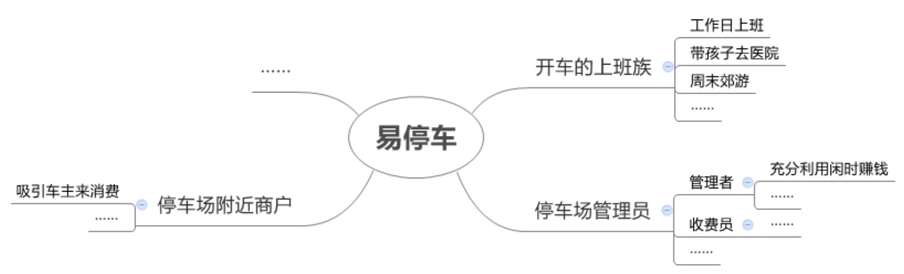
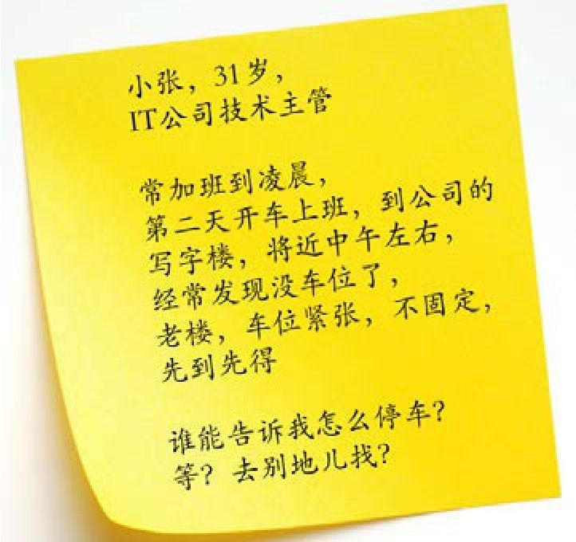
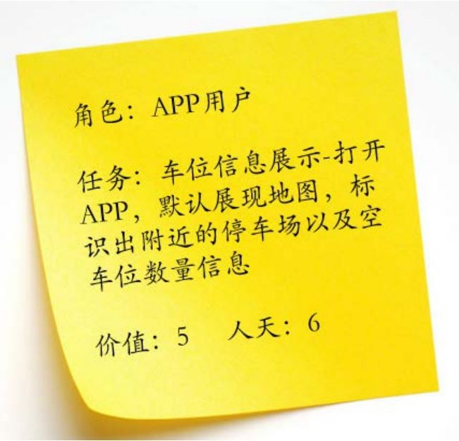
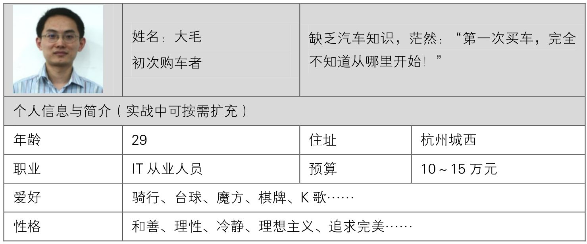
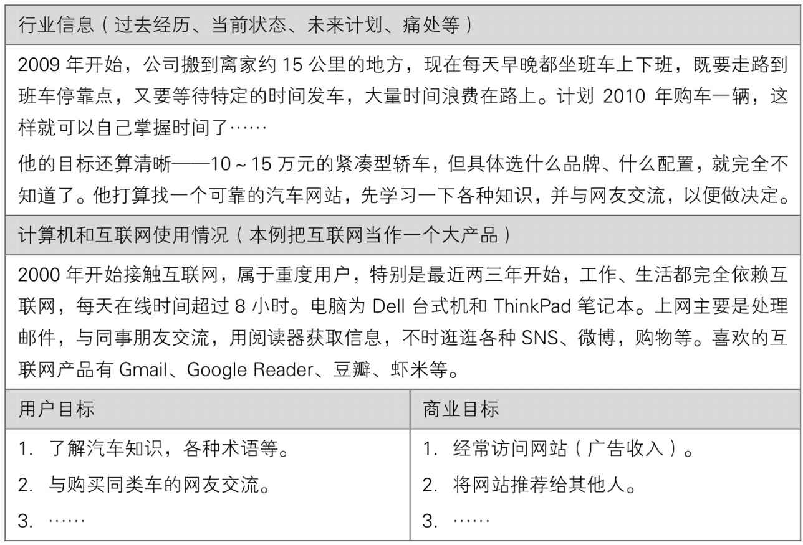

## 4.3.3 　用户：抽象到具象再到抽象

随着信息收集得越来越多，我们对用户的理解也越来越透彻，可以分为以下三个阶段。

►**第一阶段，用户是抽象群体**
：在产品概念阶段，用户是假想的某一类人——目标用户、核心用户。

►**第二阶段，用户是具象个体**
：需求采集时，我们要去接触一个个真实的用户，见活人，听故事，找感觉，发现“用户故事”。

►**第三阶段，用户又是抽象群体**
：整理采集到的需求时，把真实用户再合并特征，定义出“人物角色”，并反向修正产品概念。

在产品概念阶段定义的用户需求场景是产品的切入点，要靠产品经理的经验和经历来做出假设，有点纸上谈兵。所以纯新人，对这个行业了解甚少的人，没有办法做这个早期的定义工作。然后，试着扩展产品可能涉及的各种用户，去见具象个体，回来后修正用户需求场景，再去见另一批个体，如此循环下去。

举个例子，一次实战演练时，大家提出一个叫“易停车”的App产品概念，切入点是：解决开车上班族（抽象群体）每天到公司很难找到停车位的问题。接下来，在去真实场景中采集需求时，有可能涉及其他用户群体，包括停车场的管理员及停车场附近的商户。

有了这些假设，就去约相应的个体聊，过程中可以发现很多活灵活现的需求。比如，对于开车的上班族，除了工作日上班这个典型场景（规律性、长期），还有带孩子去医院（突发性、费用不敏感）、周末郊游（偶发性、希望长时间停车能便宜点）等其他场景。

聊完后，再用这些信息逐步抽象出类似图4-5这张思维导图的一棵树[[5]](../05/index.md#footnote_content_txt005_5)
。图中以产品概念为核心，先分用户（可能多级），再分需求场景（也可能多级）。

{ width="641" height="194" }

图4-5　易停车的用户需求场景导图

这棵树的主干节点是“人物角色”，分支节点可能是细化的“人物角色”，也可能是某个人物角色的需求场景，而末端的叶子，就是接下来要说的“用户故事”。

**工具：用户故事**

大家不妨先回忆一下产品概念里提过的“刚性需求”和“典型场景”，这些概念是抽象的，是还未经验证的假设。

去见真正的用户，能听到一个个具体、鲜活的需求场景，这就叫作“用户故事”。

继续以“易停车”为例。图4-6就是一个典型的“用户故事”，更多有故事感的细节，可以看图：小张是一家IT公司的主管，如前一天加班，第二天就会晚点去上班，到公司时已将近中午，经常找不到车位，那么他该怎么办呢？

{ width="303" height="285" }

图4-6　小张的用户故事（需求）

这就是易停车里，“开车的上班族”（人物角色）在“工作日上班”（需求场景）下的一个“用户故事”。实操过程中，可以把这样的卡片贴在树形思维导图相应的末端节点旁。

有一个和它有点像的词叫“用户任务”（这是第06章的主题）。用户故事是描述问题，而用户任务是描述解决方案，结合图4-7的例子，应该能体会到二者很明显的差别。

只要去采集需求，就可以获取很多用户的故事。这些故事既是后续设计产品功能的原材料，也有助于一步步明确“人物角色”的分类与描述。

{ width="273" height="262" }

图4-7　小张的用户任务（功能）

**工具：人物角色**

“人物角色”是一个对整个产品生命周期都很重要的工具，也叫“用户画像”，是指根据一些具体的用户故事，对某类目标用户的汇总描述。它可以用来帮助团队内部达成共识。特别对于新人和平时不怎么参与讨论的外围同事、老板，这一工具可帮助他们分清一个产品的多个人物角色，及其优先级。很多资料都提到过这个工具具体的制作和使用方法，此处不再赘述。

有了这个工具，最直接的转变就是，很多平时对产品的讨论就可以从“我喜欢”、“你认为”转变为“王大毛会需要这个产品吗”。

下面的例子是我在《人人都是产品经理》中就用过的，时间背景是2010年。再看一次，顺便感受一下短短7年时间里互联网行业的变化。

表4-1　人物角色示例

{ width="616" height="251" }

续表

{ width="616" height="415" }

从这个例子中可以发现，人物角色会随着时间的变化而变化，我们也要与时俱进。比如，校内网一开始的用户都是在校生；随着他们的毕业，如果依然要把他们定义为目标用户，继续服务他们，就需要增加“毕业生”这样一个人物角色。

**两种典型用户：新手与专家**

经常抽象出的人物角色可能是这样的：健身菜鸟，白领王喵喵；重度二次元宅男，李汪汪；网购海淘达人，孙小美；初次购车蒙圈男，王大毛……其中，可以提炼出很重要的两类抽象用户群体——新手与专家。

前面讲过，**每个产品都会面向多种多样的用户，只不过有主次之分**
。有一种很常用也很好用的用户分类方法，就是按照用户对产品所在领域的熟悉程度，把他们分为新手、专家和中间用户。其中，新手和专家是需求差异最明显的两个用户群体，对产品尤其重要，产品经理需要尽早识别出自己产品最核心的用户属于二者中的哪个群体。

新手是一群不爱看说明书、急于直接上手、用得不爽就很懊恼、很轻易就放弃的产品用户，要的是**简单易用、快速上手**
。

专家是一群会看说明书、会泡论坛、会查攻略、乐于接受挑战的产品用户，要的是**稳定可靠、性能高**
。

核心用户是新手的典型产品，是那种用户量很大的大众产品，比如电梯、公厕、垃圾桶等公众设施；电视、冰箱、洗衣机等普通家用电器。任何领域的专家总是少数，所以核心用户是专家的典型产品，往往用户量很小，比如医院或工厂的专业仪器、乐器、专业级数码设备等。总体来看，2C的产品新手用户更多，2B的产品专家用户更多；前台产品的新手用户更多，后台系统的专家用户更多。

举个例子，来对比一下数码相机中的傻瓜式卡片机与高端单反。

►**产品本身**
：前者按键很少，轻薄美丽，对用户友好，只要按快门即可拍照；后者机身上有一堆按钮，又重又大，你需要自己进行复杂设置才能拍出高质量的“大片”。

►**营销渠道**
：前者通过电视、户外灯箱等来触达大众；后者通过专业论坛、杂志、展会来触达专业玩家[[6]](../05/index.md#footnote_content_txt005_6)
。

►**广告内容**
：前者通常展现一家人、朋友间其乐融融的画面；后者要告诉你ISO1.8.0　可用、高速摄影追焦很棒，要给你看各种样张。

也正是因为以上这些特点，傻瓜式卡片机基本已被具备拍照功能的智能手机所取代，毕竟这类新手用户要的只是“简单记录”。

专家级产品有时候会考虑“**向下兼容**
”。比如Canon的1D单反相机，调到自动挡后直接按快门也能拍照。再如一些互联网、软件产品，往往也采取向下兼容的做法，将更多功能隐藏在“高级设置”里，让新手用户上手更容易。

当然，**随着时间变化，一个产品的核心用户也会变化。**
有从新手变为专家的， 一直拟物化的苹果手机操作系统从iOS 7开始扁平化就是一个很好的例子，用户更加追求效率。也有从专家变为新手的，比如自动档汽车相对于手动档汽车的比例越来越高，家用路由器的设置变得越来越傻瓜、友好。

移动互联时代，随着各种需求场景的碎片化，意味着用户，特别是C类用户的使用行为越来越“浅尝辄止”，成为专家的可能性越来越小。所以，各种产品对新手的友好越来越重要。这事儿想深一层也很有意思，总觉得人们作为“用户”这个身份，被各种体验优秀的产品宠得越来越浅薄了，我们在逐步地把控制权移交给机器、算法，以及背后的产品经理，但这样真的好吗？这也是为什么我坚信每个人都应该具备一点产品修养的理由之一。

