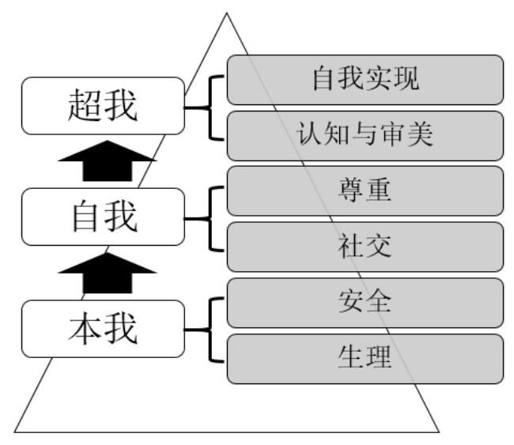

## 4.3　用户、需求的再理解

本书花了巨大的篇幅来帮助读者理解用户、需求，是因为我觉得这是做好产品经理的基础，怎么强调都不为过。接下来，进一步辨析一下需求的“三种深度”。需求深度与产品经理的功力直接相关，不同产品经理能挖掘到的层次并不相同。

### 4.3.1 　需求的三种深度

►**第一种深度——观点和行为。**
表面能听到、能看到的东西，一般是通过用户怎么说、怎么做直接表现出来。如果只到这个层次，是做不好产品经理的。

►**第二种深度——目标和动机。**
用户为什么这么说、这么做？如果能找到目标和动机，会稍微好一些。但相对第三层，这里还是要实在一些。比如，用户说希望开始每天健身、跑步，目标是减肥。再往深层挖，其价值观层面的需求可能是为了在朋友面前呈现出积极向上、健康的自己。

►**第三种深度——人性和价值观。**
最底层的，最稳定的需求，人类社会诞生的千万年来，基本上没怎么变。如果能把需求挖掘到这个层次，就找到了产品最本质的用户价值。

**第三种深度的需求**

马斯洛需求层次理论是对人性需求最常见的解读，它和弗洛伊德本我、自我、超我的理论有很多互相印证的地方。如[图4-4](#figure-4-4)所示[[4]](../05/index.md#footnote_content_txt005_4)
，生理、安全基本上对应着“本我”这个层次，属于生物人的范畴，和动物差别不大；社会交往、尊重基本上对应着“自我”这个层次，属于社会人的范畴，人只有存在于社会中，才有这两类需求；认知与审美、自我实现对应着“超我”这个层次，属于意识人的范畴，是精神层面的需要。一般而言，低层需求得到较好满足后才会产生高层次需求，比如衣食无忧后才会产生体验人生多样性的想法，比如进行一次自虐旅行或看一部恐怖电影。

<figure id="figure-4-4" tabindex="-1" markdown="1">

{ width="272" height="236" }

<figcaption markdown="span" style="margin:0.5em auto;font-size:0.8em;font-style:normal;line-height:1.5">
图4-4　人性需求的层次
</figcaption>

</figure>

这个模型里，越下层的需求越普适、刚性、工具化，也越难出彩；越上层的需求越细分（场景、时间、空间）。这对做产品也有启发：一个产品所在的市场，随着逐渐成熟和竞争日趋激烈，对用户需求的满足也遵循着类似的规律。比如供给相对丰饶的互联网产品市场，会逼着产品经理们不断去思考更多的高层次需求。再比如，食品要优先满足消除饥饿的需求，然后才是好吃、健康、用餐环境、文化内涵、与众不同，等等。越靠后的需求，其市场越细分。

好的理论，往往放之四海皆准，除了适用于产品经理，《西游记》中取经团队五个角色的核心诉求，对应了马斯洛需求中的五个层次，令人叫绝。

八戒对应生理需求，喜欢女色、大吃大喝等，有事没事就要分行李回高老庄；沙僧对应安全需求，他最经典的台词就是：大师兄，师傅被妖怪抓走了；唐僧对应尊重需求，尊重其实是一种责任感，唐王给了他一个使命，他就使命必达，历经九九八十一难愈挫愈勇；悟空对应自我实现，没活干就难受，从没人给他分派打妖怪的任务，这种主动性、积极性就是自我实现；白龙马对应社交需求，团队里面就他因工作需要一直不是人形，很容易被忽略，所以很缺乏归属感，需要别人认可他也是团队一员。

还有一部电影叫《七宗罪》，给出七种负面人性。虽是一部经典犯罪电影，在日常接触的一些产品中，其实都可以一一找到印证。

**暴食：**
吃货国这个词可不是白给的，为了好吃的，我们可以做任何事。

**贪婪：**
明明用不了那么多，但因为促销、打折、免费、补贴而买买买。

**懒惰：**
干啥都不想出门，各种上门服务应运而生。

**嫉妒：**
排行榜、攀比式刺激——你的×××打败了多少小伙伴。

**骄傲：**
动不动给你发个虚拟的勋章、成就、身份，刺激一下。

**淫欲：**
很多网站都用一些打擦边球的美女图片来吸引用户。

**愤怒：**
网络喷子的戾气，在各种社群里随时可见，也为活跃度做出了巨大贡献。

此外还有很多类型的人性，有正面也有负面，比如好奇、同情、从众、恐惧，等等，都可以找到相应的产品案例来揣摩、体会。

**案例：逛超市的需求**

试着用刚才说的三种深度分析一下，逛超市的需求到底是什么。

**观点和行为**

用户说想逛超市，可以去实体店，也可以去网上超市浏览、选择、下单。绝大多数人逛后或多或少都会买点东西。这个深度上，用户几乎都一样，看不出什么差别。

**目标和动机**

有人可能要一次性补充家里几周的日常所需，所以会特意开车去郊区的仓储式超市批量采购。有人可能是晚饭后散步消食，走到了家门口附近的超市，顺便买了点零碎的小商品。有人喜欢逛网上超市，是因为这样能买到一些小众商品。有人必须要逛进口商品超市，因为对生活品质有着严格的要求，而且想感受高级的购物体验。有人把逛超市视为一家人一起聊天、增进感情的机会和最佳场景（逛其他任何地方，都会有人没需求或感到无聊，只有在超市，男女老少都能找到一些自己需要的东西，还可以通过互相建议找到共同话题），等同于参与一次家庭团建。

到这里，目标和动机开始不一样了。

**人性和价值观**

更多的细分开始出现。比如逛网上超市的人，有为了省钱的妻子，她觉得应该勤俭持家，打造一个贤良淑德的形象；有为了省时间的职场人，他觉得应该把更多时间用来打拼，从而获得更好的社会地位；有为了买限量版商品的玩家，他就要有一种与众不同的感觉，这样在玩家圈子里可以炫耀、获得羡慕的目光；有行动不便的老人，本来买任何东西都要别人帮忙，现在可以自己搞定了，他获得了一种自尊。

作为产品经理的你，恐怕也不得不针对这些细分不断地去思考，怎样才能更好地满足各种需求。

### 4.3.2 　如何理解战略需要这类内部需求

先说个段子：淘宝商城的早期，逍遥子是老大。有一段时间，运营发现向产品提需求时有一招特别好使，就是说“这个需求是逍遥子要的”。实际情况也许是，但很多时候是在某个会议上运营问了逍遥子一个问题，逍遥子没有当场否决，而是采用“你可以去试试”之类的委婉表达。然后，有些同学就顺势拿着鸡毛当令箭。一开始，产品经理们也没啥办法。渐渐地这类需求越来越多。终于，有人想出了一个杀招，以后大家对这类指令统一回复“那你让逍遥子来找我”。一切就清净了。

当然，这个结果背后需要有开放、平等、透明等企业文化的支撑。而我想通过这个段子说明的是，老板说要做的，并不一定是最本质的需求。

战略、需要这类来自公司内部的需求，是产品经理工作中经常会碰到的。还会有一些来自各种岗位同事的内部需求，比如：运营要求营销活动可自由配置中奖率；产品经理自己要求监控各种数据；开发评估出来的性能要求；客服需要一个可以半自动处理用户反馈的后台；实施过程中还会冒出来各种限制条件……

怎么理解这些内部需求和狭义用户需求的关系？

首先，因为提出者都是广义用户，所以这些需求都要考虑，但要判断主次。

然后，要分清楚手段和目的。公司成立后，通过服务外部用户、满足外部用户价值来实现商业价值才是最终目的，而搭建团队只是达成目的的手段。

特别值得一提的是KPI（Key Performance Indicator，关键绩效指标）。它本是战略落地的手段，用来衡量战略的完成度，但经常被误以为是目的，变成了片面追求的数字。我们一起来回顾几个让人哭笑不得的KPI。

第一个KPI，提高火车的上座率。

有个地方想出一个超级有效的办法：把车厢数减少，比如16节变8节，上座率直接翻倍。

第二个KPI，改善北京的空气质量。

北京蓝天数由98年的100天提高到2010年的286天，但空气质量并没有改善，只是更改了监测站的地点。2006年，关闭了当时两个空气污染最严重的监测站，2008年又将监测站搬到六环以外远离市中心15到20公里的地方。这样，空气质量的平均水平得到显著提高。

第三个KPI，校车不能再出事故了。

新闻里说，受甘肃幼儿园校车事故及各部门严查校车的影响，多所学校决定取消校车接送。为了送孩子上下学，家长们各显神通，有的包三轮车，有的拼租面包车，有的自己抽时间接送。

第四个KPI，春运不能让一个学生站着回家。

如果你去学校附近的代售点买票，问：有卧铺吗？答：没有。又问：坐票呢？又答：也没有。再问：站票呢？再答：有，但是不卖给学生！

终极问：为什么？终极答：因为铁道部规定，今年春运不让一个学生站着回家！

上述例子有些夸张，但为了满足公司战略需要，伤害用户的情况确实比比皆是。这是公司规模变大后很难杜绝的现象，牵涉到一个很深刻的管理学命题：各层员工到底对谁负责？当然，这不在本书讨论范围内。

由以上分析可知，最重要的用户还是外部的。满足任何战略需要的内部需求时，心里都要时刻想着外部用户，防止本末倒置。战略需要而用户不需要的产品，往往没有好下场。

### 4.3.3 　用户：抽象到具象再到抽象

随着信息收集得越来越多，我们对用户的理解也越来越透彻，可以分为以下三个阶段。

►**第一阶段，用户是抽象群体**
：在产品概念阶段，用户是假想的某一类人——目标用户、核心用户。

►**第二阶段，用户是具象个体**
：需求采集时，我们要去接触一个个真实的用户，见活人，听故事，找感觉，发现“用户故事”。

►**第三阶段，用户又是抽象群体**
：整理采集到的需求时，把真实用户再合并特征，定义出“人物角色”，并反向修正产品概念。

在产品概念阶段定义的用户需求场景是产品的切入点，要靠产品经理的经验和经历来做出假设，有点纸上谈兵。所以纯新人，对这个行业了解甚少的人，没有办法做这个早期的定义工作。然后，试着扩展产品可能涉及的各种用户，去见具象个体，回来后修正用户需求场景，再去见另一批个体，如此循环下去。

举个例子，一次实战演练时，大家提出一个叫“易停车”的App产品概念，切入点是：解决开车上班族（抽象群体）每天到公司很难找到停车位的问题。接下来，在去真实场景中采集需求时，有可能涉及其他用户群体，包括停车场的管理员及停车场附近的商户。

有了这些假设，就去约相应的个体聊，过程中可以发现很多活灵活现的需求。比如，对于开车的上班族，除了工作日上班这个典型场景（规律性、长期），还有带孩子去医院（突发性、费用不敏感）、周末郊游（偶发性、希望长时间停车能便宜点）等其他场景。

聊完后，再用这些信息逐步抽象出类似[图4-5](#figure-4-5)这张思维导图的一棵树[[5]](../05/index.md#footnote_content_txt005_5)
。图中以产品概念为核心，先分用户（可能多级），再分需求场景（也可能多级）。

<figure id="figure-4-5" tabindex="-1" markdown="1">

{ width="641" height="194" }

<figcaption markdown="span" style="margin:0.5em auto;font-size:0.8em;font-style:normal;line-height:1.5">
图4-5　易停车的用户需求场景导图
</figcaption>

</figure>

这棵树的主干节点是“人物角色”，分支节点可能是细化的“人物角色”，也可能是某个人物角色的需求场景，而末端的叶子，就是接下来要说的“用户故事”。

**工具：用户故事**

大家不妨先回忆一下产品概念里提过的“刚性需求”和“典型场景”，这些概念是抽象的，是还未经验证的假设。

去见真正的用户，能听到一个个具体、鲜活的需求场景，这就叫作“用户故事”。

继续以“易停车”为例。[图4-6](#figure-4-6)就是一个典型的“用户故事”，更多有故事感的细节，可以看图：小张是一家IT公司的主管，如前一天加班，第二天就会晚点去上班，到公司时已将近中午，经常找不到车位，那么他该怎么办呢？

<figure id="figure-4-6" tabindex="-1" markdown="1">

{ width="303" height="285" }

<figcaption markdown="span" style="margin:0.5em auto;font-size:0.8em;font-style:normal;line-height:1.5">
图4-6　小张的用户故事（需求）
</figcaption>

</figure>

这就是易停车里，“开车的上班族”（人物角色）在“工作日上班”（需求场景）下的一个“用户故事”。实操过程中，可以把这样的卡片贴在树形思维导图相应的末端节点旁。

有一个和它有点像的词叫“用户任务”（这是第06章的主题）。用户故事是描述问题，而用户任务是描述解决方案，结合[图4-7](#figure-4-7)的例子，应该能体会到二者很明显的差别。

只要去采集需求，就可以获取很多用户的故事。这些故事既是后续设计产品功能的原材料，也有助于一步步明确“人物角色”的分类与描述。

<figure id="figure-4-7" tabindex="-1" markdown="1">

{ width="273" height="262" }

<figcaption markdown="span" style="margin:0.5em auto;font-size:0.8em;font-style:normal;line-height:1.5">
图4-7　小张的用户任务（功能）
</figcaption>

</figure>

**工具：人物角色**

“人物角色”是一个对整个产品生命周期都很重要的工具，也叫“用户画像”，是指根据一些具体的用户故事，对某类目标用户的汇总描述。它可以用来帮助团队内部达成共识。特别对于新人和平时不怎么参与讨论的外围同事、老板，这一工具可帮助他们分清一个产品的多个人物角色，及其优先级。很多资料都提到过这个工具具体的制作和使用方法，此处不再赘述。

有了这个工具，最直接的转变就是，很多平时对产品的讨论就可以从“我喜欢”、“你认为”转变为“王大毛会需要这个产品吗”。

下面的例子是我在《人人都是产品经理》中就用过的，时间背景是2010年。再看一次，顺便感受一下短短7年时间里互联网行业的变化。

<figure markdown="1">

<figcaption markdown="span" style="margin:0.5em auto;font-size:0.8em;font-style:normal;line-height:1.5">
表4-1　人物角色示例
</figcaption>

{ width="616" height="251" }

</figure>

<figure markdown="1">

<figcaption markdown="span" style="margin:0.5em auto;font-size:0.8em;font-style:normal;line-height:1.5">
续表
</figcaption>

{ width="616" height="415" }

</figure>

从这个例子中可以发现，人物角色会随着时间的变化而变化，我们也要与时俱进。比如，校内网一开始的用户都是在校生；随着他们的毕业，如果依然要把他们定义为目标用户，继续服务他们，就需要增加“毕业生”这样一个人物角色。

**两种典型用户：新手与专家**

经常抽象出的人物角色可能是这样的：健身菜鸟，白领王喵喵；重度二次元宅男，李汪汪；网购海淘达人，孙小美；初次购车蒙圈男，王大毛……其中，可以提炼出很重要的两类抽象用户群体——新手与专家。

前面讲过，**每个产品都会面向多种多样的用户，只不过有主次之分**
。有一种很常用也很好用的用户分类方法，就是按照用户对产品所在领域的熟悉程度，把他们分为新手、专家和中间用户。其中，新手和专家是需求差异最明显的两个用户群体，对产品尤其重要，产品经理需要尽早识别出自己产品最核心的用户属于二者中的哪个群体。

新手是一群不爱看说明书、急于直接上手、用得不爽就很懊恼、很轻易就放弃的产品用户，要的是**简单易用、快速上手**
。

专家是一群会看说明书、会泡论坛、会查攻略、乐于接受挑战的产品用户，要的是**稳定可靠、性能高**
。

核心用户是新手的典型产品，是那种用户量很大的大众产品，比如电梯、公厕、垃圾桶等公众设施；电视、冰箱、洗衣机等普通家用电器。任何领域的专家总是少数，所以核心用户是专家的典型产品，往往用户量很小，比如医院或工厂的专业仪器、乐器、专业级数码设备等。总体来看，2C的产品新手用户更多，2B的产品专家用户更多；前台产品的新手用户更多，后台系统的专家用户更多。

举个例子，来对比一下数码相机中的傻瓜式卡片机与高端单反。

►**产品本身**
：前者按键很少，轻薄美丽，对用户友好，只要按快门即可拍照；后者机身上有一堆按钮，又重又大，你需要自己进行复杂设置才能拍出高质量的“大片”。

►**营销渠道**
：前者通过电视、户外灯箱等来触达大众；后者通过专业论坛、杂志、展会来触达专业玩家[[6]](../05/index.md#footnote_content_txt005_6)
。

►**广告内容**
：前者通常展现一家人、朋友间其乐融融的画面；后者要告诉你ISO1.8.0　可用、高速摄影追焦很棒，要给你看各种样张。

也正是因为以上这些特点，傻瓜式卡片机基本已被具备拍照功能的智能手机所取代，毕竟这类新手用户要的只是“简单记录”。

专家级产品有时候会考虑“**向下兼容**
”。比如Canon的1D单反相机，调到自动挡后直接按快门也能拍照。再如一些互联网、软件产品，往往也采取向下兼容的做法，将更多功能隐藏在“高级设置”里，让新手用户上手更容易。

当然，**随着时间变化，一个产品的核心用户也会变化。**
有从新手变为专家的， 一直拟物化的苹果手机操作系统从iOS 7开始扁平化就是一个很好的例子，用户更加追求效率。也有从专家变为新手的，比如自动档汽车相对于手动档汽车的比例越来越高，家用路由器的设置变得越来越傻瓜、友好。

移动互联时代，随着各种需求场景的碎片化，意味着用户，特别是C类用户的使用行为越来越“浅尝辄止”，成为专家的可能性越来越小。所以，各种产品对新手的友好越来越重要。这事儿想深一层也很有意思，总觉得人们作为“用户”这个身份，被各种体验优秀的产品宠得越来越浅薄了，我们在逐步地把控制权移交给机器、算法，以及背后的产品经理，但这样真的好吗？这也是为什么我坚信每个人都应该具备一点产品修养的理由之一。

