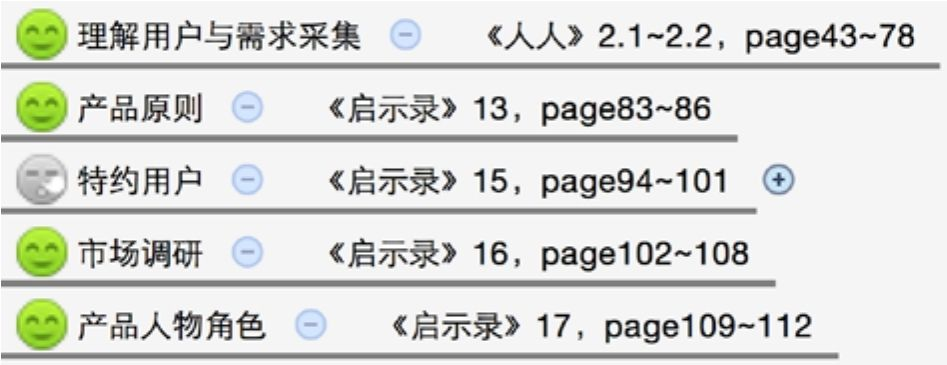
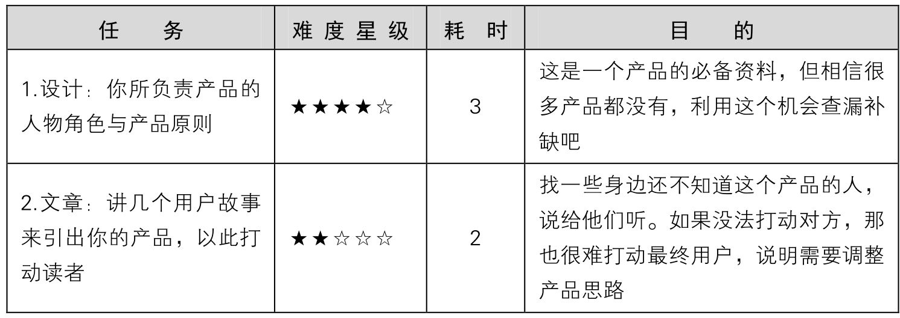
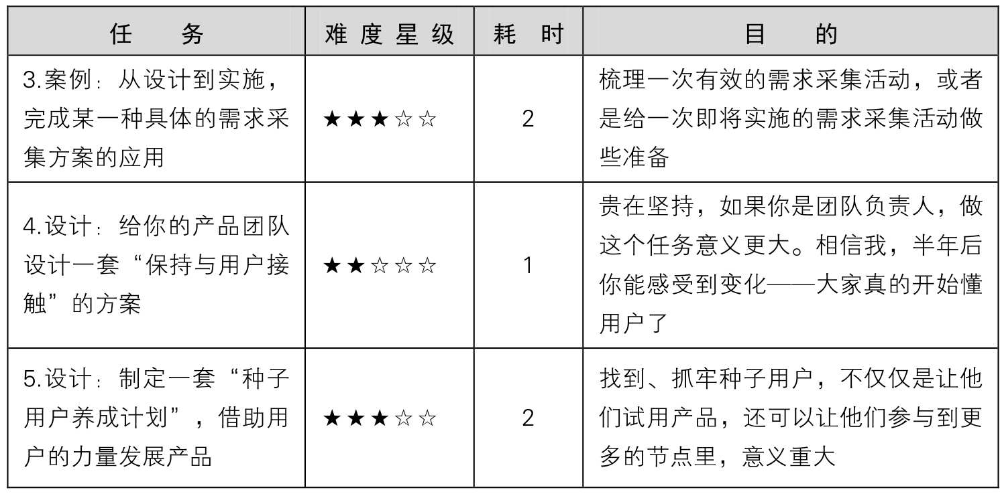
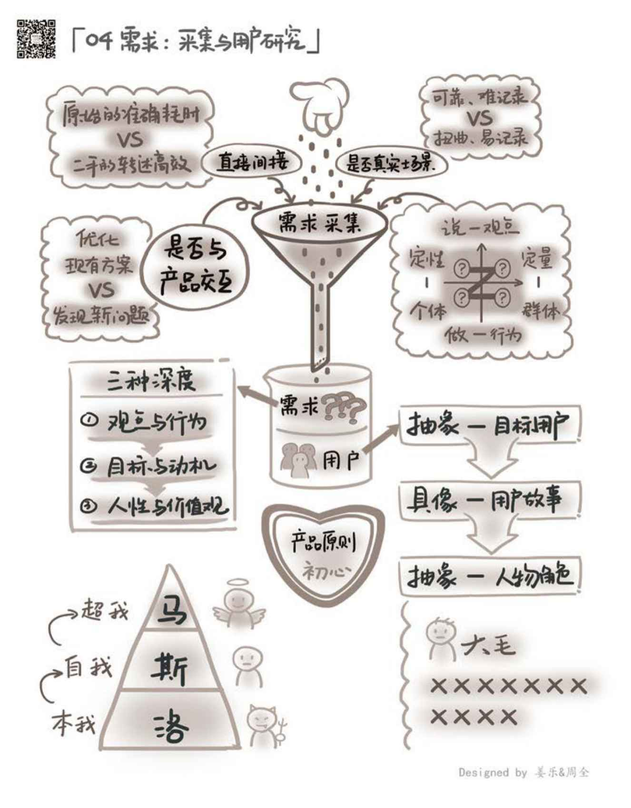

## 4.5　延伸阅读与练习

本章关联到另外几本书的相关章节如下。其中的图标表示推荐阅读（笑脸）与选择阅读（冷漠脸），亦可根据一些关键词扩展阅读。

<figure markdown="1">

{ width="397" height="152" }

</figure>

可以做的练习任务如下。

<figure markdown="1">

{ width="621" height="215" }

</figure>

<figure markdown="1">

<figcaption markdown="span" style="margin:0.5em auto;font-size:0.8em;font-style:normal;line-height:1.5">
续表
</figcaption>

{ width="621" height="303" }

</figure>

<figure markdown="1">

{ width="633" height="810" }

</figure>

---

[[1]](../01/index.md#footnote_quote_txt005_1)
简单地说，就是通过观察用户使用产品的过程，发现需求。

[[2]](../01/index.md#footnote_quote_txt005_2)
苹果公司的一种充电连接技术，接口有磁吸装置，在外力作用下，线与电脑会自行脱落。

[[3]](../02/index.md#footnote_quote_txt005_3)
分别是运营商提供的网络服务账号密码、路由器管理后台登录的账号密码，以及无线网络的SSID和密码。

[[4]](../03/index.md#footnote_quote_txt005_4)
[图4-4](../03/index.md#figure-4-4)与常见的五层马斯洛需求相比，多出一个层次。它来自马斯洛1943年在《人类激励理论》中提出需求层次理论后，在1954年，对这一理论做出的补充，他认为尊重与自我实现之间还有认知与审美的需求。

[[5]](../03/index.md#footnote_quote_txt005_5)
从数据结构的角度，[图4-5](../03/index.md#figure-4-5)就是一棵树。

[[6]](../03/index.md#footnote_quote_txt005_6)
基于同样的道理，真正的奢侈品一般都不会做电视广告。或者说，能在电视上看到广告的东西，都不会是太专业的。

[[7]](../04/index.md#footnote_quote_txt005_7)
简单地讲，是一种“专业人士一对一帮新手做简单咨询”的服务。更多的信息可以访问这个服务的主页：zaih.com。

