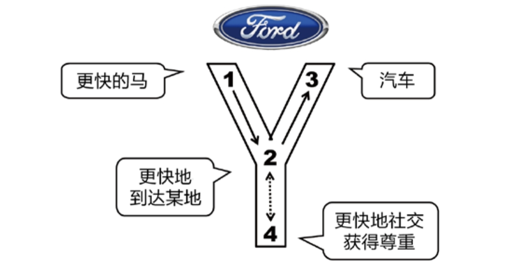

## 5.2.1 　最经典的例子

“如果福特问用户需要什么，用户会说，我要一匹更快的马”，据说这是苹果的乔布斯讲的段子。

我们看到，“1”用户需求是更快的马，但它经常会以一种不靠谱的方式表达出来，这种表述可以叫作用户自以为是的解决方案、伪需求。和用户交流的过程中，经常有这样的体会，你问他哪里不爽，他会告诉你应该怎么做。从心理角度分析，这说明每个人都喜欢给别人出主意，以显得自己很厉害。

如果是没经验的产品经理，这时候就会想，我要怎么研发一种新的饲料，或改进训练方法，让马跑得更快更久。而好的产品经理就会搞清楚Why，往“2”走。结果发现，某种需求场景下，用户其实是为了更快的到达某地，“更快”比“马”重要。相对于用户，产品经理是领域专家，可以利用自己的领域知识，给出更靠谱的方案：汽车，如图5-2所示。

这是一个最基本的从问题到方法的转化案例，值得反复体会。

<figure markdown="1">

{ width="460" height="240" }

<figcaption markdown="span" style="margin:0.5em auto;font-size:0.8em;font-style:normal;line-height:1.5">
图5-2　从更快的马到汽车
</figcaption>

</figure>

这么老的故事，为什么还要讲呢？因为只做“1.2.3　”还不够。

一个优秀的产品经理会发现，在一个不成熟的领域或全新的市场，只做“1.2.3　”是玩得转的，比如汽车市场的早期，你可以通过满足“更快”的需求建立优势。但表层需求很快就会被相似的跟进产品满足，随着市场的成熟，产品很快会陷入同质化竞争和价格战，最终整个市场变成红海（经济术语，指竞争相当激烈的市场）。

你会发现今天的各种汽车都满足“快”了，因为限制因素已经变成了道路限速、限行、堵车……比如现在我要去机场，5万的吉利和500万的宾利几乎可以同时到，那么，有人买吉利、有人买宾利肯定是因为其他原因。在供给丰饶的时代，各种行业的细分市场都已经很成熟，而你的产品如果不能脱颖而出，就很难生存和发展。怎么找到让产品出彩的其他原因呢？

答案就是向深层需求探索，顺着马斯洛需求层次向高级需求的方向上追溯。这个时候，Y模型里“4”的价值就开始展现了。市场越成熟越需要细分，今天大家对新车功能的关注点已非常发散，全景天窗、真皮座椅、按摩、加热、通风、高级灯光、安全辅助系统，等等功能，每个用户都各有侧重，但都和“更快”没什么关系。

我们挑一个细分市场来分析，地域设定为中国市场，品牌设定为宝马、奔驰这个级别的豪华汽车，主需求场景设定为上下班通勤。如果想知道客户为什么不买10万的车，而买40万的车，可以想象“4”要的是什么，我们都知道肯定不只是代步。设想一下客户有可能进出某些高端场所，或者打算换车时发现朋友们都买了宝马、奔驰这些场景，应该可以理解客户还有“想获得他人尊重和高品质社交”这些细分需求。

接下来，用产品经理的视角给家用轿车做用户细分。应该怎么分？开车的和坐车的，应该是一个好分法，这两种用户的需求差异很大，对不同的汽车品牌也会各有侧重。有句话叫“坐奔驰开宝马”，说的就是奔驰更照顾乘坐者的感受，宝马更照顾驾驶者的体验。那么，你觉得相对于10万元级别的车，豪车应该先满足谁？答案是坐车的。大家可以用5万和500万这两个极限数字去模拟思考，哪个级别的车更没有可能用于自驾？由此很容易得出结论，越贵的车越会优先照顾乘客。继续思考，在中国最尊贵的乘客一般会坐在汽车上的哪个位置？我们都知道，是后排。所以，宝马的3系和奔驰的C级，在中国有个本地化的功能点，就是“轴距加长”，特别照顾了后排乘客的乘坐空间。重要的乘客感觉舒服，反过来也能给车主带来尊贵感和社交优势。这个功能的设计，就来自对“4”的理解。

当然，为了分别满足不同的用户需求，宝马、奔驰也没有放弃操控感更好的标准轴距版。标轴和长轴一起卖的现象，在国内平民品牌（成本优先，够用就好）和顶级品牌（要么是超跑，要么轴距都很长）上很难见到，在欧美市场也很少见。

关于最早的“加长”，我追根溯源，找到了一个段子。

上个世纪八十年代，奥迪成为了中国的官车。一段时间后，奥迪的德国工程师就问中国的工程师：我们准备改款了，你们有什么需求？

中国工程师就说：把轴距拉长，把后排做宽敞点吧。

德国工程师很困惑：我知道你们中国人的身材，德国人都觉得后排够坐了，为啥还要加长？

中国工程师就解释：你不懂。因为奥迪在德国就是普通的家用车，老公开老婆带着孩子坐后面，但在中国是官车，司机开，官员做在后排。用户需求场景不一样，对产品功能的要求自然不一样。

后来，很多企业主也喜欢这款车，老板和朋友们坐后排，宽敞舒服，显得更有面子。于是，有了A4L、A6L，卖得非常好，其他品牌也都纷纷跟进加长。

小结一下，和任何一个市场一样，汽车也经历了“从无到有”阶段拼功能、拼价格、拼质量等，以及“从有到优”阶段拼个性、拼服务、拼体验、拼品牌等的完整过程。而“加长”，就是典型的洞察人性、分析价值观之后的决定。这类功能，往往看起来不是“必须”的，但在一个充分竞争的丰饶市场，一款产品必须拥有这些细分优势，才能够鹤立鸡群。

