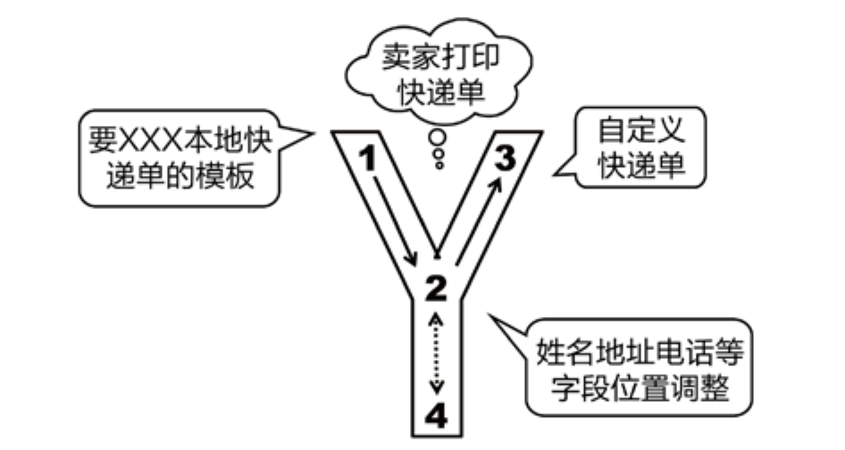
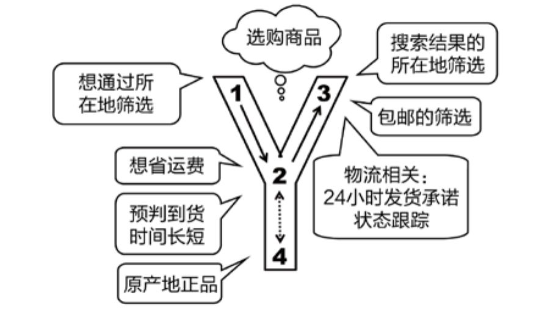
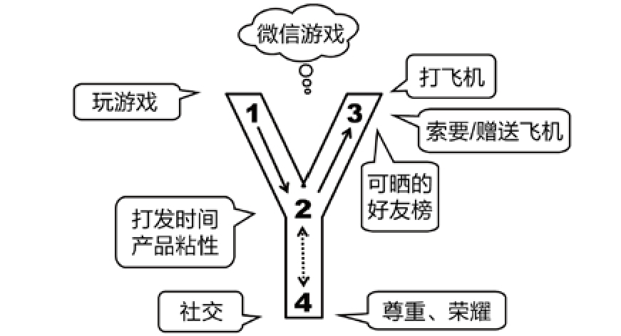
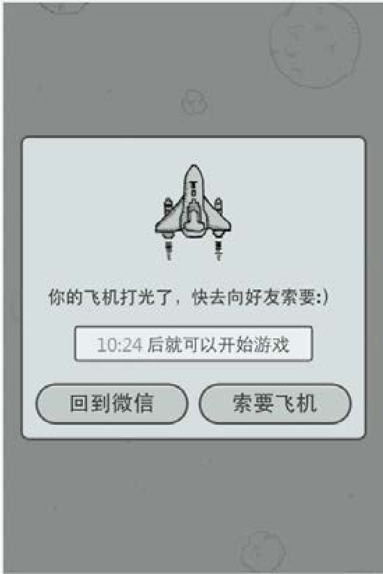

## 5.2.3 　不照着做的好处

不照着做，即不能跳过“2”，直接从“1”到“3”。这样显然会有额外的成本，下面来看看额外成本能带来哪些回报。

**不被伪需求欺骗**

遵循“1.2.3　”这样的完整路径，第一个好处是不会被伪需求欺骗，不被用户自以为是的解决方案绕进去。比如，路人问附近有没有肯德基，可能是想找洗手间；潜在用户承诺“再加一个某某功能我就会用你们产品”，也许只是一个随口瞎编的用来搪塞你的理由；老板面露难色，嘀咕着“这版海报字不够大”，可能只是因为他嫌转化率太低……

再讲一个我在生活中碰到的事情。多年以前，我在杭州买了房，要去建行把之前若干年的住房公积金全部取出来，转到我常用的招行卡里去，当时，一个柜员妹子给我好好上了一课，没有被我的伪需求欺骗，分享一下当时的对话。

我：我要**转账**
，把这张建行卡里的钱转到招行。（“1”用户需求，表现为“伪功能”——转账，用户自以为是的解决方案。）

妹子：转账的话要1%的手续费，最高50元，如果你用网银的话最高25。

我：但是我没有网银，算了，我是把钱全部转出去，只操作这一次，就柜台转吧。（双方陷入对解决方案的讨论。）

妹子：对了，你是要**把钱转到招行账号里**
吧？（“产品经理”意识到，应该深挖“2”用户目的，即真实要解决的问题。）

{ width="73" height="74" }

我：是啊，要**转账。**
（作为一个不懂银行业务的小白用户，分不清转账和转钱的区别。）

妹子：隔壁就有一个招行，我可以给你开个**本票**
，手续费只要0.8元。（“产品经理”给出优化的“3”产品功能。）

我：本票？我从来没听说过，那和转账有啥区别？

妹子：对你来说没啥区别，呵呵，只是手续费成本50.0.8　，不过，额外增加的成本是要再跑一趟隔壁的招行，反正近嘛。

我自己想了一下，确实，我的真实需求是转钱，除了转账和本票，甚至还有把现金全部取出来，再到隔壁招行存进去的办法，这样虽然连0.8的手续费都没有，但是增加了风险。

通过这个例子，我们看到，一个“用户需求”，可以用很多种“产品功能”来解决，产品经理的水平高低也就体现在这儿了。当然，妹子这个做法对自己、对建行的价值高低，在这个例子中就不再展开讨论了。

**解决需求冲突**

产品用户是多种多样的，所以彼此之间的需求经常不一致。每个用户在提需求时，只会站在自己的立场上，不会为其他用户去考虑，这是人之常情。于是，不同用户提出的需求就很可能发生冲突。比如百度，普通的搜索用户希望结果页里的广告越少越好，但是广告主呢，当然希望越多越好。所以，只有靠产品经理站在更高的位置来统一规划，才可以避免出现需求冲突，所以他要从“1”到“2”转一下再到“3”。

再举个例子，多年前我做过一个淘宝卖家的小工具，叫快递单打印。早期的淘宝卖家，大多用手写快递单，当单量达到每天100左右的时候，他们就需要通过打印来节省时间。

经过调研后，我们向所有卖家提供了几家最主流的大型快递公司的面单模板，解决了80%的需求。模板上线后，我们收到各种来自卖家的反馈，说需要A、B、C等快递公司的模板。我们去了解了一下，发现A、B、C等多为区域化的小型快递公司，因快递价格相对便宜而受到一些对成本很敏感的卖家欢迎。收集了一批这些公司的面单后，我们开始研究对策，这时才发现，问题并没有那么简单。

这时候，如果直接按照用户说的做，页面上就会出现几十上百家快递公司的面单模板。而且，模板需要转化为在线页面，这样会占用大量的研发工作量。即使不考虑工作量的因素，完成的页面也会非常复杂，卖家用户都很难找到自己需要的那家快递公司。很多时候产品的功能多、选择多，不但不是加分项，还会是减分项，因为会让用户分不清重点，甚至最终选择放弃。

怎么办？其实也很简单，面单的不同，无非是姓名、地址、电话等字段位置的不同。于是，我们做了一个自定义快递单功能，允许用户自行在页面上调整几个重要字段的打印起点坐标位置，从而一举解决了这个问题，如图5-3所示。

{ width="397" height="211" }

图5-3　卖家打印快递单的需求

各种需求冲突，就算没有发生在用户之间，也会因为资源不足而产生，同样需要产品经理做出取舍。比如，相信不少产品经理都经历过这样的窘境——各个部门的同事都给你提需求，而且都是“最高优先级”、“越快越好”的紧急程度。解决的办法同样是“不要照着做”。

**发现更多用户目标**

很多人喜欢“创造需求”这个词，觉得能做出用户没想到的功能，比“满足需求”更高端。我认同这个结论，不过想修正一下其说法：我们没法创造需求，只能创造出用户没见过的解决方案，从而更好地满足需求。

用户不如产品经理专业，所以很难想得很全面，能直接表达出来的信息往往很少。所以直接从“1”到“3”，会有很多功能缺失。我们需要在“2”上下工夫，把他没有说出来的东西挖出来。来看一个“选购商品”相关的需求，如图5-4所示。

买家简单地告诉你，“搜索宝贝时希望能通过卖家所在地做筛选”，这当然是个值得满足的需求，所以淘宝在搜索结果里提供了所在地筛选。但如果只是草草满足一个需求，表现就太初级了。要想做得更好，就应该去继续探究“为什么买家需要做筛选”。于是，发现原因各异——有人希望省运费，搜索结果页面相应地增加了“包邮”的筛选。有一个有趣的现象：客观数据表明，200块的衣服加10块运费，就是不如210块包邮卖得好。有人希望能提前获知到货时间，客服经常会收到类似“后天宝宝过生日，今天买的乐高明天能不能到啊”这样的咨询，淘宝相应地做了一些与快递时效性相关的功能，比如增加“24小时发货承诺”的筛选，以及生成订单以后的快递状态跟踪等；有人希望买一些地方特产，买家评论里经常能看到类似“这个龙井茶的卖家在重庆？”这样的质疑，淘宝相应地推出“特色中国”活动[[2]](../06/index.md#footnote_content_txt006_2)
。

{ width="369" height="211" }

图5-4　通过所在地筛选商品的需求

**抓住恒定的人性**

更进一步，有些需求要遵循“1.2.4　→3”这样的路径，其背后的深层理由是“表象无常，人性更持久”。你会发现用户提的需求“1”，甚至目标“2”都会随着时间变化，而“4”指向的东西，几百年几千年都没有太大变化。关于吃，中午还在为了省时间而叫外卖，晚上又要挑个安静的餐厅来边吃边谈商务合作，但生理层面的需求一直恒定。对于Y模型里的“1.2.4　”，随着时间的推移，越上面的需求变化越多，越下面的需求变化越少[[3]](../06/index.md#footnote_content_txt006_3)
。

举个例子，人与人之间一直有社交、通信、沟通的需求，在“4”这个层面几千年都没有变，但是在“1”上，变化是非常多的。

原始社会，“通讯基本靠吼”，需求表象是沟通双方要距离足够近，要有个好嗓门、好耳朵。

古代有了烽火台，需求表象是能找到一种白天烧起来冒烟、晚上烧起来有火的材料，然后天气要好，不能下暴雨，不能有雾霾。

近代出现了电报，于是，要有莫尔斯编码，电报的收发设备、线路，以及专业的工作人员、机构。

现在，用电话、用微信，于是要有网络、要有电，甚至要随身带充电宝。

我们往下挖，找到这些需求的根，才不会被每天变化的具体工作内容、随着时代变化的市场环境弄得手足无措，才能知道自己做的产品，主线到底是什么。假设一家福特时代的马车公司，如果它把自己的产品定位成马车，那只能被时代淘汰，但如果定位成“帮助人们更好地出行”，就可以转型参与到汽车工业中，然后生存下去。

**在成熟市场中找到机会**

成熟市场中的竞争更加激烈，你会发现如果仅仅满足了用户提出的需求，他们不会感到惊喜，因为这些需求用户事先已经知道。你只有满足他人性层面的需求，让用户觉得自己都没有想到的问题被你想到了，这时候他们才会尖叫，对你产生正向情感，甚至主动帮你传播。

说个微信游戏的例子。随着微信渐渐地从一个“有用的”通信工具，变成一个“有趣的”平台，用户也渐渐地从有事儿上微信，变成了没事儿就打开看看，于是微信有了朋友圈、公众号，也有了游戏。用户可以打发时间，产品可以提升黏性。下面继续用Y模型分析一下微信的第一款游戏——著名的“打飞机”，如图5-5所示。

{ width="366" height="197" }

图5-5　微信游戏的Y模型

打飞机类的游戏并不新鲜，上个世纪八九十年代的红白机上就有类似的游戏，例如沙罗曼蛇、兵峰、B计划、1942等。微信如果只提供基本的游戏功能，那就太没意思了。你愿意在微信里玩，而不是自己装一个模拟器玩，肯定有别的原因。

试着往“4”想一想，就能想到两点人性的诉求，第一是社交，第二是尊重。

先说社交，最近几年，不知大家有没有和很久没见的同学（比如小学、初中的同学）聚会过？我的经历是，现场很热闹，同学们互相加了微信，但一两年过去了，从来没聊过天。为什么？因为大家的生活轨迹差异太大，一群人在一起的时候还可以调侃过去，一对一单聊有什么可聊的呢？打字或发语音是一种比较重的社交，很难开场。所以，你们也就在朋友圈里互相点个赞，装作还很熟的样子，背后的本质是我们需要这种轻度的社交。

打飞机和以往的游戏不同，不是只要有钱有时间就可以一直玩下去。飞机用完了的时候，它给我们提供了一个轻度社交的理由——索要、赠送飞机，如图5-6所示。有没有想起儿时一起躲着老师、家长玩游戏的情景？赶紧和老朋友互动一下吧。

{ width="231" height="346" }

图5-6　故意不让你继续玩的设计

从“增长黑客”[[4]](../06/index.md#footnote_content_txt006_4)
的角度看，这个功能点也很有意思，它让用户成为了产品的推销员，索要、赠送的动作都会让一些新用户接触到这个游戏。

再说尊重，它包括荣耀、攀比、虚荣、自尊等诉求，也是游戏让人上瘾的一大要素。结合微信自身特点——这里有好友、有互动，“打飞机”给出的特性是“可晒的好友榜”。游戏里的排行榜依然不是新鲜玩意，但在我看来，好友榜是第三代排行榜。

►第一代是单机榜，自己和自己比，和兄弟姐妹比，或和隔壁老王的儿子比，有时候还可以和电脑虚拟出的机器人比。但一段时间后玩家就会觉得没意思，因为就那么几个人，排序渐渐稳定。

►第二代是世界榜，因为有了网络，可以和同一个服务器里的网友比，显然更有趣。但时间一长，第二代排行榜出现两个新问题，一是你的排名会停滞不前，排在前面的都是专业玩家、高手，二是排行榜上的人都不认识，没法互动。私服（某种局域网里的服务器）的出现可以解决部分问题，但依然有很大缺憾。

►第三代是好友榜，完美解决了第二代的两个问题。谁排前面，完全比的是谁时间多，毕竟你的朋友不是专业玩家。而且还有一个杀手锏可用，如果你怎么努力都只能排到第二，你还可以删掉第一名的好友，立即分享纪念后再把好友加回来。

另一方面，可以晒、可以刷存在感，绝对是一种生产力。网上说的“中国的微信朋友圈和微博拯救了不丹的旅游业”，就能体现出可晒的巨大能量。因为去不丹旅游的成本很高，本来应该没什么人去那里，但“我在一个很贵的地方玩哦”是一个绝好的晒点。通过照片和游记让朋友知道这个晒点，似乎钱花得就很值了。哪怕某天你在酒店昏睡了一天，什么地方也没去，只要发一句“今天又犯懒了，啥地方也没去，还得交××美刀的环境保护税，嘤嘤嘤”，就会觉得倍儿有面子，是不是？回到“打飞机”，可能有些人觉得“我小时候游戏玩得可厉害呢，但现在身边的同事都不知道”，这让“怒刷”、“怒晒”的行为变得更是动力十足。

可晒的好友榜以及索要、赠送飞机等特性，都不是游戏的基本功能，但正是有了这些特性，让“打飞机”更具可玩性。

