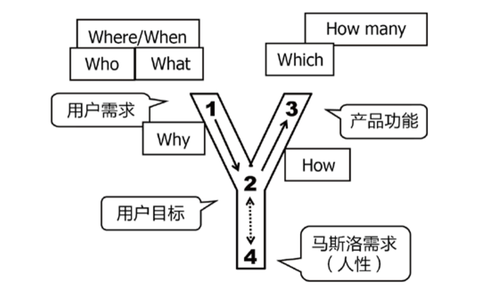

## 5.2　Y模型的基本概念

产品经理们工作中经常说的“需求分析”一词，就是指从问题到方法（解决方案）的转化，或者说从用户需求到产品功能的转化。我的总结非常简单，就是一个大写的字母Y，我把它叫作“Y模型”，如图5-1所示。先看看Y模型中的一些概念，如果看过前面的章节，对这些术语应该并不陌生。

{ width="457" height="271" }

图5-1　Y模型的基本概念

“1”是用户需求场景，经常简单说成用户需求。这是起点，是表象，是需求的第一种深度——观点和行为。

“2”是用户需求背后的目标和动机，是需求的第二种深度，产品经理在思考用户目标时也要综合考虑公司、产品的目标。

“3”是产品功能，是解决方案，是实施人员能看懂的描述。

“4”是人性，或者说价值观，是需求的第三种深度，是需求的本质。

Y模型的不同阶段，各自需要回答的一些问题，可以总结为6个W和2个H。

“1”这个阶段的问题主要是Who（用户）、What（需求）和Where/When（场景）。

“1”到“2”和“2”到“4”这个阶段，对应上一章提到的需求的三种深度。其间，要回答Why：不停地往下深挖需求。当然，有些细碎的用户需求，不一定会挖到“4”，所以“2”到“4”是虚线。

“4”到“2”再到“3”的过程中要想清楚“How”：问题怎么解决。

“3”这个点，要回答Which和How many。Which是指选哪一个方案，做哪一个功能，这背后其实是对价值的判断，比如怎么评估性价比和优先级。How many是指这一次做多少个功能，考验的是对迭代周期、MVP的把控。

