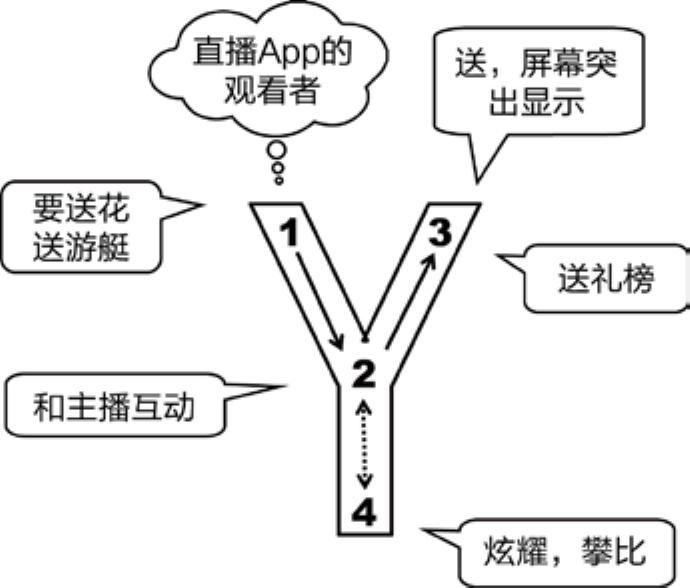
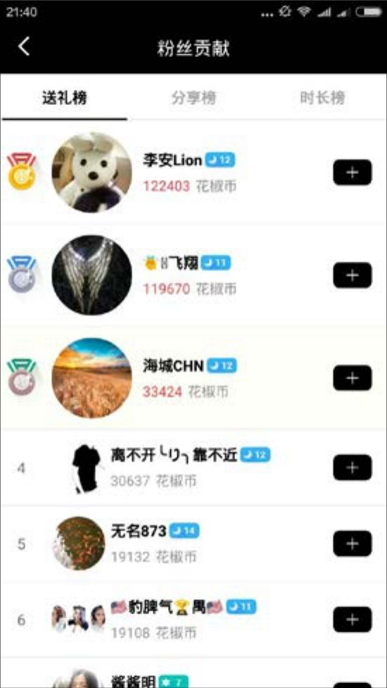

## 5.4.3 　直播应用

2016年直播很火，我们分析一下“秀场直播”观看者的需求。

用户可能会说，我要给主播妹妹送花送游艇。我们知道，肯定不是白送，如果你做了一个“默默送”的功能，估计没几个人用。他的目的是希望“我送了”这个成就能让在看直播的芸芸众生知道，最好还能单独和主播互动一下。如图5-10所示，“2”这个点对应的就是“想引起注意”、“和主播互动”，那么在设计“3”对应的这个“送礼物”功能时，一定要做成在屏幕上突出显示，让所有人都看到老王送大礼了。这个时候，乖巧的主播也会说一声“谢谢老王送的保时捷，永远爱你宝宝”什么的。我看过一些直播，女主播就一直在说谢谢某某的礼物，可以感觉到那些送出礼物的用户听后是真的很开心。

<figure markdown="1">

{ width="289" height="247" }

<figcaption markdown="span" style="margin:0.5em auto;font-size:0.8em;font-style:normal;line-height:1.5">
图5-10　直播App的Y模型分析
</figcaption>

</figure>

这么多人送礼，怎么让他们更开心，“4”里有没有突破口？分析一下，就会发现突破口有可能是炫耀和攀比。好比在线下的演艺酒吧里，经常出现前排卡座里的老板斗富的场景，这在线上也可以复现。于是，在几乎所有的直播应用里，都可以找到排行榜，有的还有分类，如图5-11所示。送礼榜表示谁为主播花的钱最多；分享榜表示谁帮主播做的宣传最多，即没钱的捧个人场；时长榜表示谁最忠诚，一直在看。

<figure markdown="1">

{ width="231" height="410" }

<figcaption markdown="span" style="margin:0.5em auto;font-size:0.8em;font-style:normal;line-height:1.5">
图5-11　某直播App里的排行榜页面
</figcaption>

</figure>

