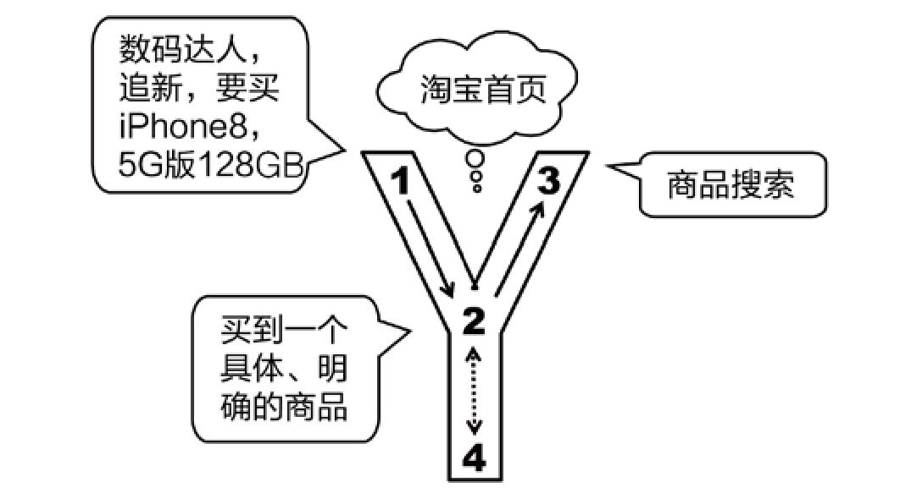
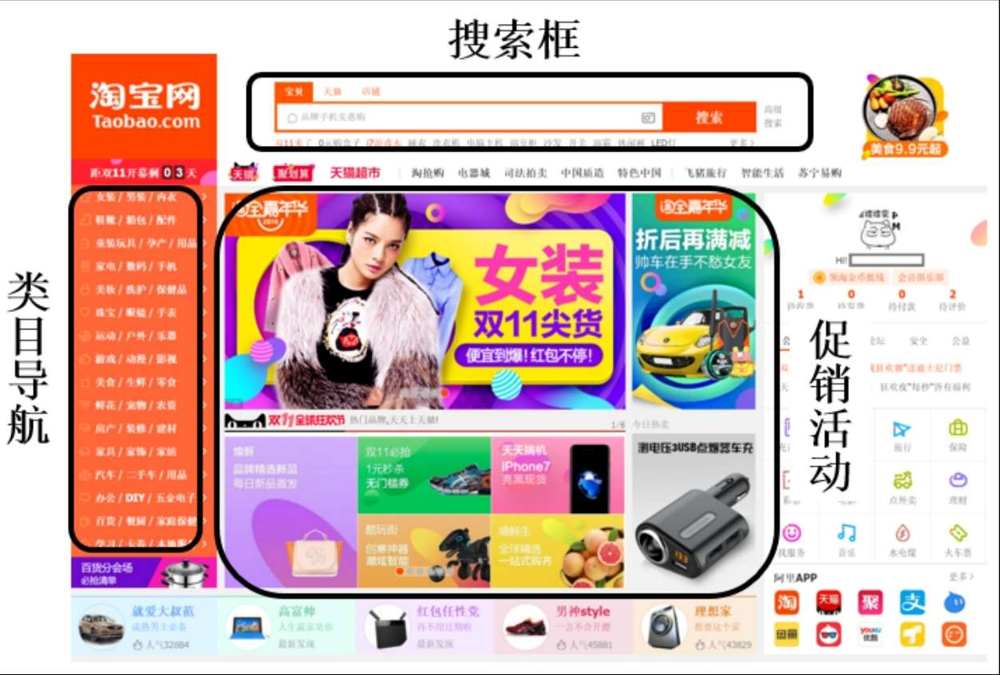
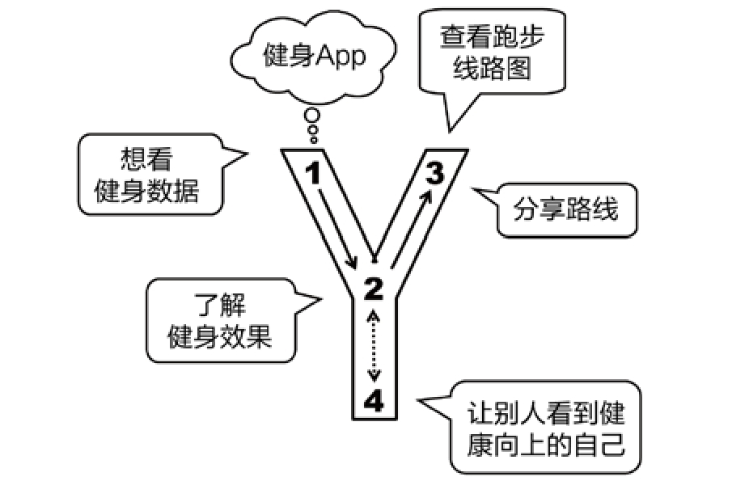
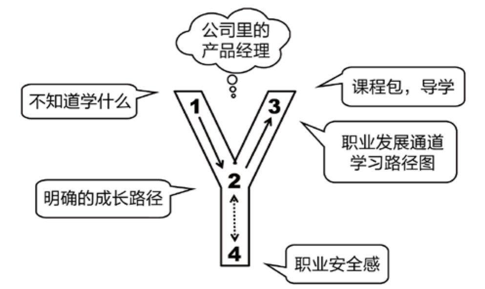

## 5.4　一些综合案例

大到整个产品概念，小到一个具体功能，都可以用Y模型来分析。

也许你已经发现，我们讲的人性有关的例子，都是2C的产品。确实如此，产品类型与自身定位直接相关，2C产品重心在生活，2B产品重心在工作。2C产品是感性的，像女人，更在乎过程和感觉；2B产品是理性的，像男人，更在乎目标和结果。2B产品要解决问题，需要分析业务逻辑，建立领域模型，多数需求处于从无到有、提升效率阶段，很少需要分析用户动机，也很少需要解决炫耀、认同等这样的心理需求。当然，如果你的2B产品能够让大家在工作中有些小惊喜，也会是非常棒的亮点。而2C产品的市场供给已经很丰富了，很多解决方案都是从有到优，所以更注重于人性。

下面再说几个案例。

### 5.4.1 　淘宝首页

接着第03章讲过的淘宝首页案例，继续说。很多年来，淘宝首页的核心用户及其刚性需求都比较稳定，没有出现太大变化，一直是之前总结过的“有购物需求的新手买家”。既然核心用户和刚性需求的变化很小，产品功能的变化也不应该太大。因此，尽管淘宝首页在外观上一直千变万化，其背后一定有一些核心功能始终稳定地存在着。下面，让我们一起来把它们挖出来。

假设我们是淘宝的产品经理，目标是满足新手买家的各种购物需求——看来，要和买家用户来个亲密接触了。

我们可能碰到一位数码发烧友，他对各种新玩意儿很热衷，要买iPhone 8，心仪的是256GB内存、土豪金色的裸机。这类需求，连商品的“货号”都已覆盖到，隐含的用户目标是“**买到一个具体、明确的商品**
”。只须在淘宝首页上放一个大大的明显的搜索框，就可以满足这类用户，如[图5-7](#figure-5-7)所示。有一个有趣的问题，同样是搜索框，为什么“聚划算”首页没有？当年团购大战的时候，淘宝产品经理看到有些小的团购网站首页居然有搜索框，不禁哑然失笑。要知道，这种设计简直是自杀行为，因为必然导致大量的搜索无结果、少结果的页面，很难处理。

<figure id="figure-5-7" tabindex="-1" markdown="1">

{ width="451" height="244" }

<figcaption markdown="span" style="margin:0.5em auto;font-size:0.8em;font-style:normal;line-height:1.5">
图5-7　淘宝首页的用户需求到产品功能
</figcaption>

</figure>

我们可能碰到一个大学生，夏天快到了，他衣服不够穿，想买几件T恤，这背后代表的是“**有模糊购物目标的新手买家**
”。淘宝首页上大块的类目导航，就是为他们而生。当然，搜索也可以满足这类需求。所以，我们看到，**用户需求和产品功能并不是一一对应的**
。

我们可能碰到一个小女生，刚和男朋友吵了一架，心情不好，想在淘宝上买点东西来发泄一下，这背后代表的是“**无购物目标的新手买家**
”。对于这类用户，反正他们自己也不知道要什么，我们就在首页放一些促销活动吧，告诉他们什么东西正在打折、什么东西新上了、明星在用什么、大家都在买什么……

再看一眼[图5-8](#figure-5-8)所示的2016年淘宝首页，变化背后不变就是这几大模块。如有你有兴趣找来每一年的淘宝首页，会发现这几块一直存在。

<figure id="figure-5-8" tabindex="-1" markdown="1">

{ width="527" height="355" }

<figcaption markdown="span" style="margin:0.5em auto;font-size:0.8em;font-style:normal;line-height:1.5">
图5-8　不变的搜索、类目导航和促销活动
</figcaption>

</figure>

### 5.4.2 　健身应用

如[图5-9](#figure-5-9)所示，在这个健身App中，“1”对应用户说想看的健身数据，“2”对应的目标是想了解健身有没有效果，所以产品会做一些信息的展示，比如跑了多远，消耗了多少卡路里，体重变化了多少。再往下深挖“4”对应的健身的人性需求是什么。很有可能，是用户想让别人看到积极、健康、向上的自己。于是，可以让用户把他的健身成果秀出来。比如做一个结合地图的跑步线路，用户可以方便地分享给朋友。

有个段子说“外国人健身是为了自己，中国人健身是为了发朋友圈”，表达的就是中国人对分享、晒的偏爱。所以，我们总是能够在深夜看到一些朋友在秀图，很多人健身就是为了让别人知道他在健身。在设计产品的时候，就要把这些都考虑进去。有的功能，用户不一定提出来，但你有了，用户就感觉很好，很喜欢。

<figure id="figure-5-9" tabindex="-1" markdown="1">

{ width="389" height="249" }

<figcaption markdown="span" style="margin:0.5em auto;font-size:0.8em;font-style:normal;line-height:1.5">
图5-9　健身App的Y模型分析
</figcaption>

</figure>

### 5.4.3 　直播应用

2016年直播很火，我们分析一下“秀场直播”观看者的需求。

用户可能会说，我要给主播妹妹送花送游艇。我们知道，肯定不是白送，如果你做了一个“默默送”的功能，估计没几个人用。他的目的是希望“我送了”这个成就能让在看直播的芸芸众生知道，最好还能单独和主播互动一下。如[图5-10](#figure-5-10)所示，“2”这个点对应的就是“想引起注意”、“和主播互动”，那么在设计“3”对应的这个“送礼物”功能时，一定要做成在屏幕上突出显示，让所有人都看到老王送大礼了。这个时候，乖巧的主播也会说一声“谢谢老王送的保时捷，永远爱你宝宝”什么的。我看过一些直播，女主播就一直在说谢谢某某的礼物，可以感觉到那些送出礼物的用户听后是真的很开心。

<figure id="figure-5-10" tabindex="-1" markdown="1">

{ width="289" height="247" }

<figcaption markdown="span" style="margin:0.5em auto;font-size:0.8em;font-style:normal;line-height:1.5">
图5-10　直播App的Y模型分析
</figcaption>

</figure>

这么多人送礼，怎么让他们更开心，“4”里有没有突破口？分析一下，就会发现突破口有可能是炫耀和攀比。好比在线下的演艺酒吧里，经常出现前排卡座里的老板斗富的场景，这在线上也可以复现。于是，在几乎所有的直播应用里，都可以找到排行榜，有的还有分类，如[图5-11](#figure-5-11)所示。送礼榜表示谁为主播花的钱最多；分享榜表示谁帮主播做的宣传最多，即没钱的捧个人场；时长榜表示谁最忠诚，一直在看。

<figure id="figure-5-11" tabindex="-1" markdown="1">

{ width="231" height="410" }

<figcaption markdown="span" style="margin:0.5em auto;font-size:0.8em;font-style:normal;line-height:1.5">
图5-11　某直播App里的排行榜页面
</figcaption>

</figure>

### 5.4.4 　企业内训

最后说个不是IT系统的产品。我在负责阿里集团产品大学时，经常有产品经理跟我说自己的用户需求（对应Y模型里的“1”）是“不知道学什么”。和他们深聊下来，发现背后的原因是“缺乏明确的成长路径”。于是，除了一门门的培训课程以外，我们还设计了一些“导学”的内容，告诉大家如何通过当前的日常任务，推导出需要具备什么能力，然后要学哪些内容。而更深层的需求，我认为是大家缺乏职业安全感。因此，我们还和HR部门的其他同事一起，制定出“岗位模型”，设计出“职业发展通道”，并且通过“学习路径图”将其和具体的学习方法、内容结合在一起，如[图5-12](#figure-5-12)所示。

<figure id="figure-5-12" tabindex="-1" markdown="1">

{ width="417" height="248" }

<figcaption markdown="span" style="margin:0.5em auto;font-size:0.8em;font-style:normal;line-height:1.5">
图5-12　产品经理学习的Y模型分析
</figcaption>

</figure>

