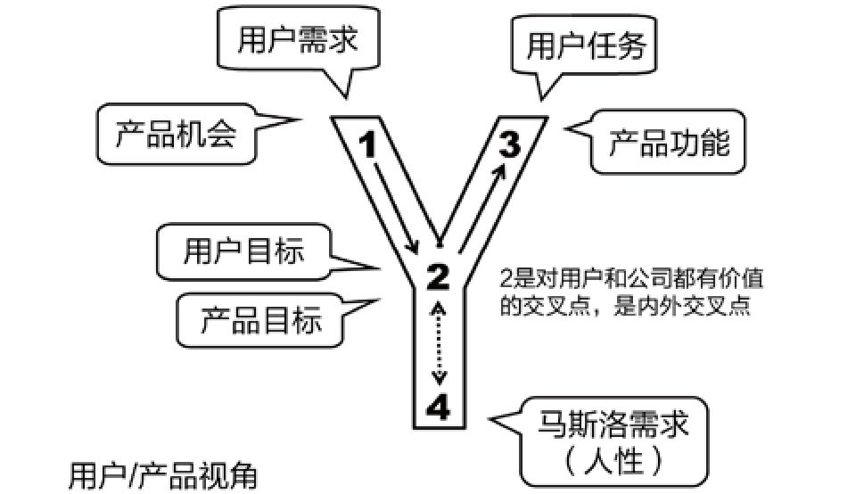

## 5.5.1 　用户视角与公司视角

Y模型里的“1”、“2”、“3”三点，分别可以从用户视角、公司产品视角给出三对近义词。

**用户需求就是产品机会**

产品经理是挑剔、追求完美的，总能发现问题；但他们又是乐观的，具备视问题为机会的意识。比如，当前国内的教育、医疗领域都有很多不完善的地方，所以也蕴藏着巨大的创业机会。

**用户目标就是产品目标**

长期来看，在满足“2”对应的用户目标的同时，必须也要为公司创造价值。优秀的产品经理都知道，只满足用户目标而没有产品目标，就不是一个商业行为，也不可能得到持续发展；同样，只有产品目标而不去满足用户目标，用户就会渐渐离你而去。

图5-13就展示了一个很有趣的例子。在这个例子中，用户目标“讨个好彩头”与产品目标“游人排队”最终达成了和谐统一。

{ width="363" height="322" }

图5-13　用户目标与产品目标的完美结合

**用户任务就是产品功能**

虽然，这两个词都在说解决方案，但有意思的是，往往用户任务越简单，产品功能背后的实现就越复杂，而产品经理应该做的是，把简单留给用户，把复杂留给自己。

本书中，会根据上下文灵活描述Y模型里的“1”、“2”、“3”说法，如图5-14所示，大家心里清楚我在说什么就好。

{ width="407" height="232" }

图5-14　用户视角与产品视角的对比

