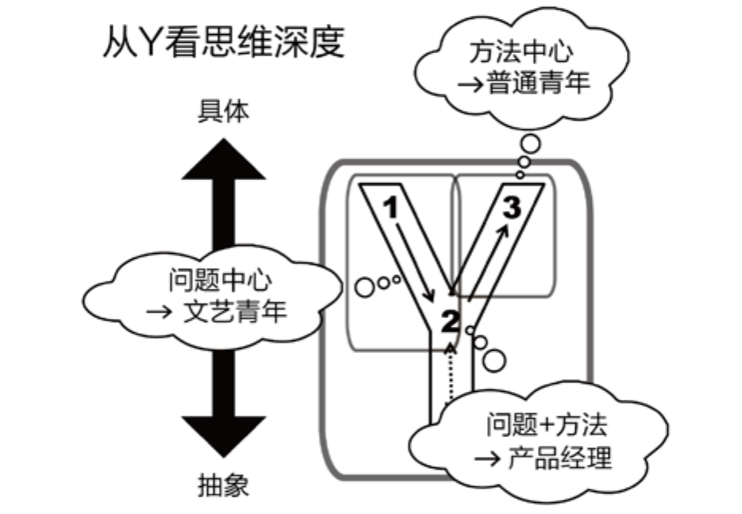

## 5.5　Y模型的更多理解

最近几年，我时常发现各种概念都可以结合Y模型来理解。本章的最后，就给大家分享一下我的心得。

### 5.5.1 　用户视角与公司视角

Y模型里的“1”、“2”、“3”三点，分别可以从用户视角、公司产品视角给出三对近义词。

**用户需求就是产品机会**

产品经理是挑剔、追求完美的，总能发现问题；但他们又是乐观的，具备视问题为机会的意识。比如，当前国内的教育、医疗领域都有很多不完善的地方，所以也蕴藏着巨大的创业机会。

**用户目标就是产品目标**

长期来看，在满足“2”对应的用户目标的同时，必须也要为公司创造价值。优秀的产品经理都知道，只满足用户目标而没有产品目标，就不是一个商业行为，也不可能得到持续发展；同样，只有产品目标而不去满足用户目标，用户就会渐渐离你而去。

[图5-13](#figure-5-13)就展示了一个很有趣的例子。在这个例子中，用户目标“讨个好彩头”与产品目标“游人排队”最终达成了和谐统一。

<figure id="figure-5-13" tabindex="-1" markdown="1">

{ width="363" height="322" }

<figcaption markdown="span" style="margin:0.5em auto;font-size:0.8em;font-style:normal;line-height:1.5">
图5-13　用户目标与产品目标的完美结合
</figcaption>

</figure>

**用户任务就是产品功能**

虽然，这两个词都在说解决方案，但有意思的是，往往用户任务越简单，产品功能背后的实现就越复杂，而产品经理应该做的是，把简单留给用户，把复杂留给自己。

本书中，会根据上下文灵活描述Y模型里的“1”、“2”、“3”说法，如[图5-14](#figure-5-14)所示，大家心里清楚我在说什么就好。

<figure id="figure-5-14" tabindex="-1" markdown="1">

{ width="407" height="232" }

<figcaption markdown="span" style="margin:0.5em auto;font-size:0.8em;font-style:normal;line-height:1.5">
图5-14　用户视角与产品视角的对比
</figcaption>

</figure>

### 5.5.2 　新手思维与专家思维

产品经理应用Y模型，还有个挑战，是要在“新手”和“专家”两种思维方式之间来回切换。在Y模型的前半段，面对“问题”时要像新手，这也是常说的“一秒钟变傻瓜”，要快速进入一个没有任何专业知识的用户的视角。而在Y模型的后半段，设计“解决方案”时必须成为专家，才能发现需求的本质，找到最具性价比的解决方法。

**拥有“新手”心态**

保持好奇心，思维不固化，拒绝“存在即合理”，才可以不断发现新的问题和可改进之处。经验不足的产品经理，经常设计出一些自觉逻辑很清晰的产品使用流程，但产品一到用户手里，用户用起来就各种卡壳，不知道接下来的流程应该怎么进行。这是因为产品经理掌握着充足的相关背景信息，是这个产品的专家，但用户不是。

举个例子，如果用户在网上提交完一个申请后，只能在页面上找到“提交成功”这样的简单提示，而后续的一系列问题，包括怎么知道进展、多久可以有反馈、等不及该联系谁等的答案统统不得而知，那么用户对这一“产品”的体验评价一定不会是正面的。之所以会出现这样的问题，是因为产品经理已完全脱离了新手思维，觉得只要自己可以在后台看到用户的申请，就一切尽在掌握，完全考虑不到用户使用过程中的困惑和沮丧。

**拥有“专家”能力**

对一个职场人来说，面对问题时表现出的能力有几个层次，分别是制造问题、忽视问题、发现问题、解决问题。而作为产品经理，我们的能力不能仅仅停留在发现问题上，还要能设法解决问题。而要提升到这一层次，需要产品经理拥有必备的领域知识和超强的学习能力，也就是说，要拥有专家的能力。

比如我的一些产品经理朋友在家里装修时，就表现出了极强的学习能力，迅速成为了专家，对于包阳台，没几天就是满口黑话——凤铝789.1.4　的，中空双钢，顶面用5加5夹胶，2.0型材，下面用8个的毛玻……打胶、转角立柱全包。他们会发现包工头的施工方案不合理，项目经理的过程管控可以改进……后来，他们甚至会自己上手优化设计方案，参与项目管理，这个表现看起来很有“职业病”，但淋漓尽致地体现了迅速成为专家的能力。

回顾一下第01章讲产品经理“思维方式”时提到的三点：“从学生到职场”讲的是用新手的“无知”心态面对问题，“从用户到产品经理”讲的是从新手到专家的切换，“从现象到本质”讲的是像专家一样解决问题。然而灵活切换并非轻而易举，对能力的要求极高。

### 5.5.3 　普通青年与文艺青年

从Y模型里，还可以映射出三种人，普通青年、文艺青年与产品经理。最终的结论是，前两者的思维深度都不够，产品经理才是真正的高手，如[图5-15](#figure-5-15)所示。

<figure id="figure-5-15" tabindex="-1" markdown="1">

{ width="393" height="271" }

<figcaption markdown="span" style="margin:0.5em auto;font-size:0.8em;font-style:normal;line-height:1.5">
图5-15　从Y模型看思维深度
</figcaption>

</figure>

第一种人普通青年，采用方法中心的思维方式，拥有典型的学生式解题思维。这种思维对应着Y里的“2”到“3”，需要有人告诉他们明确的任务。

而且，这种人不大会问为什么，而是以完成任务的心态面对各种工作。单纯的方法中心容易使他们陷入努力地在做错误事情的误区。普通青年总是显得很急躁，想着你怎么还不告诉我该怎么做。其实对方正在交代来龙去脉，想告诉他“为什么会有这个方法出现，最早是为了解决什么问题”，这样可以帮助他理解得更深刻，但是这些在方法中心思维的角度来看都是废话。最典型的例子就是，我们觉得西方的教科书枯燥，不像国内教材，会总结出很多知识点想塞进你的脑子，来让你感觉很充实。而从科学的角度来看，我们的大脑更应该用来分析处理信息，而不是存储信息。

第二种人文艺青年，采用问题中心的思维方式。这种思维方式对应着Y里的“1”到“2”，整天只会思考为什么，却不行动。就像很多文艺青年都有一场“只说不走的旅行”一样，他们执行力比较差，不愿意做脏活累活。

第三种人产品经理，习惯先问题后方法，思维方式是“用心听，但不要照着做”，对应着Y里的“1”到“2”再到“3”，或是更好的从“1”到“2”到“4”再到“3”。

读者可以想想自己的日常，更多的时候在做哪一种人。其实，大多数人都习惯用比较简单的思维方式，而这事儿的根源，也许是教育。

孩子是天生的提问者，一开始不会懂任何方法，绝对是问题中心的思维模式。而且他们提问题的视角，与成人完全不同，甚至会提出只有哲学家才有可能提出的问题。之后发生的变化，极有可能是“教育的摧残”——把问题中心的孩子变成了方法中心的成人。方法中心的典型动作是“答题”，问题中心的典型动作是“提问”。教育让我们太熟悉前者，忘了问才是主动的独立思考，答只是被动的记忆接收。更为甚者，好奇心一旦不在，小到个人，大到人类社会，各种创新、进步的动力都难以维系。

学校里通常的教育方式，是传授给你诸多技能，但不告诉你是干什么用的。你即使已经掌握，却不知道可以用在什么场景下。直到我们工作以后，才恍然大悟，原来《软件工程》在做系统项目的时候能用得上，原来《概率与数理统计》在分析用户数据的时候用得上……

在学校里成绩好，只能证明你具备解题思路，可以很好地执行任务。“方法中心”没问题，但“问题中心”是否够强，则不得而知。这也是学校教育与实际工作的脱节之处，只能靠不断实践、不断犯错或职业再教育来弥补。

好在，虽然现在国内的教育现状非常不如人意，却并不妨碍方法中心有其更终极的意义，那就是科研，我指的是真正的科研。“你做这个有什么用呢？”，这是个很值得思考的问题。为什么做事情必须要“有用”呢？应用求用，科研求新，而新就意味着没法立刻找到应用场景。哪里是人类还未曾探知的领域？用我现在掌握的技术和设备可以攻克哪些难题？不在乎意义，也许反而有利于实现终极意义。不考虑目的的研究，源自追求真理的纯粹好奇心，导向的则是人类文明的不断进步。

### 5.5.4 　复习、预习一些概念

最后结合Y模型，以问答的形式来复习、预习一些概念，作为本章的结束。

1\. 如何理解竞品？

答： 不仅仅是“3”相似的东西是竞品，“3”不同但“1”相似的产品，也是竞品，甚至更要关注。

2\. 如何理解创新？

答： 创新不只是做一个新东西出来，而是要同时满足“1”（有用户需求，背后靠的是市场洞察）和“3”（有方法突破，背后靠的是科学发明）。

3\. 产品如何扩张？

答： 通常而言，早期先要扩张用户规模。因为“3”的变化不大，所以要围绕核心功能不断优化，等用户增长出现瓶颈以后，再去设法满足用户群体更多“1”对应的需求场景，这时候就要在“3”上做较大改动。

4\. 产品发展早期为什么会有鸿沟？

答： 产品用户数增长的鸿沟存在于种子用户与主流目标用户之间，主要因为这两个人群的“1”对应的需求场景不同。种子用户是“饥不择食”的，主流用户是在乎性价比的。

5\. 何谓生产驱动和需求驱动？

答： Y模型里，从“1”到“3”叫需求驱动，是从问题出发推导解决方案，前面说得比较多。其实，也可以从“3”到“1”，这叫生产驱动，是用现有的技术方案去解决合适的问题。调整“3”，更多的工作是产品开发，而调整“1”，更多的工作是市场开发。产品经理的价值体现，是找到“1”用户需求（问题）与“3”产品功能（解决方案）的匹配，无所谓从哪里出发[[5]](../06/index.md#footnote_content_txt006_5)
。设想一下，如果你没有开发新产品，但是为公司滞销的一批货找到了新的用户，那也一样创造了很大的价值。

6\. 如何理解目的与手段？

答： Y模型的前半段是目的，后半段是手段。随着技术发展和市场变化，手段会不断更新升级。所以，我们应该花更多的时间、精力在目的的研究上。

