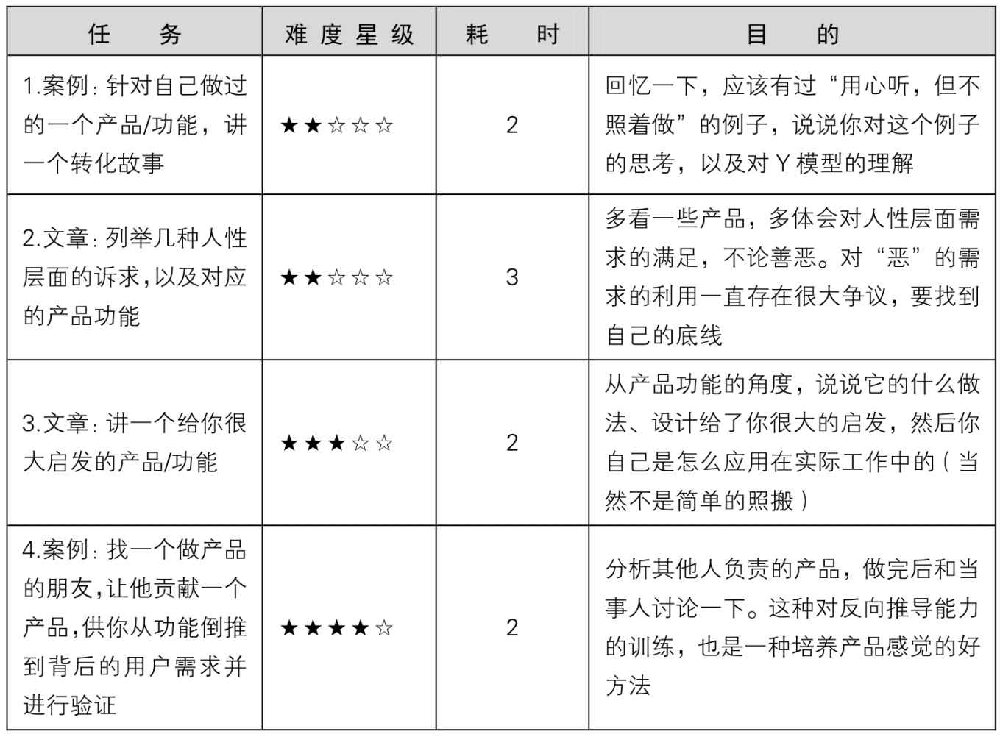
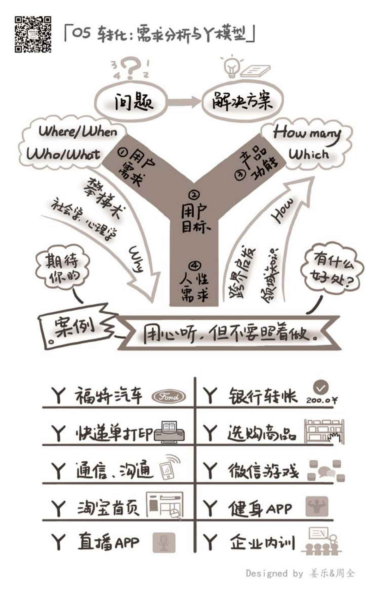

## 5.6　延伸阅读与练习

本章关联到另外几本书的相关章节不多，大家可以试着去“读”一些真实的产品，亦可根据一些关键词扩展阅读。

<figure markdown="1">

{ width="403" height="62" }

</figure>

可以做的练习任务如下。

<figure markdown="1">

{ width="623" height="457" }

</figure>

<figure markdown="1">

{ width="633" height="994" }

</figure>

---

[[1]](../02/index.md#footnote_quote_txt006_1)
我甚至为这句话拍了个1分多钟的视频，大家可以扫右侧二维码观看，视频的题目叫“用心听，但不要照着做”。

[[2]](../02/index.md#footnote_quote_txt006_2)
当时，纪录片《舌尖上的中国》特别火，每集直播的时候，淘宝上相关的美食搜索量剧增。于是，淘宝做了“特色中国”的活动，后来演变为“特色中国”频道。

[[3]](../02/index.md#footnote_quote_txt006_3)
这一点可以结合需求的三种深度一起理解，在特定时间背景下，越上面的需求越统一，越下面的需求越细分。

[[4]](../02/index.md#footnote_quote_txt006_4)
简单地讲，就是利用产品技术的手段，帮助产品某方面数据增长。

[[5]](../05/index.md#footnote_quote_txt006_5)
如果读者对这个话题感兴趣，可以去了解一个概念PMF（Product Market Fit）。

