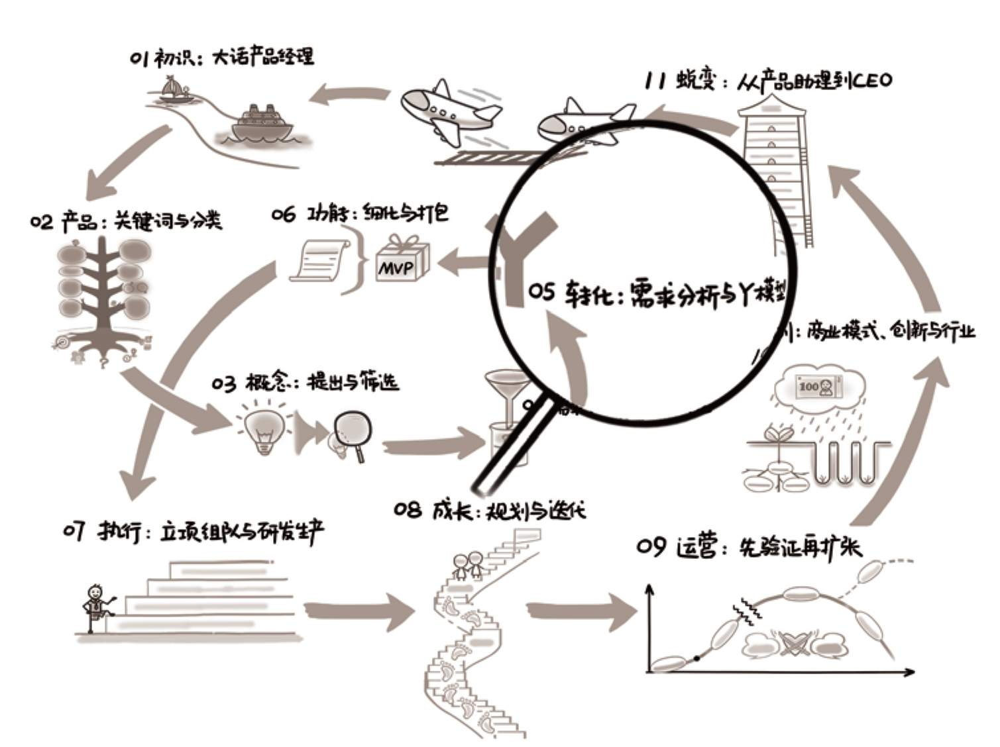

## 第05章　转化：需求分析与Y模型

{ width="634" height="474" }

**第05章　转化：需求分析与Y模型/123**

**5.1　从问题到解决方案/125**

**5.2　Y模型的基本概念/126**

5.2.1　最经典的例子/127

5.2.2　用心听，但不要照着做/129

5.2.3　不照着做的好处/130

**5.3　实战中如何深入浅出/136**

5.3.1　深入：如何深挖人性/136

5.3.2　浅出：如何设计功能/141

**5.4　一些综合案例/142**

5.4.1　淘宝首页/143

5.4.2　健身应用/144

5.4.3　直播应用/145

5.4.4　企业内训/146

**5.5　Y模型的更多理解/147**

5.5.1　用户视角与公司视角/147

5.5.2　新手思维与专家思维/148

5.5.3　普通青年与文艺青年/150

5.5.4　复习、预习一些概念/151

**5.6　延伸阅读与练习/152**

