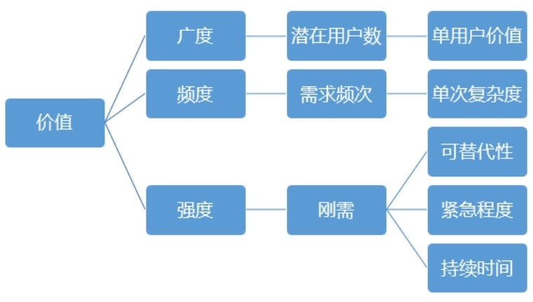
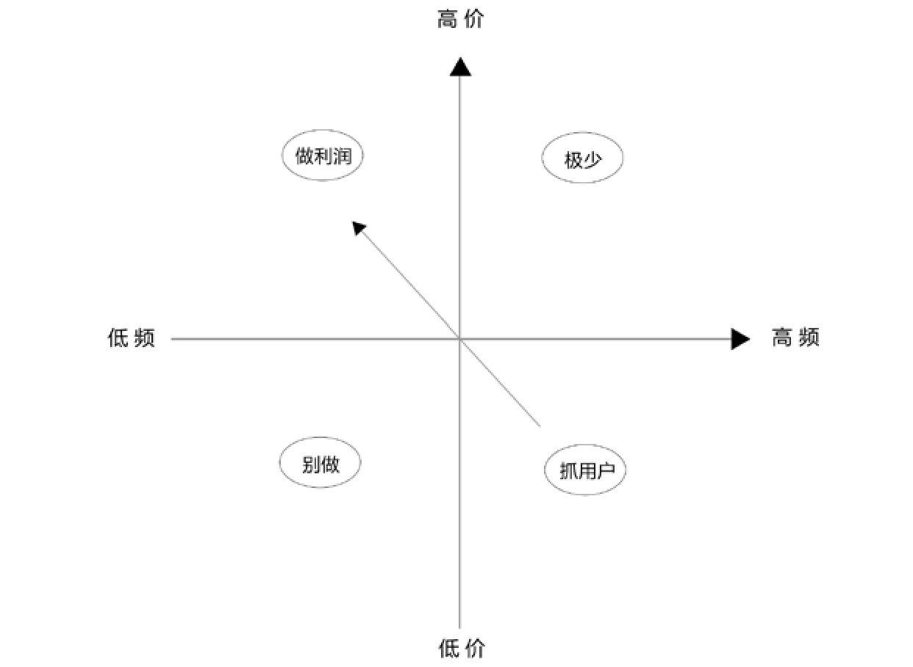

## 6.1.1 　功能的价值判断

先说说对某个功能进行价值判断的流程。

►参照“产品原则”里“目标”部分的定义，明确当前产品最看重的指标是什么，可以是数字化的KPI，比如注册用户数达到10万，也可以是某些关键结果，比如“建立起线上自动化的专家入驻全流程”。如果有多个指标，则需要对这些指标加权合并[[2]](../04/index.md#footnote_content_txt007_2)
。

►考察每个功能点实现后，对上述指标的帮助大不大。如果大，则这个功能的价值就大。因为每个产品不同时期的指标不同，所以评判各个功能价值的标准也各有差异。通常用半定量的方式来衡量，比如最简单的大、中、小，或者5.4.3　、2、1等评分标准。

接下来介绍图6-1中三个功能价值评判的基础原则。

{ width="319" height="180" }

图6-1　功能价值评估的框架

**广度：潜在用户数**
\***单用户价值**

简单来讲，广度对应着潜在用户数，即一个产品将来可能覆盖的用户群体有多大。不同产品、不同功能的定位，直接决定其可能覆盖的潜在用户数会有差异，有时甚至相差一个或多个量级。

同样是面向出行这一需求，如果是打车应用，覆盖的潜在用户数可能是几个亿，如果是代驾应用，因为要求用户有车且没法开，可能覆盖的潜在用户数最多只有几百万，二者相差两个量级。同样是餐饮服务，日常快餐和只接婚宴，潜在用户数的差距也很大。

同等条件下，我们肯定愿意做潜在用户数多的产品功能。但是，潜在用户数不是唯一的因素。有一些产品虽然潜在用户人数很少，但是也可以做，因为它覆盖的这些用户，“单用户价值”非常高。典型的例子就是银行的VIP业务，从普卡、银卡、金卡、白金卡到钻石卡，以及再高级一点的私人银行，用户数越来越少，但一个高级用户的资产少则几千万，多则几个亿，可以抵上几千几万个初级用户。

单用户价值这个词，在不同行业能找到不同的说法。比如，电商行业的“客单价”，是指用户平均每次消费花多少钱；游戏行业和运营商的“ARPU值”（average revenue per user），是指平均每个用户在单位时间内给公司带来的收入；而对于社交应用，对应的说法也许是活跃度。

从广度的角度，“潜在用户数\*单用户价值”可以用来判断产品对应的市场容量，也就是第03章提到的“产品概念筛选”里的“天花板”。当然，具体操作时，经常先从某些细分用户切入，再逐步扩大到所有潜在用户。比如，2016年下半年火爆的ofo共享单车，就是先攻高校内部，再扩张到校园外。

**频度：需求频次**
\***单次复杂度**

频度是指需求频次的高低，不同的需求，频次差异会非常大。

有些需求每天都会出现一次甚至多次，比如叫外卖；有的需求每周最多出现一次，比如看电影；有的需求也许每个月只出现一次，比如交水电费、还信用卡；有的需求每年出现一、两次，比如车险，出境游等；有的需求甚至有可能一辈子只出现一次，比如结婚。

同等条件下，我们当然更喜欢做频次高的产品功能。我曾负责过天猫积分系统，当时有很多积分相关的消息要开发。在产品的早期版本里，我做了一些简化：买家每次购物产生的积分变动消息，需要先做；而用户每年年底积分过期的提醒，可以缓缓，如果碰到可以先手动解决。

但是，有些需求的频次不是那么高，我们也愿意做。这是因为这些单次需求的复杂度高，而且单价也高，有很大的价值空间可供挖掘。

虽说外卖需求的频次比较高，但每单通常只有20块左右。而婚礼，虽然一辈子只有一次，但背后的需求包含了很多点——拍婚纱照要几万，办酒席要几十万，蜜月旅行要几万；还需要买一些周边产品，小到喜糖，大到车和房，后者又至少有几百万的潜在市场价值。

通常，频次很高的需求不太可能有太高的单次价值。理由很简单，类似每天一次、每次一万块这种需求，只能存在于极端小众的土豪市场，大众普遍没有这么强的消费能力。图6-2为这四种情况的二维图。

{ width="523" height="381" }

图6-2　不同价位、不同频次需求的处理策略

通过图6-2很容易就能得出结论，高频高单价的需求极少，低频低单价的需求不值得做。对于另外两个象限的需求，常见的策略是：先利用高频低单价的需求抓用户，因为高频场景和用户互动的机会多，而低单价的轻决策场景可以降低用户进入门槛，容易引流；再用低频高单价的需求做利润，因为单价高了，可以切分的蛋糕才大。之所以采取这样的先后次序，是因为必须有海量用户做基础，低频需求的总量才足够大。比如汽车后市场（指买车以后产生的各种消费）就很典型，用高频低单价的洗车增加客流量，甚至通过补贴来抓牢用户，然后用低频高单价的保险、保养、修车来赚取利润。

“需求频次\*单次复杂度”，让我们在广度之余，可以从频度的视角再一次对市场容量进行验证。

**强度：不可替代、紧急、持久**

强度背后说的就是真实刚需。

一个需求是不是真的，是不是刚性，有一个简单的判断原则，就是问自己这样一个问题：“当你没有做这个产品功能时，用户是不是在设法解决，甚至已经在用某种低效的方式来解决这个问题？”如果答案是肯定的，那么说明需求真的很强烈。接下来再给大家讲几个判断的角度。

**可替代性**

可替代性用来说明一个功能是不是很容易被其他功能替代。打个比方，假设你开了家早餐店，一开始技术不太熟练，所以每天早上只能供应包子这一款单品。做了几个礼拜之后，技术水平提高了，发现早上时间还有富余，可以再做第二款单品。这时有两个选择，一个是馒头，一个是豆浆，应该怎么选呢？我相信大家都会选择豆浆。因为馒头和包子是可以互相替代的，豆浆是不可替代的。你会发现，买了包子的人经常会四处张望，看看旁边有没有卖牛奶、豆浆或其他饮料的，因为包子太干，容易噎着。

**紧急程度**

需求紧急程度也可以作为衡量需求强度的判断原则。科学的时间管理建议我们应该更有计划性，尽量避免紧急的事情发生，但现实中的确有这样的需求，真的是受各种客观情况所限，必须马上动手实施或调整计划。比如，极个别用户的负面评价，引起了广泛的舆论风波，必须要在产品上做出响应；营销方案已经开始推广，忽然发现支撑后台还有部分功能没有实现；竞争对手突然提高了补贴力度，必须马上决定是否应战。

**持续时间**

持续时间是指一个功能做好之后，用户有效使用的周期是多久。有一些需求上线后用户可能只用几天，另外一些需求上线后用户可以用几年，产品经理当然愿意做后者。举个例子，中秋节的促销活动一般只持续3天。如果要开发一个特定的系统，那么产品经理通常会采取两种对策，或是和营销人员沟通，询问能否借用已有功能来实现这一需求，或是争取把这个功能做成通用模块，以后可以经常复用。

**不同阶段的产品看重什么**

在产品的不同阶段，对上面提到的广度、频度、强度，会有不同的侧重点。

产品早期的验证阶段，更重视“强度”。通常在产品上线前后，要设法验证用户是否认可产品，愿意用且愿意反复用，即测验留存率高低。只有留存率够高，产品在将来才会有好的发展，而留存率高就要求产品背后的需求足够强。所以，刚上线的产品就像大家在小学应用题里经常见到的那个游泳池，有一个进水口在进水（获取新用户），有一个出水口在出水（失去老用户）。如果产品经理在现实生活中遇到这样的事情，当然会先去堵上出水口，而不是急于灌水。这个阶段的产品，常见的版本号是0.8.0　.9和1.0，还在不断试错，寻找最能打动用户的切入点。

验证完毕，产品进入大面积拉新（指获取新用户）的阶段，这时更重视“广度”。这个阶段的产品需要快速增长，希望通过各种推广来占领更多市场份额，以尽快与对手拉开差距。所以，拉新是否顺利，依赖的就是需求和功能覆盖的广度是否够大，当然也离不开足够的资源和资本支持。对于产品本身，此阶段常见的版本号是1.1.1　.2，工作重心依然是围绕核心功能做优化，同时可以获取大量的用户反馈。

当用户增长出现瓶颈，就需要开始对产品的用户进行激活，这时更重视“频度”。拉新阶段，通常的策略是先攻“单用户获取成本”低的场景，比如你要主攻白领人群，那么上下班时间的写字楼电梯口，就是一个好场景，在这里单位时间内能获取的新用户数肯定高于你在路边随机拉人。但是，当这类场景都做得差不多了，拉新成本就会越来越高，也就意味着用户数没法一直保持高速增长。这时再想扩大产品的价值，怎么办？在每个用户身上挖掘更大的潜力是个好办法，所以这个阶段适合做频度，让已有用户更加活跃，使用产品的频次提高，贡献更大的价值。这时候产品一般会出现大幅度的版本跳跃，比如从2.X升级到3.0。

当然，上述对产品阶段的划分过于理想化，真实情况是各个环节互相渗透，交替出现。

