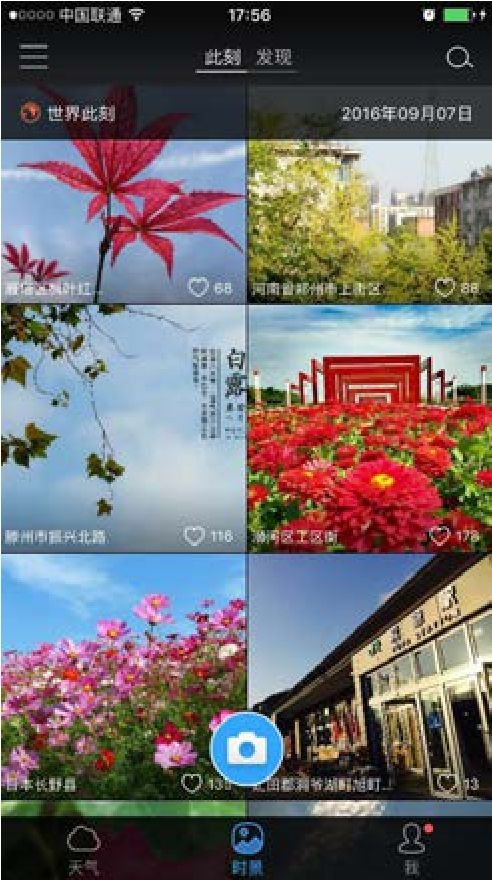

## 6.1.2 　几个价值判断的案例

对于功能的价值判断，可以借助回答下面这两个问题来得到结论：

谁的痛，有多少这样的人？（这些人是核心用户吗，人群足够大吗？）

痛有多深？何时会痛？何地会痛？多久一次？一次多久？（具体场景典型吗？需求刚性吗？）

完成判断后，再来验证一下被判断为价值最大的那些功能，是不是正好满足第03章提出的产品概念切入点——核心用户、刚性需求、典型场景，借由二者的吻合情况可再次验证整个产品功能价值判断的逻辑。

下面这些案例，可以用来对大到产品、小到功能的价值进行综合判断，进而推导出产品发展的对策。

**实用工具，如何突破**

以墨迹天气为例，来聊聊实用工具类产品在价值上的优劣，以及如何突破工具产品没有想象空间的瓶颈。

墨迹天气的优势在于潜在用户数很大，几乎所有人都有看天气的需求；而且，需求频次很高，每天都要看天气。所以，它可以作为典型的入口级产品快速积累用户。

但是，它和用户之间的互动关系很疏远，这导致单用户价值很低。甚至可以说，看天气的只是“用户画像很模糊”的人，都称不上是真实的用户。因为Ta用了几年都没有注册，墨迹天气根本不知道Ta是谁。而且，每次的需求也很简单，只是点开App、刷新，看到天气情况后就离开，其间只停留5秒钟左右，产品方几乎难以榨取任何价值。此外，因为产品门槛不高，所以可替代性很强，用户如果要换另外一个天气应用，在使用上并没有太大区别。这就是典型的工具型产品的困境。

所以，我们看到墨迹天气做了各种尝试，这些尝试对其他工具型产品都很有启发。比如，它推出时景功能，让用户拍照、上传，在产品里留下一些数据，以期用户对产品的依赖性和黏性增强，如图6-3所示。再如，它利用自己的大流量，给其他产品引流，这种“把用户卖给别人”的做法也不失为一种很有价值的探索。

有一位同行说过这样一句精彩语录：**一个产品要大成，靠的就是用户与你产生复杂的积极性情感**
。所以，很多工具都在尽力向社区和个性化的方向靠拢，其实都是为了让用户跟自己产生情感。

<figure markdown="1">

{ width="207" height="369" }

<figcaption markdown="span" style="margin:0.5em auto;font-size:0.8em;font-style:normal;line-height:1.5">
图6-3　墨迹天际的时景
</figcaption>

</figure>

**智能硬件，怎样“送礼”**

再来看一下2C的硬件产品。这类产品在上市之前或上市初期，比较适合做一些新品赠送的活动。可以站在产品方的立场上设计一下这样的活动，尝试回答怎么送、送给谁这些重要问题。

首先要判断活动目的。如果是为了“公测”，那么应该送给一些目标用户，比如硬件发烧友，让他们帮助测试功能、性能及各种产品细节；或是送给小白用户，以获取易用性等反馈。

而对于2C的硬件产品，这类活动更多是为了“营销”。那么，就应该考虑如何把路由器送到价值最大的人手里，而这个价值，就是获赠人能影响的目标用户的数量，“送给谁”这个问题的答案也就有了——KOL（Key Opinion Leader，意见领袖），特别是互联网、商界、媒体圈子的意见领袖。从投入产出比来看，这样营销相当划算，但需要有个重要的前提，就是自己产品的性能和质量足够过硬，能一举征服这些KOL，最好促使他们自发地帮忙宣传、为产品背书。

以智能路由器极路由为例，它曾在线上微信群做过新品发布会，聚集了几百位KOL，并在群里发红包、抽奖，最终引发正向的口碑传播，效果不错。

这个例子可以推而广之，它告诉我们，要重视那些“单用户价值”很高的用户。你看，我在书里又帮他们宣传了。

**上门服务，哪种靠谱**

2015年，各种上门服务特别火，美甲、家政、洗车、厨师、按摩、宠物等服务项目轮番登场。到了2016，幸存者寥寥。这些发生在他人身上的教训，让我们认识到，资本推动的补贴并不是长久的商业模式，上门服务还是要做到行业效率优于旧模式才能持久。下面简单讲讲哪些因素是我们应该关注的要点。

第一，客单价要高。上门相对于到店，把用户在路上花费的时间转嫁到了服务者身上。因为“时间不值钱，收入水平低”的人在路上跑才合理，所以，上门服务应该是相对有钱的人才会叫的，高客单价能弥补服务者的时间损失。几十块的上门很难，几百块才靠谱。

第二，订单密度要高。为了进一步减少手艺人的路上时间，上门服务讲求“三公里效应”。要瞄准一个个小区域来攻克，以把订单密度做到足够大。只有让服务者在一个街区就能做满一整天的活，才能充分体现出高效的优势，而这背后依赖的其实是需求的频次。单次服务时间越短的上门服务，比如取送清洗的衣服或收发快递等，越要减少路上时间。有些服务项目设计得比较巧妙，比如有一家上门理发的服务，为了提高订单密度，只接写字楼里的企业客户，将常规认识中典型的2C业务转化2B业务，一下子提高了单位时间的服务人数。

