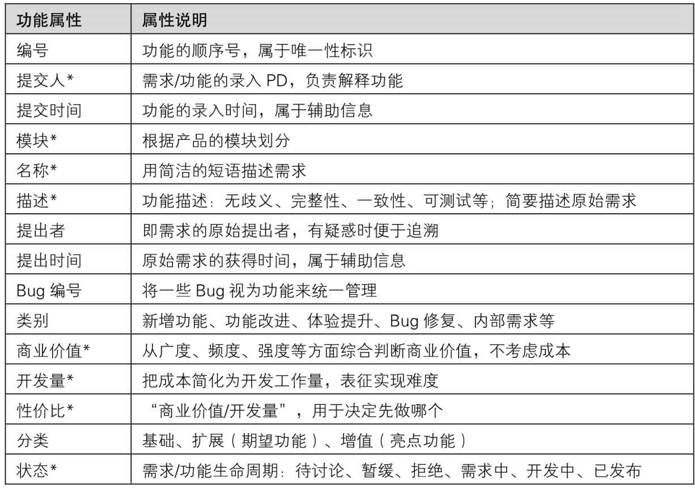
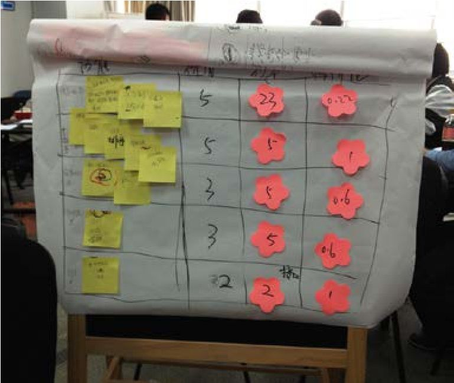
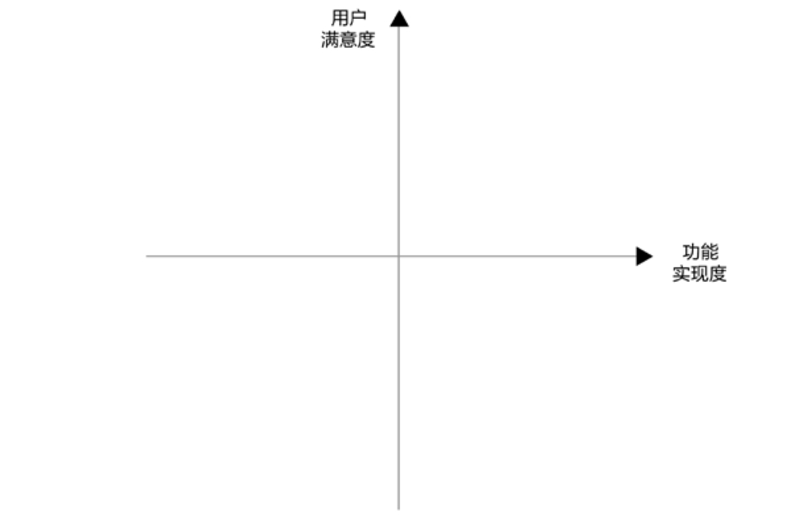
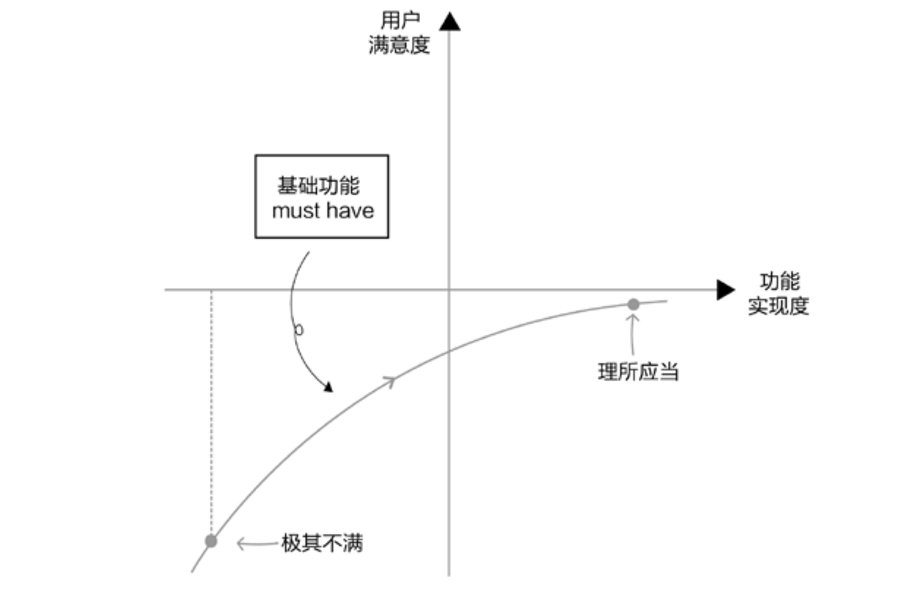
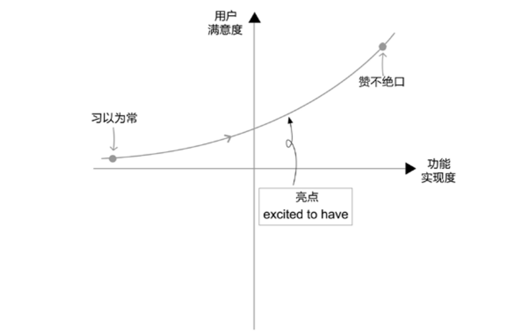
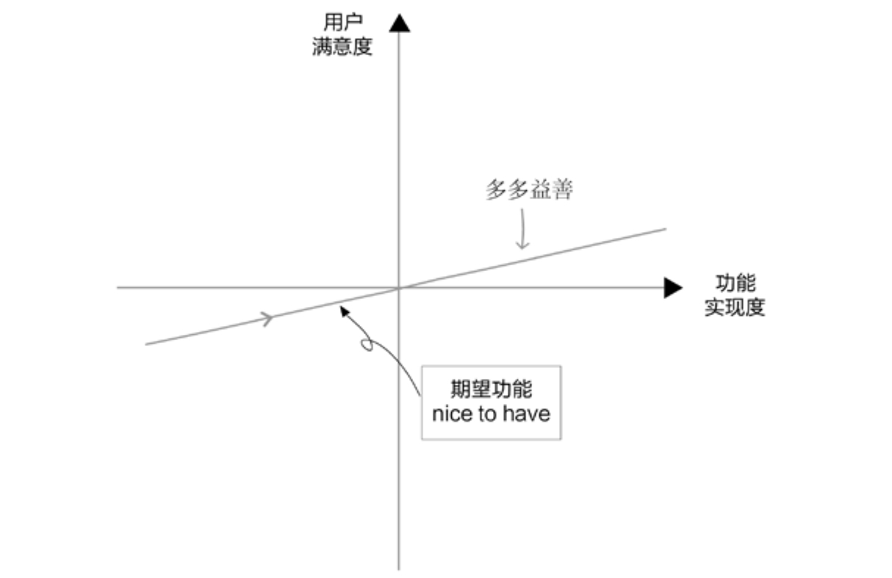
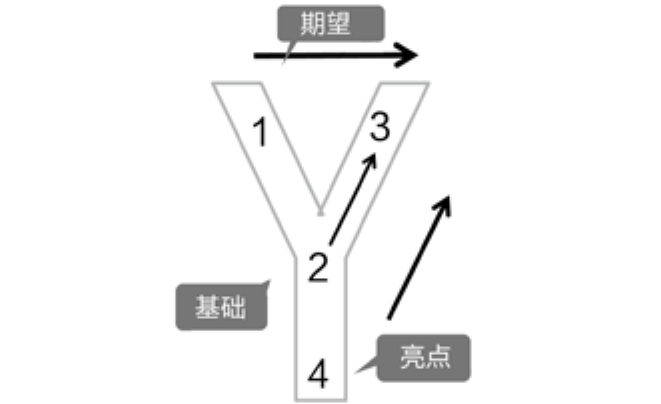
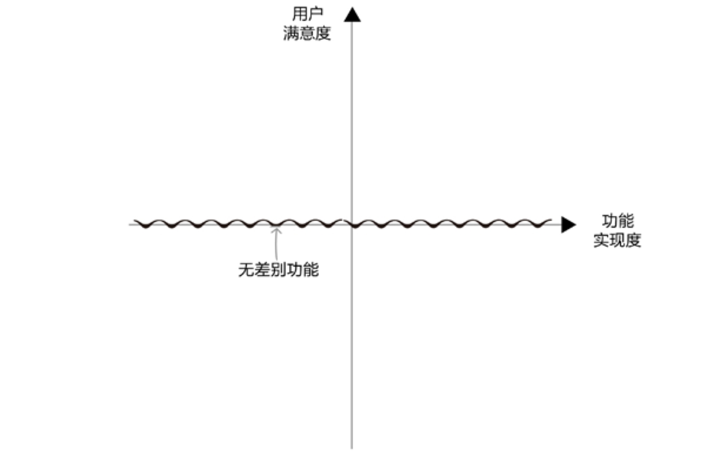
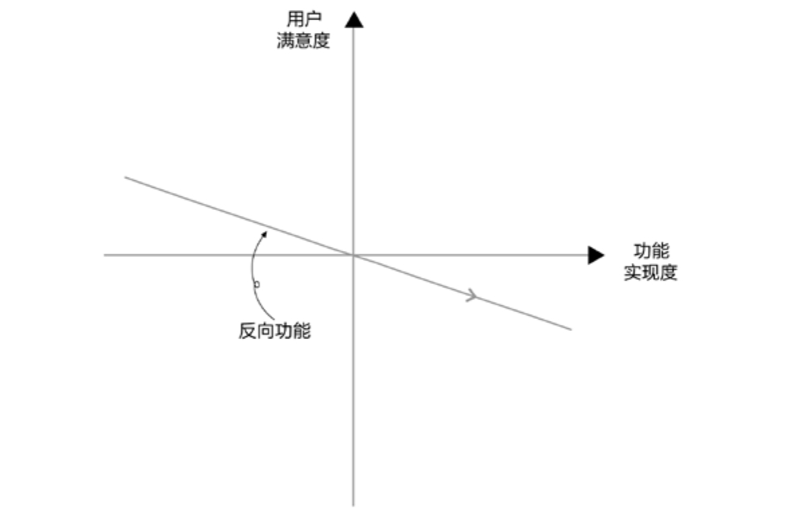

## 6.1 功能 DNA

俗话说，产品经理推动工程师实现功能有三宝：竞品已搞，老板想要，开发量小。如果不行，再上杀招，求求你了好不好。

实际工作中，当然不能这么玩。第05章中用Y模型做完了需求分析，从一堆用户需求中推导出很多产品功能，接下来，要回答Which（做哪个）和How many（这次做多少）这两个问题。

一个功能，涉及表6-1中所列的很多属性（更具体的介绍请参见《人人都是产品经理（纪念版）》）。

<figure markdown="1">

<figcaption markdown="span" style="margin:0.5em auto;font-size:0.8em;font-style:normal;line-height:1.5">
表6-1　一个功能的DNA[[1]](../04/index.md#footnote_content_txt007_1)
</figcaption>

{ width="621" height="434" }

</figure>

表6-1中最基础的信息，是功能的描述。必须要让技术同学看了之后，就大概知道要做什么事情，这里的描述，通常只是一两句话，界面、逻辑等细节，还需要等到项目中的PRD（产品需求文档）阶段才会细化。

在本章中，主要展开说三点：价值评估（表中的“商业价值”）、成本评估（表中的“开发量”）和功能分类（表中的“分类”）。

更进一步可以总结出以下两点：

►价值由产品功能背后的用户需求（问题）决定。

►成本由产品功能（解决方案）决定。

实现成本低，或者对应需求的价值高，这两个条件中的任一个，都不能单独作为决定去实现一个功能的理由。必须结合这两个条件，综合考量功能的性价比。理论上，性价比高的功能优先级也就高，应该先做。

性价比 = 价值/成本

不过在实际操作中，还需要考虑功能的分类，在本章的功能分类部分，会仔细分析不同种类功能各自的应对策略。

### 6.1.1 　功能的价值判断

先说说对某个功能进行价值判断的流程。

►参照“产品原则”里“目标”部分的定义，明确当前产品最看重的指标是什么，可以是数字化的KPI，比如注册用户数达到10万，也可以是某些关键结果，比如“建立起线上自动化的专家入驻全流程”。如果有多个指标，则需要对这些指标加权合并[[2]](../04/index.md#footnote_content_txt007_2)
。

►考察每个功能点实现后，对上述指标的帮助大不大。如果大，则这个功能的价值就大。因为每个产品不同时期的指标不同，所以评判各个功能价值的标准也各有差异。通常用半定量的方式来衡量，比如最简单的大、中、小，或者 5、4、3、2、1 等评分标准。

接下来介绍[图6-1](#figure-6-1)中三个功能价值评判的基础原则。

<figure id="figure-6-1" tabindex="-1" markdown="1">

{ width="319" height="180" }

<figcaption markdown="span" style="margin:0.5em auto;font-size:0.8em;font-style:normal;line-height:1.5">
图6-1　功能价值评估的框架
</figcaption>

</figure>

**广度：潜在用户数**
\***单用户价值**

简单来讲，广度对应着潜在用户数，即一个产品将来可能覆盖的用户群体有多大。不同产品、不同功能的定位，直接决定其可能覆盖的潜在用户数会有差异，有时甚至相差一个或多个量级。

同样是面向出行这一需求，如果是打车应用，覆盖的潜在用户数可能是几个亿，如果是代驾应用，因为要求用户有车且没法开，可能覆盖的潜在用户数最多只有几百万，二者相差两个量级。同样是餐饮服务，日常快餐和只接婚宴，潜在用户数的差距也很大。

同等条件下，我们肯定愿意做潜在用户数多的产品功能。但是，潜在用户数不是唯一的因素。有一些产品虽然潜在用户人数很少，但是也可以做，因为它覆盖的这些用户，“单用户价值”非常高。典型的例子就是银行的VIP业务，从普卡、银卡、金卡、白金卡到钻石卡，以及再高级一点的私人银行，用户数越来越少，但一个高级用户的资产少则几千万，多则几个亿，可以抵上几千几万个初级用户。

单用户价值这个词，在不同行业能找到不同的说法。比如，电商行业的“客单价”，是指用户平均每次消费花多少钱；游戏行业和运营商的“ARPU值”（average revenue per user），是指平均每个用户在单位时间内给公司带来的收入；而对于社交应用，对应的说法也许是活跃度。

从广度的角度，“潜在用户数\*单用户价值”可以用来判断产品对应的市场容量，也就是第03章提到的“产品概念筛选”里的“天花板”。当然，具体操作时，经常先从某些细分用户切入，再逐步扩大到所有潜在用户。比如，2016年下半年火爆的ofo共享单车，就是先攻高校内部，再扩张到校园外。

**频度：需求频次**
\***单次复杂度**

频度是指需求频次的高低，不同的需求，频次差异会非常大。

有些需求每天都会出现一次甚至多次，比如叫外卖；有的需求每周最多出现一次，比如看电影；有的需求也许每个月只出现一次，比如交水电费、还信用卡；有的需求每年出现一、两次，比如车险，出境游等；有的需求甚至有可能一辈子只出现一次，比如结婚。

同等条件下，我们当然更喜欢做频次高的产品功能。我曾负责过天猫积分系统，当时有很多积分相关的消息要开发。在产品的早期版本里，我做了一些简化：买家每次购物产生的积分变动消息，需要先做；而用户每年年底积分过期的提醒，可以缓缓，如果碰到可以先手动解决。

但是，有些需求的频次不是那么高，我们也愿意做。这是因为这些单次需求的复杂度高，而且单价也高，有很大的价值空间可供挖掘。

虽说外卖需求的频次比较高，但每单通常只有20块左右。而婚礼，虽然一辈子只有一次，但背后的需求包含了很多点——拍婚纱照要几万，办酒席要几十万，蜜月旅行要几万；还需要买一些周边产品，小到喜糖，大到车和房，后者又至少有几百万的潜在市场价值。

通常，频次很高的需求不太可能有太高的单次价值。理由很简单，类似每天一次、每次一万块这种需求，只能存在于极端小众的土豪市场，大众普遍没有这么强的消费能力。[图6-2](#figure-6-2)为这四种情况的二维图。

<figure id="figure-6-2" tabindex="-1" markdown="1">

{ width="523" height="381" }

<figcaption markdown="span" style="margin:0.5em auto;font-size:0.8em;font-style:normal;line-height:1.5">
图6-2　不同价位、不同频次需求的处理策略
</figcaption>

</figure>

通过[图6-2](#figure-6-2)很容易就能得出结论，高频高单价的需求极少，低频低单价的需求不值得做。对于另外两个象限的需求，常见的策略是：先利用高频低单价的需求抓用户，因为高频场景和用户互动的机会多，而低单价的轻决策场景可以降低用户进入门槛，容易引流；再用低频高单价的需求做利润，因为单价高了，可以切分的蛋糕才大。之所以采取这样的先后次序，是因为必须有海量用户做基础，低频需求的总量才足够大。比如汽车后市场（指买车以后产生的各种消费）就很典型，用高频低单价的洗车增加客流量，甚至通过补贴来抓牢用户，然后用低频高单价的保险、保养、修车来赚取利润。

“需求频次\*单次复杂度”，让我们在广度之余，可以从频度的视角再一次对市场容量进行验证。

**强度：不可替代、紧急、持久**

强度背后说的就是真实刚需。

一个需求是不是真的，是不是刚性，有一个简单的判断原则，就是问自己这样一个问题：“当你没有做这个产品功能时，用户是不是在设法解决，甚至已经在用某种低效的方式来解决这个问题？”如果答案是肯定的，那么说明需求真的很强烈。接下来再给大家讲几个判断的角度。

**可替代性**

可替代性用来说明一个功能是不是很容易被其他功能替代。打个比方，假设你开了家早餐店，一开始技术不太熟练，所以每天早上只能供应包子这一款单品。做了几个礼拜之后，技术水平提高了，发现早上时间还有富余，可以再做第二款单品。这时有两个选择，一个是馒头，一个是豆浆，应该怎么选呢？我相信大家都会选择豆浆。因为馒头和包子是可以互相替代的，豆浆是不可替代的。你会发现，买了包子的人经常会四处张望，看看旁边有没有卖牛奶、豆浆或其他饮料的，因为包子太干，容易噎着。

**紧急程度**

需求紧急程度也可以作为衡量需求强度的判断原则。科学的时间管理建议我们应该更有计划性，尽量避免紧急的事情发生，但现实中的确有这样的需求，真的是受各种客观情况所限，必须马上动手实施或调整计划。比如，极个别用户的负面评价，引起了广泛的舆论风波，必须要在产品上做出响应；营销方案已经开始推广，忽然发现支撑后台还有部分功能没有实现；竞争对手突然提高了补贴力度，必须马上决定是否应战。

**持续时间**

持续时间是指一个功能做好之后，用户有效使用的周期是多久。有一些需求上线后用户可能只用几天，另外一些需求上线后用户可以用几年，产品经理当然愿意做后者。举个例子，中秋节的促销活动一般只持续3天。如果要开发一个特定的系统，那么产品经理通常会采取两种对策，或是和营销人员沟通，询问能否借用已有功能来实现这一需求，或是争取把这个功能做成通用模块，以后可以经常复用。

**不同阶段的产品看重什么**

在产品的不同阶段，对上面提到的广度、频度、强度，会有不同的侧重点。

产品早期的验证阶段，更重视“强度”。通常在产品上线前后，要设法验证用户是否认可产品，愿意用且愿意反复用，即测验留存率高低。只有留存率够高，产品在将来才会有好的发展，而留存率高就要求产品背后的需求足够强。所以，刚上线的产品就像大家在小学应用题里经常见到的那个游泳池，有一个进水口在进水（获取新用户），有一个出水口在出水（失去老用户）。如果产品经理在现实生活中遇到这样的事情，当然会先去堵上出水口，而不是急于灌水。这个阶段的产品，常见的版本号是 0.8、0.9 和 1.0，还在不断试错，寻找最能打动用户的切入点。

验证完毕，产品进入大面积拉新（指获取新用户）的阶段，这时更重视“广度”。这个阶段的产品需要快速增长，希望通过各种推广来占领更多市场份额，以尽快与对手拉开差距。所以，拉新是否顺利，依赖的就是需求和功能覆盖的广度是否够大，当然也离不开足够的资源和资本支持。对于产品本身，此阶段常见的版本号是 1.1、1.2，工作重心依然是围绕核心功能做优化，同时可以获取大量的用户反馈。

当用户增长出现瓶颈，就需要开始对产品的用户进行激活，这时更重视“频度”。拉新阶段，通常的策略是先攻“单用户获取成本”低的场景，比如你要主攻白领人群，那么上下班时间的写字楼电梯口，就是一个好场景，在这里单位时间内能获取的新用户数肯定高于你在路边随机拉人。但是，当这类场景都做得差不多了，拉新成本就会越来越高，也就意味着用户数没法一直保持高速增长。这时再想扩大产品的价值，怎么办？在每个用户身上挖掘更大的潜力是个好办法，所以这个阶段适合做频度，让已有用户更加活跃，使用产品的频次提高，贡献更大的价值。这时候产品一般会出现大幅度的版本跳跃，比如从2.X升级到3.0。

当然，上述对产品阶段的划分过于理想化，真实情况是各个环节互相渗透，交替出现。

### 6.1.2 　几个价值判断的案例

对于功能的价值判断，可以借助回答下面这两个问题来得到结论：

谁的痛，有多少这样的人？（这些人是核心用户吗，人群足够大吗？）

痛有多深？何时会痛？何地会痛？多久一次？一次多久？（具体场景典型吗？需求刚性吗？）

完成判断后，再来验证一下被判断为价值最大的那些功能，是不是正好满足第03章提出的产品概念切入点——核心用户、刚性需求、典型场景，借由二者的吻合情况可再次验证整个产品功能价值判断的逻辑。

下面这些案例，可以用来对大到产品、小到功能的价值进行综合判断，进而推导出产品发展的对策。

**实用工具，如何突破**

以墨迹天气为例，来聊聊实用工具类产品在价值上的优劣，以及如何突破工具产品没有想象空间的瓶颈。

墨迹天气的优势在于潜在用户数很大，几乎所有人都有看天气的需求；而且，需求频次很高，每天都要看天气。所以，它可以作为典型的入口级产品快速积累用户。

但是，它和用户之间的互动关系很疏远，这导致单用户价值很低。甚至可以说，看天气的只是“用户画像很模糊”的人，都称不上是真实的用户。因为Ta用了几年都没有注册，墨迹天气根本不知道Ta是谁。而且，每次的需求也很简单，只是点开App、刷新，看到天气情况后就离开，其间只停留5秒钟左右，产品方几乎难以榨取任何价值。此外，因为产品门槛不高，所以可替代性很强，用户如果要换另外一个天气应用，在使用上并没有太大区别。这就是典型的工具型产品的困境。

所以，我们看到墨迹天气做了各种尝试，这些尝试对其他工具型产品都很有启发。比如，它推出时景功能，让用户拍照、上传，在产品里留下一些数据，以期用户对产品的依赖性和黏性增强，如[图6-3](#figure-6-3)所示。再如，它利用自己的大流量，给其他产品引流，这种“把用户卖给别人”的做法也不失为一种很有价值的探索。

有一位同行说过这样一句精彩语录：**一个产品要大成，靠的就是用户与你产生复杂的积极性情感**
。所以，很多工具都在尽力向社区和个性化的方向靠拢，其实都是为了让用户跟自己产生情感。

<figure id="figure-6-3" tabindex="-1" markdown="1">

{ width="207" height="369" }

<figcaption markdown="span" style="margin:0.5em auto;font-size:0.8em;font-style:normal;line-height:1.5">
图6-3　墨迹天际的时景
</figcaption>

</figure>

**智能硬件，怎样“送礼”**

再来看一下2C的硬件产品。这类产品在上市之前或上市初期，比较适合做一些新品赠送的活动。可以站在产品方的立场上设计一下这样的活动，尝试回答怎么送、送给谁这些重要问题。

首先要判断活动目的。如果是为了“公测”，那么应该送给一些目标用户，比如硬件发烧友，让他们帮助测试功能、性能及各种产品细节；或是送给小白用户，以获取易用性等反馈。

而对于2C的硬件产品，这类活动更多是为了“营销”。那么，就应该考虑如何把路由器送到价值最大的人手里，而这个价值，就是获赠人能影响的目标用户的数量，“送给谁”这个问题的答案也就有了——KOL（Key Opinion Leader，意见领袖），特别是互联网、商界、媒体圈子的意见领袖。从投入产出比来看，这样营销相当划算，但需要有个重要的前提，就是自己产品的性能和质量足够过硬，能一举征服这些KOL，最好促使他们自发地帮忙宣传、为产品背书。

以智能路由器极路由为例，它曾在线上微信群做过新品发布会，聚集了几百位KOL，并在群里发红包、抽奖，最终引发正向的口碑传播，效果不错。

这个例子可以推而广之，它告诉我们，要重视那些“单用户价值”很高的用户。你看，我在书里又帮他们宣传了。

**上门服务，哪种靠谱**

2015年，各种上门服务特别火，美甲、家政、洗车、厨师、按摩、宠物等服务项目轮番登场。到了2016，幸存者寥寥。这些发生在他人身上的教训，让我们认识到，资本推动的补贴并不是长久的商业模式，上门服务还是要做到行业效率优于旧模式才能持久。下面简单讲讲哪些因素是我们应该关注的要点。

第一，客单价要高。上门相对于到店，把用户在路上花费的时间转嫁到了服务者身上。因为“时间不值钱，收入水平低”的人在路上跑才合理，所以，上门服务应该是相对有钱的人才会叫的，高客单价能弥补服务者的时间损失。几十块的上门很难，几百块才靠谱。

第二，订单密度要高。为了进一步减少手艺人的路上时间，上门服务讲求“三公里效应”。要瞄准一个个小区域来攻克，以把订单密度做到足够大。只有让服务者在一个街区就能做满一整天的活，才能充分体现出高效的优势，而这背后依赖的其实是需求的频次。单次服务时间越短的上门服务，比如取送清洗的衣服或收发快递等，越要减少路上时间。有些服务项目设计得比较巧妙，比如有一家上门理发的服务，为了提高订单密度，只接写字楼里的企业客户，将常规认识中典型的2C业务转化2B业务，一下子提高了单位时间的服务人数。

### 6.1.3 　成本评估与性价比

**成本评估**

判断完了功能的价值，就要评估另外一个同等重要的因素——成本。

判断一个产品功能的成本，有很多方面的考量，比如人力、时间、金钱等，甚至也可以把风险看作广义的成本。日常评估时，没法面面俱到，所以通常会先判断成本的瓶颈在哪里，然后用对成本瓶颈的评估来简化完整评估。互联网、IT行业的功能成本瓶颈一般在开发工程师的工作量上，所以常常把“开发量”的高低视为成本的高低。

那么，具体谁来评估？我认为有技术背景的产品经理，这时候自己上就可以了。因为这个阶段的评估是相对粗略的，可以称作成本的“初评”，虽然常用的计量单位还是“人天”（指一个人一天可以做的工作量）、“人周”、“人月”，但目的不是为了精确知道工作量，而是为了了解不同功能实现难度的排序。

这个时候只做初评的原因，一方面是因为评估准确也需要很多投入资源，而这个功能做不做还不知道，所以没有必要精确评估；另一方面是因为做不到，毕竟还没有确定功能细节，也不知道由谁来做这个功能。

举一个方案细节对成本影响的小例子。

电商卖家向淘宝的产品经理提了个需求，希望可以修改订单价格。这看起来简单，但具体做起来，难度可大可小。最简单的做法是直接修改总价的数字。但修改价格的目的，有可能是多种多样的。

►买家经常要求包邮，那淘宝是否提供“包邮”这样的快捷操作功能，让卖家可以直接把总价中的邮费部分清零。

►免邮费是否需要和地域结合，给出类似偏远地区不包邮这样的提示？

►对于货款，卖家经常要修改的是打折、抹零，要不要提供更方便的操作？

►老客户折扣有没有提醒？这又需要和CRM系统打通。

……

往往，越想让用户简单，系统就要设计得越复杂。

所以，针对成本的初评来细化功能，细化到什么粒度是很讲究的事情。粒度太粗则没法评估准确，而太细又会浪费时间。这里面有个有趣的悖论：开发说你不细化我就无法评估，产品说你不评估我就不知道是否值得细化，双方各执一词，形成死循环。

要想正确看待这一悖论，需要双方心里都清楚，功能细化有可能给成本带来很多方面的影响，最终减少影响也离不开大家的共同努力。

而要在没细化时就能评估得相对准确，要靠团队默契。想象一下，如果产品和技术团队都很成熟，对彼此的人员情况很熟悉，对现有产品、技术架构也很熟悉，具体表现为产品经理知道技术人员的能力，了解功能实现的基本可行性；技术人员理解产品业务，能预测将来会扩展的地方，那么早期的评估一定会更加准确。

如果细化之后工作量确实比预想的大了很多，我们还可以灵活分割，把一个大功能切分成更细的模块，按照性价比分期实现，从而在保证产品迭代节奏的前提下，逐步完成工作。

**确定性价比**

评估完价值与成本后，就可以得到一张功能列表，具体的呈现可能是一张Excel表格，或者是某个IT系统里的需求管理表。

[图6-4](#figure-6-4)是我在某公司交流时做的一个简化的功能列表。第一列的每张卡片各是一个功能点，有些功能之间的关联很紧密，必须一起做，特意贴在一起以表示同属一个功能模块。第二列是价值评估，用1～5从低到高的分值来衡量。第三列是成本评估，已简化为开发量“人天”，而且因为较难一次性评估准确，用了便签的方式以便修改。第四列是第二列除以第三列得到的性价比数值。

<figure id="figure-6-4" tabindex="-1" markdown="1">

{ width="323" height="272" }

<figcaption markdown="span" style="margin:0.5em auto;font-size:0.8em;font-style:normal;line-height:1.5">
图6-4　最简单的功能列表
</figcaption>

</figure>

经常有人问我产品经理要不要懂技术？我的观点是，产品经理懂技术肯定是优势，只要不滥用。比如，在初步评估成本时，自己能搞定就可以大大提升效率。那如果不懂技术怎么办？你就必须和技术人员配合。提供两个常见的方法，Team Estimation Game和Planning Poker，都是敏捷开发过程中供团队一起评估成本的方法，非常简单也非常好用，有需要可以自行查找资料加以学习。

要牢记此时评估的目的：确定功能的相对成本高低，从而确定性价比。功能A与功能B相比，哪个相对成本较大一点，哪个较小一点，只需要知道对比关系就可以，比如“高中低”的评价或者“5、3、1”的不同分值。然后，用半定量的价值和半定量的成本，就可以计算出半定量的性价比。

这个半定量的公式是：性价比 = 价值/成本

按理说应该先做那些性价比高的功能，但这太理想化了，实际操作中，还需要考虑功能的分类和其他的实际情况。

### 6.1.4 　功能分类：KANO模型

表面上看，只要从功能列表中找到性价比最高的功能先做，就不会有问题。但事实上并非如此。你会发现，有一些非常基础的功能，比如一个电商网站的交易、支付等功能，是非做不可的。如果这些功能需要投入较大工作量，则性价比不会很高。这与之前性价比高者优先的结论有些矛盾，要想正确看待和理解这一矛盾，需要引入KANO模型[[3]](../04/index.md#footnote_content_txt007_3)
。不过，由于KANO模型并不是专门针对产品经理而设计的，此处对其说法进行了一些相应的转化，用它来对功能进行分类。

先来解释一下[图6-5](#figure-6-5)。图中横轴指的是产品功能的实现度，用来表征一个功能有没有做完。最左侧的一点代表功能实现尚未开始，最右侧的一点则代表功能实现已经很完善。纵轴指的是用户满意度，越靠近下端表示用户越不满意，越靠近上端表示用户越满意。

<figure id="figure-6-5" tabindex="-1" markdown="1">

{ width="510" height="330" }

<figcaption markdown="span" style="margin:0.5em auto;font-size:0.8em;font-style:normal;line-height:1.5">
图6-5　针对产品经理语境优化的KANO模型
</figcaption>

</figure>

不同类型的功能，对应[图6-5](#figure-6-5)中的不同曲线，下面逐一加以说明。

**第一类，基础功能**

第一类功能对应的是如[图6-6](#figure-6-6)这样的一条曲线。

由[图6-6](#figure-6-6)可知，当这类功能没有实现时，用户对产品是“极其不满”的。但是，这个功能做得再好，用户也认为“理所应当”。于是，把这种功能叫作基础功能，英文中的说法是Must Have。基础功能是必须要实现的功能点，但无法带来满意，只会消除不满。

<figure id="figure-6-6" tabindex="-1" markdown="1">

{ width="517" height="350" }

<figcaption markdown="span" style="margin:0.5em auto;font-size:0.8em;font-style:normal;line-height:1.5">
图6-6　基础功能曲线
</figcaption>

</figure>

比如，对于手机来说，如果只可以有一个基础功能的话，就是打电话。基础功能不具备，用户根本就不会用我们的产品，所以在回答其对应的Which问题时，没有必要再看性价比，唯一正确的做法就是留足资源先把它搞定。

那么，怎么判断一个功能是不是基础功能呢？主要靠领域知识。一个产品经理做某个领域的产品，就得知道该领域有哪些基础功能。比如，要做一个美图的应用，就必须知道它要能拍照，还要有几种基本的滤镜和一些类似拼图这样的核心工具，用来处理拍完的照片。

如果领域知识不够，无法做出正确判断，还可以通过问用户两个经典问题来补救：

►如果产品没有功能A，你觉得如何？请从很满意、一般满意、无所谓、不太满意、很不满意（或 5、4、3、2、1）这五个评价选项中选出一个来作答。

►如果产品有了功能A，你觉得如何？同上给出相应的答案。

然后，在KANO模型图中将以上两个答案对应的点之间连线，就能看出这一功能所属的类型。这个方法对接下来要讲的几类功能同样适用。

之所以首先强调领域知识，而不是直接建议向用户提问，是因为有些特别基础的功能，不适于提出这样的问题。比如，“如果我们的下一款车没有刹车，你觉得如何？”这样的问题，就颇显尴尬。

**第二类，亮点功能**

第二类功能的曲线与基础功能的曲线看上去正好相反，如[图6-7](#figure-6-7)所示。

<figure id="figure-6-7" tabindex="-1" markdown="1">

{ width="487" height="320" }

<figcaption markdown="span" style="margin:0.5em auto;font-size:0.8em;font-style:normal;line-height:1.5">
图6-7　亮点功能曲线
</figcaption>

</figure>

当这个功能没有做时，用户并不会不满意或觉得有问题，因为已经“习以为常”。但是一旦有了这个功能，用户就会大为惊喜，甚至“赞不绝口”。为什么会这样？主要因为这些功能通常是新的，用户事先想不到产品居然还能有此妙用。比如，若干年前，有谁会想到，手机能当手电筒用，浏览器能通过记忆和联想自动补全你刚开始输入的网址，已发送出去的电子邮件还可以因内容不妥在几秒内撤回……这类功能有一个名字，叫作“亮点”，对应的英文说法是Excited To Have。

亮点是忠诚度、口碑传播的基础。如今，一个没有亮点的产品，用户也许偶尔会用，但不会与产品建立正向情感连接，更不会主动帮我们传播。想要低成本引流，让老用户带来新用户，产品必须找到自己的亮点。

那么应该做什么样的亮点呢？常见的亮点特性有“用户没见过”、“未经市场检验”和“如果被认可就能获得巨大回报”这几种。由其可知，选择亮点不能一概而论，大公司和小公司，已经很厉害的产品和新生的产品，都会做出截然不同的判断。

小公司和早期产品，应该优选成本低的亮点，仅将其作为锦上添花。比如很多网站有趣的404页面、很多App里用心的交互小细节。因为一个潜在的亮点在投放市场之前，并不知道它会不会真的变成亮点。如果投入太大成本去做这样的亮点，对小公司来说往往等于孤注一掷，一旦用户不买账，公司基本就完蛋了。当然，如果就是信奉大赌大赢，则另当别论。

对于大公司或很厉害的产品来说，情况完全不同。由于市场竞争领先、资源充足，完全可以不用那么在乎成本，做一些可以让自己保持领先地位的亮点，以寻求更大突破。还可以通过大量市场调研和技术预研，在功能推向市场之前就基本确定它是一个亮点，然后再投入大量资源重点研发，把这个亮点打造成领跑市场的杀手锏。

比如苹果手机，从iPhone 5S开始推出指纹识别，就是一个比较典型的例子。起初，安全和麻烦似乎相伴而生，想要安全就不能怕麻烦。要学会用多个密码、大小写字母+数字的强密码、短信验证、安装证书、硬件USB KEY、动态密码卡等方式严防死守，因为怕麻烦就意味着不安全。最终，指纹识别的出现一举解决了这一矛盾，完美兼顾了“方便”和“安全”这对曾经矛盾的需求。指纹识别这种级别的功能，一定需要投入大量市场、研发的资源，但因为能事先确定必会成为大趋势，先做出来就能引领潮流，而且苹果公司和产品的状态也足以支撑这样的突破，自然不会放过这样的亮点。

怎么做出亮点？主要靠对用户人性的理解，因为亮点是用户想不到、说不出的，必须领先一步，深刻洞察，这方面内容在第05章已经聊了很多。

**第三类，期望功能**

第三类功能的曲线如[图6-8](#figure-6-8)所示，看上去比较平缓。这类功能叫作期望功能，对应的英文说法是Nice To Have。这类功能，对产品而言往往是“多多益善”，选择起来也比较简单：先做性价比高的。

<figure id="figure-6-8" tabindex="-1" markdown="1">

{ width="510" height="331" }

<figcaption markdown="span" style="margin:0.5em auto;font-size:0.8em;font-style:normal;line-height:1.5">
图6-8　期望功能曲线
</figcaption>

</figure>

之所以取“期望功能”这个名字，是因为这类功能都是用户的期望。比如，你要做一款创新的智能手环，去问用户有什么需求，用户的答案可能是“最好操作简单一些”、“要能自动记录我的运动情况”、“充电不用太频繁，希望充一次至少用一个礼拜”、“样子要酷一点”……这种大多数用户能说得出来的，就是期望功能。

产品具备了期望功能，用户当然会继续使用，但因为缺乏惊喜而不大可能主动传播。如果只是通过简单地和用户交流来采集需求，最终实现的大多只能是期望功能，这再一次印证了第05章反复提到的Y模型中的一个原则：“用心听，但不要照着做”。让我们用[图6-9](#figure-6-9)来进一步阐释。

Y模型里面的“1”，既是用户需求的表象，也是用户的期望。KANO模型从另外一个角度告诉我们，如果直接从“1”到“3”，照着用户说的做，这个产品的功能往往是不完整的。因为用户告诉你的，只会是期望功能。用户不会提基础功能，因为他觉得你的产品肯定会有；用户也不会说亮点功能，因为他想不到。可见，不能抄近道，必须从“1”往下挖，挖到“2”后用领域知识来补全基础功能，再挖到“4”，这时要通过对人性和价值观的理解来提出亮点。从各种功能的来源上看，期望功能对应的是“1”，亮点对应的是“4”，而基础功能对应的是“2”。

<figure id="figure-6-9" tabindex="-1" markdown="1">

{ width="277" height="169" }

<figcaption markdown="span" style="margin:0.5em auto;font-size:0.8em;font-style:normal;line-height:1.5">
图6-9　KANO模型与Y模型的关联
</figcaption>

</figure>

**前三类功能的与时俱进**

我们刚刚讲的前三类功能，还只是在一个时间切片上去分析。现在，再加入时间维度来理解KANO模型。先说结论，随着时间的推移，一个功能的类型是会变化的，往往会经历从亮点功能到期望功能再到基础功能这样一个完整变迁。

预测未来很难，但可以通过追溯过往来找到例子。2000年左右，有少数手机已经可以用来听歌，彻底颠覆了单独使用MP3的用户习惯，所以“可以听歌”明显是个亮点；一、两年后，越来越多的用户意识到手机能听歌的好处，会在参与需求调研时提出“希望你们的下一款手机也可以听歌”，这时“可以听歌”又变成了典型的期望功能；再过去几年，当所有手机都能听歌了，用户就再也不会主动提这个功能，“可以听歌”变成了理所当然的基础功能。

有些新功能因为一直没能成为亮点，最终淡出了历史舞台，而有些基础功能也有可能被新技术替代，慢慢不再被用户需要，这都是时间的力量。现在看一下自己手机里的短信，会发现短信收发这个功能，已经彻底沦落为只用来接收验证码和垃圾广告了吧？几乎所有的短信，收发的对方都是机器，很少是真人，所以已经渐渐变得无足轻重，也许再过若干年，它会完全消失。

时间的推移，也是一个市场逐渐成熟、由俭入奢的过程，越来越多的功能成为基础功能，行业门槛也就随之提升。因此，基础功能常用来满足旧有的存量市场，而亮点功能则更有可能创造一个全新的增量市场。随着市场竞争的日益充分，企业要想胜出，必须不断创新，对市场进行有效细分，以快速找到自己产品的亮点。

**第四类，无差别功能**

接下来，再说第四类功能。在[图6-10](#figure-6-10)中，它和横轴重叠，用波浪线表示。这类功能叫作无差别功能，做不做用户对产品的感受是没有变化的。

可能有人会觉得奇怪，怎么会有这样的功能呢？举个例子，某产品的某个二级菜单，从后台观察数据，从来没有人点击，这就是无差别功能。

<figure id="figure-6-10" tabindex="-1" markdown="1">

{ width="503" height="322" }

<figcaption markdown="span" style="margin:0.5em auto;font-size:0.8em;font-style:normal;line-height:1.5">
图6-10　无差别功能曲线
</figcaption>

</figure>

这样的功能怎么应对？当然是不要做。那么问题来了，如果不做，怎么知道它是无差别功能？所以，这里需要提一下低成本验证的概念，就是采取一些小投入的方案，来验证用户需求、验证市场，进而决定要不要做这个功能。对任何准备做的功能做取舍时，我都极力推荐低成本验证的方法。

美国有一个鞋类电商网站，叫Zappos，后来被Amazon收购了。它早在十几年前就在做网上卖鞋这件事情。最开始的时候，要回答的第一个问题就是“有没有人愿意在网上买鞋？”。当时没人知道这件事，毕竟对于买鞋，传统的想法还是要试穿的。如果先把电商的整个系统，包括网站、后台、供应链，等等都搭好，万一没有人愿意在网上买鞋，那损失的成本就太高了。

Zappos的创始人谢家华是这样做的：他先搭了几个简单的页面，当有人下单之后，他就去商场把这双鞋买过来，然后给对方寄过去。通过这样的方式把业务流程给跑通，然后才逐步做各种电商系统。

谢家华写过一本书，叫《三双鞋》，讲的是在用户每次购买一双鞋的时候，Zappos会给用户寄三双，挑中那双外的其他两双可以无条件退回。Zappos通过这样的方式，把用户不敢在网上买鞋的顾虑打消了。

IT系统作为狭义的产品，本来就是用于提高效率的。所以，先通过人肉跑流程来验证模式，使用量上来后再用IT系统来提升效率、实现规模化效益，是常见的操作方式。一个流程在效率可接受时，不一定非要做一个产品出来。千万不要因为我们是产品经理，为了刷存在感，就要把各种东西都做成IT系统。产品只是一种解决方案，人工服务也是，这里面的核心考量是投入产出比。

**第五类，反向功能**

如[图6-11](#figure-6-11)所示，第五类功能的线条呈现为一条反向的斜线，代表的含义是做得越多用户越讨厌，听起来是不是很奇怪？这类功能叫作反向功能。

<figure id="figure-6-11" tabindex="-1" markdown="1">

{ width="493" height="320" }

<figcaption markdown="span" style="margin:0.5em auto;font-size:0.8em;font-style:normal;line-height:1.5">
图6-11　反向功能曲线
</figcaption>

</figure>

既然用户讨厌，是不是不要做这种功能就好了？问题没这么简单。

比如百度的广告，对普通搜索用户来说，搜索结果页里广告越多，满意度就越差，但对投放广告的用户，肯定希望搜索结果中也里有自己的广告。

这是因为，KANO模型里的纵轴叫用户满意度，而一个产品的用户是多种多样的，不同用户的目标也各不相同，所以这里的“满意”，针对某一种用户可能是反向的，而针对另外一种用户却可能是正向的。

一个KANO模型，往往只针对一种用户，通常是核心用户。实际上，也可以针对不同的用户画出多个KANO模型。一般情况下，因为必要性不大，实操中很少有人这么做。

在评估反向功能时，要注意以下两种常见的用户属性。

第一种是用户的多边性，指多边型的平台产品[[4]](../04/index.md#footnote_content_txt007_4)
里有完全不同类型的用户，他们之间可能存在的利益矛盾。比如同时有卖家、买家双方的交易类平台，往往卖家很喜欢的功能，对买家利益可能有损害，反之亦然。比如出行应用里，司机希望能够主动挑乘客，不希望被平台派单，而乘客也希望能主动挑司机，不希望被动接受，这里面就有冲突。而广义的多边，是外部用户和公司，他们之间的利益，也经常是有冲突的。

第二种是用户的多样性。同一类用户中，有一些人喜欢这个功能，有一些人不喜欢这个功能。举个例子，豆瓣每次改版后总有一些用户会不满意，然后产品经理被骂得受不了了，只好改回去。马上，另外一些刚才没说话的用户站出来说，你怎么又改回去了，我们挺喜欢新版的。这体现的就是用户的多样性。

反向功能很考验产品经理，我们需要在多种用户利益之间寻找平衡，而如何判断不同用户孰重孰轻，则又要回到“价值判断”的章节寻求答案。

