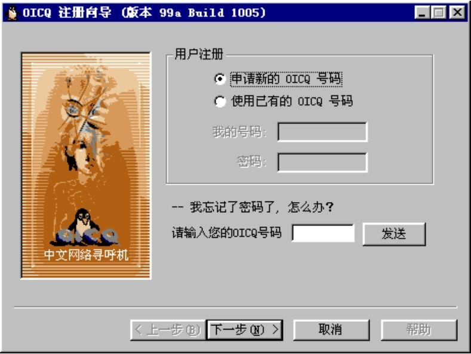
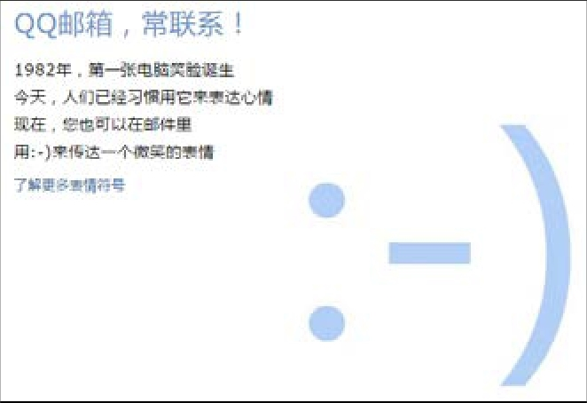

## 6.2.2 　案例：QQ的MVP

看一个真实的功能打包案例：QQ，当时还叫OICQ，1988年开始产品规划，1999年2月推出图6-13所示的Beta1，这是QQ的第一个公开版本。因为各种考虑和限制因素，只能优先实现三个特性，应该怎么选？

{ width="331" height="249" }

图6-13　QQ早期版本的注册界面

这是一道腾讯的面试题，网上有很多版本的答案，我按照自己的理解梳理了一遍。我们不去回答在下面的12个特性里到底选哪3个，而把分析焦点放在每一个选项到底应该先做，还是缓缓。

1\. 卡通头像

2\. 不可窃听的安全通讯

3\. 聊天室

4\. 很小的.exe文件

5\. 皮肤Skin

6\. 速度超快0.5秒反应

7\. 聊天记录管理器

8\. 语音

9\. 视频

10\. 看谁在线上

11\. 传文件

12\. QQ表情

第1个功能“卡通头像”，是QQ比较早做的。

那个年代，用户在大多数网络应用里只有一个ID，分不清男女老少。要知道，那会儿还很少有数码相机和摄像头，更别提可以拍照的手机，所以真人头像很难实现。QQ的卡通头像，让用户活了起来。当时，头像用了一批迪斯尼的卡通动物和漫画人物，唤起了早期用户对小时候看过的动画片的记忆，产生了情感连接。而用户自己选择的头像，也帮助用户在沟通时能大概知道对方的性格、性别、年龄，是个萌妹子，还是个女汉子，是个小鲜肉，还是个成熟大叔。

第2个功能“不可窃听的安全通讯”，在QQ历史上是较早实现的功能，但我认为值得商榷。

这可能和QQ最早定位为“中文网络寻呼机”，对标产品是“寻呼机”有关。“寻呼机”主要用于商务场合，对信息安全要求比较高；而QQ，其实是一个偏娱乐、生活化的应用，早期对安全的要求并没有想象得那么高。

第3个功能“聊天室”，也是QQ最早就有的。

QQ最核心的基础功能就是让用户在网上聊天，所以，和所有IM一样，刚推出来时都要解决单边产品的共性问题：第一批用户从哪来，如何让他们彼此互动？第一版QQ的用户大多是孤独的极客，缺少足够的熟人用户，所以要解决“能找到陌生人聊天”这个迫切需求。而聊天室正好可以提供一个有共鸣的主题，让彼此陌生的人在一起天南海北地聊。很多人的打字速度都是当年在聊天室里练出来的。

早期的网络用户，更熟悉的是Web聊天室这种陌生人交友模式，很难在迁移到客户端的聊天工具QQ时，一下子习惯熟人社交。所以先从聊天室开始，这样更尊重用户习惯，让他们适应起来更加顺畅。陌生人聊熟了，再互加一下好友，也解决了用户QQ上没有好友的问题。一旦有了好友，用户就会被黏住，有了持续使用QQ的动力。

第10个功能“看谁在线上”，也是很早实现的特性。因为原因与上一个类似，所以提前说一下。

QQ是即时通讯工具，强调实时性。要立即找人聊天，就得知道当时谁在线上，QQ有在线、离线、隐身等状态，这和后来微信的“永远在线”是完全不同的概念。查找谁在线上这个功能，还经常被早期用户用来定向添加好友，比如设定好友查找条件为“北京市海淀区”+“女”+“18到22岁”。（是不是和后来的陌陌很像？）

第4个功能“很小的.exe文件”，是一个并不需要投入太多资源去做的特性。

当年的电脑、网络性能确实很差，要求安装文件尽可能小一点。但QQ的第一个版本，没有经过任何版本迭代，安装文件只有几百K，优化的必要性和空间都很小。真正需要优化安装包大小，要等到若干版本之后，exe文件膨胀到几十M时，才值得专门投入资源去做的。

第5个功能“皮肤Skin”，明显是一个锦上添花的功能。

我一直有个观点，当一个产品开始考虑“换肤”，就说明这个产品进入了成熟期，可以把资源抽调出来去做更重要的事情了。

段子里是这样说的：

公司有个技术牛人，某产品助理向他提需求，牛人一看内容很扯，质问“你觉得这个需求有价值吗？”

对方诚恳回答：“没价值，但是我总得写周报啊。”

牛人想了一分钟，回答说“好吧，我帮你做，因为我也得写周报啊。”

而“换肤”就是这样的需求，一个能满足产品技术团队“写周报”的需求，能满足老板“识别投入过剩”的需求。

第6个功能“速度超快0.5秒反应”，是针对网络的优化，需要尽早做。

当年很多人家里还在使用33.6K、56K的猫[[5]](../04/index.md#footnote_content_txt007_5)
，访问网络速度慢、不稳定。记得假期和大学同学聊QQ时，事先都要按照约定的暗号试试网络是否通畅：我在QQ对话框里输入“1”，他看到了回复“2”，我看到“2”再回“3”，到“10”后掐表算一下平均一条消息需要传输几秒。可见当时的网络的确有明显的延时，哪怕是用QQ传输文字。所以，将网络优化的优先级设为很高是合理的。

第7个功能“聊天记录管理器”，早期并没有做。

仔细区分一下，聊天记录其实有两种，存储在客户端的本地聊天记录和存储在服务器端的漫游聊天记录。限于当时的网络带宽，下载漫游记录纯属奢望，只能考虑客户端聊天记录的备份和管理。但，那个时候很多用户都没有个人电脑，去网吧上网是常态。因为经常需要换电脑，保存本地聊天记录并无实质意义。更为甚者，当时很多用户聊一次QQ就重新注册一个QQ号，完全不理解“个人账号”的含义，以为和登录某些Web聊天室，进房间之前取个昵称是一样的，也就更不会有对备份“聊天记录”这种个人信息的强需求。

第8个“语音”、第9个“视频”和第11个“传文件功能”，都很类似，没有在早期做。

以当时的网络速度，这些功能就算实现了也不会有很好的用户体验，要等到宽带普及才有必要考虑。

第12个功能“QQ表情”，因为满足这个需求有可替代的现行途径，所以也可以先搁置。

当时，很多人都已经知道有一种东西叫颜文字，可以用标点符号及英文表示一些十分简单的面部图案。比如用冒号+不同方向的括号就可以代表笑脸和哭脸，如图6-14所示。所以，解决情绪表达的需求暂时不急。

{ width="278" height="189" }

图6-14　QQ邮箱的欢迎界面，介绍了最早的表情符号

最后，再提一下“优雅降级”这个概念。说的是，在思考这种“一大堆功能中选哪几个先做”的问题时，也可以用逆向思维。假设产品已经完全具备这些功能，但是因为流量太大，服务器撑不住了，必须要关掉某些功能以保证基础产品的可用性，你会留下哪些功能？

天猫双11时，在产品里就做了成百上千个这样的开关，以应对局部系统的压力过大。回到QQ的案例，你想保留的那些，就是应该最先做的。

综上所述，我认为应该最先做的几个特性是：3.6.10　，最多再加一个1。

