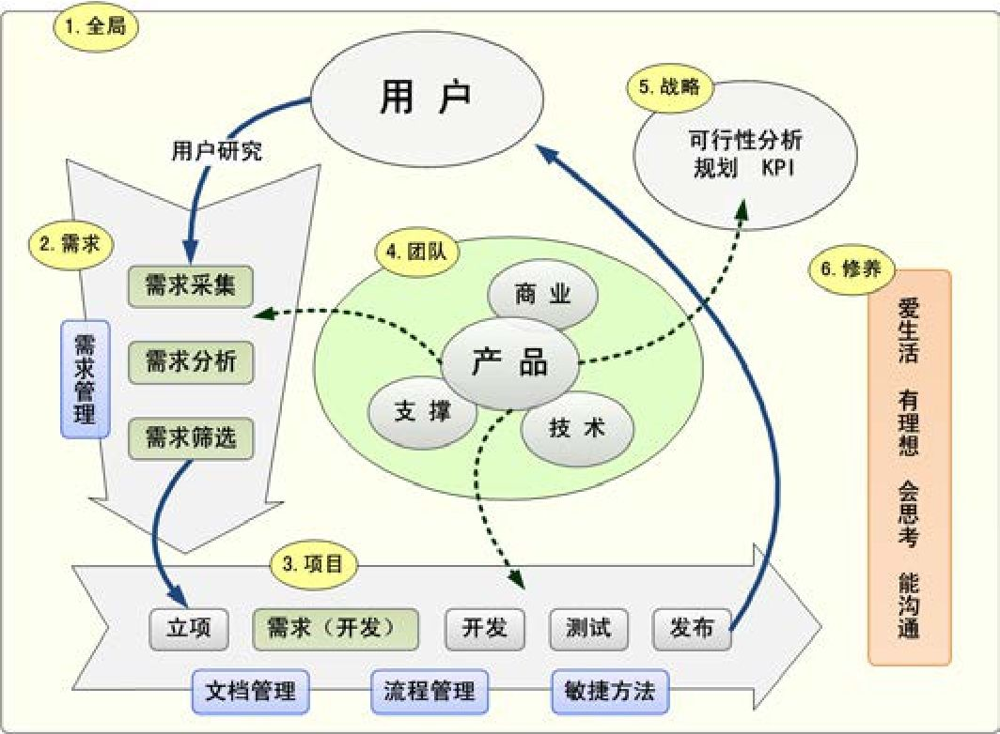
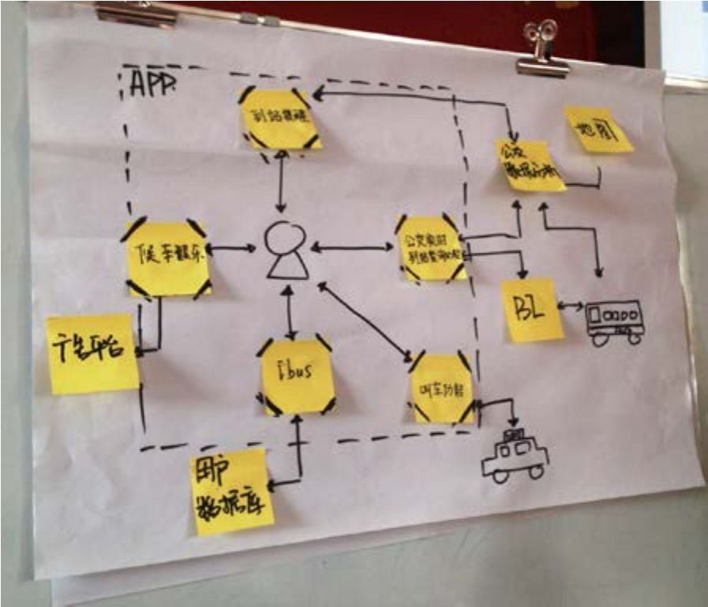
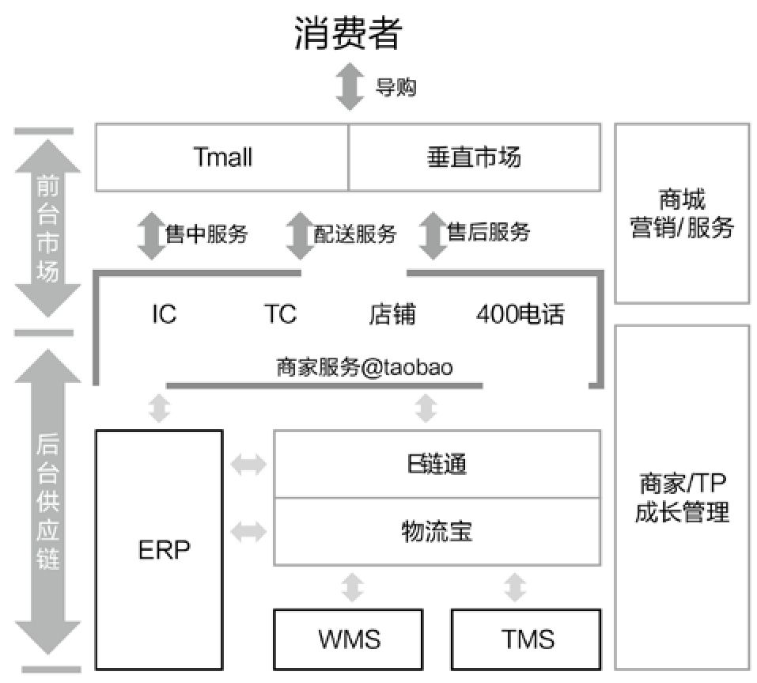

## 6.2.4 　MVP的表达，产品架构图

有一个段子说：

通过在公司里写的文档类型，就能看出地位高低。最底层的写Word，在细化一个具体的任务；高级一点的写Excel，给很多事情安排优先级；更高级的写PPT，需要向老板汇报；什么时候开始听PPT，就成老板了。

俗话说“字不如表，表不如图”，能用一张图来表达想要做的事情，通常说明是想得比较清楚了。产品架构图的形式不限，绘制工具不限，甚至手绘都可以，因为画得好不好根本不重要，关键是要能把事情表达清楚。

一起来看几个例子。

**一本书的产品架构图**

图6-15是用Visio画的，纯自由流，是《人人都是产品经理（纪念版）》一书的产品架构图，表达了每一章讲什么，主要有哪些话题。

{ width="447" height="328" }

图6-15　《人人都是产品经理（纪念版）》的产品架构图

**一个创业产品的架构图**

再来一张，是我在某公司交流时指导学员画的。他们要做一个叫“No Waiting”的产品，切入点是解决“乘坐公共交通出行的人们在上车前和在车上的大量等待时间里感觉很无聊”这个问题。针对这一切入点，学员们以核心用户为中心，把关键功能依次展开，来完成这张产品架构图的绘制。

{ width="377" height="323" }

图6-16　No Waiting的产品架构图

图中有以下几个关键的功能点。

►**公交实时到站查询：**
让用户了解是否需要一路小跑去公交站，还是可以先去旁边的便利店买一瓶水。将来计划对接公交公司的数据、BI（Business Intelligence，商业智能）系统，还会对接地图应用。

►**候车娱乐：**
如果车还有很久才来，或者已经上车还没到站的时候，用户可以通过候车娱乐玩游戏。其亮点在于，玩的过程中不用再紧张地随时需要停下来抬头看看是否该上、下车了，系统里会有到站提醒。这一功能点将来可以用来承接广告，产生直接收入。

►**叫车功能：**
如果实在等不及，还可以唤起第三方的打车应用。

►**到站提醒：**
准备上车和准备下车的提醒，同样需要对接公交系统的数据。

►**个人中心iBus：**
建立用户数据库，让系统记录用户的家、公司等常去地点及乘车路线，将来也许可以做社交，比如：“本月你和小红已经在这路公交车上邂逅3次了，要不要打个招呼？”

**天猫的产品架构图**

图6.17.2010　年天猫（当时还叫淘宝商城）的真实产品架构图，供大家参考。

{ width="402" height="363" }

图6.17.2010　年淘宝商城的产品架构图

根据表达的需要，产品架构图可以画成流程图、实体关系图、用例图等，各种类型的架构图都可以在网上找到相应的参考。

