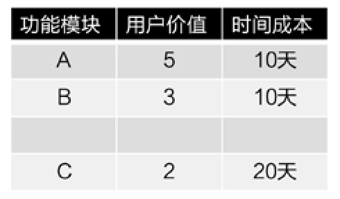
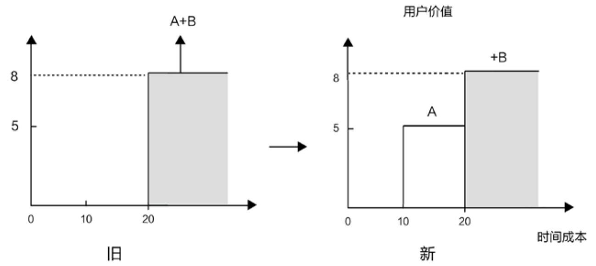

## 6.2　功能打包，确定MVP

到这里，基本完成了功能细化的工作。接下来，就要回答How many这个问题，决定下一个版本到底要做到什么程度。这一节标题里的“功能打包”，就是从整个功能列表里，把下个版本打算做的功能点挑选出来，理清逻辑，安排实施的意思。

### 6.2.1 　尽可能多地放弃

产品界的主流价值观是“少做就是多做”、“完美不是无一分可增，而是无一分可减”。所以，这一步要确定“最小可行产品”，即MVP（Minimum Viable Product）。

MVP是指的是满足“用户愿意用、最好愿意付费”、“用户易于使用”、“团队有能力实现”的最小功能集合，有些可以直接作为最终产品使用，有些甚至只能用来演示。它的重点就是制作的成本要极低，但是却能展示最终产品的主要特色。当然，对MVP的解释也有争议，比如“可以人工跑通流程的业务模型”算不算MVP？但比起理解MVP的目的，这并不重要。

MVP 的功用就是让你拿着它接触客户，尽早根据客户的回馈来改进你的产品。用户需要的东西有时候并不难实现，但很容易被忽略。如果你不是一开始就跟用户接触，就很难知道这些内幕。典型的错误就是窝在家里做没人要的东西，却自以为很有成就。

和需求采集阶段“尽可能多地采集”不同，这一步要“尽可能多地放弃”。看似矛盾的理念，其实目的都是为了提供尽可能多的用户价值。可以通过表6-2以及[图6-12](#figure-6-12)来理解这个观点。

<figure markdown="1">

<figcaption markdown="span" style="margin:0.5em auto;font-size:0.8em;font-style:normal;line-height:1.5">
表6-2　A、B、C三个功能模块的用户价值与时间成本
</figcaption>

{ width="198" height="113" }

</figure>

<figure id="figure-6-12" tabindex="-1" markdown="1">

{ width="546" height="243" }

<figcaption markdown="span" style="margin:0.5em auto;font-size:0.8em;font-style:normal;line-height:1.5">
图6-12　尽可能多的放弃，反而能提供更多价值
</figcaption>

</figure>

这是一个理想化的模型，假设功能列表里待开发的功能模块有A、B、C三个，价值和成本如表6-2以及[图6-12](#figure-6-12)所示。来对比以下两种做法。

第一种是传统做法，先做A和B，到第20天，可以发布一个用户价值为5.3.8　的产品。

第二种是新做法，先做A，再做B。这样，到第10天，就可以发布一个用户价值为5的产品，第20天依然可以发布一个用户价值为8的产品。

如果简单地把曲线下的面积理解成产品持续提供给用户的价值，那么可以从图中得出明显的结论：只要条件允许，“尽可能多地放弃”反而能提供更多的用户价值。这里的放弃不是要把更多功能丢掉，而是不要集中完成，分批次地迭代实现。

这样做的另一个好处是，可以提前10天开始获取用户和市场的反馈，而这就足以让我们能提前几天制定出更合理的产品策略。比如，在开始做C之前，发现价值为4的D模块，就可以改为先做D。

真实场景中可能会出现以下情况，需要加以留意。

►发布的频次，并非越频繁越好。因为发布本身也需要占用时间和支付成本，如果发布次数太多，正式版的最终发布时间会不断延迟，最终严重影响产品整体的市场节奏。

►越轻量级的产品，越容易打包出一个尽量小的MVP。能独立发布的前提条件是要有一个MVP，但并不是每个产品都能很容易地打包出一个MVP，这取决于产品形态。从大实体到软硬结合、CS结构、BS结构，越重的产品打包MVP的难度越大。

►不完美的产品先让种子用户去用。提前发布的产品，直接推给全体用户时一定要慎重。最好能和“种子用户”的概念结合起来，让他们来完成试用。

我们经常听到迭代、敏捷、试错、小步快跑、持续交付等这些说法，其实它们都表达了相似的价值观——尽可能早地改正错误。一年有52周，如果4周迭代一次，则有13次改正的机会，如果2周迭代一次，就有26次改正的机会。迭代的话题属于研发生产环节，后面的章节还会细聊。

### 6.2.2 　案例：QQ的MVP

看一个真实的功能打包案例：QQ，当时还叫OICQ，1988年开始产品规划，1999年2月推出[图6-13](#figure-6-13)所示的Beta1，这是QQ的第一个公开版本。因为各种考虑和限制因素，只能优先实现三个特性，应该怎么选？

<figure id="figure-6-13" tabindex="-1" markdown="1">

{ width="331" height="249" }

<figcaption markdown="span" style="margin:0.5em auto;font-size:0.8em;font-style:normal;line-height:1.5">
图6-13　QQ早期版本的注册界面
</figcaption>

</figure>

这是一道腾讯的面试题，网上有很多版本的答案，我按照自己的理解梳理了一遍。我们不去回答在下面的12个特性里到底选哪3个，而把分析焦点放在每一个选项到底应该先做，还是缓缓。

1\. 卡通头像

2\. 不可窃听的安全通讯

3\. 聊天室

4\. 很小的.exe文件

5\. 皮肤Skin

6\. 速度超快0.5秒反应

7\. 聊天记录管理器

8\. 语音

9\. 视频

10\. 看谁在线上

11\. 传文件

12\. QQ表情

第1个功能“卡通头像”，是QQ比较早做的。

那个年代，用户在大多数网络应用里只有一个ID，分不清男女老少。要知道，那会儿还很少有数码相机和摄像头，更别提可以拍照的手机，所以真人头像很难实现。QQ的卡通头像，让用户活了起来。当时，头像用了一批迪斯尼的卡通动物和漫画人物，唤起了早期用户对小时候看过的动画片的记忆，产生了情感连接。而用户自己选择的头像，也帮助用户在沟通时能大概知道对方的性格、性别、年龄，是个萌妹子，还是个女汉子，是个小鲜肉，还是个成熟大叔。

第2个功能“不可窃听的安全通讯”，在QQ历史上是较早实现的功能，但我认为值得商榷。

这可能和QQ最早定位为“中文网络寻呼机”，对标产品是“寻呼机”有关。“寻呼机”主要用于商务场合，对信息安全要求比较高；而QQ，其实是一个偏娱乐、生活化的应用，早期对安全的要求并没有想象得那么高。

第3个功能“聊天室”，也是QQ最早就有的。

QQ最核心的基础功能就是让用户在网上聊天，所以，和所有IM一样，刚推出来时都要解决单边产品的共性问题：第一批用户从哪来，如何让他们彼此互动？第一版QQ的用户大多是孤独的极客，缺少足够的熟人用户，所以要解决“能找到陌生人聊天”这个迫切需求。而聊天室正好可以提供一个有共鸣的主题，让彼此陌生的人在一起天南海北地聊。很多人的打字速度都是当年在聊天室里练出来的。

早期的网络用户，更熟悉的是Web聊天室这种陌生人交友模式，很难在迁移到客户端的聊天工具QQ时，一下子习惯熟人社交。所以先从聊天室开始，这样更尊重用户习惯，让他们适应起来更加顺畅。陌生人聊熟了，再互加一下好友，也解决了用户QQ上没有好友的问题。一旦有了好友，用户就会被黏住，有了持续使用QQ的动力。

第10个功能“看谁在线上”，也是很早实现的特性。因为原因与上一个类似，所以提前说一下。

QQ是即时通讯工具，强调实时性。要立即找人聊天，就得知道当时谁在线上，QQ有在线、离线、隐身等状态，这和后来微信的“永远在线”是完全不同的概念。查找谁在线上这个功能，还经常被早期用户用来定向添加好友，比如设定好友查找条件为“北京市海淀区”+“女”+“18到22岁”。（是不是和后来的陌陌很像？）

第4个功能“很小的.exe文件”，是一个并不需要投入太多资源去做的特性。

当年的电脑、网络性能确实很差，要求安装文件尽可能小一点。但QQ的第一个版本，没有经过任何版本迭代，安装文件只有几百K，优化的必要性和空间都很小。真正需要优化安装包大小，要等到若干版本之后，exe文件膨胀到几十M时，才值得专门投入资源去做的。

第5个功能“皮肤Skin”，明显是一个锦上添花的功能。

我一直有个观点，当一个产品开始考虑“换肤”，就说明这个产品进入了成熟期，可以把资源抽调出来去做更重要的事情了。

段子里是这样说的：

公司有个技术牛人，某产品助理向他提需求，牛人一看内容很扯，质问“你觉得这个需求有价值吗？”

对方诚恳回答：“没价值，但是我总得写周报啊。”

牛人想了一分钟，回答说“好吧，我帮你做，因为我也得写周报啊。”

而“换肤”就是这样的需求，一个能满足产品技术团队“写周报”的需求，能满足老板“识别投入过剩”的需求。

第6个功能“速度超快0.5秒反应”，是针对网络的优化，需要尽早做。

当年很多人家里还在使用33.6K、56K的猫[[5]](../04/index.md#footnote_content_txt007_5)
，访问网络速度慢、不稳定。记得假期和大学同学聊QQ时，事先都要按照约定的暗号试试网络是否通畅：我在QQ对话框里输入“1”，他看到了回复“2”，我看到“2”再回“3”，到“10”后掐表算一下平均一条消息需要传输几秒。可见当时的网络的确有明显的延时，哪怕是用QQ传输文字。所以，将网络优化的优先级设为很高是合理的。

第7个功能“聊天记录管理器”，早期并没有做。

仔细区分一下，聊天记录其实有两种，存储在客户端的本地聊天记录和存储在服务器端的漫游聊天记录。限于当时的网络带宽，下载漫游记录纯属奢望，只能考虑客户端聊天记录的备份和管理。但，那个时候很多用户都没有个人电脑，去网吧上网是常态。因为经常需要换电脑，保存本地聊天记录并无实质意义。更为甚者，当时很多用户聊一次QQ就重新注册一个QQ号，完全不理解“个人账号”的含义，以为和登录某些Web聊天室，进房间之前取个昵称是一样的，也就更不会有对备份“聊天记录”这种个人信息的强需求。

第8个“语音”、第9个“视频”和第11个“传文件功能”，都很类似，没有在早期做。

以当时的网络速度，这些功能就算实现了也不会有很好的用户体验，要等到宽带普及才有必要考虑。

第12个功能“QQ表情”，因为满足这个需求有可替代的现行途径，所以也可以先搁置。

当时，很多人都已经知道有一种东西叫颜文字，可以用标点符号及英文表示一些十分简单的面部图案。比如用冒号+不同方向的括号就可以代表笑脸和哭脸，如[图6-14](#figure-6-14)所示。所以，解决情绪表达的需求暂时不急。

<figure id="figure-6-14" tabindex="-1" markdown="1">

{ width="278" height="189" }

<figcaption markdown="span" style="margin:0.5em auto;font-size:0.8em;font-style:normal;line-height:1.5">
图6-14　QQ邮箱的欢迎界面，介绍了最早的表情符号
</figcaption>

</figure>

最后，再提一下“优雅降级”这个概念。说的是，在思考这种“一大堆功能中选哪几个先做”的问题时，也可以用逆向思维。假设产品已经完全具备这些功能，但是因为流量太大，服务器撑不住了，必须要关掉某些功能以保证基础产品的可用性，你会留下哪些功能？

天猫双11时，在产品里就做了成百上千个这样的开关，以应对局部系统的压力过大。回到QQ的案例，你想保留的那些，就是应该最先做的。

综上所述，我认为应该最先做的几个特性是：3.6.10　，最多再加一个1。

### 6.2.3 　MVP的限制因素

现在，试着完整地回答如何打包功能和确定MVP这个问题。

**不同功能不同对策**

先回顾理想模型，结合相关原则和限制，按照性价比的评估和KANO模型的功能分类，最终结论可总结为：

►基础功能必做，要留足资源。

►在产品初创期，先实现个别低成本的亮点。

►对期望功能，先做性价比高的。

►无差别功能无须做，低成本验证出来即可。

►对反向功能，权衡各方利益后再决定。

**考虑功能依赖关系**

功能的内外部依赖关系，如合作伙伴和各种前置条件等，都需要事先考察。

例如，某个功能的实现有技术难点，在你的公司里只有某位技术大牛才能解决，而他短期内在另外一个项目里出不来；或者，你的海淘业务想做一个互动，能不能成功，取决于某个关键商品是否能拿到更好的价格，现在需要等待与供应商的谈判结果。功能的依赖关系，有点像产品概念筛选环节需要讨论的那些因素。只不过，这里需要考虑的因素更细节、更具体，并且是针对每一个具体功能点的。

**考虑功能相似性**

功能相似才能保证我们做的是一个整体的项目，而不是一个小需求合集。本书提及的所有产品相关流程，更加适用于一个完整的可以实现用户价值的产品，而日常小修小补的需求合集，则可以做适当简化。一般来说，1.0.2　.0这种成熟的版本，基本上已经是一个完整的产品，而1.01.2　.1.3这样微小的版本升级，通常对应一个小需求的合集。

**考虑非功能需求**

最后，还要识别出一些“非功能需求”。由于非功能需求也是有成本的，所以要在项目实施之前应当一并考虑进去。如“论坛需要支持1000人同时在线”，这是一个性能需求；“系统功能升级，必须在发布2周以前完成对客服部门的培训”，这是一个培训需求；“如果硬件压力突增，应该有报警，具体细节是……”，这是一个运维部门的维护需求；“在用户数增加10倍的情况下，硬件投入必须小于2倍”，这是一个可扩展需求；“此功能的用户操作日志需要记录”，这是一个内部数据分析的需求。

功能打包好了，怎么来表达你的MVP呢？通常会画一张产品架构图。

### 6.2.4 　MVP的表达，产品架构图

有一个段子说：

通过在公司里写的文档类型，就能看出地位高低。最底层的写Word，在细化一个具体的任务；高级一点的写Excel，给很多事情安排优先级；更高级的写PPT，需要向老板汇报；什么时候开始听PPT，就成老板了。

俗话说“字不如表，表不如图”，能用一张图来表达想要做的事情，通常说明是想得比较清楚了。产品架构图的形式不限，绘制工具不限，甚至手绘都可以，因为画得好不好根本不重要，关键是要能把事情表达清楚。

一起来看几个例子。

**一本书的产品架构图**

[图6-15](#figure-6-15)是用Visio画的，纯自由流，是《人人都是产品经理（纪念版）》一书的产品架构图，表达了每一章讲什么，主要有哪些话题。

<figure id="figure-6-15" tabindex="-1" markdown="1">

{ width="447" height="328" }

<figcaption markdown="span" style="margin:0.5em auto;font-size:0.8em;font-style:normal;line-height:1.5">
图6-15　《人人都是产品经理（纪念版）》的产品架构图
</figcaption>

</figure>

**一个创业产品的架构图**

再来一张，是我在某公司交流时指导学员画的。他们要做一个叫“No Waiting”的产品，切入点是解决“乘坐公共交通出行的人们在上车前和在车上的大量等待时间里感觉很无聊”这个问题。针对这一切入点，学员们以核心用户为中心，把关键功能依次展开，来完成这张产品架构图的绘制。

<figure id="figure-6-16" tabindex="-1" markdown="1">

{ width="377" height="323" }

<figcaption markdown="span" style="margin:0.5em auto;font-size:0.8em;font-style:normal;line-height:1.5">
图6-16　No Waiting的产品架构图
</figcaption>

</figure>

图中有以下几个关键的功能点。

►**公交实时到站查询：**
让用户了解是否需要一路小跑去公交站，还是可以先去旁边的便利店买一瓶水。将来计划对接公交公司的数据、BI（Business Intelligence，商业智能）系统，还会对接地图应用。

►**候车娱乐：**
如果车还有很久才来，或者已经上车还没到站的时候，用户可以通过候车娱乐玩游戏。其亮点在于，玩的过程中不用再紧张地随时需要停下来抬头看看是否该上、下车了，系统里会有到站提醒。这一功能点将来可以用来承接广告，产生直接收入。

►**叫车功能：**
如果实在等不及，还可以唤起第三方的打车应用。

►**到站提醒：**
准备上车和准备下车的提醒，同样需要对接公交系统的数据。

►**个人中心iBus：**
建立用户数据库，让系统记录用户的家、公司等常去地点及乘车路线，将来也许可以做社交，比如：“本月你和小红已经在这路公交车上邂逅3次了，要不要打个招呼？”

**天猫的产品架构图**

[图6.17](#figure-6-17).2010　年天猫（当时还叫淘宝商城）的真实产品架构图，供大家参考。

<figure id="figure-6-17" tabindex="-1" markdown="1">

{ width="402" height="363" }

<figcaption markdown="span" style="margin:0.5em auto;font-size:0.8em;font-style:normal;line-height:1.5">
图6.17.2010　年淘宝商城的产品架构图
</figcaption>

</figure>

根据表达的需要，产品架构图可以画成流程图、实体关系图、用例图等，各种类型的架构图都可以在网上找到相应的参考。

### 6.2.5 　功能分分合合的本质

顺着产品架构的话题，再探讨一个产品形态的问题——不同的功能，到底应该做在一起，还是分开。举个例子：滴滴平台的顺风车，乘客和车主的功能在同一个客户端里，而其出租车，乘客和司机的功能分布于两个客户端。

其实这个问题背后的判断逻辑很简单，就是看**不同用户角色背后的自然人重合度高不高**
。如果高，则倾向于同一个端搞定，如果不高，则倾向于分离。

说一个淘宝的故事。

淘宝的买家和卖家，是典型的双边，他们都需要“商品类目”这个功能。一开始，淘宝试图用一套类目满足双方，但发现两者需求不同。买家通过类目来找商品，希望路径更短，更容易找到，为了不断优化路径，类目结构最好能随着季节、热点不停变换；卖家通过类目来发布商品，则希望其相对固定。

后来淘宝做了一个很大的项目，叫“前后台类目拆分”。简单地说就是，卖家通过后台类目发布商品，买家通过前台类目选择商品，用不同的产品来服务不同的用户。

这个项目体现的是互联网向传统行业学习的结果，我在《淘宝十年产品事》中有过仔细的描述，简单说就是电商向线下超市学习商品陈列。

大超市里的商品，在货架上的陈列方式是变来变去的，会随着季节、销售情况或特定事件经常调整。大超市还有一个重要的地方，就是仓库。仓库里的商品摆放相对固定，食品就在食品区，洗护用品就在洗护区。所以说，商品放在两个地方，对应的是两种分类方法：前台销售和后台存储。从这个例子可以看出，电子商务并不一定比传统商务先进，毕竟后者发展了数百年，一定有很多值得学习的东西。

如果把外部用户和公司员工视为广义的双边用户，那么，通常外部用户用的前台产品和员工用的后台系统，是两个独立的产品。所以，MVP阶段，就很可能需要做一个独立的后台，而这部分往往被新手产品经理忽略，特别提醒一下。

