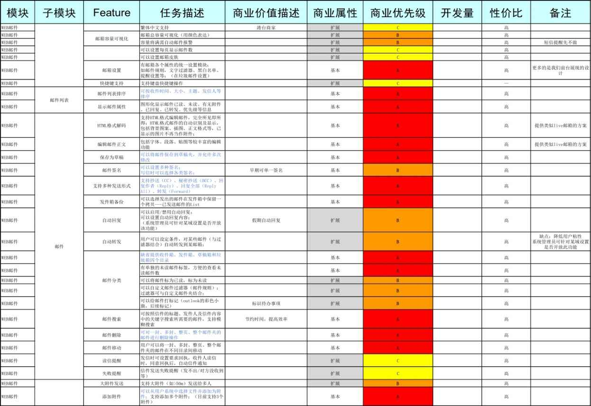
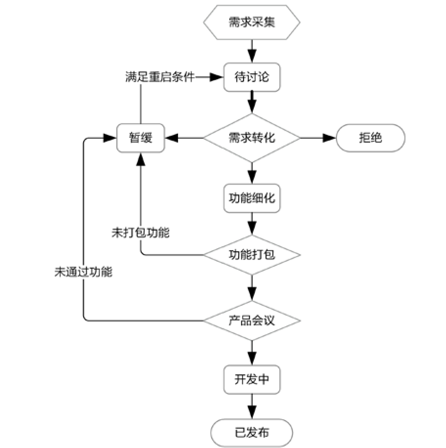

## 6.3　把需求和功能管起来

该做哪些、做多少都想清楚了，MVP和产品架构图也确定了，接下来要扫个尾，把已经做了的、正在做的、还没做的需求和功能都管理起来。可以从以下两个维度进行管理。

### 6.3.1 　空间维度：功能列表

空间维度的管理工具是“功能列表”，它表达了在某个时间切片，所有功能的状态。类似[图6-18](#figure-6-18)，每行是一个功能点，每列是功能的一种属性。读者如想进一步了解相关知识，请参阅拙作《人人都是产品经理（纪念版）》，书中有详细讲解。

<figure id="figure-6-18" tabindex="-1" markdown="1">

{ width="612" height="422" }

<figcaption markdown="span" style="margin:0.5em auto;font-size:0.8em;font-style:normal;line-height:1.5">
图6-18　功能列表示意
</figcaption>

</figure>

### 6.3.2 　时间维度：需求流程

时间维度的管理工具是“需求流程”，它其实是从需求到功能的状态流转图。[图6-19](#figure-6-19)反映的就是从最初需求采集回来的待讨论状态开始，之后需求发生转化，流向开发环节，最后过渡到已发布状态的全流程。“需求流程”实际上是在管理某个需求到功能的完整生命周期。读者如想进一步了解，同样可以参阅《人人都是产品经理（纪念版）》一书。

值得一提的是，[图6-19](#figure-6-19)里的“暂缓”，在实际工作中已化身为“这个需求放二期”，成为产品经理拒绝需求的金句。用这招，不知道砍掉了多少功能，因为很多项目根本就没有二期。还有一些砍需求的金句，分享出来博读者一乐[[6]](../04/index.md#footnote_content_txt007_6)
。

<figure id="figure-6-19" tabindex="-1" markdown="1">

{ width="384" height="385" }

<figcaption markdown="span" style="margin:0.5em auto;font-size:0.8em;font-style:normal;line-height:1.5">
图6-19　需求到功能的状态流转
</figcaption>

</figure>

你不是我的目标用户。

这是你的需求，还是用户的需求。

我建议你们再去评估一下。

……

