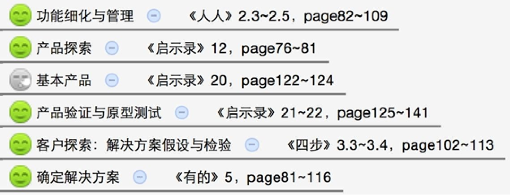
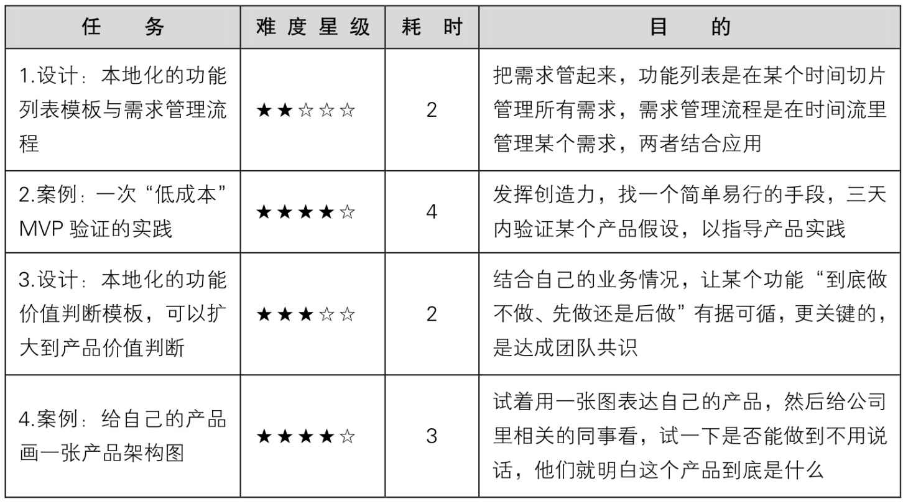
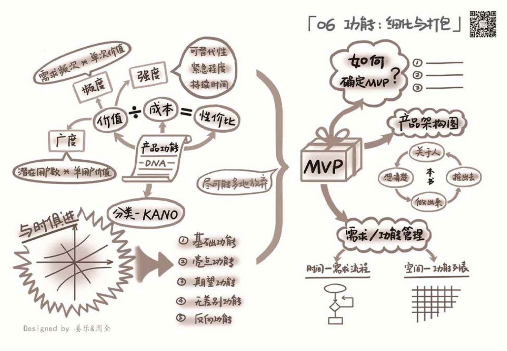

## 6.4　延伸阅读与练习

本章关联到另外几本书的相关章节如下。其中的图标表示推荐阅读（笑脸）与选择阅读（冷漠脸），亦可根据一些关键词扩展阅读。

<figure markdown="1">

{ width="73" height="73" }

</figure>

<figure markdown="1">

{ width="478" height="181" }

</figure>

可以做的练习任务如下。

<figure markdown="1">

{ width="640" height="354" }

</figure>

<figure markdown="1">

{ width="824" height="570" }

</figure>

---

[[1]](../01/index.md#footnote_quote_txt007_1)
表6-1中标记\*的功能属性比较重要，为必填项。

[[2]](../01/index.md#footnote_quote_txt007_2)
举个例子，假设某产品在当前关注用户数与收入两个指标中更看重前者，就可以用“用户数\*0.7 + 收入\*0.3”来作为加权合并后的综合指标。

[[3]](../01/index.md#footnote_quote_txt007_3)
KANO 模型是东京理工大学教授狩野纪昭（Noriaki Kano）发明的一种对用户需求进行分类和优先排序的实用工具，以分析用户需求对用户满意的影响为基础，体现了产品性能和用户满意之间的非线性关系。

[[4]](../01/index.md#footnote_quote_txt007_4)
第02章里提过的概念，指需要几个不同人群一起使用才能产生价值的产品。

[[5]](../02/index.md#footnote_quote_txt007_5)
猫是Modem的谐音，即调制解调器，是早年的拨号上网设备。

[[6]](../03/index.md#footnote_quote_txt007_6)
想看更多产品经理的内心OS，可以扫右侧二维码看我自拍的一个小视频。

