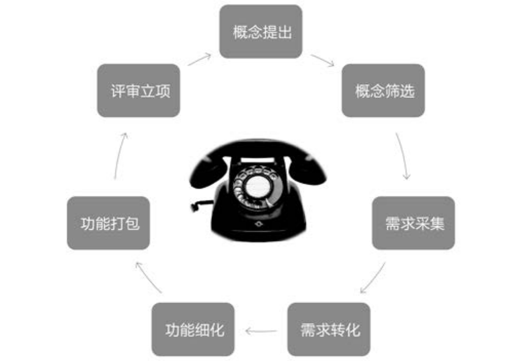

## 7.1　从“想清楚”到“做出来”

截止第06章，我们几乎已经想清楚了要做什么。第03到06章提到的关键步骤可以概括为[图7-1](#figure-7-1)，也可以把这个过程称作“创意设计”环节。图中特意放置了一个老式电话机，是为了再次提醒，这些步骤不是Step by Step顺序完成的，而是更像老式电话机的拨号过程[[1]](../05/index.md#footnote_content_txt008_1)
，要不停地回溯到前面进行过的步骤去验证，如经验证发现步骤有误，需要继续向前追溯，以进一步修正相关步骤。

<figure id="figure-7-1" tabindex="-1" markdown="1">

{ width="419" height="295" }

<figcaption markdown="span" style="margin:0.5em auto;font-size:0.8em;font-style:normal;line-height:1.5">
图7-1　“想清楚”的几大步骤
</figcaption>

</figure>

本章的开始，先说说产品项目执行前最后的验证——评审立项。因为必须找到一群人来完成执行，接着会聊聊组队的话题，最后再讲讲执行过程中有哪些注意事项，以确保通过合理、准确的研发生产把产品做出来。

### 7.1.1 　原型验证与NPS

确保有的放矢，**不要努力地做错误的事**
，这是产品立项前要做出的最重要的判断。因为，立项就意味着研发资源的正式投入。在这个节点的验证，叫原型验证。之前的验证，主要目的是验证用户需求抓得准不准，而本次验证则是考察用户是否认可解决方案。

有的公司把这个环节叫作POC（Proof of Concept），产品概念测试。在这一环节，需要用尽量低的成本，做出某种形式的产品原型或Demo，来让用户试用。对于制作原型的工具和方法，网上资料很多，不再细说，本书重点提一个叫NPS的概念。

NPS（Net Promoter Score）指净推荐值，是一种计量用户将会向其他人推荐某产品可能性的指数。作为一种流行的用户忠诚度分析指标，它专注于用户口碑，在产品早期验证用户价值时，尤为重要[[2]](../05/index.md#footnote_content_txt008_2)
。

净推荐值的计算公式：

NPS =（推荐者数 – 批评者数）/总样本数×100%

确定净推荐值时，可以直截了当地问用户一个问题：“您是否会愿意将某某产品推荐给您的朋友或者同事？”然后让用户根据愿意推荐的程度，在0到10分之间来打分，最后根据打分情况把用户分为推荐者、被动者和批评者。

►**推荐者：**
打分在9～10分之间，是具有狂热忠诚度的人，他们会继续使用产品并将其引荐给其他人，可以帮助产品成长。

►**被动者：**
打分在7～8分之间，总体满意但并不狂热，会用但不会传播，可能考虑其他竞争对手的产品。

►**批评者：**
打分在0～6分之间，使用后不满意，或者对你的产品没有忠诚度，可能有负面口碑，会阻碍产品成长。

然后，再根据推荐者和批评者的人数来计算NPS的数值。

NPS的得分值在50%以上就已经比较理想，如果达到70%～80%，则说明产品拥有一批忠实拥趸。而实际情况是，很多产品的NPS值远远低于50%，甚至是负数。如果你的产品还没有测试过NPS，那么赶紧去测试一下吧，这个测试永远都不晚。如果分数太低，建议马上把推广甚至研发生产停下来，回过头来好好想清楚产品定位。产品上市后，NPS也应该定期测试，以指导后续策略。

对于验证用户是否认可解决方案这件事儿，没经验的产品经理可能会去问用户：这个产品做出来你会不会用，会不会买？这时候，用户通常会给出毫无意义的敷衍式回答：我可能会用、会买。所以一定要用净推荐值这种方式来问，这一步骤是产品生命周期早期的一个关键节点。

### 7.1.2 　产品委员会与关键节点

从“想清楚”到“做出来”，再到“推出去”，每逢关键节点，都需要判断接下来对此产品是应该加大投入、保持投入，还是减少投入。那么，由谁来判断？答案就是“产品委员会”。

一个团队里，总会有某种形式的“产品委员会”存在，他们通常由各个相关团队的Leader组成，或者说得更直白一点，由手里握有资源的人组成。因为资源投入方向要阶段性地做出判断，所以产品委员会要在每个关键节点召开产品会议。经过筛选，以下四个关键节点是必不可少的。

**概念筛选**

根据各种背景信息，判断要不要对某个产品概念进行细化、展开。如果认为可行，就要启动全方位的需求采集工作。这是本书第03章讲的事情。

**立项组队**

对产品进行原型验证，评估需要投入多少研发生产资源，有多少风险及如何应对等。如果立项获批，就要启动项目、组队开干。这是本章前半部分的内容。

**上线发布**

产品完成开发后，千万不要因为怕浪费而仓促上线。这时还是要先用真实产品找种子用户验证，如果没有通过验证，就不要上线，以免浪费更多的客服、销售、运营维护资源。

**营销推广**

为提升用户量，上线之后马上就开始推广，也是常见的错误。应该先花一段时间考察用户是否活跃，是否会再次使用产品。当这些指标达到预期后，才可以大力推广，否则就是浪费资源。

在大公司，这四个节点是申请资源的关键节点；在创业公司，这四个节点是引入外部投资、关键岗位人才的重要节点。产品经理们只有把自己的视野拓宽一下，站在老板或投资人的立场去想想他们到底想要什么，才更容易理解获取资源更有效的途径。接下来讲立项时具体需要搞定哪些资源。

