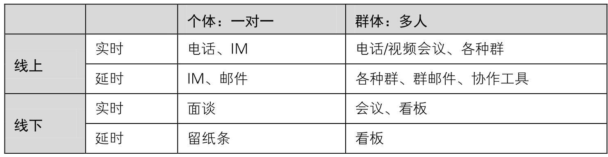

## 7.3.2 　小团队的沟通协作

虚的讲完了，再讲一个实的。这也是我带过的一个真实小团队的故事。这个团队一共有5人，其中2个全职、3个兼职，每个人的专业能力都不错，做的是互联网/移动互联网领域的产品。因为不在同一个城市办公，挑一个好用的协作工具来同步信息，成为关键点。

本着“工欲善其事，必先利其器”的理念，团队组建前就研究过很多协作工具。但并没有一个工具被坚持采用下来，因为随着一个个队友的加入，前一个工具总是很快被与团队规模更加匹配的新工具所取代。我们始终遵循“奥卡姆剃刀”原理[[4]](../05/index.md#footnote_content_txt008_4)
，每时每刻都在考虑用最低成本的方式来满足需求。

**第一/二周，**
只有2个人，微信+电话搞定。

**第三/四周，**
团队变5个人了，很自然地改用微信群搞定。大家也第一次在北京集结，一起吃了个饭。随着要做的事情逐步清晰，我开始把自己手头的文档分享给大家，发现微信群分享文档不太方便，需要新工具了。

**第五/六周，**
我们发现QQ群就够了，群共享、群公告都很好用。随着工作的展开，会不停地在QQ群里讨论一些细节。这时候，有的兼职同学反馈，他们白天在公司里参加一个会议，就会漏很多信息，之后也不一定能想起来看。这怎么办？

**第七/八周，**
增加了E-mail群发，每天晚上我会把事情汇总后发给大家，第二天晚上再更新汇总。这样运作了几天，感觉还不错。但随着任务越来越多，越来越细，大家都觉得如果能自己更新自己的部分就更好了，可以更高效。

**第九/十周，**
大家聚在一起吃了第二顿饭，总结了在工作方法上可以优化的点，一致认为确实需要一个协同工具了。于是，花了一点时间评估备选工具，猜猜最终用了哪个？我们分析了团队的需求，发现只需要一个格式清爽、允许多人在线编辑的记事本而已。最终，用了一个叫WorkFlowy[[5]](../05/index.md#footnote_content_txt008_5)
的产品。

作为产品经理，在给自己和团队选择产品时，也无时无刻不体会到“没有最好的产品，只有最适合的产品”。最好用的团队协作工具是随着用户需求场景不断变化的。比如，上述团队的成员都是有技术背景的Geek或伪Geek，所以都觉得WorkFlowy不错，而到了这个项目的后期，新加入的运营同学会觉得很不习惯。

把这个话题扩展一下，更多的小团队并非异地办公，而是在一起办公。这时，除了协作工具的使用，随时随地面对面的沟通更加重要。协作也好、沟通也罢，都是为了彼此之间信息同步，表7-1列出了工作中经常用的方法。

<figure markdown="1">

<figcaption markdown="span" style="margin:0.5em auto;font-size:0.8em;font-style:normal;line-height:1.5">
表7-1　沟通协作方式举例
</figcaption>

{ width="617" height="154" }

</figure>

简单地说，实时沟通在需要各方参与讨论时的效率高于延时沟通，但对沟通发起者有利，被动方正在做的工作往往会被打断。所以，加个简单的预约行为会更好。延时沟通用于单向传递信息时的效率更高，无须协调双方时间，紧急情况下加个通知提醒即可。线下沟通的信息传递效率高于线上，因为除了文字、语音、图片等，还可以加入表情、手势等辅助形式，但缺点在于对沟通各方的地理位置有要求，视频会议也只能解决部分问题；线上沟通组织协调各方时间的成本低于线下，如今更可以通过手机随时随地讨论事情。

我们可以根据事情的重要和紧急程度，灵活使用各种沟通协作方法。

