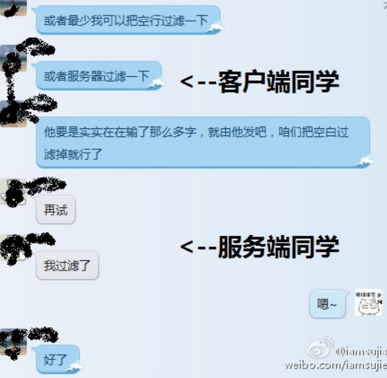

## 7.3　组队：聊聊初创团队

理想的初创团队，当然是熟识多年，底层价值观相同，方法论、能力、性格互补的一群人，但这群人通常不会一开始就凑齐，往往需要经历“借事修人”到“因人成事”的转化。“借事修人”的阶段相当于练兵、演习，就算事情没成，如果锻炼了团队，也算差强人意，接下来就说说这个阶段可能出现的问题以及应对方法。

### 7.3.1 　如何快速知己知彼

以下故事，皆为亲历，如有雷同，真是巧合。

不管怎样，事情只要已经开始，就说明已经凑齐了一支看起来可以开干的团队。大家并不是很熟的时候，做起事来总会一团和气，但过一段时间，每个人都会发现，过程、结果并没有想象得那么美好。于是，团队进入频繁吵架的阶段，大家都在找合适的当口发泄自己的失望和不满。吵架的原因，往往是一些底层的东西并没有达成一致，导致观念冲突，团队成员之间不信任、不理解、没有默契。当出现这种情况时，就说明有些统一思想的事情漏做了。我们要花最少的时间，让大家感觉到彼此已经熟识多年，互相很清楚对方想要什么。

大公司里的专业HR可能会更早意识到这一点，然后提醒业务人员。但对于创业团队，只能靠老大自己发现，然后决定团队成员是不是需要聊聊，以及在什么场合下聊。场合很关键，找到一个大家都很想聊聊的场合，是达成默契的第一步。

所以，在团队里比较和谐的场景是，某天下午大家又因为一个具体的业务问题，从讨论逐步发展到争吵，继而开始对彼此的思维模式、做事套路不认同……正当大家精疲力竭的时候，老大问了一句：“晚上都没事吧？一起去吃饭，我请客。”这就是一个良好的开端。

**在非工作时间、非工作地点**
，沟通更容易敞开。这时候可以一起聊这样几个方面的话题，每个人都要发言。

► 为什么要来这个团队？

讨论可以从每个人的理想，若干年后希望自己在做什么，到更具体的三年后的个人目标。然后，设法找到个人目标与团队目标的结合点。

► 对一年后收获的底线预期。

有人希望能找到一份工资翻倍的新工作，有人希望提升某方面的技能，有人希望锻炼出一支能成事的团队……但任何人都不能一无所获。

► 个人对团队的帮助。

在“守住底线，奔向理想”的基础上，每个人有必要让其他人知道自己是有价值的，而每个人也需要知道其他人的具体价值。

► 自己能做什么？

这个话题主要总结过往积累的能力。

通过一个人过去做过的事情，比如App的渠道运营、做过SEO等，可以看出哪些事情他可以较快上手。团队Leader对每个人比较了解，但团队核心成员很有可能互相并不清楚对方能做什么。

► 自己想做什么？

这个问题用来探求将来的意愿。

每个人都有希望提升的方面。比如，有人想在线上线下的活动策划上有提升，以便对运营岗位有个更全面的把握，这时其他团队成员可以一起帮着分析、判断一下，其想提升的方向和个人的长远目标是否契合。知道对方想要什么，配合起来才更顺畅。

► 项目失败最可能的原因是什么？比如，没能及时引入合适的人，或者团队成长不够快，因整体实力不够，项目难以突破，僵死在一个不好不坏的程度。甚至，初始的股权结构不合理，到某个阶段可能会让团队散掉……

批评与自我批评的意图是继续暴露问题，因此前提是沟通气氛到位，才可以继续聊这个话题。

聊的时候，可以抽离出来，以第三方的视角来看待问题。最终会发现，绝大多数问题还是出在人的身上，团队成员能有共识至关重要。

最终，可以结合以上问题，由团队共同提出非业务层面的改进方案，但方案的核心要点最好不要超过三条。比如，其中一条有可能类似——将决策机制从原来的核心团队共同讨论，直到达成一致，改为核心团队共同讨论，最终由老大拍板后执行，或是核心团队每周必须聚餐之类很具体的举措。

上面这些话题看上去有些虚，但对提升早期核心团队的战斗力非常关键，问题的具体答案是什么其实不重要，重要的是共同参与。

### 7.3.2 　小团队的沟通协作

虚的讲完了，再讲一个实的。这也是我带过的一个真实小团队的故事。这个团队一共有5人，其中2个全职、3个兼职，每个人的专业能力都不错，做的是互联网/移动互联网领域的产品。因为不在同一个城市办公，挑一个好用的协作工具来同步信息，成为关键点。

本着“工欲善其事，必先利其器”的理念，团队组建前就研究过很多协作工具。但并没有一个工具被坚持采用下来，因为随着一个个队友的加入，前一个工具总是很快被与团队规模更加匹配的新工具所取代。我们始终遵循“奥卡姆剃刀”原理[[4]](../05/index.md#footnote_content_txt008_4)
，每时每刻都在考虑用最低成本的方式来满足需求。

**第一/二周，**
只有2个人，微信+电话搞定。

**第三/四周，**
团队变5个人了，很自然地改用微信群搞定。大家也第一次在北京集结，一起吃了个饭。随着要做的事情逐步清晰，我开始把自己手头的文档分享给大家，发现微信群分享文档不太方便，需要新工具了。

**第五/六周，**
我们发现QQ群就够了，群共享、群公告都很好用。随着工作的展开，会不停地在QQ群里讨论一些细节。这时候，有的兼职同学反馈，他们白天在公司里参加一个会议，就会漏很多信息，之后也不一定能想起来看。这怎么办？

**第七/八周，**
增加了E-mail群发，每天晚上我会把事情汇总后发给大家，第二天晚上再更新汇总。这样运作了几天，感觉还不错。但随着任务越来越多，越来越细，大家都觉得如果能自己更新自己的部分就更好了，可以更高效。

**第九/十周，**
大家聚在一起吃了第二顿饭，总结了在工作方法上可以优化的点，一致认为确实需要一个协同工具了。于是，花了一点时间评估备选工具，猜猜最终用了哪个？我们分析了团队的需求，发现只需要一个格式清爽、允许多人在线编辑的记事本而已。最终，用了一个叫WorkFlowy[[5]](../05/index.md#footnote_content_txt008_5)
的产品。

作为产品经理，在给自己和团队选择产品时，也无时无刻不体会到“没有最好的产品，只有最适合的产品”。最好用的团队协作工具是随着用户需求场景不断变化的。比如，上述团队的成员都是有技术背景的Geek或伪Geek，所以都觉得WorkFlowy不错，而到了这个项目的后期，新加入的运营同学会觉得很不习惯。

把这个话题扩展一下，更多的小团队并非异地办公，而是在一起办公。这时，除了协作工具的使用，随时随地面对面的沟通更加重要。协作也好、沟通也罢，都是为了彼此之间信息同步，表7-1列出了工作中经常用的方法。

<figure markdown="1">

<figcaption markdown="span" style="margin:0.5em auto;font-size:0.8em;font-style:normal;line-height:1.5">
表7-1　沟通协作方式举例
</figcaption>

{ width="617" height="154" }

</figure>

简单地说，实时沟通在需要各方参与讨论时的效率高于延时沟通，但对沟通发起者有利，被动方正在做的工作往往会被打断。所以，加个简单的预约行为会更好。延时沟通用于单向传递信息时的效率更高，无须协调双方时间，紧急情况下加个通知提醒即可。线下沟通的信息传递效率高于线上，因为除了文字、语音、图片等，还可以加入表情、手势等辅助形式，但缺点在于对沟通各方的地理位置有要求，视频会议也只能解决部分问题；线上沟通组织协调各方时间的成本低于线下，如今更可以通过手机随时随地讨论事情。

我们可以根据事情的重要和紧急程度，灵活使用各种沟通协作方法。

### 7.3.3 　小团队与大公司的区别

<figure markdown="1">

{ width="73" height="73" }

</figure>

虚的、实的各说了一点，再结合亲身体会，聊一下在小团队和大公司做产品的区别。有一句话说得很好：对于初创公司，组织架构应该以**目标**
为中心，按需设置部门，而不是像大公司一样以**流程**
为中心。而组建公司之前，应该以**机会**
为中心。因为在最早的阶段，运气的确更重要。

以下是我在知乎上对“在大公司和小公司做产品经理有哪些异同点？”的回答。

20.4.12　月，一个小的创业项目启动，我作为创始人，完整体验了从0开始的全过程。20.5.1　月，基本上我是团队的产品、运营、商务、测试……把体会给大家分享一下。

**大公司：**
写规划，过规划——老板那边又没过，郁闷。

**小公司：**
没人管，自己决定做什么。谁来告诉我这么做到底对不对？有人来喷喷也好啊，但找喷都是要钱的（至少得请人吃顿饭吧）。

**大公司：**
竞品分析——那个谁谁也做了类似的东西吗？——没事，我大××怕过谁，灭了他。

**小公司：**
那个谁谁也做了类似的东西吗，大公司？额，怎么避开他……小公司？找他聊聊，看有没有合作的可能。

**大公司：**
用户研究——申请用研团队的资源，输入目的，拿到报告。

**小公司：**
直接约人吃饭、喝咖啡、聊天；隔两天，继续约人吃饭、喝咖啡、聊天。所以，只能做一件身边有很多目标用户的事儿。

**大公司：**
评优先级——最好我提出来的都是最高优先级的，把别人的需求PK掉，哈哈哈。

**小公司：**
没有“别人”，先做哪个自己说了算，但反而要更认真地想——能不能再砍一点，再砍一点，特别心疼开发在没那么重要的功能上花时间，越是能低成本验证的成功率越大。

**大公司：**
需求文档——按模板写啊，谁知道这次分配到哪位来开发……

**小公司：**
自由流太爽了——和开发确认一下能不能看懂就行——用Excel写逻辑，用Visio画图，用Axure做示意Demo，完事儿。

**大公司：**
老板给的开发资源不够啊——走，吵架去。

**小公司：**
算算现在几个全职，几个兼职，开销多少，再加人一个月又要多几万块成本——更充分地体会到“时间就是金钱”——都是资源，容我纠结一下……

**大公司：**
怎么还有这种低级Bug，测试干什么吃的。

**小公司：**
自己测，大家一起测——总是担惊受怕，觉得测得不完整，漏了什么。你问为啥不找个测试？产品早期，能省就省……

**大公司：**
需求变更——发现一个地方可以简单优化一下，可能要走流程什么的，最快两三个礼拜吧。

**小公司：**
如[图7-2](#figure-7-2)所示，我发现了一个小问题，提给客户端同学；正在讨论方案的同时，服务器端同学已经把问题改掉了，几分钟解决。

<figure id="figure-7-2" tabindex="-1" markdown="1">

{ width="317" height="310" }

<figcaption markdown="span" style="margin:0.5em auto;font-size:0.8em;font-style:normal;line-height:1.5">
图7-2　小团队的响应速度
</figcaption>

</figure>

**大公司：**
产品数据不好看（但也是以“万”为单位），找运营聊聊，再搞点流量。

**小公司：**
自己琢磨用户和内容，怎么零成本冷启动，找各种资料补课。

**大公司：**
团队组建，产品1人，设计2人，技术5人，测试2人，运营2人……

**小公司：**
比例一样，只不过是——产品0.3人，设计0.3人，技术1.5人，测试0.2人，运营0.2人……有零有整是因为有兼职同学，或者有人是劈成几个岗位来用的。

**大公司：**
参加聚会，别人过来搭讪，你们正在做什么呢？

**小公司：**
只参加“有用”的聚会，目的性特别强地去主动搭讪——嗨，我们正在做什么什么。

**大公司：**
上班上知乎，偷个闲，嘿嘿嘿。

**小公司：**
连回答这个问题都是有潜在目的的，比如说为了招人……

**大公司：**
睡觉前想想，今天没干什么又收入几百块。

**小公司：**
睡觉前想想，今天没干什么又花了几千块。

现在，有些大公司也在尝试着内部分解，分出很多的小团队来运作，以获取两种状态下的优势。不管你们现在处于哪种状态，都应该好好享受、珍惜，互帮互助、祝福彼此。

### 7.3.4 　借助第三方力量做产品

如7.3.2　节我的那个小团队一样，很多初创公司在一开始都会采取兼职员工的方式做事，这其实是在借助第三方的力量。因为绝大多数初创团队都很弱小，如果任何事情都要自己搞定，那前进的速度肯定会慢下来，所以必须要学会借助外力。举个例子，大公司做一个新产品，可能一开始就会配备专职测试人员，但对于创业公司，尤其是20人以下的团队，很少有专职测试，都是全体员工一起做测试。

本节从创业角度给大家讲讲都有哪些外力可以借用。初创产品、团队碰到的所有问题，最终都可以归结为：找钱、找人。也许你觉得还有找资源、找方向，但所有资源、方向都可以追溯到人和钱上。这两个问题，分别有两种解决方式：旧模式和新模式，如[图7-3](#figure-7-3)所示。

<figure id="figure-7-3" tabindex="-1" markdown="1">

{ width="362" height="154" }

<figcaption markdown="span" style="margin:0.5em auto;font-size:0.8em;font-style:normal;line-height:1.5">
图7-3　找钱、找人的新旧模式
</figcaption>

</figure>

缺钱怎么办？旧模式下就是募资。缺人怎么办？旧模式下就是招人。对于这种比较传统、比较重的模式，其问题在于，资源往往只能优先满足最优秀的公司，很多新的、还没什么名气的团队很难搞定。这时，可以尝试一下新模式。

新模式下应对缺钱的方案是众筹，应对缺人的方案是众包。这里重点讲讲众包。

缺什么人招什么人看似合情合理，但对于创业公司来说，招人其实是一件风险特别大的事情。因为你的业务有可能变化很快，很多时候没等你找到一个合适的人，业务又变了；或者，招来一个人后发现，你的业务暂时只能发挥他的40%的能力，甚至发现招进来的这个人根本不合适。这时候你就要面对最大的风险——时间已经过去了。

精益创业的理念告诉我们，做产品要不断低成本试错，其实用人也是。我们可以利用非全职员工来解决问题，更常见的说法是众包、外包、顾问。

我认为，众包服务又分两类。

一类是帮助现有的人节省时间，通常是借助工具，还有一类是借助外面的人力。

前者，比如做项目管理，本来要花技术负责人20%的时间，现在可以借助项目管理的工具，省掉部分精力，再如要给App加一个客服功能模块，可以借助第三方组件，几行代码搞定。现在各种技术服务已经非常发达了，磨刀不误砍柴工，准备撸起袖子做一件事之前，多研究一下市场上是不是已经有现成的服务。初创团队千万不要重复造轮子，条件允许最好花钱买时间。

再说说借助外面的人力。这其实是一个知识经验领域共享经济的概念。将来的公司和个人的关系，一定比现在更加灵活。个人不再是公司的附庸，公司反而变成了个人的平台。在用人上，越来越多的公司会认可“为我所有不如为我所用”的理念。

这种人才的专业能力众包，又可以分成四个层面。

►第一个层面：**分享**
，就是我说你听，借的力只是一个想法和做法，我并没有帮你做事，而且针对性也不是很强。

►第二个层面：**座谈**
，可以有针对性地进行讨论，给出一些有针对性的建议。

►第三个层面：**咨询**
，给你指导，带着你做。

►第四个层面：**外包**
，直接上手，帮你搞定。

只要可以把工作标准化，外包现在可做的事情就已经有很多，比如客服可以外包，财务出纳的事情可以外包。将来不那么标准化的事情也可以外包，甚至产品的1.0版本也可以交给外包团队来做。做产品，特别是在早期，快比什么都重要，而借助第三方力量，会让团队更加灵敏。而且，产品的早期版本主要用来验证方向对不对，如果发展得好，后期还可以自建团队、重构产品。

关于初创团队的话题，就聊这么多，当一切准备妥当，就要进入“研发生产”阶段了。

