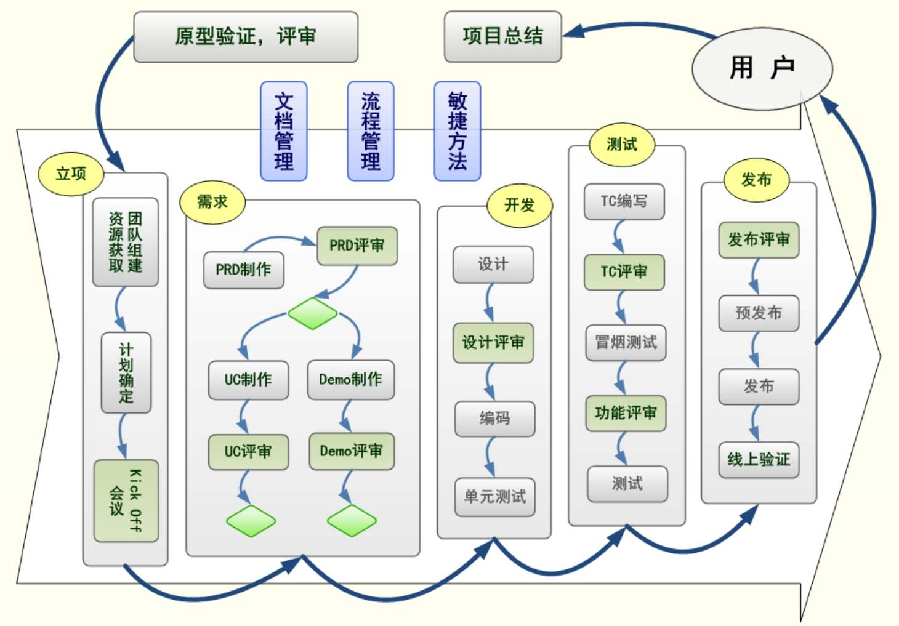

## 7.4　研发生产时，我们做什么

本节说的研发生产阶段，是指立项到产品发布之间的过程。作为产品经理，在这个过程中要做些什么事情呢？[图7-4](#figure-7-4)是对《人人都是产品经理（纪念版）》里描述项目流程的图略做修改后的结果。

<figure id="figure-7-4" tabindex="-1" markdown="1">

{ width="614" height="427" }

<figcaption markdown="span" style="margin:0.5em auto;font-size:0.8em;font-style:normal;line-height:1.5">
图7-4　产品经理视角的项目流程
</figcaption>

</figure>

简单地讲，原型验证完成、产品委员会评审通过以后，要经历立项、需求、开发、测试、发布几大环节，然后再拿着做出来的产品找用户验证，最后做项目总结。

►**立项环节：**
即本章前半部分探讨的话题。在这个环节，产品经理要组建团队、设法获取各种资源，以及确定项目计划。在正式开干之前，一般还会开个Kick Off会议，鼓舞一下士气。

►**需求环节：**
这个环节主要做的是功能细化，也可以叫需求开发。产品经理要写PRD产品需求文档和UC用例，并和设计师配合做Demo原型。在这个过程中，可能会经历多次评审会议，还要和技术人员一起确定功能细节。以写产品需求文档为例，产品经理一般都不会遗漏主干流程的描述，但是否能把分支流程、异常处理、边界条件都写完整就不一定了。比如，一个搜索结果为空或少结果时怎么处理，会员管理列表中如果一个会员都没有，是否应该全空着，微博用户关注人数达到上限时该怎么提示，等等，都是产品经理需要掌握的基本功。

►**开发环节：**
这一环节的主角是开发工程师，他们要做代码方案的设计和评审，然后完成编码和单元测试[[6]](../05/index.md#footnote_content_txt008_6)
。与此同时，产品经理已经开始下一个迭代版本的项目前期准备，这是第08章的话题。

►**测试环节：**
开发推进的同时，测试工程师要编写TC测试用例，通过TC评审，并且在系统可用的第一时间做冒烟测试[[7]](../05/index.md#footnote_content_txt008_7)
。此环节中，产品经理要组织功能评审，在第一时间把新产品展示给所有的项目干系人，以确保做出来的东西是大家想要的。

►**发布环节：**
测试工作完成后，运维人员要组织发布评审，执行预发布、发布的动作，并且在发布完成后让产品经理到真实的线上环境去验证，以确保产品符合预期。

为了保证整个过程的顺利进行，产品经理还要把控三件事。**一是文档管理：**
每个环节的输入/输出文档是什么，用什么模板、工具编写，以及如何保证同步更新等。**二是流程管理：**
每个环节的各种评审会议，是否可以结合团队实际情况做出删减，突发需求和需求变更如何处理等。**三是敏捷方法：**
团队日常沟通采取什么方法，如何监控进度，以及如何改进配合模式等。

上述这些细化需求和跟进研发的工作，产品经理在入行的头两年会经常遇到。我在《人人都是产品经理（纪念版）》的第3章有更加详细的讲述，这里就不再展开。研发生产环节的主角是技术人员，下面主要聊聊产品经理和他们配合过程中的各种注意点。

### 7.4.1 　产品经理要不要懂技术

产品经理到底要不要懂技术？这是一个经久不衰的问题，因为在研发生产过程中，产品经理要经常和技术人员讨论细节，如果完全不懂技术，似乎很难沟通。所以，这本质上是一个沟通的问题，标题中的“技术”换成“设计”、“运营”、“市场”等也是适用的。下面，说一下我的理解。

第一， 底线是可以和技术人员无障碍沟通，并不要求你会写代码。具体点说，技术人员可以直接用平时和同伴说话的方式与你交流，而不用刻意翻译。如果对话过程中经常出现听不懂甚至解释了还是不明白这类情况，很容易让彼此间失去信任，直至没法沟通。当然，和高水准的技术人员配合，会轻松很多，他们更会换位思考，尽量用通俗一点的语言进行沟通。此外，良好的沟通能力和理解能力，也可以弥补专业知识的不足。

第二， 多向技术伙伴请教，自学一些技术知识。如果你懂一些术语或者会说一些“黑话”，让技术人员觉得“你即使不会写代码，但也是懂的”，会拉近彼此的距离，建立一种自己人的信赖感，这在沟通、协作过程中会有很大的帮助。所以，对于技术出身的产品经理，这点确实是天生的优势，但他们要注意的是不要滥用技术，越俎代庖。一方面自身应该把更多的时间精力用在思考产品层面的事情；另一方面也不应挫伤技术人员对产品的“责任感”与“参与感”。

第三， 根据所负责的产品，决定要懂哪些技术，懂到什么程度。做技术驱动型的产品，比如Baidu搜索，那必须是特定方向的技术出身，否则很难胜任，而如果你要做一个导购类的App，就相对容易一些。所以，要补哪方面的“技术常识”，最好能先明确将来你要做什么产品，可能碰到哪些技术。

第四， 要特别关注技术方案与业务场景的关联。有些技术方案的选择会反过来影响业务，这种情况下产品经理最好能给技术人员提出建议。举几个例子：你要知道iOS的开发分客户端和服务器端，能根据业务需要建议数据更新的方案；你要能想到把一些静态素材做成配置文件以方便修改；你要能给出建议，将经常需要改动的那几个页面做成H5页面。

如果你现在还做不到上面说的几点，也不用担心，我见过很多文科出身的人，经过几个月的痛苦折磨之后，也上路了。文科生做产品，在研发生产阶段确实有劣势，需要有更多的加分项来弥补。推荐关注“给产品经理讲技术”（微信号：pm\_teacher）这个公众号，里面的文章用浅显的语言讲解了很多产品经理最需要掌握的技术知识。

接下来，分别看一点开发、测试、设计、运维等方面的专业知识，用极短的篇幅帮助大家快速摆脱一窍不通的状态。

**开发的**
Secret Toolbox

如果你不被技术人员认可，或者把他们逼得太紧，就容易逼出一系列可怕的大招——开发的Secret Toolbox，下面给大家分享一下。

► **Copy&Paste：**
不假思索地“复用”，满足当前需求就好，不考虑逻辑的可扩展。比如，A和B现在1对1，不考虑将来有可能1对N，即使是业务上已经做出提示。

► **Hardcode：**
写死代码，不用配置文件和变量。当你发现某个参数不妥，想要多改几次试试时，会发现工作量超乎想象，而且怎么改都改不干净。

► **Less Testing：**
减少测试，或者不重视测试。听到一个很搞笑的故事，某位技术同学写完代码做单元测试，第一次没过，百思不得其解，于是再测一次看看，结果过了，再测，又过了。于是，就认为第一次是幻觉。

► **Skip Error Handling：**
不考虑异常情况，直接假设用户都是正常使用（当然，在业务方认可时确实可以这样做）。举一个最简单的例子，输入框没有做安全上限的长度控制，用户可以通过输入过长的内容来直接使网站挂掉。

► **Descope：**
偷摸减需求，只做主流程，不做分支流程。不用举例，真的会有，验收时产品经理发现了还好，但只验收主要场景是发现不了的。

► **Less Review：**
减少设计评审、代码Review等。强技术的确可以少评审，但会动用Secret Toolbox的同学往往并不是很厉害的人。

► **No Autotest：**
不提供测试自动化。工欲善其事，必先利其器，一直不磨刀，整体效率就一直上不去。

如果对技术缺少敬畏，就会在不知不觉中背上沉重的技术债务。一次交付最终完成，当你看到需求都已满足，心里甚至还会暗爽：就是要逼吧，你看，逼一逼都做出来了，下次继续……但这种理想状况不会持续太久，总有一天你会发现，整个技术团队越来越不愿意承诺，即使承诺也越来越难履行，效率好像越来越低。要么任务经常延期，要么出活越来越少。这些现象表明，用来填坑的时间越来越多。

直到有一天，技术Leader面露难色地找到你，说：

“兄弟，业务发展太快了，技术架构跟不上，要重构了。”

“啊，要多久？”

“两个月，一大半的兄弟都要参与。”

“不可能，因为……”

“必须重构了，不然说不准什么时候就挂了。”

以上就是技术负债前后生动的一幕。

**测试是个专业活**

测试工程师也是技术人员的一种，他们与产品经理做事的思路有明显差异。产品是把握大方向，而测试是专盯细节。有一次我在知乎上看到一个很有趣的问题，通过这个问题，正好能把一些常见的测试概念科普一遍。

问： 为什么互联网公司开除测试，转而让大众来测，找到一个Bug给100元？

答： 大家的讨论很有意思，不少都是围绕100块够不够、给不给、怎么给来说的。我的角度是，测试是产品团队里一个重要的角色（团队早期可能由产品经理来兼任这个角色），没了他们还真的不行。

00\. 默认前提是，开发已经做了**单元测试**
和**冒烟测试**
（原则上冒烟测试应该测试来做，但人家都被你们开除了啊，只好让开发来做了，至少要保证交给大众的是一个能跑起来的产品），这两项总不至于期望大众来帮忙做吧。

01\. 很多Bug其实并不是非黑即白，也许产品就是这么设计的。这些内部的测试知道，但外部的大众不知道，他们用起来觉得不爽，当Bug提了，这钱是给还是不给？哪怕公司内部，当测试发现此类问题（比如为了安全考虑，第二次输入密码的确认框不允许复制粘贴），开发说这是一个**需求/特性**
，还得再把产品经理叫过来一起讨论，外部可做不到。

02\. 专业的测试需要**测试用例**
（Test Case），但常见的测试用例（临界值相关、内存会不会泄漏、特殊字符……专业测试人员玩起来一套一套的，分分钟把开发认为没问题的程序挂掉）在大众那里可做不到，更不要说**TC评审**
了。或者说，大众永远是知其然不知其所以然，所以只能做**黑盒测试**
，没有办法做**白盒测试**
。

03\. 专业测试提的Bug是**分级**
的（成熟的产品应该有Bug分级标准和规范）。研发流程里应该有相应规定，几级以上的Bug必须全部close才能发布；开发也会按照级别来确定修复顺序，并不是所有的Bug都需要马上修复。而大众提交上来的Bug，还得额外安排人去做分级Review。

04\. 专业测试会把Bug指定给特定的开发或产品经理，背后的逻辑是这些特定人员知道技术角度的模块划分，以及对应的负责人，只有这样才能方便流程向下执行。而大众提交上来的Bug，还得安排人去做assign to这个动作。

05\. 专业测试懂得用开发明白的语言描述Bug，能说清楚是什么机器、什么系统、什么版本，特别是能说清楚“如何重现”。而大众提上来的Bug，出错环境不明确，**Bug重现**
不了，急死你。

06\. 内部经常有针对Bug的讨论，部分Bug可以defer或reject。那么问题来了，谁来牵头组织讨论，以确定**Bug状态**
的流转与控制？可不要指望大众会“跟进”自己提交的Bug。

07\. 如果开发比较牛，能理解大众提的Bug，但改完后谁来确认是否修复，谁来close这个Bug，整体的**回归测试**
[[8]](../05/index.md#footnote_content_txt008_8)
谁来做？

08\. 以上还只说了狭义的**功能测试**
，**性能测试**
、**压力测试**
怎么办？大众没法帮你模拟10万人同时做某个操作。还有，**自动化测试**
谁来做？

09\. **QA**
——质量控制相关的事情还没说呢。

10\. 其实，这个做法接近于**UAT**
（用户接受度测试），也有人叫**验收测试**
。经常由产品经理代表用户做（当然，有资源最好让用户亲自来），不是找Bug，而是看产品是否满足用户需求、设计是否符合用户认知，等等。

11\. 这事儿很好，有条件都做吧。但更多的目的是找个理由和用户互动，而不是找Bug。

看了这一段，相信大家对测试工程师也心生敬仰了吧。

**设计与运维环节**

研发生产的主干环节是开发、测试。在其前后，还有设计和发布这两个环节。下面讲一下这两个环节对应的两种主要角色。

**设计**

先说说设计师的分工，主要有以下四种。

►**交互设计：**
关注的是产品与用户互动的过程，具体的输出为产品线框图、低保真原型等。

►**视觉设计：**
更加注重用户界面看上去的美观、好用，具体的输出为视觉稿、高保真原型等。

►**工业设计：**
主要对应产品里的硬件、实物、包装等的设计。

►**服务设计：**
更加关注线上、线下的服务流程，以及如何提升用户体验等。

在需求细化的环节中，产品经理和设计师要并行作业，所以两者任务的界限也有点模糊。如果用一句话来区分他们，就是产品经理负责结构化思维，设计师负责形象化表达。

接下来以著名的“尼尔森十大可用性原则”其中两条为例，进一步感受一下设计师到底在做什么。

原则一：所有动作都可视

所有动作都是可以及时获得反馈的。比如在PC互联网时代，你的鼠标悬停在一个超链接上或单击一个超链接都会看到实时的视觉反馈。

原则二：对用户操作容错

帮助用户从错误中恢复，容许用户在操作后反悔。例如，在你误删除邮件后还可以做undo操作。

**发布**

发布相关的概念属于运维的范畴。因为有了丰富的云服务，现在互联网业务的运维工作轻松很多。在团队不大时，甚至可以交给开发工程师代劳，而等到产品发展壮大后，运维工作就非常关键了。运维工作要负责维护并确保整个服务的高可用性，还要不断优化系统架构、提升部署效率、优化资源利用率以提高整体的ROI（Return on Investment，投资回报率）。目前大规模集群已司空见惯，如何管理好成千上万台服务器上的服务，成为运维工程师面临的最大挑战。

移动互联网时代，发布的工作还包括“发包”。发包是把安装包提交给各种应用市场。俗话说，iOS怕审核，Android烦渠道。具体地说，iOS程序提交到苹果App Store审核之后，总会碰到奇奇怪怪的拒绝理由，关键是每次拒绝审核人员只提出一个问题，改好后再次审核时才提下一个，时间就这样一天天过去，效率非常低下。而Android程序，有太多各式各样的应用商店，发包工作不胜其烦。

以上提到的都是把产品“做出来”的岗位，但只列出一些线索。研发生产的过程中，还会有些其他岗位的人员也介入进来，比如客服要熟悉新产品、准备帮助文档，市场运营要准备商业上的发布方案等，这属于广义运营的内容，到第09章再说。

### 7.4.2 　如何做一个让Ta们讨厌的人

本章的最后，继续聊聊在研发生产过程中与他人沟通和配合时的注意事项。下面以与技术人员沟通为例，分享一些简单易学、通俗易懂，能让产品经理在各种配合方眼中迅速变得很讨厌的做法。

**开始实施之前**

►**不说清需求价值。**
技术问“为什么要做”时支支吾吾，或者说这是老板（运营）要的，假装自己是个传话筒，或者说“我接的是二手需求，什么都不知道”，而不是去追溯这个需求的初衷。相反，面对老板时，则一定不要有理有据地顶撞，那会让大家喜欢上你。

►**不去想功能细节。**
技术问细节（当然，是涉及业务的细节，不是技术实现细节）时，装作自己之前完全没想过，需要现想：“那就这样做”、“可能那样做也可以”“要不你来定吧”……这时你能看到的是技术同学的白眼，听不到的是他们心里的三字经。

►**帮技术评估工作量。**
特别是技术出身的产品经理，最容易这么干。他们的潜台词就是“希望加活”：“我评估过了，这些都能做掉的”、“不要偷懒，不要忽悠我，我都懂”。

►**逼着技术团队承诺。**
任何时候只知道公事公办，技术承诺了却做不到，自己就没责任了。很多事情不像接力跑的交棒，更像踢足球的传球，一开始没人知道下一步该干什么，如果对方基于此对你说：“大家在一条船上，应该同舟共济”时，你只要回：“我不管，我不管，我不管”就好了。

我认为，“承诺”更适合传统的瀑布模型，开发任务明确，技术也成熟，可以提前计算好工作量。但在互联网的敏捷模式下，很多时候会做着做着发现坑，或做着做着需求不得已发生变化，所以产品经理应该和技术人员一起做“预测”，心里想着目标，一起面对变化。最核心的区别是：承诺是技术对产品的责任，预测是两边一起承担责任。

**实施过程之中**

►**做了一半改需求。**
经常在某个迭代周期内做“非受迫的需求变更”，这招太狠了，技术同学肯定很难忍受，俗话说“没有变更就没有伤害”。如果是因为产品经理没想清楚而导致无谓劳动，碰到性子烈的技术就要直接干架了，这时候要注意保证自己的人身安全。

►**开发过程中消失。**
你可以多安排点出差、多开开会，注意手机尽量关机，不要响应技术的问题，要不然，责任就回来了。让技术同学为了赶进度，按照他们自己的想法做下去，关键是要在验收的时候跳出来说“这不是我要的”，再次提醒注意人身安全。

►**过度关注实现细节。**
帮技术决定技术方案，技术出身的产品经理最爱干的事儿就是变着法儿地越俎代庖。一定要把技术从积极主动的小伙子，打击成一个个纯打工心态的“资源”（这个词听起来就有杀伤力）。

**产品发布之后**

►**发布后没有反馈。**
技术人员也需要从市场、用户那里获得反馈，从而对自己做的事情产生价值感和成就感。我们要做的就是，功能发布之后，好像石沉大海，不告诉大家任何结果，甚至庆功会都不叫他们，紧接着继续安排他们干活。

►**任务无节奏感。**
让技术人员忙一阵闲一阵，发布之后再开始研究接下来做什么。一会儿让技术人员有着天天通宵的高强度，给deadline，下死命令，做完之后突然不知道做什么：“你们也一起来讨论一下业务”或者“出去培训培训（做做团建）吧”。

**全程适用**

►**优柔寡断无决断。**
表现出这个品质很具杀伤力。比如，在事情讨论完毕后，大家说：“你定吧，你说往哪儿走我们就照办。”在所有人都等着你拍板的时候，你说：“啊……那个……方案各有利弊，我也不知道怎么办，你们有什么好想法……”

►**报喜不报忧。**
藏着、掖着一些坏信息，比如“老板在考虑干掉这个项目”这类信息，从不主动公开，但通过其他小道消息让大家知道，这样很容易就把互信完全打破，这时候他们一定很讨厌你。

►**不要把他们当人。**
这是必杀技——不关注人的成长，只关注事的结果，永远把合作伙伴当“资源”。

以上内容正话反说，希望能对大家有所触动。当然，所有配合顺畅的大前提是，每个人在自己的岗位上都要专业靠谱。

做完本章说的事情，就已经拥有了一个成型的产品。但任何产品的1.0版本一定非常粗糙，需要不断地优化，这就是第08章的话题“规划与迭代”。

