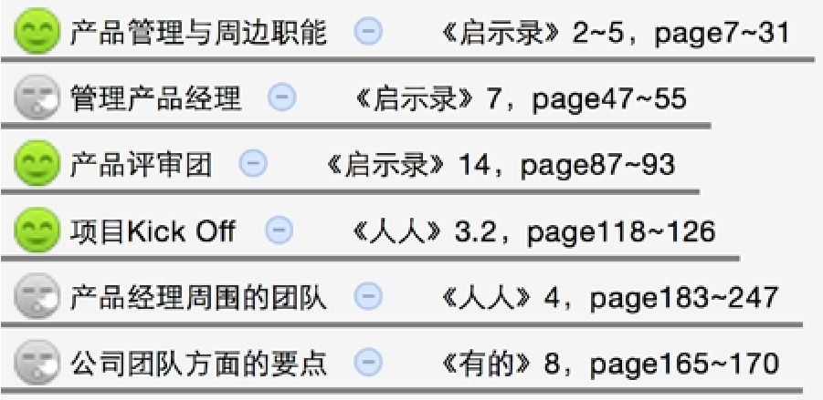
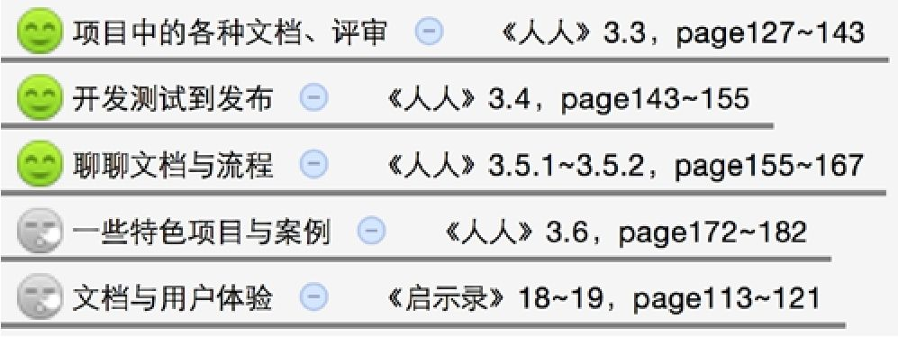
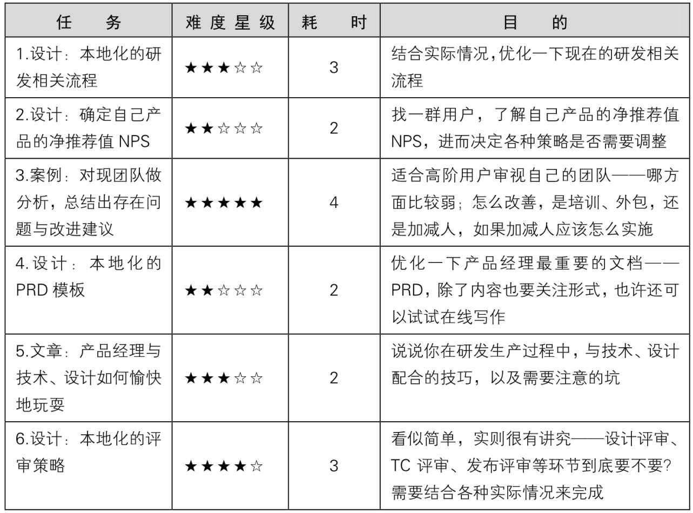
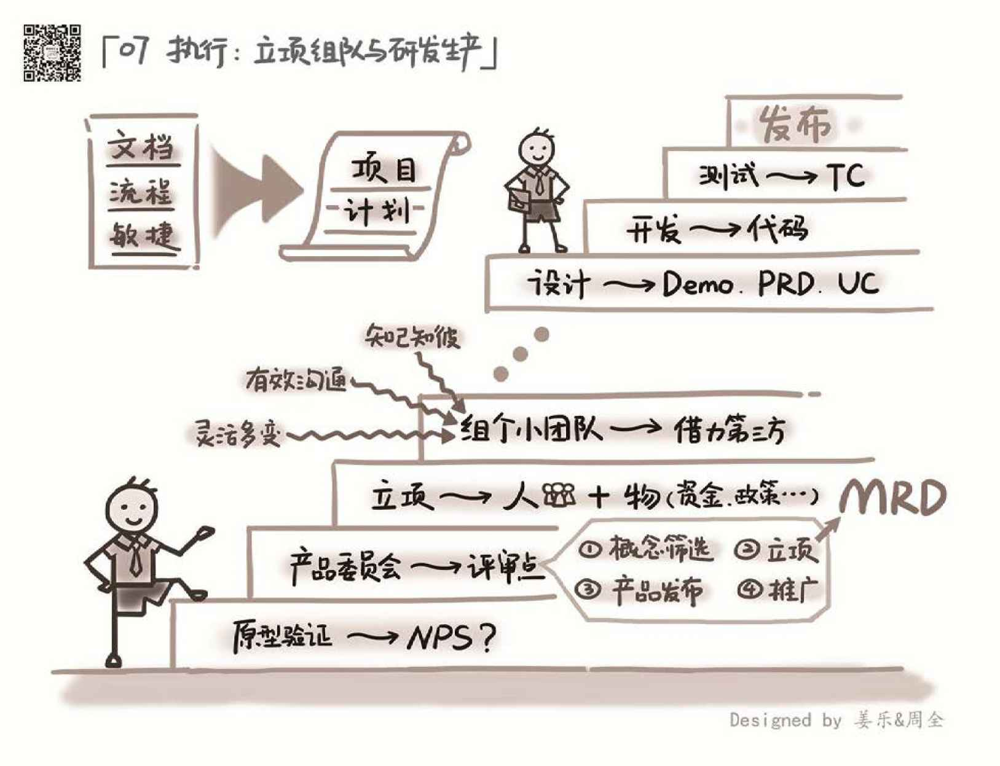

## 7.5　延伸阅读与练习

本章关联到另外几本书的相关章节如下。其中的图标表示推荐阅读（笑脸）与选择阅读（冷漠脸），亦可根据一些关键词扩展阅读。

以下是立项组队部分：

<figure markdown="1">

{ width="379" height="184" }

</figure>

以下是研发生产部分：

<figure markdown="1">

{ width="419" height="156" }

</figure>

可以做的练习任务如下。

<figure markdown="1">

{ width="623" height="460" }

</figure>

<figure markdown="1">

{ width="824" height="632" }

</figure>

---

[[1]](../01/index.md#footnote_quote_txt008_1)
老式电话机的拨号需要转动拨号盘。拨号盘上有10个洞，分别对应0到9的数字，在把手指放进某个洞里顺时针转动拨号盘，到底再松手，拨号盘会自动回位，这样才能完成这个洞对应数字的拨号。

[[2]](../01/index.md#footnote_quote_txt008_2)
净推荐值最早由贝恩咨询公司“客户忠诚度”业务创始人Fred Reichheld在2003年哈佛大学商务回顾文章《你需要致力于增长的一个数字》中提到。

[[3]](../02/index.md#footnote_quote_txt008_3)
不同行业和公司，每一轮融资的金额差异很大，这里列出的数字仅供参考。

[[4]](../03/index.md#footnote_quote_txt008_4)
奥卡姆剃刀原理是由14世纪逻辑学家、圣方济各会修士William of Occam提出。该原理称“如无必要，勿增实体”，即“简单有效原理”。

[[5]](../03/index.md#footnote_quote_txt008_5)
对该工具感兴趣的读者，可以扫右侧二维码查看这篇知乎问答：如何玩转 WorkFlowy？绝对是强迫症、洁癖患者的好工具。

[[6]](../04/index.md#footnote_quote_txt008_6)
unit testing，是指对软件中的最小可测试单元进行检查和验证，一般由开发人员自己完成。

[[7]](../04/index.md#footnote_quote_txt008_7)
冒烟测试，Smoke Test，是对新电路板基本功能检查的形象类比。任何新电路板焊好后，先要通电检查，如果板子不冒烟，则冒烟测试通过。软件研发领域借用这个词来描述新功能是否可用的初步测试。

[[8]](../04/index.md#footnote_quote_txt008_8)
回归测试是指修改了旧代码后，对相关功能重新测试以确认修改没有引入新的错误或导致其他代码产生错误。

