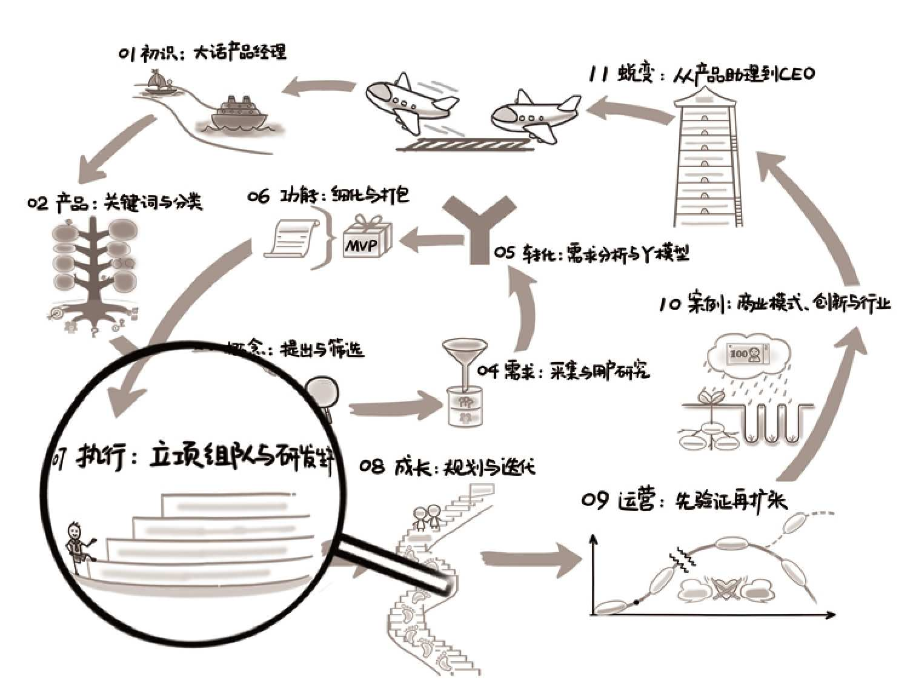

## 第07章　执行：立项组队与研发生产

<figure markdown="1">

{ width="634" height="474" }

</figure>

**第07章　执行：立项组队与研发生产/191**

**7.1　从“想清楚”到“做出来”/193**

7.1.1　原型验证与NPS/193

7.1.2　产品委员会与关键节点/195

**7.2　立项：搞定各种资源/196**

7.2.1　关于人：团队、组织/196

7.2.2　关于物：政策、资金等/197

**7.3　组队：聊聊初创团队/199**

7.3.1　如何快速知己知彼/199

7.3.2　小团队的沟通协作/201

7.3.3　小团队与大公司的区别/202

7.3.4　借助第三方力量做产品/205

**7.4　研发生产时，我们做什么/206**

7.4.1　产品经理要不要懂技术/208

7.4.2　如何做一个让Ta们讨厌的人/213

**7.5**
　延伸阅读与练习/21587

