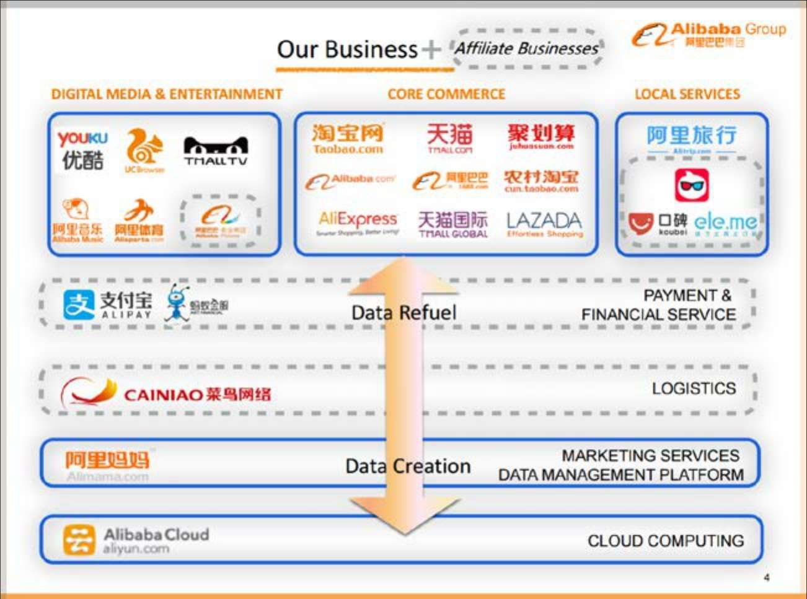

## 8.2　 规划：只看最短和最长

一个产品经理在做产品三五年之后，不可避免地要碰到写规划这件事儿。在快速变化的互联网行业里，规划到底该怎么做才有实际意义呢？

我的建议是，只做最短和最长的规划。短的规划是指最近1到3个月，最多6个月的时间段里，要做什么，其实更像一个项目计划。长的规划是要预判产业终局，比如3到5年，甚至10年以后会是什么样子，要思考那个时候我们能处于产业链的什么位置。有不少人，其中不乏大牛，持“规划无用论”的观点。如果将他们说的无用，理解为中等时长规划的无用，则并无不妥。对于1到3年这样尺度上的规划，在一个快速变化的行业中，多想无益，只能选择放弃思考。

规划通常会有业务规划和产品规划两种。字面意思看，产品规划只需要讲清楚产品要做什么，而业务规划更完整，要涉及不少商业上的话题，因此业务规划要大于产品规划。一份业务规划，与第07章提到的MRD类似，分为三大块：Why、What、How。

业务规划可以包含MRD里的所有内容，但它更加强调“未来几步怎么走”，就像一名优秀的棋手，会多算几步，更通俗的说法是：吃着嘴里的，看着碗里的，想着锅里的。它和MRD相比还应该说清楚以下三点。

► **一句话的业务定位：**
如果一句话说不清，那就说明定位还不够准，还需要反复想清楚。这句话通常也会表现为产品的Slogan，比如小红书的“全世界的好东西”、微信的“一个生活方式”，以及陌陌的“总有新奇在身边”。

►**一个业务模型：**
包括这个业务内部分为哪些模块，彼此之间有什么关系，与产业链中的各个角色怎么配合，如何平衡各方的利益，自己如何赚钱等。为了更加清晰，可以画几张图来表达。图8-1出现在阿里集团20.6.7　月的公开季度财报，它从最宏观的视角描绘出阿里的完整业务模型。

{ width="548" height="407" }

图8-1　阿里集团2016年的业务模型

►**三五个业务关键点：**
接下来的一段时间，主攻的几个业务难点是什么。比如“入驻平台的卖家数在1个月内达到1.0.0　”“3个月内把服务扩展到所有省会城市”或“半年内谈妥ABC几个战略合作伙伴”。

作为一个产品经理，如果规划做得好，就有可能再进一步，参与公司的战略讨论。

