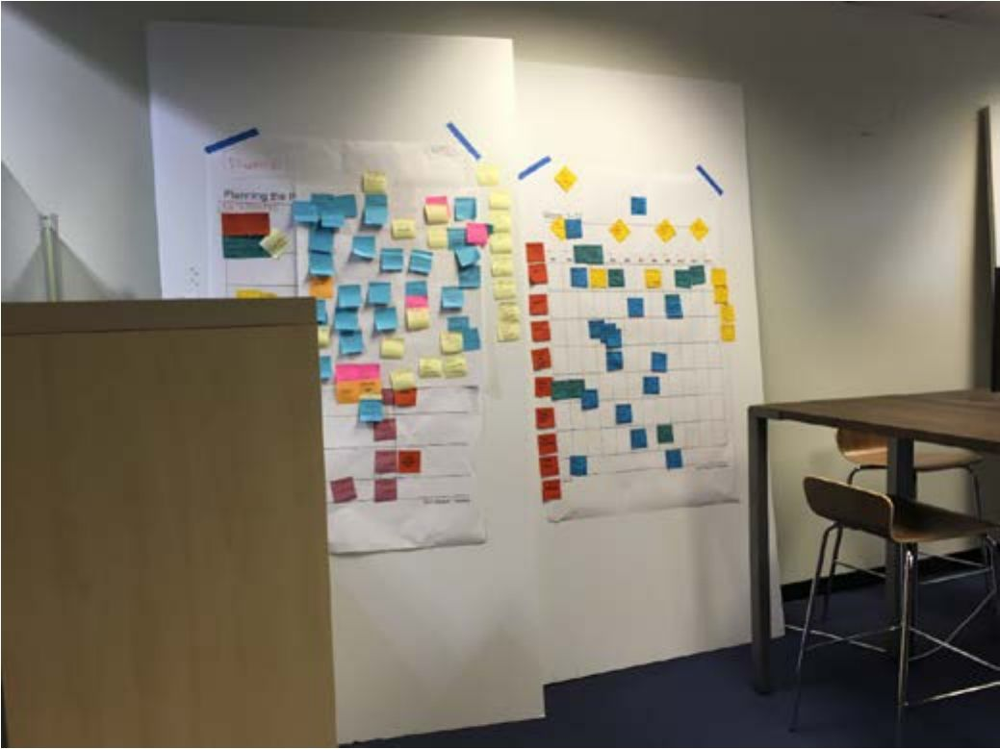
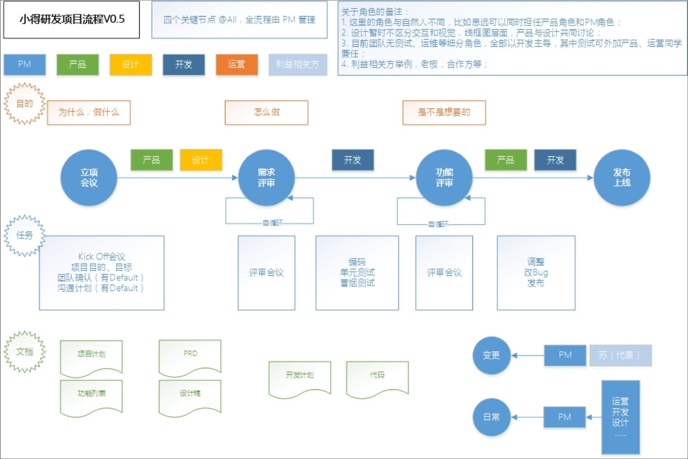
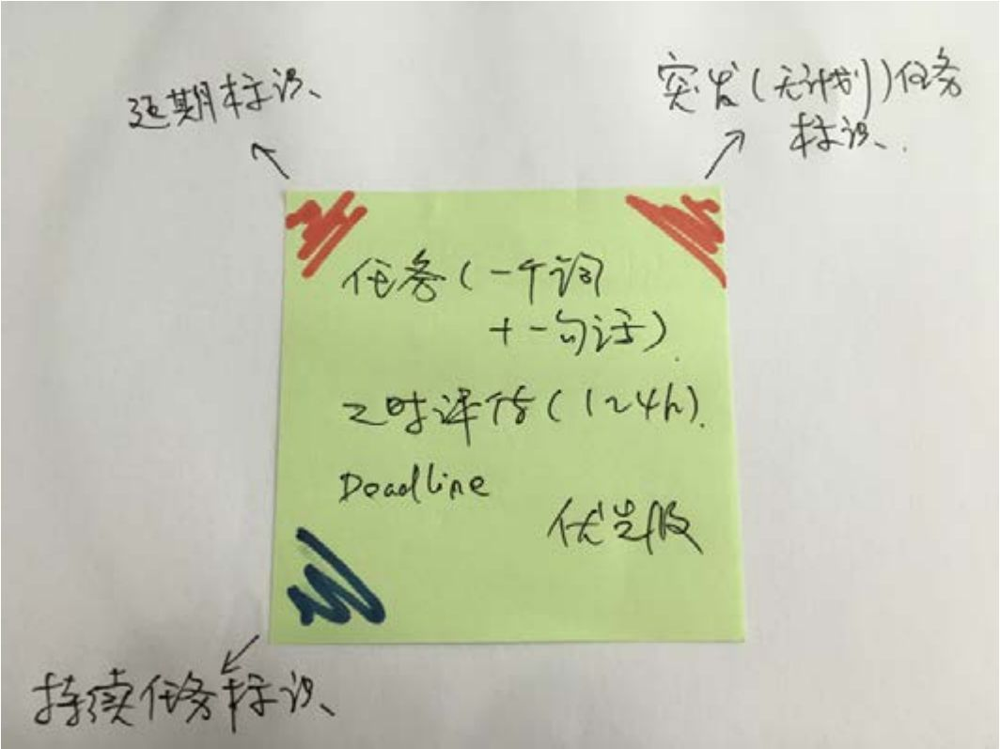
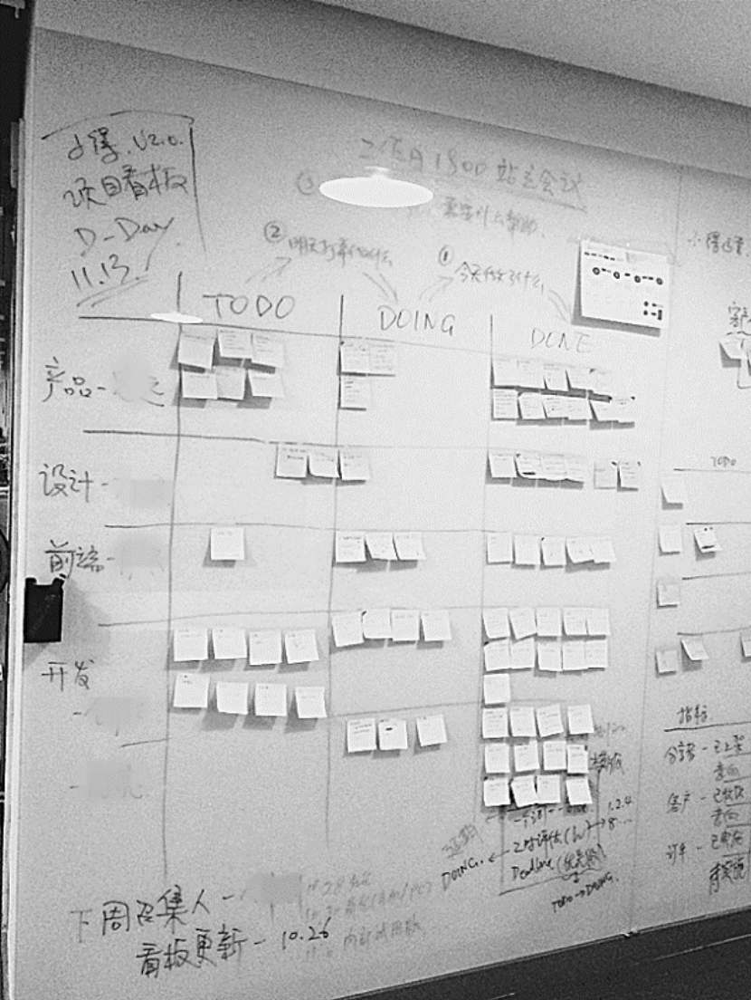

## 8.3.2 　 敏捷项目管理的实践

说完了对敏捷方法的理解，再聊聊实践。我经历过的团队，最常采用的是以Scrum方法为原型，再根据实际情况略做调整。下面，先说一下对几个Scrum关键概念的理解。

►团队角色

PO（Product Owner）通常是产品经理，要对各种利益相关方负责。

SM（Scrum Master）充当教练的角色，一般由对流程、方法论比较熟悉的人来担任，不建议这个角色和PO重叠。

Team由核心成员组成，其中的某一个人是可以担任SM的。

►关键产出物

Product Backlog指比较长期的产品任务表，即第06章提到的功能列表。

Sprint Backlog在Scrum里指当前这个迭代里面的任务点。

Burndown Chart是燃尽图，用来监控任务是不是在按期推进。

►重要的会议

首先是每个迭代的**计划会**
，经常和**需求评审会**
合并，主要目的是明确任务，以及评审这个迭代里需要做的功能。

每天的**站立会议**
，是重要的信息同步手段。

**功能评审会**
用来评估做出来的东西是不是想要的。

**回顾会**
的目的是为了过程改进，因为Scrum和敏捷最核心的思想就是不断优化，以优化出一个最适合当前团队的方法论。

►日常管理工具

**看板**
是一个非常重要的实用工具，很多公司的办公区里都会有，在硅谷创新公司里也被广泛应用。比如，有一块写着当前迭代关键信息的白板，或者有一面用来粘贴任务卡片和便利贴的玻璃墙，如图8-2所示。

接着，再说一些Scrum实际应用的具体做法。

2015年下半年，我孵化的一个项目，采用的就是以Scrum为原型的敏捷方法。

{ width="437" height="326" }

图8-2　我在硅谷某孵化器里拍的看板

当时的团队成员大部分只有1到3年的工作经验，缺乏足够的专业训练。所以在开始几周，花了很多时间跟大家一起定规矩，并最终制定出如图8-3所示的简化项目流程。

{ width="645" height="430" }

图8-3　创业公司的简化项目流程

**项目流程简化**

**角色的简化**

首先，根据业务和团队的现状，对项目进行了合理的角色简化。这还是挺考验经验的，必须见过分工很细的团队，且能理解其中每个角色是怎么一步步分化出来，以及不同角色各自的设置目的，才能做好。当时这个项目的做法是：不区分交互和视觉，用全民测试代替专职测试，运维、DBA等全部由开发承担，前端职能单列出来，最终一共设置四个角色：产品、设计、前端、开发。

**流程的简化**

同样，需要见过更复杂的流程，知道每一个环节是为了防止出什么状况，才能合理地简化。最后，设置了四个关键节点。这些节点是除了产品、技术、运营之外的其他关键团队成员也要一起参与的，已经没法再减了。

►**立项会议：**
确定项目目的——为什么、做什么（时间控制在半小时以内）。

►**需求评审：**
确定项目怎么做（对相对较小的项目，可以和立项会议合并，总体时间控制在2小时以内）。

►**功能评审：**
简单地讲，就是在测试环境下演示一下产品，以确定做出来的是不是团队要的（1小时左右搞定）。

►**发布上线：**
确定产品是不是用户想要的，以及用户还要什么。通过获取用户反馈来让产品的优化形成一个螺旋上升的闭环。

以上说的是主流程，还有两个常见的分支流程也简单提一下。

►**需求变更**
：这在项目过程中不可避免，一开始可以简化成某个人拍板，决定是否接受变更。

►**日常需求：**
即零散、随机出现的小需求。开始只掌握一点，即所有需求必须经过产品经理，运营等角色不能直接找开发，确保产品经理知道所有的需求信息，以便统筹安排。

**文档的简化**

在项目开始阶段，文档只保留PRD、设计稿、代码三件套，其他文档，都用看板、白纸加上拍照留存来解决。既然看板可以代替很多文档的职能，接下来就看看其在项目中的实际应用。

**看板实践**

看板这种看起来很原始的线下手段，事实上在研发项目过程中特别好用。与在线软件相比，它最大的好处是，所有不时路过看板的人，只要抬头就能看到所有关键信息。

**任务卡片**

看板里经常用到的基本元素是任务卡片，它其实就是一张如图8-4所示的便签，上面一般会呈现几个关键信息。

{ width="447" height="334" }

图8-4　本地化的任务卡片

►**任务描述：**
一般是一个词加一句话（如果一个词可以讲清楚，也可以不用一句话）。比如，前端可以写一张叫“Detail页面制作”的任务卡片，产品可以写一张叫“后台订单管理需求细化”的任务卡片。

►**工时评估：**
对于2～4周的项目，评估精确到1～4小时的粒度比较合理。如果一张任务卡片上的工作量超过8小时，则需要分拆。对工时的评估，一开始不准确很正常，通过每天的站立会议回顾和改进，很快就会越来越准。

► **deadline：**
写明日期即可，因为人人都信奉deadline是第一生产力。

►**优先级：**
任务越多就越需要重视和完善这个信息。

图8-4任务卡片的角部，还能看到三个很明显的小标志，这是我们团队的实用小创新。在一张任务卡片相应角部位置做出标记，就表示这一任务具有如下的特定属性，可用来提醒团队注意。

►**左上角标：**
表示此卡片的任务延期。少量的任务延期是正常的，也是允许的，但要进行监控。如果发现项目里有很多人出现大幅延期，则说明计划制订不合理，需要及时调整；如果只是个别人出现大幅延期，则更可能是个人问题，需要延期人自己加班赶上进度。团队要达成共识，让别人等、浪费别人时间是可耻的。

►**右上角标：**
表示突发任务。少量的突发任务也是正常且允许的，但如果有大量突发任务，则说明缺乏经验、计划不足，或者有“外力”经常干扰项目进程。

►**左下角标：**
表示持续任务，可以一直贴在看板的Doing（正在做的）任务列表里。比如，对产品经理来说，“处理用户反馈”就算一个持续任务。而非持续任务都应该从看板的Doing列表及早转移到Done（已完成的）任务列表。

►**右下角标：**
未定义的备用标记。团队在做项目的同时会不断优化项目流程，如有需要可以临时定义这个新的角标。

还可以灵活运用卡片的不同颜色。比如，我们团队有4种角色，正好对应4种颜色的卡片，这样可以让看板更加清晰。

**看板应用**

在日常工作中，一个完整的看板应该怎么应用呢？看一下如图8-5所示的看板，其横坐标是Todo（未开始的任务列表）、Doing和Done，纵坐标是各种团队角色。当时，团队每天下班前，也就是18:00开站立会议，大约持续15分钟，会上每个人只说三句话。第一句“今天做了什么”，说某个任务的同时指着看板上对应的任务卡片，如果任务完成，则把卡片从Doing一列拿到Done一列，如果延期了就涂上左上角标；第二句“明天打算做什么”，同时指着Todo一列的相应任务卡片，并把它拿到Doing一列；第三句“碰到什么困难、需要什么帮助”，与大家一起讨论，但不展开，具体的细节可以约着会后私聊。

而Todo里的便签，是平时每个人分解完任务后，随时贴进看板的。

实践中还根据需要确立了一些规则，比如团队里每个人都要轮值汇总周报，以及担任周会召集者。

通过以上项目流程的执行和看板的运用，一个10人左右团队、2～4周一次迭代的研发项目基本可以得到妥善和有效的管理。

{ width="348" height="464" }

图8-5　本地化的看板

