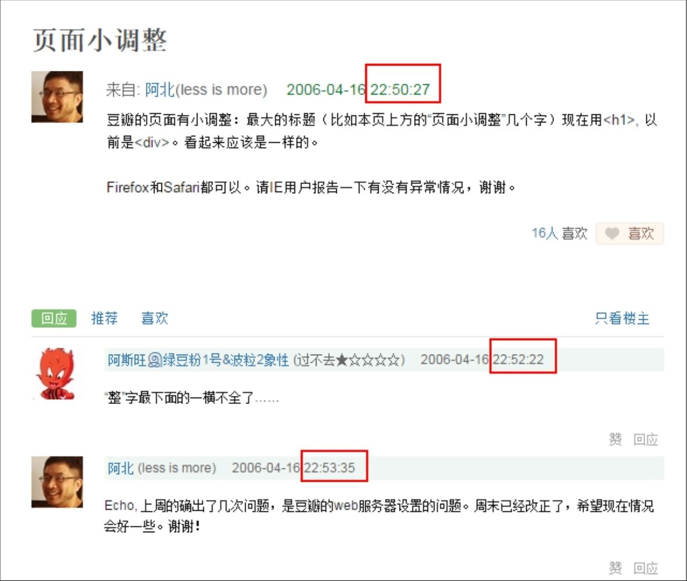

## 8.4.1 　 互联网速度到底有多快

在产品早期的验证阶段，团队灵活，流程简单，还没有太多的用户，最能体现出互联网速度。有的产品从发现问题或机会，到讨论出方案，再到上线，大约可以做到两三个小时，甚至不到一个小时。

给大家两个鲜活的小例子，第一个来自豆瓣。10多年以前的豆瓣，还是由创始人阿北一个人来写代码。如图8-6所示的这个帖子发布的时间是某个周日将近23点，跟帖的若干条讨论也就发生在几分钟内。阿北通过和用户紧密而及时地互动，在几分钟内就完成了对豆瓣页面这个小调整的一系列优化。

<figure markdown="1">

{ width="497" height="420" }

<figcaption markdown="span" style="margin:0.5em auto;font-size:0.8em;font-style:normal;line-height:1.5">
图8-6　早期豆瓣的迭代速度[[5]](../06/index.md#footnote_content_txt009_5)
</figcaption>

</figure>

第二个例子是互联网产品运营社群“三节课”贡献的，展示了产品和运营是如何配合完成一次快速响应的。

<figure markdown="1">

{ width="73" height="73" }

</figure>

2016.4.21　号，微信群里曝出一个很有意思的玩法——用户可以通过修改自己的名字、撤回已发出的消息等操作，在群里留下如图8-7所示的有意思的系统提示。

<figure markdown="1">

{ width="282" height="503" }

<figcaption markdown="span" style="margin:0.5em auto;font-size:0.8em;font-style:normal;line-height:1.5">
图8-7　三节课的响应速度
</figcaption>

</figure>

对大多数微信用户来说，这只是一个有趣的小玩法罢了。但职业敏锐度让三节课团队意识到，完全可以趁着业内人士新鲜劲还在的时候，借势做点事情，让三节课从中受益。而达成这一目标的关键，就是响应速度。

下面，依次列出他们采取行动前后几个小时内发生的事情。

11:00 发现这个玩法，三节课的同学自己开始玩。

11:40 技术同学出于好奇，主动研究微信系统提示的运行逻辑。

12:20技术同学研究出原理，开始思考是否可以做一个全民娱乐的小工具，让大家都可以更方便地留下各种系统提示。当然，这个小工具可以顺带植入三节课的广告。

12:50工具完成，运营同学接力，开始传播。

13:20微信同样反应迅速，封掉了这个也许称不上漏洞的漏洞。

在互联网行业里，每天都在上演着与时间赛跑的案例。这个行业的机会很多，但都是稍纵即逝，因此保持敏锐度和快速执行的能力，非常关键。

