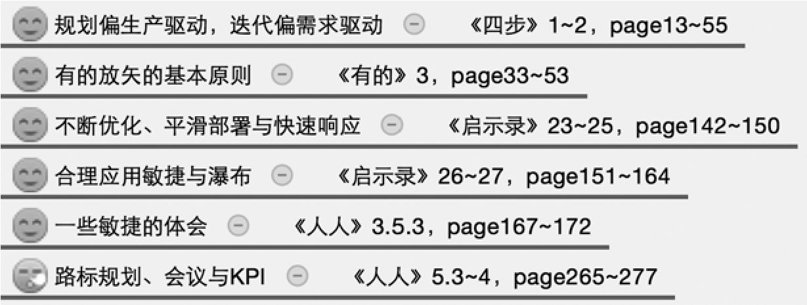
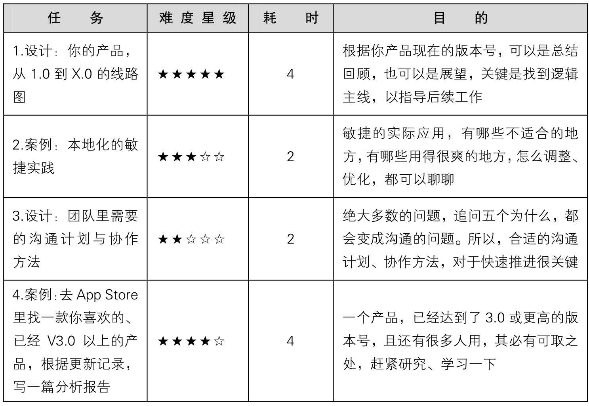
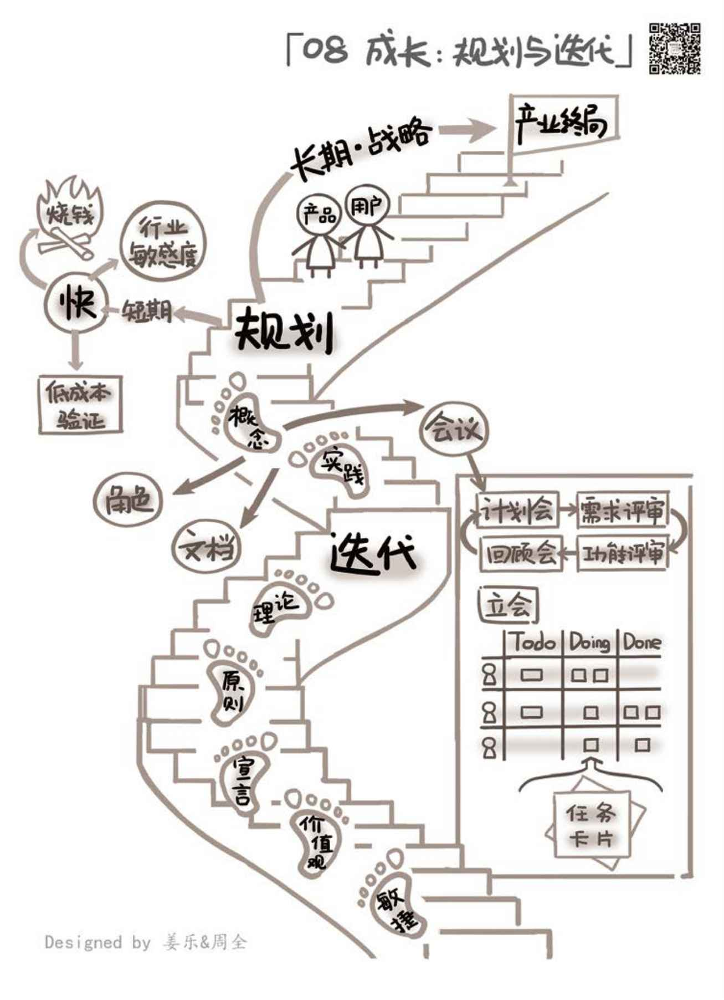

## 8.6　 延伸阅读与练习

本章关联到另外几本书的相关章节如下。其中的图标表示推荐阅读（笑脸）与选择阅读（冷漠脸），亦可根据一些关键词扩展阅读。

<figure markdown="1">

{ width="517" height="195" }

</figure>

可以做的练习任务如下。

<figure markdown="1">

{ width="619" height="424" }

</figure>

<figure markdown="1">

{ width="634" height="877" }

</figure>

---

[[1]](../01/index.md#footnote_quote_txt009_1)
新浪微博原帖可扫描右侧二维码进行阅读。

[[2]](../02/02.md#footnote_quote_txt009_2)
古希腊哲学家苏格拉底和人讨论问题时常用诘问法，又称苏格拉底法（the socratic method）或产婆法（比喻为知识接生）。这种方法首先是怀疑的：苏格拉底认为一切知识均从疑难中产生，愈求进步疑难愈多，疑难愈多进步愈大；其次是谈话方式的：采用谈话的方法，以辩论为技术来寻求真理和概念的正确定义。

[[3]](../02/02.md#footnote_quote_txt009_3)
走动管理是指高阶主管抽空前往各办公室走动，以获得更丰富、更直接的员工问题，并及时了解员工工作困境的一种制度。

[[4]](../03/01.md#footnote_quote_txt009_4)
有一个段子说：“如果你花了一个月完成了开发工作的90%，那么最后10%还需要两个月。”所以，脱离了最终可用产品的开发进度都是纸上谈兵。

[[5]](../04/01.md#footnote_quote_txt009_5)
有兴趣的读者可以扫右方二维码来膜拜一下这个几乎是史前神迹的帖子。

