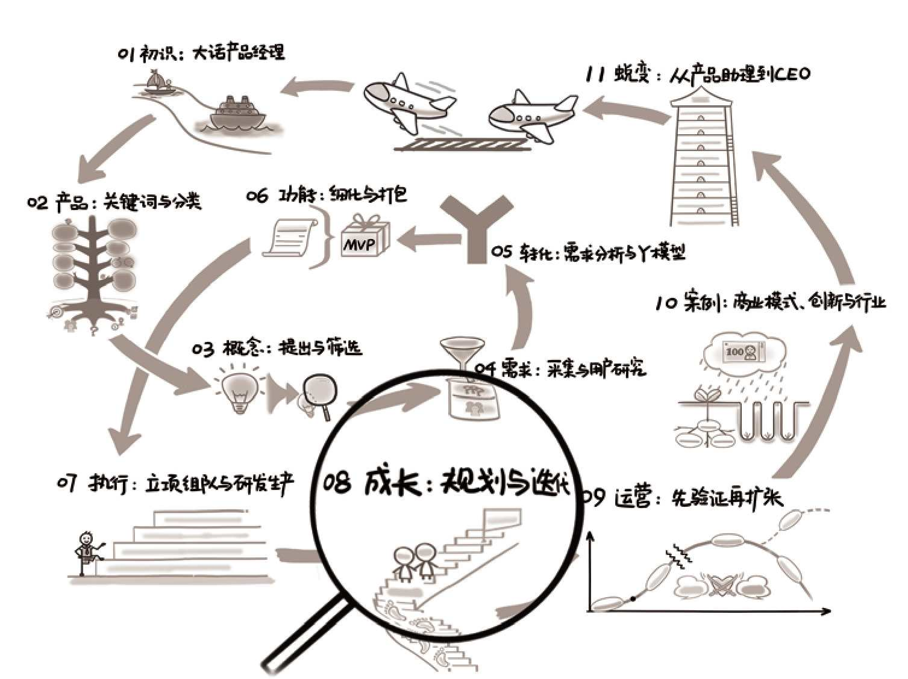

## 第08章　成长：规划与迭代

{ width="634" height="474" }

**第08章　成长：规划与迭代/219**

**8.1　好产品步步为营/221**

**8.2　规划：只看最短和最长/223**

8.2.1　从规划向上看战略/225

8.2.2　通过提问把别人干翻/226

8.2.3　提升规划能力的实践/229

**8.3　迭代：再理解敏捷/230**

8.3.1　价值观、宣言与原则/230

8.3.2　敏捷项目管理的实践/233

**8.4　天下武功，唯快不破/238**

8.4.1　互联网速度到底有多快/239

8.4.2　烧钱是为了抢时间/241

8.4.3　省时间的低成本验证/242

**8.5　与用户一起成长/244**

**8.6　延伸阅读与练习/246**

