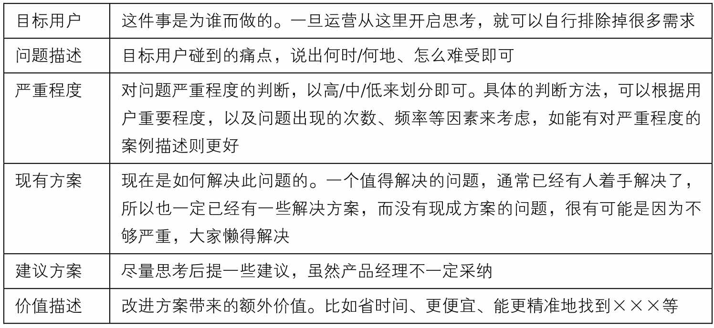
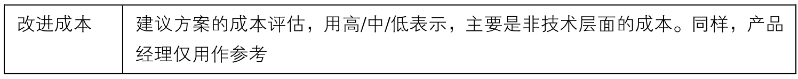

## 9.1.3 　给运营提需求的模板

在上述聊天后不久，我和运营一起制定出一个提需求的模板，用来帮助双方化干戈为玉帛。不管是不是产品经理，如有必要都可以拿来参考，既可以作为日常思考的清单，也可以分享给公司里其他岗位的同事，如表9-1所示。

表9-1　给运营提需求的模板

{ width="623" height="282" }

续表

{ width="623" height="55" }

以上模板，其实是本书前几章“想清楚”模块的内容简化，产品经理拿到这样的需求后，再根据性价比等主要参考因素进行判断，可以更快速、准确地决定接下来做什么。

