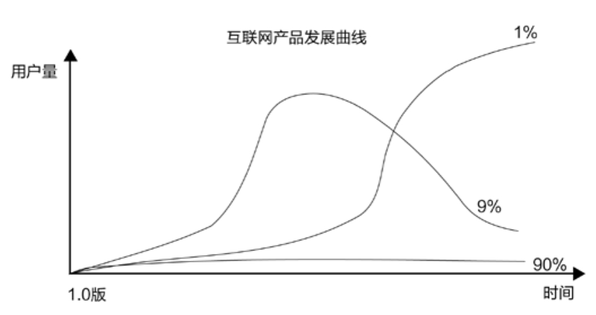
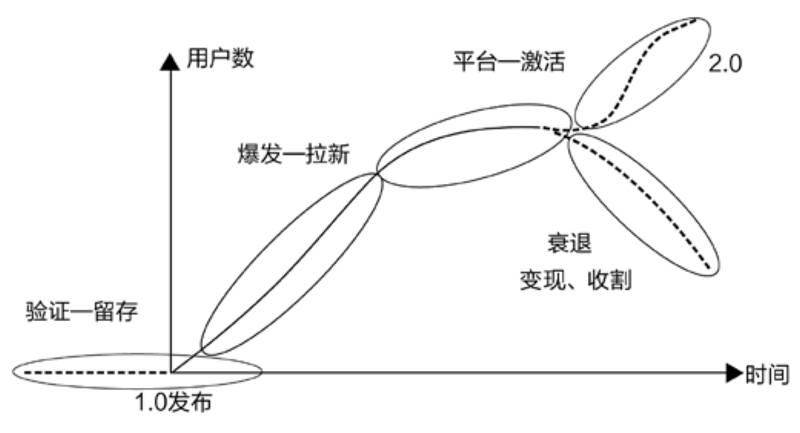
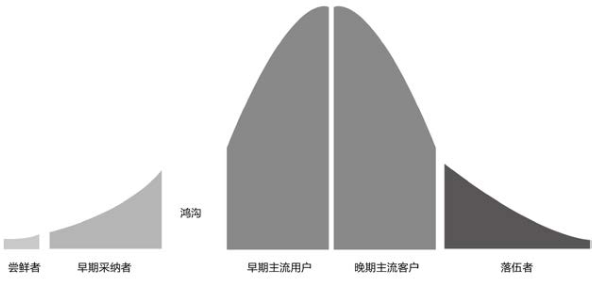
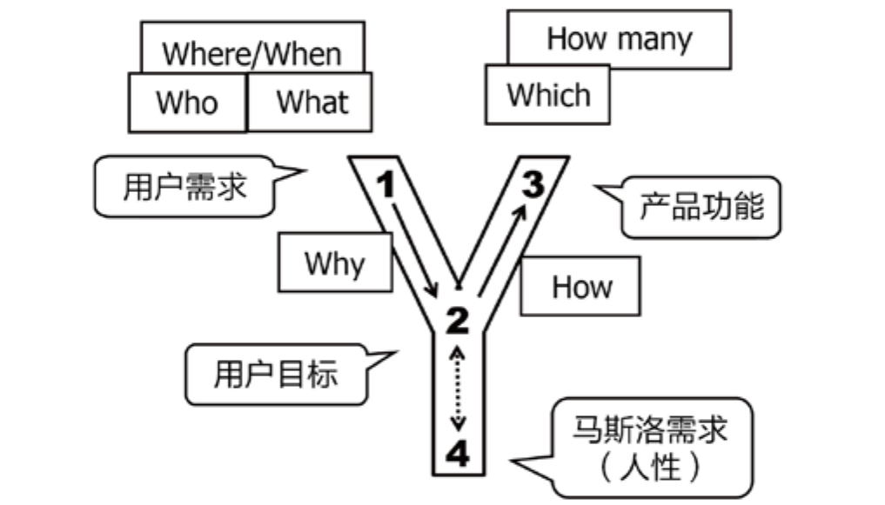

## 9.2.1 　不同阶段的运营目标

先看图9-2，此图参考了前迅雷看看CEO郝志中先生一次分享里的素材，横轴是时间，纵轴是用户量，表达了一款产品从上线到退市期间用户量的变化。我们看一下各种互联网产品，都会画出一条什么样的曲线。

首先是下方曲线对应的90%的产品，这里的数字是虚指，意味着绝大多数产品从来没红过，用户量始终没起来。

在看看中间曲线对应的9%的产品。这类产品肯定有它的过人之处，比如脸萌、足记等，但过把瘾就死，只能成为现象级产品。它们的硬伤在于是好奇心驱动的，无法提供持续的用户价值，用户新鲜劲一过就难以为继。所以，这类产品更适合作为一个更大产品里的功能，出现在一次有计划的推广活动中，能起到很好的拉新作用，然后用产品的其他功能做留存。

<figure markdown="1">

{ width="442" height="233" }

<figcaption markdown="span" style="margin:0.5em auto;font-size:0.8em;font-style:normal;line-height:1.5">
图 9-2　互联网产品随时间变化的用户数曲线
</figcaption>

</figure>

最后是如图9-2中曲线对应的1%的产品。作为极少数，它们可以拉出一根真正漂亮的S型曲线，成为大家眼中成功的产品。

这三类产品的比例分布很不均匀，符合幂次法则[[2]](../05/index.md#footnote_content_txt010_2)
。借用投资的理念来解释这一现象：对于一支投早期项目的风险基金，通常表现最好的一家公司，给基金赚回的钱要超过其他所有的公司，而表现第二好的公司，赚的钱又会超过前两名以外的所有公司。于是，早期基金的投资人，在选择公司时，会特别喜欢那种“一家公司就可能赚回整个基金”的标。投资之后，也不能均匀服务，而是要把所有资源都给表现最好的，绝不应该去做“哪家碰到困难就去帮哪家”的救火队员。这还真是有点像马太福音中说的“凡有的，还要加给他，叫他有余。没有的，连他所有的也要夺过来”，这就是商业的理性。

聚焦到1%成功的产品上，再看图9-3。

<figure markdown="1">

{ width="438" height="236" }

<figcaption markdown="span" style="margin:0.5em auto;font-size:0.8em;font-style:normal;line-height:1.5">
图9-3　成功产品的用户数曲线
</figcaption>

</figure>

首先，给1%产品曲线增加了几条线段。第一段是1.0发布前持续时间不短且用户数很少的发布前期；第二段是衰退期，再成功的1.0版产品，也有完成使命的那一天；第三段是2.0版生长期，它会延续1.0的生命。理想状态的2.0产品，会在1.0版期间获得一定规模用户的基础上，再拉出一根漂亮的S型曲线。当然，这种理想状态的产品，在1%的成功产品中可能也只有1%。所以，版本号超过3.0且广为人知的产品，大多是经久不衰的，可以放心使用。

在图9-3曲线中，除2.0部分外还有四个阶段。

►**验证期：**
也就是产品发布前的筹备阶段，加上发布之后到推广之前的预备阶段。这个阶段的主要目标是验证产品是否达到了与市场的匹配，即PMF（Product Market Fit）。产品在这个期间要不断修正主打功能，运营主要关注的指标是用户留存，典型的良性表现就是用户用了还想用，成为回头客。

►**爆发期：**
产品验证完成后开始大面积推广，即进入爆发期。此阶段产品依然在围绕核心功能进行强化，但用户数会迅速增加，运营工作的主要目标是拉新。

►**平台期：**
拉新一段时间后，产品会进入平台期。一旦容易搞定的用户都搞定了，单用户的获取成本就开始越来越高，这时候要想继续放大产品的整体价值，就只能依托于提升单用户的价值。于是，产品功能开始扩展，升级2.0版逐渐提上日程，运营工作的主要目标是激活用户，也常常说成“促活”，让用户使用产品的时间尽可能增加。

►**衰退期：**
1.0版的产品终归要退出历史舞台。进入衰退期以后，产品仅需要维护，而运营能做的事情就是想方设法榨取产品的剩余价值。比如，在敬畏用户、不伤口碑的前提下，从用户身上赚到最后一点钱；把用户平稳无知觉地导入2.0；让团队去做更有价值的事情，等等。

上面提到的拉客、接客、留客，在产品的每个时期都要做，只是不同时期各有侧重。想了解更多内容，推荐大家去研究一下AARRR模型[[3]](../05/index.md#footnote_content_txt010_3)
。

仔细研究，就会发现产品和运营对每个阶段的贡献是不同的。拉新阶段特别依赖推广能力，明显运营的作用更大一些；激活阶段二者的贡献则不相伯仲；留存阶段的成功，产品的因素会更多一些，因为只有产品好用户才会持续使用。就像有些街边小店的吆喝——第一次不来是你的错，第二次不来是我的错。对用户而言，第一次不来是运营的错，第二次不来是产品的错。

下面就验证期、爆发期、平台期这三个重点阶段，讲一下对应的运营工作要点。

**验证，艰难的冷启动**

产品团队经常觉得自己是在让世界更美好，而用户根本不会那样认为，如同某位朋友的这条金句**：一些很有初心、情怀的产品，看似是在助人为乐，其实是在强行扶老奶奶过马路。**

那么，问题来了，如何找到那些真正想过马路的老奶奶，什么是帮助老奶奶过马路的正确姿势，有什么只需要盯着就行、能直观代表留存的数据指标？这些就是验证阶段要回答的主要问题。

“真想过马路的老奶奶”有以下两个特征：

**用户数自然增长**

在无主动拉新的情况下，依靠产品的自身价值，而非不可持续的利益刺激，每天的新增用户数持续攀升。这意味着已有相当多的用户愿意把产品推荐给亲朋好友，也就是说产品在净推荐值NPS（第7.1.1　节有详细介绍）这项指标上表现出色。

可以在网上通过各种渠道去搜索，看能不能找到在主动推荐产品的用户，尽快和这些人搞好关系，以弄清楚到底是产品的哪些方面给他们带来了惊喜，从而有针对性地做出强化。

用户数自发地高速增长，也意味着产品产生了“病毒式传播”现象。而这一现象背后的关键要点，值得进一步找资料学习。

**用户的激活与留存稳定**

同样地，把所有运营动作停掉，如用户激活率、留存率等相关指标依然可以保持稳定，则说明产品能持续提供用户价值。激活和留存，一个是一个转化率漏斗，而另一个则表明用户走了还会再来，接下来对它们分别加以分析。

激活率等于单位时间内的“已激活用户/新用户”，表征的是新用户使用后，觉得有用的人数比例。激活行为像是完成新人转化的漏斗。

可以有意识地每周观摩几个新用户使用产品的真实场景，看他们在几分钟内是否能体会到产品的预设价值，以及使用流程是否顺畅。如果经常发现用户产生困惑，则说明产品使用过程有些复杂，比如一个社交App，激活流程包括找到、下载、安装、（需要很多步骤才能完成的）注册、新手上路引导、找到感兴趣的人、加好友/接受好友请求、发出第一句话、产生互动等操作节点，使用链路上的任何一个环节不顺，都可能造成激活转化率过低。

留存率等于特定时间段内的“回访用户/已激活用户”，表征的是第一次走了之后仍念念不忘、还会再次使用产品的用户比例。

针对这一指标做用户访谈时，不要只听用户怎么说，因为他们有可能只是在当面敷衍你，更要盯着后台数据，调查清楚他们是觉得有用但真要用又懒得用，还是的确在地反复使用。而后者，需要产品靠内容或靠其他用户等方式来实现。比如天气预报，是靠内容（每天都在变的天气）来吸引用户；比如社交，是靠不停有人要加你为好友或老朋友又发来新消息这类来自其他用户的影响来吸引用户。

如果找到了“真想过马路的老奶奶”，似乎不用推广，产品也可以自己成长。这是很多产品经理的梦想，完全通过产品逻辑实现运营——**做一个不需要运营的产品**
。由此可见，“帮忙过马路”即推广行为，真的不是产品上线后马上应该做的，其**本质只是加速产品的成长**
，说白了就是为了抢时间，和市场抢、和友商抢。不幸的是，如果方向不对，抢跑越成功，距离目标只会越远。

这个阶段，需要对大量用户的涌入慎之又慎，甚至还要故意设置一些门槛，比如采用“邀请码”的机制，比如B站[[4]](../05/index.md#footnote_content_txt010_4)
的考试答题环节。因为大量的主流用户只会给产品一次机会，如果他们看到了早期不完美的产品，今后就算产品成熟了，他们也不会再来了。

最后，聊聊第一批的种子用户如何获取，也就是冷启动的问题。产品的验证就是从种子用户开始，如果你的产品可以匹配上如下这几个人群，那不失为一个好的开局。

►**学生党：**
年轻有好奇心，愿意尝试各种新产品，有大把的时间，但没有钱，容易用小额利益撬动，而且人群密集，获客与社会化传播的成本都较低。比如当年的校内网，用免费的鸡腿，拉了很多学生用户。

►**美女：**
不管在何种产品里，美女用户都是焦点，满足她们的优越感、存在感之后，其他用户就会源源不断地被美女吸引过来。社交类的应用，通常更适合走这条路。这类用户的本质是那种可以以一带十、以一带百的焦点人物，比如自带流量的大V明星。

►**羊毛党：**
这个词从形容贪小便宜的说法“薅羊毛”而来。这群人是最容易用补贴撬动的，但风险也大，要好好思考他们到底是不是目标用户，有些理财产品选择了羊毛党作为种子用户，而这群人也正好是爱财的人。

►**竞品用户：**
竞争对手那里，产品的目标用户的密度自然也最高，而且竞争对手已经帮我们筛选过的，往往是真正的优质用户。比如小米最早的100个用户，就是从一些手机发烧论坛里找来的，这类论坛也可以算是广义的竞品，和小米手机是行业上下游的关系。

有了种子用户，服务好他们非常重要，小米在产品早期的做法是很好的榜样：

每年的发布会，更多是为了“米粉”而不是媒体而办，最终成为用户的狂欢。不完美的产品，通过“内测”直接送给粉丝，一方面成为福利，另一方面又能更早获取到市场反馈。小米社区的运营理念是，让用户帮助产品优化，决定一些功能的优先级。种子用户选取“发烧友”人群，因为他们是意见领袖，能影响很多身边的人。

**爆发，脱离种子阶段**

经过验证期，对产品优化效果满意后，运营就要开始发力，迅速扩散产品信息。市场留给产品的时间窗口往往不大，容不得慢慢打磨。

爆发期的主要运营工作是拉新。经常听到的打广告、烧钱、借力用户、做事件等，都属于拉新行为，目的是尽快把目标用户吸引过来。在这个阶段竞争的是谁能在时间相同、资源相同的情况下获取更多的用户，因此需要研究各种推广渠道，包括搜索广告、线上线下媒体广告、户外广告、社会化广告，以及各种论坛、社群，或是借力名人，等等，还需要思考什么策略和产品最匹配。这是一个很大的话题，本书不再展开。

回忆一下本书前文提过的四级用户：种子用户→核心用户→目标用户→潜在用户。

在这个阶段，要迅速把产品从（第一级的）种子用户手里至少推到（第三级的）目标用户手里。看看滴滴公司的例子。

**种子用户**
也许就是滴滴在机场摆摊阶段每天遇到的那几十个司机。

**核心用户**
为北京等各大城市的出租车司机。

**目标用户**
是出租车司机和乘客。产品有了对目标用户的覆盖之后，就可以达成一个价值闭环。

后来，滴滴打车扩张成滴滴出行时，覆盖到了滴滴只做打车时的潜在用户，例如有闲暇时间的代驾司机，可以充当顺风车的私家车主。

图9-4反映了产品生命周期不同阶段的不同用户类型。

<figure markdown="1">

{ width="527" height="251" }

<figcaption markdown="span" style="margin:0.5em auto;font-size:0.8em;font-style:normal;line-height:1.5">
图9-4　跨越鸿沟（Geoffrey Moore，1991）
</figcaption>

</figure>

**第一批用户：**
尝鲜者，极客。他们对你要尝试解决的问题毫不在意，只是对新鲜的东西感兴趣。任何产品投放市场的第一批外部用户，基本上都是竞争对手的产品经理和业内人士，千万不要被他们带到沟里。

**第二批用户：**
早期采纳者。他们是种子用户，是受你要解决问题困扰最深的一部分人。你会发现他们相对比较好满足，但把他们服务好以后，并不意味着你能占领主流市场。在他们和主流用户之间，还存在一个鸿沟。因为早期采纳者有可能饥不择食，而主流用户却是实用主义者，很看重性价比。

用户从早期采纳者扩展到主流用户时，产品策略需要做一些调整。比如小米，种子用户是“发烧友”，但全国又能有多少发烧友呢？要做大，必须把手机卖给更多的人。于是，我们看到小米手机的口号从“为发烧而生”变成 “每个人都可以享受科技的乐趣”，产品也由小米系列衍生出红米系列。从另一方面来看，种子用户阶段又是必不可少的。如果小米直接推出的是800.10.0　块的红米，用户会觉得，无非又是一款产自深圳的山寨机。

后面三种用户：早期主流用户、晚期主流用户、落伍者，不再细说，感兴趣的读者可自行参考《跨越鸿沟》一书。

**平台，深耕更多价值**

拉新进行到一定程度，容易搞定的、便宜的新用户越来越少，说明产品已进入平台期。在这个阶段，要想继续提升产品的价值，只能通过提升单用户贡献来实现，而其主要手段就是“促活”。在促活这件事情上，产品、运营并重，二者都能起到很大的作用。

促活对于电商来讲就是提升客单价，对游戏就是提升ARPU值（单用户产生的收入），而对于一些社区类产品，主要是指增加活跃度，比如每周登录的次数或单次使用的时长。

先复习一下Y模型，看看爆发期和平台期，提升产品价值的路径有什么区别，如图9-5所示。

<figure markdown="1">

{ width="427" height="243" }

<figcaption markdown="span" style="margin:0.5em auto;font-size:0.8em;font-style:normal;line-height:1.5">
图9-5　Y模型基本概念
</figcaption>

</figure>

爆发期主要做的是市场开发，这意味着产品并不会有太大的变化，但要设法让产品满足更多的人。例如，优步在美国市场已经做得很好，还是要继续开拓中国市场或欧洲市场，这就是典型的基于市场开发的发展策略。对应Y模型来看，就是在“3”的产品功能层面的改动相对不大，但在“1”的方向上，要解决更多用户相似场景的需求。

平台期主要做的是产品开发，对应“1”中面对的用户群体变化不大，只是要设法满足他们更多场景的需求。所以，需要开发更多的“3”——产品功能。最典型的例子是阿里对消费者网购需求的满足。当淘宝已经满足了几乎所有网民对“商品丰富”的需求后，做了“天猫”来满足用户对品质的需求，又做了“聚划算”来满足用户对个性化的需求（聚划算的本质不是团购，而是聚集消费者需求，反向给厂家提要求、定制商品）。

要注意，这里说的产品开发除了IT系统的开发，可能还包括对一些线下服务的设计或改善。比如，聚划算在找厂家定制商品时，可能需要改变很多既有产业链里的关系和流程，这也算针对广义产品的开发。

市场开发和产品开发这两条线路都很常见，但是一个产品在某一个特定阶段，通常要以其中一条线路为主，要随着阶段的不同而不断变化线路，像两条腿交替走路一样。经常看到对公司应该聚焦还是多元化的讨论，对此我的建议也是应该交替进行。就产品的四个阶段而言，主攻**“市场开发”的策略与增长期和衰退期更匹配，而主攻“产品开发”的策略与平台期和验证期更匹配。**

