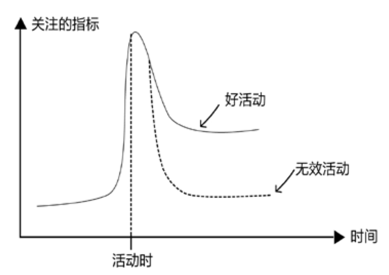
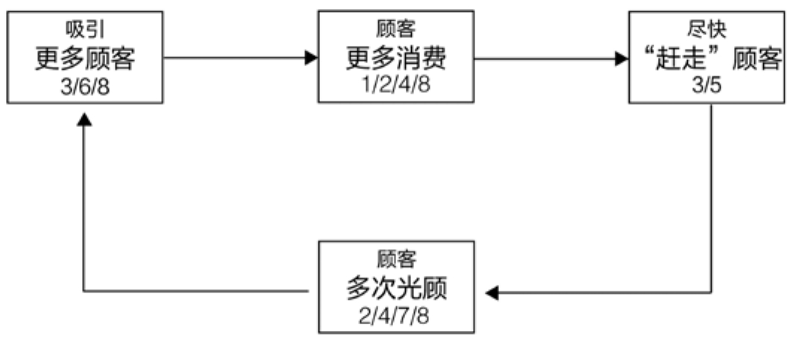

## 9.2　运营工作的分类

回到运营岗位本身，看一看这个岗位主要要做的几件事情。

从方法视角来分类，**内容运营、活动运营、用户运营**
是最常听到的几种运营岗位。

**内容运营**

内容的定义很广泛，文章、图片、视频、商品等都属于内容。内容运营要做的事情是打造“内容供应链”，从内容来源的挖掘、筛选，到内容本身的生产加工、包装呈现和传播。

内容运营的目的是通过连接用户与其匹配的内容，促进用户的下一步行动。针对电商的运营内容就是商品和类目；针对论坛的运营内容就是主帖和跟帖；针对视频网站的运营内容就是视频、回复和弹幕。广义而言，所有媒体从业者，包括互联网环境下的网络编辑和新媒体运营等的工作，都属于内容运营范畴。

**活动运营**

活动只是手段，策划活动是为达成背后的运营目的。

电商的各种促销活动，可能是为了获取新用户；社交网络上举办的各种晒图大赛，也许是为了促进活跃度；我的一家公司“B12”，经常在全国各地举办一些以创业、创新为主题的品牌活动，是为了提升影响力。办活动存在通用的框架性思路，包括确定目的、策划方案、执行方案和复盘等。如果是一次有效的活动，做完以后应该能看到关注指标的明显提升，如[图9-1](#figure-9-1)所示。

**用户运营**

根据产品的不同，用户运营的对象也会有所不同。以电商运营为例，就可以分为针对商家和针对买家两种。

<figure id="figure-9-1" tabindex="-1" markdown="1">

{ width="318" height="224" }

<figcaption markdown="span" style="margin:0.5em auto;font-size:0.8em;font-style:normal;line-height:1.5">
图9-1　有效与无效活动的对比
</figcaption>

</figure>

有会员体系的产品，会花很多精力做会员运营，比如QQ为会员准备的各种颜色的钻，实体商家给客户办的各种级别的VIP卡。淘宝有一种VIP叫APASS，面向的都是每年在淘宝消费几十万元以上的用户，淘宝甚至会为其中最高级别的那部分人在豪华酒店里举办线下聚会，场面宛如一些高端的时尚界晚宴。

对产品来说，用户运营是最本质的命题，用户在哪里、产品当前的主要目标是获取新用户还是维护老用户、怎么高效触达用户等问题，是务必及早找出答案的。

上述几种运营是根据运营的对象不同，对岗位任务做出的细分。还有一些类型不符合这种划分标准，但同样需要了解。比如渠道运营，也可以视为广义用户运营的一种，其运营的对象是渠道商，在2B的产品中比较常见。再比如数据运营，主要职能是用数据来辅助决策，运营对象是数据，在某些公司中这一岗位隶属于BI（商业智能）部门。

接下来，换到目的视角，看看运营都需要解决哪些问题。

按照这个视角，运营工作主要分为拉新、激活、留存三个阶段，也有人戏称为拉客、接客、留客。有人觉得“转化”也算一项独立的运营工作，但我认为转化更像是每个阶段都要做的工作，运营目标体现为特定事件的“事后用户数/事前用户数”比率，只不过特定事件的定义不同。

下面，仔细说说不同阶段的不同运营目标。

### 9.2.1 　不同阶段的运营目标

先看[图9-2](#figure-9-2)，此图参考了前迅雷看看CEO郝志中先生一次分享里的素材，横轴是时间，纵轴是用户量，表达了一款产品从上线到退市期间用户量的变化。我们看一下各种互联网产品，都会画出一条什么样的曲线。

首先是下方曲线对应的90%的产品，这里的数字是虚指，意味着绝大多数产品从来没红过，用户量始终没起来。

在看看中间曲线对应的9%的产品。这类产品肯定有它的过人之处，比如脸萌、足记等，但过把瘾就死，只能成为现象级产品。它们的硬伤在于是好奇心驱动的，无法提供持续的用户价值，用户新鲜劲一过就难以为继。所以，这类产品更适合作为一个更大产品里的功能，出现在一次有计划的推广活动中，能起到很好的拉新作用，然后用产品的其他功能做留存。

<figure id="figure-9-2" tabindex="-1" markdown="1">

{ width="442" height="233" }

<figcaption markdown="span" style="margin:0.5em auto;font-size:0.8em;font-style:normal;line-height:1.5">
图 9-2　互联网产品随时间变化的用户数曲线
</figcaption>

</figure>

最后是如[图9-2](#figure-9-2)中曲线对应的1%的产品。作为极少数，它们可以拉出一根真正漂亮的S型曲线，成为大家眼中成功的产品。

这三类产品的比例分布很不均匀，符合幂次法则[[2]](../05/index.md#footnote_content_txt010_2)
。借用投资的理念来解释这一现象：对于一支投早期项目的风险基金，通常表现最好的一家公司，给基金赚回的钱要超过其他所有的公司，而表现第二好的公司，赚的钱又会超过前两名以外的所有公司。于是，早期基金的投资人，在选择公司时，会特别喜欢那种“一家公司就可能赚回整个基金”的标。投资之后，也不能均匀服务，而是要把所有资源都给表现最好的，绝不应该去做“哪家碰到困难就去帮哪家”的救火队员。这还真是有点像马太福音中说的“凡有的，还要加给他，叫他有余。没有的，连他所有的也要夺过来”，这就是商业的理性。

聚焦到1%成功的产品上，再看[图9-3](#figure-9-3)。

<figure id="figure-9-3" tabindex="-1" markdown="1">

{ width="438" height="236" }

<figcaption markdown="span" style="margin:0.5em auto;font-size:0.8em;font-style:normal;line-height:1.5">
图9-3　成功产品的用户数曲线
</figcaption>

</figure>

首先，给1%产品曲线增加了几条线段。第一段是1.0发布前持续时间不短且用户数很少的发布前期；第二段是衰退期，再成功的1.0版产品，也有完成使命的那一天；第三段是2.0版生长期，它会延续1.0的生命。理想状态的2.0产品，会在1.0版期间获得一定规模用户的基础上，再拉出一根漂亮的S型曲线。当然，这种理想状态的产品，在1%的成功产品中可能也只有1%。所以，版本号超过3.0且广为人知的产品，大多是经久不衰的，可以放心使用。

在[图9-3](#figure-9-3)曲线中，除2.0部分外还有四个阶段。

►**验证期：**
也就是产品发布前的筹备阶段，加上发布之后到推广之前的预备阶段。这个阶段的主要目标是验证产品是否达到了与市场的匹配，即PMF（Product Market Fit）。产品在这个期间要不断修正主打功能，运营主要关注的指标是用户留存，典型的良性表现就是用户用了还想用，成为回头客。

►**爆发期：**
产品验证完成后开始大面积推广，即进入爆发期。此阶段产品依然在围绕核心功能进行强化，但用户数会迅速增加，运营工作的主要目标是拉新。

►**平台期：**
拉新一段时间后，产品会进入平台期。一旦容易搞定的用户都搞定了，单用户的获取成本就开始越来越高，这时候要想继续放大产品的整体价值，就只能依托于提升单用户的价值。于是，产品功能开始扩展，升级2.0版逐渐提上日程，运营工作的主要目标是激活用户，也常常说成“促活”，让用户使用产品的时间尽可能增加。

►**衰退期：**
1.0版的产品终归要退出历史舞台。进入衰退期以后，产品仅需要维护，而运营能做的事情就是想方设法榨取产品的剩余价值。比如，在敬畏用户、不伤口碑的前提下，从用户身上赚到最后一点钱；把用户平稳无知觉地导入2.0；让团队去做更有价值的事情，等等。

上面提到的拉客、接客、留客，在产品的每个时期都要做，只是不同时期各有侧重。想了解更多内容，推荐大家去研究一下AARRR模型[[3]](../05/index.md#footnote_content_txt010_3)
。

仔细研究，就会发现产品和运营对每个阶段的贡献是不同的。拉新阶段特别依赖推广能力，明显运营的作用更大一些；激活阶段二者的贡献则不相伯仲；留存阶段的成功，产品的因素会更多一些，因为只有产品好用户才会持续使用。就像有些街边小店的吆喝——第一次不来是你的错，第二次不来是我的错。对用户而言，第一次不来是运营的错，第二次不来是产品的错。

下面就验证期、爆发期、平台期这三个重点阶段，讲一下对应的运营工作要点。

**验证，艰难的冷启动**

产品团队经常觉得自己是在让世界更美好，而用户根本不会那样认为，如同某位朋友的这条金句**：一些很有初心、情怀的产品，看似是在助人为乐，其实是在强行扶老奶奶过马路。**

那么，问题来了，如何找到那些真正想过马路的老奶奶，什么是帮助老奶奶过马路的正确姿势，有什么只需要盯着就行、能直观代表留存的数据指标？这些就是验证阶段要回答的主要问题。

“真想过马路的老奶奶”有以下两个特征：

**用户数自然增长**

在无主动拉新的情况下，依靠产品的自身价值，而非不可持续的利益刺激，每天的新增用户数持续攀升。这意味着已有相当多的用户愿意把产品推荐给亲朋好友，也就是说产品在净推荐值NPS（第7.1.1　节有详细介绍）这项指标上表现出色。

可以在网上通过各种渠道去搜索，看能不能找到在主动推荐产品的用户，尽快和这些人搞好关系，以弄清楚到底是产品的哪些方面给他们带来了惊喜，从而有针对性地做出强化。

用户数自发地高速增长，也意味着产品产生了“病毒式传播”现象。而这一现象背后的关键要点，值得进一步找资料学习。

**用户的激活与留存稳定**

同样地，把所有运营动作停掉，如用户激活率、留存率等相关指标依然可以保持稳定，则说明产品能持续提供用户价值。激活和留存，一个是一个转化率漏斗，而另一个则表明用户走了还会再来，接下来对它们分别加以分析。

激活率等于单位时间内的“已激活用户/新用户”，表征的是新用户使用后，觉得有用的人数比例。激活行为像是完成新人转化的漏斗。

可以有意识地每周观摩几个新用户使用产品的真实场景，看他们在几分钟内是否能体会到产品的预设价值，以及使用流程是否顺畅。如果经常发现用户产生困惑，则说明产品使用过程有些复杂，比如一个社交App，激活流程包括找到、下载、安装、（需要很多步骤才能完成的）注册、新手上路引导、找到感兴趣的人、加好友/接受好友请求、发出第一句话、产生互动等操作节点，使用链路上的任何一个环节不顺，都可能造成激活转化率过低。

留存率等于特定时间段内的“回访用户/已激活用户”，表征的是第一次走了之后仍念念不忘、还会再次使用产品的用户比例。

针对这一指标做用户访谈时，不要只听用户怎么说，因为他们有可能只是在当面敷衍你，更要盯着后台数据，调查清楚他们是觉得有用但真要用又懒得用，还是的确在地反复使用。而后者，需要产品靠内容或靠其他用户等方式来实现。比如天气预报，是靠内容（每天都在变的天气）来吸引用户；比如社交，是靠不停有人要加你为好友或老朋友又发来新消息这类来自其他用户的影响来吸引用户。

如果找到了“真想过马路的老奶奶”，似乎不用推广，产品也可以自己成长。这是很多产品经理的梦想，完全通过产品逻辑实现运营——**做一个不需要运营的产品**
。由此可见，“帮忙过马路”即推广行为，真的不是产品上线后马上应该做的，其**本质只是加速产品的成长**
，说白了就是为了抢时间，和市场抢、和友商抢。不幸的是，如果方向不对，抢跑越成功，距离目标只会越远。

这个阶段，需要对大量用户的涌入慎之又慎，甚至还要故意设置一些门槛，比如采用“邀请码”的机制，比如B站[[4]](../05/index.md#footnote_content_txt010_4)
的考试答题环节。因为大量的主流用户只会给产品一次机会，如果他们看到了早期不完美的产品，今后就算产品成熟了，他们也不会再来了。

最后，聊聊第一批的种子用户如何获取，也就是冷启动的问题。产品的验证就是从种子用户开始，如果你的产品可以匹配上如下这几个人群，那不失为一个好的开局。

►**学生党：**
年轻有好奇心，愿意尝试各种新产品，有大把的时间，但没有钱，容易用小额利益撬动，而且人群密集，获客与社会化传播的成本都较低。比如当年的校内网，用免费的鸡腿，拉了很多学生用户。

►**美女：**
不管在何种产品里，美女用户都是焦点，满足她们的优越感、存在感之后，其他用户就会源源不断地被美女吸引过来。社交类的应用，通常更适合走这条路。这类用户的本质是那种可以以一带十、以一带百的焦点人物，比如自带流量的大V明星。

►**羊毛党：**
这个词从形容贪小便宜的说法“薅羊毛”而来。这群人是最容易用补贴撬动的，但风险也大，要好好思考他们到底是不是目标用户，有些理财产品选择了羊毛党作为种子用户，而这群人也正好是爱财的人。

►**竞品用户：**
竞争对手那里，产品的目标用户的密度自然也最高，而且竞争对手已经帮我们筛选过的，往往是真正的优质用户。比如小米最早的100个用户，就是从一些手机发烧论坛里找来的，这类论坛也可以算是广义的竞品，和小米手机是行业上下游的关系。

有了种子用户，服务好他们非常重要，小米在产品早期的做法是很好的榜样：

每年的发布会，更多是为了“米粉”而不是媒体而办，最终成为用户的狂欢。不完美的产品，通过“内测”直接送给粉丝，一方面成为福利，另一方面又能更早获取到市场反馈。小米社区的运营理念是，让用户帮助产品优化，决定一些功能的优先级。种子用户选取“发烧友”人群，因为他们是意见领袖，能影响很多身边的人。

**爆发，脱离种子阶段**

经过验证期，对产品优化效果满意后，运营就要开始发力，迅速扩散产品信息。市场留给产品的时间窗口往往不大，容不得慢慢打磨。

爆发期的主要运营工作是拉新。经常听到的打广告、烧钱、借力用户、做事件等，都属于拉新行为，目的是尽快把目标用户吸引过来。在这个阶段竞争的是谁能在时间相同、资源相同的情况下获取更多的用户，因此需要研究各种推广渠道，包括搜索广告、线上线下媒体广告、户外广告、社会化广告，以及各种论坛、社群，或是借力名人，等等，还需要思考什么策略和产品最匹配。这是一个很大的话题，本书不再展开。

回忆一下本书前文提过的四级用户：种子用户→核心用户→目标用户→潜在用户。

在这个阶段，要迅速把产品从（第一级的）种子用户手里至少推到（第三级的）目标用户手里。看看滴滴公司的例子。

**种子用户**
也许就是滴滴在机场摆摊阶段每天遇到的那几十个司机。

**核心用户**
为北京等各大城市的出租车司机。

**目标用户**
是出租车司机和乘客。产品有了对目标用户的覆盖之后，就可以达成一个价值闭环。

后来，滴滴打车扩张成滴滴出行时，覆盖到了滴滴只做打车时的潜在用户，例如有闲暇时间的代驾司机，可以充当顺风车的私家车主。

[图9-4](#figure-9-4)反映了产品生命周期不同阶段的不同用户类型。

<figure id="figure-9-4" tabindex="-1" markdown="1">

{ width="527" height="251" }

<figcaption markdown="span" style="margin:0.5em auto;font-size:0.8em;font-style:normal;line-height:1.5">
图9-4　跨越鸿沟（Geoffrey Moore，1991）
</figcaption>

</figure>

**第一批用户：**
尝鲜者，极客。他们对你要尝试解决的问题毫不在意，只是对新鲜的东西感兴趣。任何产品投放市场的第一批外部用户，基本上都是竞争对手的产品经理和业内人士，千万不要被他们带到沟里。

**第二批用户：**
早期采纳者。他们是种子用户，是受你要解决问题困扰最深的一部分人。你会发现他们相对比较好满足，但把他们服务好以后，并不意味着你能占领主流市场。在他们和主流用户之间，还存在一个鸿沟。因为早期采纳者有可能饥不择食，而主流用户却是实用主义者，很看重性价比。

用户从早期采纳者扩展到主流用户时，产品策略需要做一些调整。比如小米，种子用户是“发烧友”，但全国又能有多少发烧友呢？要做大，必须把手机卖给更多的人。于是，我们看到小米手机的口号从“为发烧而生”变成 “每个人都可以享受科技的乐趣”，产品也由小米系列衍生出红米系列。从另一方面来看，种子用户阶段又是必不可少的。如果小米直接推出的是800.10.0　块的红米，用户会觉得，无非又是一款产自深圳的山寨机。

后面三种用户：早期主流用户、晚期主流用户、落伍者，不再细说，感兴趣的读者可自行参考《跨越鸿沟》一书。

**平台，深耕更多价值**

拉新进行到一定程度，容易搞定的、便宜的新用户越来越少，说明产品已进入平台期。在这个阶段，要想继续提升产品的价值，只能通过提升单用户贡献来实现，而其主要手段就是“促活”。在促活这件事情上，产品、运营并重，二者都能起到很大的作用。

促活对于电商来讲就是提升客单价，对游戏就是提升ARPU值（单用户产生的收入），而对于一些社区类产品，主要是指增加活跃度，比如每周登录的次数或单次使用的时长。

先复习一下Y模型，看看爆发期和平台期，提升产品价值的路径有什么区别，如[图9-5](#figure-9-5)所示。

<figure id="figure-9-5" tabindex="-1" markdown="1">

{ width="427" height="243" }

<figcaption markdown="span" style="margin:0.5em auto;font-size:0.8em;font-style:normal;line-height:1.5">
图9-5　Y模型基本概念
</figcaption>

</figure>

爆发期主要做的是市场开发，这意味着产品并不会有太大的变化，但要设法让产品满足更多的人。例如，优步在美国市场已经做得很好，还是要继续开拓中国市场或欧洲市场，这就是典型的基于市场开发的发展策略。对应Y模型来看，就是在“3”的产品功能层面的改动相对不大，但在“1”的方向上，要解决更多用户相似场景的需求。

平台期主要做的是产品开发，对应“1”中面对的用户群体变化不大，只是要设法满足他们更多场景的需求。所以，需要开发更多的“3”——产品功能。最典型的例子是阿里对消费者网购需求的满足。当淘宝已经满足了几乎所有网民对“商品丰富”的需求后，做了“天猫”来满足用户对品质的需求，又做了“聚划算”来满足用户对个性化的需求（聚划算的本质不是团购，而是聚集消费者需求，反向给厂家提要求、定制商品）。

要注意，这里说的产品开发除了IT系统的开发，可能还包括对一些线下服务的设计或改善。比如，聚划算在找厂家定制商品时，可能需要改变很多既有产业链里的关系和流程，这也算针对广义产品的开发。

市场开发和产品开发这两条线路都很常见，但是一个产品在某一个特定阶段，通常要以其中一条线路为主，要随着阶段的不同而不断变化线路，像两条腿交替走路一样。经常看到对公司应该聚焦还是多元化的讨论，对此我的建议也是应该交替进行。就产品的四个阶段而言，主攻**“市场开发”的策略与增长期和衰退期更匹配，而主攻“产品开发”的策略与平台期和验证期更匹配。**

### 9.2.2 　综合案例：星巴克

本节内容来自我在2016年办的一次“读书会”上的一份优秀作业。从中可以看出星巴克对人性的理解，以及其产品和运营策略在拉新、激活、留存上的综合应用。作者徐颖是做品牌出身，看来是没少喝咖啡。

1971年成立的星巴克，是全球最大的咖啡连锁店，在全球范围内已经有近2.3.0　间分店，遍布北美、南美洲、欧洲、中东及太平洋地区。这个全球最成功的咖啡连锁店，究竟利用了哪些人性特征，运用了哪些产品和运营策略呢？结合[图9-6](#figure-9-6)的简要总结，来仔细剖析。

<figure id="figure-9-6" tabindex="-1" markdown="1">

{ width="445" height="193" }

<figcaption markdown="span" style="margin:0.5em auto;font-size:0.8em;font-style:normal;line-height:1.5">
图9-6　不同策略的目的
</figcaption>

</figure>

**1.杯子容量+定价**

**产品功能：**
加量1/3，但是价格只加3元。

**人性欲望：**
贪便宜，在低价格面前人们经常会放大自己的需求。

很多人在星巴克都遇到过这样的纠结：加量1/3，但是价格只多了3元。此时，贪便宜的念头很容易在头脑中闪现——那要大杯或者超大杯吧。很多人在做出这一选择时会认为自己是出于理性，同样几乎所有人都会选型性忽视“自己是否能喝得下那么多”这个因素，盲目地选择了“划算”，总觉得不买大杯型就吃亏了。最后的结果是，很多人没有喝完大杯，多支付的3元其实并不划算。从星巴克的收益角度来看，这3元几乎是净赚。

**2.较高的价格**

**产品功能：**
亚太区（特别是中国）的价格高于美国。

**人性欲望：**
成就感，与众不同。

咖啡在中国不是平民饮料，而是带有明显的大城市、白领倾向，因此与美国相比，星巴克在中国的形象显得更加“高端”。

中国最不缺什么，众所周知是“人”。星巴克某高管曾在接受媒体采访时说过，其产品定价时更多考虑产品的零售空间以及消费者的期望：“从亚太地区门店的反馈来看，抱怨最多的是人多的问题而不是售价问题，顾客愿意多花一点钱让店内的人变少一些 ”。

**3.杯子的材质**

**产品功能：**
马克杯换成了纸杯。

**人性欲望：**
自由、随心所欲地做事。

很多人在星巴克都遇到过这样的情况，需要离开的时候才发现咖啡没有喝完。由于星巴克店面选址多在写字楼、购物中心、机场等人群密集且流动性大的地方，大部分顾客都有带走咖啡的需要。据星巴克店员介绍，在部分门店80%至90%的顾客会选择外带。

使用马克杯装咖啡，不利于顾客灵活地做出购买决定，而用纸杯就可以让顾客放下顾虑，先毫不犹豫地买下一杯，然后再决定是坐下来慢慢喝还是直接带走。

**4.各种周边产品**

**产品功能：**
限量版、纪念版马克杯。

**人性欲望：**
拥有的欲望（期望拥有具有特殊价值的物品，渴望追赶潮流）。

各种纪念杯是星巴克的另一个盈利源，它们都摆在了货架上。星巴克会定期推出主题杯、城市杯来吸引你把它们买回家，还会推出“用星巴克的自带杯立减2元”的促销策略。对喜欢猎奇和赶时髦的人来说，刺激他们“拥有的欲望”往往是行之有效的方法。

**5.桌椅的设计**

**产品功能：**
桌椅不过于舒适，又让人放松。

**人性欲望：**
追求放松自在的感觉。

在星巴克的店里，高脚凳、硬硬的木凳子是标配，即便有沙发，配套的桌子也多是很矮的，非常不符合人体工学设计标准。难道星巴克不知道这样会赶走顾客吗？怎么可能不知道！这是因为星巴克的服务定位就是“赶走顾客”。

“翻台率对咖啡店盈利非常重要”，有专业人士这样分析——对于一家咖啡店来说，租金和人工成本是硬性的，单杯咖啡的成本也是固定的，销量直接决定了最终的利润率：一个可以让顾客“一杯咖啡一下午”的店，拿什么支付租金？因此，星巴克的桌椅设计，既可以让星巴克看起来有档次有品位，让顾客“轻松一刻”，又不至于让顾客坐太长时间。

**6.纸杯上醒目的Logo**

**产品功能：**
方便携带的纸杯，鼓励更多外带。

**人性欲望：**
社会归属感（期待与他人保持联系、构筑良好人际关系）。

社交的需要也叫归属与爱的需要，是指个人渴望得到家人、朋友、同事的关怀，爱护和理解，是对亲情、友情、爱情、信任、温暖的需要。

我们试想一下这样的情景：当你吃完午饭回来，碰到几个同事有说有笑地走来，每个人都拿着一杯星巴克。你也会产生想要一杯星巴克的念头，因为你也想要融入这个欢乐的群体。

**7.店内的香气**

**产品功能：**
店内浓郁的咖啡香气。

**人性欲望：**
享受感官刺激（嗅觉）且印象深刻。

星巴克能创立全球咖啡王国的原因之一，就是长期保持一致的店面氛围。除了音乐、高雅的摆设及舒服的灯光之外，令顾客印象最深的就是店内、外总是充满浓郁的咖啡香气。

有研究表明，人的情绪有75%由嗅觉产生。人对照片的记忆，在三个月后只剩下50%，但回忆气味的准确度高达65%。美国摩内尔化学香气中心研究指出：“消费者如果身处气味宜人的环境，像是充满了咖啡香或饼干香的空间，不但心情会变好，行为举止也可能更为迷人，甚至出现更多利他的友善表现”。香气，在打造星巴克品牌独特性的同时，还能树立高品质咖啡的形象，也增强了客户对星巴克的黏性，进一步提升了回头率。

**8.星享卡**

**产品功能：**
买三赠一、买二赠一、买一赠一。

**人性欲望：**
贪便宜+社交需求（期待与他人保持联系、构筑良好人际关系）。

星享卡中经常会出现买三赠一、买二赠一、买一赠一的优惠券，看上去很优惠，其实并没有多大用处，因为没有人会一次性喝那么多咖啡。这些优惠券的真正意图是让顾客带朋友来或者买回去赠送朋友。这样就能把星巴克的品牌传递给更多的人，让星巴克“社交媒介”的形象更加深入人心。

我们再进一步分析和总结一下星巴克的这八个产品、运营策略。

►**为吸引更多顾客采取的拉新策略包括**
杯子的材质（3）、纸杯上的醒目Logo（6）和星享卡（8）。

►**为使顾客消费更多采取的提升活跃度和客单价策略包括**
杯子容量+定价（1）、较高的价格（2）、各种周边产品（4）和星享卡（8）。

►**为降低单用户服务成本采取的尽快“赶走”顾客策略包括**
杯子的材质（3）和桌椅的设计（5）。

►**为吸引顾客多次光顾采取的提升留存、复购率策略包括**
较高的价格（2）、各种周边产品（4）、店内的香气（7）和星享卡（8）。

