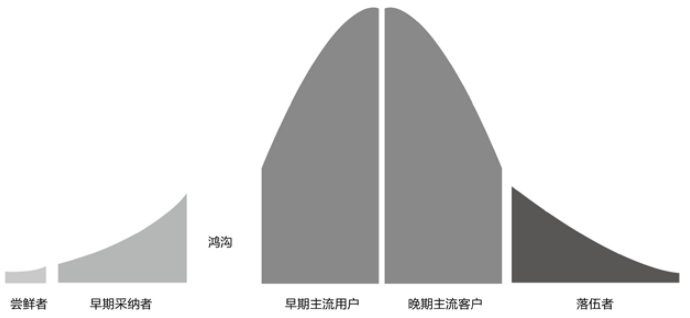

## 9.4　产品的生命周期

至此，已经讲完了一个产品的各个方面，最后再从产品生命周期的不同视角来做个总的回顾。

**从验证期到衰退期**

产品在“验证期→爆发期→平台期→衰退期”这个完整生命周期的每个阶段，都需要面对和实现不同的运营目标。

**从定位、需求到品牌**

从企业发展层面来看，依次要经历定位、需求、产品、流量、用户、收入、盈利、品牌这些阶段。对应要做的事情有：给产品定位→采集需求回来分析→做产品功能→产品上市以后要获取流量→把流量转化成有价值的用户→从用户身上获取收入→实现盈利→沉淀为品牌。

真正产生商业价值，往往需要等到盈利这一步，因为前面几步的所谓商业价值，是有可能通过作假来体现出来的。有一个投资人受骗的故事，它有意思的地方在于，行骗的创业者并未在流量和用户规模等数据上做文章，而是直接针对“持续付费用户”这个指标作假，方法很简单粗暴：推出第一单9.9元、第二单0.1元的洗车优惠活动，轻松拿到一个漂亮的持续付费（定义为至少付过两次钱）用户数。

**想清楚、做出来、推出去**

一个产品从无到有的全过程，从团队的主要工作内容角度，可以划分为以下四个阶段。

►**创意设计：**
问题正确，解决方案靠谱——用户还没用上产品。

►**研发生产：**
做得出来，不断优化——极少量种子用户用上了内测版本。

►**运营销售：**
卖得出去，赚得到钱——尝鲜者、早期采纳者使用产品。

►**市场品牌：**
铺得开，叫得响——主流用户使用产品。

第一个阶段要“想清楚”，第二个阶段要“做出来”，第三、四个阶段要“推出去”，而在最后两个阶段之间，就会碰到图9-7中的鸿沟问题，这在本章前面的小结中已经有过阐述。

本书从第02到09章，按时间顺序讲述了一个产品从无到有的演变过程。下一章，再用更完整的商业视角来检阅产品、创新及相关案例。

<figure markdown="1">

{ width="527" height="243" }

<figcaption markdown="span" style="margin:0.5em auto;font-size:0.8em;font-style:normal;line-height:1.5">
图9-7　跨越鸿沟（Geoffrey Moore，1991）
</figcaption>

</figure>

